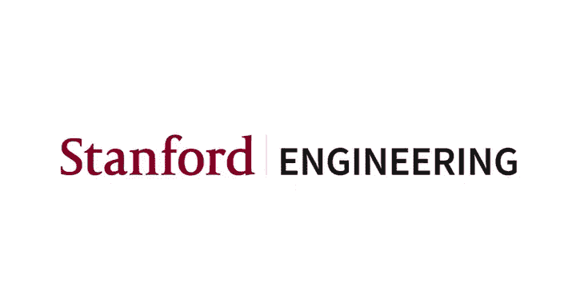

# 课程8：如何阅读研究论文与机器学习职业建议 📚💼

在本节课中，我们将学习两个核心技能：如何高效阅读和理解深度学习领域的研究论文，以及如何规划并开启你在机器学习领域的职业生涯。掌握这些技能将帮助你在课程结束后，依然能紧跟技术发展，并做出明智的职业选择。

## 第一部分：如何阅读研究论文 📄

上一节我们介绍了课程的整体目标，本节中我们来看看如何高效地掌握一个全新的知识领域。深度学习发展迅速，即使你已经掌握了大量基础知识和实用技巧，为了在应用或研究中保持领先，高效阅读学术文献的能力至关重要。

### 掌握一个知识领域的方法

以下是当你想要深入理解一个新领域（例如语音识别）时，我推荐的一系列步骤：

1.  **编译论文列表**：首先，收集该领域相关的关键研究论文、博客文章（如Medium上的文章）以及其他学习资源。
2.  **跳跃式阅读**：不要按顺序逐篇精读。开始时，可以快速浏览（例如阅读每篇的10%），以评估其价值。
3.  **筛选与深入**：根据初步浏览，放弃那些质量不高或无关紧要的论文。对于 seminal（开创性）的论文，则投入大量时间深入理解。
4.  **扩展阅读**：通过已读论文的参考文献，发现新的重要论文，并回头巩固对之前论文的理解。

关于阅读量，以下是一些参考指南：
*   阅读 **5-20篇** 论文，足以让你对一个领域有基本理解，并能进行一些应用实践。
*   阅读 **50-100篇** 论文，将使你对该领域有非常扎实和深入的理解。

### 如何阅读单篇论文

接下来，我们具体看看如何阅读单篇论文。低效的方法是逐字逐句从头读到尾。我推荐采用 **多次通读法**。

**第一遍：速览**
*   阅读 **标题**、**摘要** 和 **所有图表**（尤其是图注）。
*   在深度学习领域，核心思想常常通过一两个架构图就能概括。这一步旨在快速抓住论文主旨。

**第二遍：细读关键部分**
*   仔细阅读 **引言** 和 **结论**。作者通常在这些部分精心总结工作，以说服审稿人。
*   再次审视所有图表。
*   快速浏览或暂时跳过 **相关工作** 部分。初次接触一个领域时，这部分可能难以理解。

**第三遍：通读全文（可跳过数学）**
*   完整阅读论文，但首次阅读时可以 **跳过复杂的数学推导**，先专注于理解文字描述的核心思想。

**第四遍：精读全文**
*   最后，完整阅读论文，包括数学部分。如果仍有部分不理解，可以暂时跳过。前沿研究论文中的某些内容可能在当时看来并不重要，或者作者自己也未能完全把握重点。

### 实践练习：7分钟阅读挑战

现在，让我们来实践一下。请用大约7分钟时间，尝试阅读一篇名为 **《Densely Connected Convolutional Networks》** （DenseNet）的论文。

在阅读时，请思考以下几个问题：
1.  作者试图实现什么目标？
2.  论文的关键要素或方法是什么？
3.  论文中有哪些内容你可以用于自己的项目？
4.  你还想了解哪些参考文献或后续工作？

**（7分钟后）**

通过这个练习，你会发现，通过重点阅读图1和图2及其图注，你很可能已经掌握了论文80%的核心思想。随着阅读经验的增加，你对论文中常见表述方式（如描述网络架构的表格）会越来越熟悉，阅读速度也会越来越快。

### 深入理解与长期学习建议

为了更深入地理解论文（特别是包含复杂数学的论文），我建议：
*   **重新推导数学公式**：阅读并做详细笔记后，合上论文，尝试从空白草稿纸开始重新推导算法。这是检验你是否真正理解数学原理的最佳方式，也是培养自己创新能力的基础。
*   **重新实现代码**：下载并运行开源代码是轻量级的学习方式。而 **从零开始重新实现算法** 则能确保你深刻理解其细节。

对于长期学习，关键在于 **持之以恒**，而非短期冲刺。
*   **间隔重复优于填鸭式学习**：每周坚持阅读2-3篇论文，持续一年，效果远胜于在某个长假集中阅读50篇。
*   **建立学习社群**：与同学、同事组成阅读小组，定期分享和讨论有趣的论文，可以极大地提升学习动力和效率。

---

## 第二部分：机器学习职业导航 🧭

上一节我们探讨了如何通过阅读论文持续学习，本节我们将目光转向长远的职业发展。在机器学习领域，有众多令人兴奋的机会，如何选择道路至关重要。

### 如何获得理想职位

大多数招聘者（或博士项目招生委员会）主要关注以下几点：

1.  **技术技能**：你需要扎实的机器学习知识和编码能力。面试中常会考察对基础概念（如梯度下降、RNN/LSTM区别）的理解。
2.  **有意义的项目经验**：这比单纯的理论知识更重要。它向招聘者证明你不仅懂理论，还能实际应用并解决问题。
3.  **持续学习的能力**：在快速发展的领域，保持学习新技能的热情至关重要。

最成功的候选人通常具备 **“T型”知识结构**：
*   **广度**：对AI/机器学习的多个领域有广泛了解。
*   **深度**：在至少一个领域有深入、扎实的项目或研究经验。

CS230课程的设计正体现了这一点：你学习了CNN、RNN等多个方向（广度），并通过课程项目在其中一个方向进行深入实践（深度）。

### 应避免的职业发展模式

在构建你的“T型”技能时，请注意避免以下几种低效模式：
*   **只上课，无深度项目**：上了很多课，但没有一个拿得出手的实质性项目。
*   **过早专精，缺乏广度**：在基础不牢时，就一头扎进一个非常狭窄的研究方向。
*   **项目多而浅**：做了很多个小项目，但没有一个足够深入和完整。招聘者更看重一两个出色的项目，而非十个平庸的项目。

### 如何选择职位/团队

当你拿到多个offer时，如何选择？一个最重要的原则是：**关注你将直接共事的团队（约10-50人），而非公司的整体品牌**。

*   **团队决定你的成长**：你每天互动的同事和经理，他们的水平、工作热情和学习态度，将直接影响你的成长速度。
*   **警惕“轮岗项目”**：对于那种不明确告知你最终加入哪个团队，只是承诺先轮岗再分配的offer要格外谨慎。你可能会被分配到一个与机器学习无关的枯燥岗位。
*   **发现“隐形冠军”团队**：有些公司整体品牌在AI领域不突出，但其内部可能有一个非常精英的机器学习团队。加入这样的团队，可能比加入大公司里一个平庸的团队更有收获。

硅谷越来越倾向于根据个人的真实技能而非公司品牌来评估人才。因此，选择能让你 **学到最多** 和 **做出重要工作** 的职位，才是长期成功的基石。

---

## 总结 🎯

本节课中我们一起学习了两个对未来至关重要的主题。

首先，我们掌握了高效阅读研究论文的方法：通过 **多次通读法** 快速抓取核心思想，并通过 **重新推导公式** 和 **重新实现代码** 来深化理解。关键在于 **持之以恒** 的定期阅读。

其次，我们探讨了机器学习领域的职业规划。重点是构建 **“T型”知识结构**，并明智地选择职位——**优先考虑优秀的团队而非公司光环**，确保你的工作既能带来快速成长，又具有实际意义。

希望这些建议能帮助你在深度学习之旅中持续进步，并找到能让你施展才华、创造价值的职业道路。