# 课程9：深度强化学习 🧠🎮

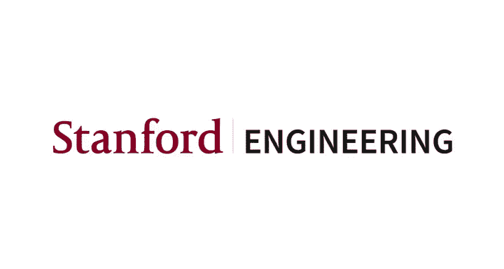

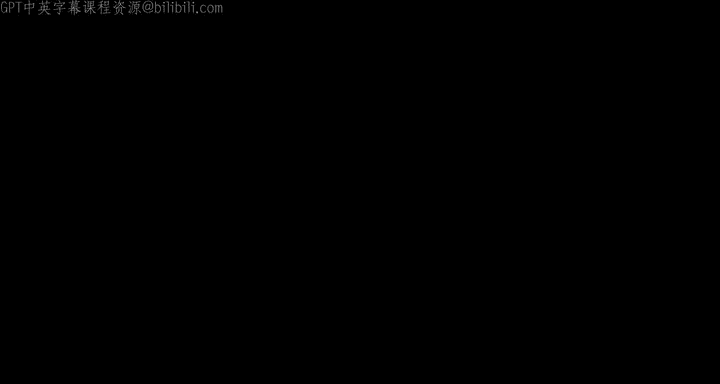

在本节课中，我们将探讨一个高级主题——深度学习与人工智能另一领域（强化学习）的结合。我们将看到一个实际应用，并了解如何将深度学习方法融入另一类算法中。这很有趣，因为深度神经网络已被证明是优秀的函数逼近器。许多不同领域都需要这类函数逼近器，而深度学习方法可以融入所有这些方法中。强化学习应用就是其中一个例子。

---

## 强化学习动机 🤔

为什么需要强化学习？为什么不能仅用深度学习方法解决所有问题？有些问题是深度学习方法无法解决的，强化学习应用就是这类问题的例子。

我们将通过一个例子来介绍一种名为Q学习的强化学习算法。然后，我们将深度学习融入此算法，使其成为深度Q学习。

正如我们在生成对抗网络和深度神经网络中所见，大多数模型都难以训练。我们必须想出各种方法，如Z初始化、Dropout、批归一化等，来训练这些深度神经网络。同样，为了训练深度Q学习（一种强化学习算法），我们也将看到一些技巧和窍门。

最后，我们将邀请一位客座演讲者来讨论结合深度学习与强化学习的高级研究课题。

---

## 深度强化学习简介 🚀

深度强化学习是一个相对较新的领域。虽然强化学习本身已存在很长时间，但直到最近才证明，使用深度学习来逼近在强化学习算法中起关键作用的函数非常有效。

一个著名的例子是AlphaGo，它击败了围棋世界冠军。另一个例子是DeepMind的论文《通过深度强化学习实现人类水平控制》，该论文发表在顶级期刊《自然》上。他们证明，将深度学习融入强化学习设置中，可以训练出在多种游戏中达到人类水平的智能体。

---

## 从监督学习到强化学习的挑战 🎲

让我们以围棋为例。如果我们想用之前学过的深度学习方法构建一个能解决此游戏的智能体，该如何做？

在经典的监督学习中，我们需要一个包含输入X和输出Y的数据集。对于围棋，可能的想法有：
*   **想法1**：输入是棋盘状态，输出是该位置的获胜概率。问题在于，即使是专家也难以准确给出任意棋盘的获胜概率。
*   **想法2**：输入是棋盘状态，输出是专业棋手的下一步落子。问题在于：
    1.  需要海量数据。围棋的可能状态数约为 \(3^{19 \times 19} \approx 10^{170}\)，我们无法通过观察有限的对局来覆盖所有状态。
    2.  专业棋手的走法（ground truth）不一定总是最优。
    3.  模型可能无法泛化。围棋关乎长期策略，而不仅仅是识别模式。

因此，我们需要一种能**自动学习做出良好决策序列**的方法，这就是强化学习。它适用于**延迟奖励**的场景，即当前的决策会影响未来的结果。

强化学习的应用示例包括机器人学、游戏和广告实时竞价。

---

## Q学习基础：一个简单示例 🗑️➡️♻️

让我们通过一个超级简单的例子来理解Q学习。

**环境设定**：
我们有5个状态（S1到S5），两个动作（左移或右移）。
*   S1：垃圾桶，奖励+2（终端状态）。
*   S2：起始状态，手持塑料瓶（初始状态）。
*   S3：普通状态。
*   S4：有巧克力的状态，奖励+1。
*   S5：回收箱，奖励+10（终端状态）。

**目标**：最大化长期回报。
**约束**：垃圾收集员3分钟后到达，每步耗时1分钟，因此最多只能走3步。

**长期回报的定义**：
我们使用**折扣回报**，公式为：
`总回报 = R_t + γ * R_{t+1} + γ^2 * R_{t+2} + ...`
其中 γ 是折扣因子（0 ≤ γ ≤ 1），它表示未来奖励的当前价值。γ=0.9是常用值。

**Q表**：
我们想要学习一个Q表，其形状为 `(状态数， 动作数)`。表中的每个值 `Q(s, a)` 表示在状态 `s` 下采取动作 `a` 所能获得的**长期折扣回报**。

通过迭代计算（考虑即时奖励和未来可能的最大折扣回报），我们可以填满这个Q表。例如，从S3向右走到S4，即时奖励为1，并且从S4可以走到S5获得10奖励。因此，`Q(S3, 右) = 1 + 0.9 * 10 = 10`。

**贝尔曼方程**：
最优Q函数满足以下方程，称为贝尔曼方程：
`Q*(s, a) = R(s, a) + γ * max_{a'} Q*(s', a')`
其中 `s'` 是执行动作 `a` 后到达的下一个状态。

**策略**：
策略 π 是我们的决策函数，它告诉我们在给定状态下应该采取什么行动：
`π(s) = argmax_a Q*(s, a)`

对于状态空间和动作空间较小的问题，Q表是有效的。但对于像围棋这样状态空间巨大的问题（\(10^{170}\)），存储和查询Q表是不现实的。

---

## 从Q学习到深度Q学习 🧠➡️🎮

为了解决状态空间过大的问题，我们使用一个深度神经网络作为**函数逼近器**来替代Q表。这个网络被称为 **Q网络**。

**网络设计**：
*   **输入**：状态 `s`（例如，游戏的像素画面）。
*   **输出**：一个向量，其每个元素对应在状态 `s` 下采取每个可能动作的Q值 `Q(s, a)`。
*   **决策**：选择输出向量中值最大的动作。

**如何训练？挑战**：
与监督学习不同，这里没有静态的标签（`y`）。我们的目标是让Q网络的输出满足贝尔曼方程。

**解决方案**：
我们使用当前Q网络来生成一个“目标”`y`，然后让网络向这个目标学习。
`y = R(s, a) + γ * max_{a'} Q(s', a'; θ)`
其中 `θ` 是Q网络的参数。

**关键技巧**：
在计算损失 `L = (y - Q(s, a; θ))^2` 并进行反向传播时，我们将目标 `y` 中的 `Q(s', a'; θ)` **视为常数**（即不计算其梯度）。这可以通过使用一个**目标网络**（其参数 `θ-` 定期从主网络复制而来）来实现。这样避免了训练中的反馈循环，增加了稳定性。

---

## 深度Q网络实战：Breakout游戏 🎯

让我们以Atari游戏《Breakout》为例。

**输入预处理**：
1.  **帧堆叠**：单一帧无法判断球的方向。因此，将连续4帧堆叠起来作为输入，以获取动态信息。
2.  **灰度化**：将RGB三通道图像转换为单通道灰度图，减少计算量。
3.  **裁剪**：移除屏幕上不相关的区域（如分数栏）。

**网络架构**：
使用卷积神经网络处理预处理后的图像，经过若干卷积层和全连接层，最终输出三个值，分别对应三个动作（左、右、不动）的Q值。

**训练伪代码与核心技巧**：
以下是增强后的DQN训练循环，集成了多个关键技巧：

1.  **经验回放**：
    *   **问题**：连续的状态转移具有高度相关性，直接使用会导致训练不稳定且数据效率低下。
    *   **解决**：将智能体探索得到的经验 `(s, a, r, s')` 存储在一个“回放缓冲区”中。训练时，从缓冲区中随机采样一批经验进行学习。这打破了数据间的相关性，提高了数据利用率和稳定性。

2.  **探索 vs. 利用**：
    *   **问题**：如果智能体总是选择当前认为最好的动作（利用），它可能永远发现不了更好的策略。
    *   **解决**：采用 ε-贪婪策略。以概率 ε 随机选择一个动作（探索），以概率 1-ε 选择当前Q值最大的动作（利用）。ε 通常随着训练进行而衰减。

3.  **终端状态处理**：
    *   当到达终端状态（游戏结束）时，未来的折扣回报为0。因此，目标 `y` 应仅为即时奖励 `r`。

**整合所有技巧的伪代码概述**：
```
初始化主Q网络参数 θ，目标网络参数 θ- = θ
初始化回放缓冲区 D
for 回合数 = 1 to M:
    初始化状态 s，并进行预处理 φ(s)
    for 时间步 t = 1 to T:
        以概率 ε 选择随机动作 a，否则 a = argmax_a Q(φ(s), a; θ)
        执行动作 a，观察奖励 r 和下一状态 s'
        预处理 s' 得到 φ(s')
        将经验 (φ(s), a, r, φ(s'), 是否终止) 存入 D
        从 D 中随机采样一批经验
        对于每个采样经验：
            如果下一状态是终端状态：y = r
            否则：y = r + γ * max_{a'} Q(φ(s'), a'; θ-)
            计算损失：L = (y - Q(φ(s), a; θ))^2
        对损失 L 执行梯度下降，更新 θ
        每隔 C 步，更新目标网络：θ- = θ
```

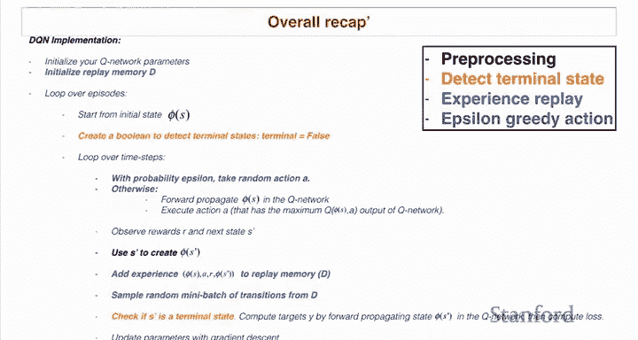

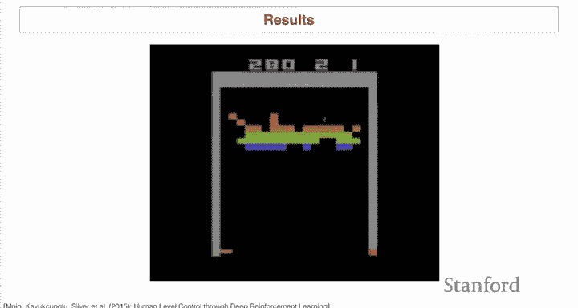

通过这种训练，智能体在《Breakout》中甚至能自己发现“挖隧道”从上方打击砖块的高效策略，这显示了其超越人类示范的学习能力。

---

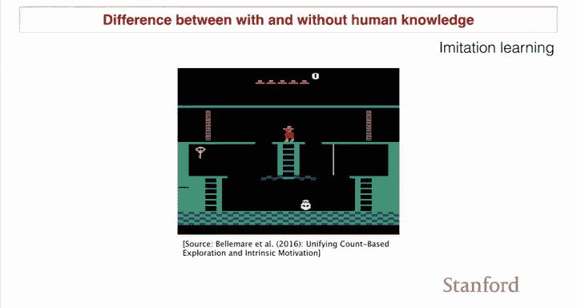

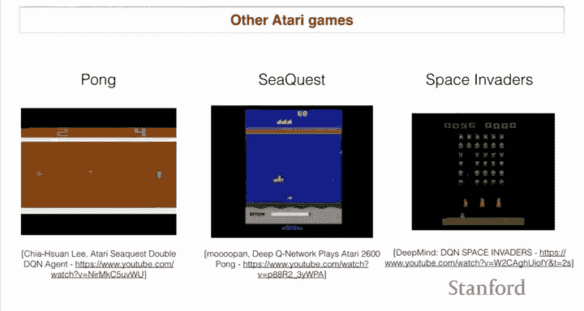

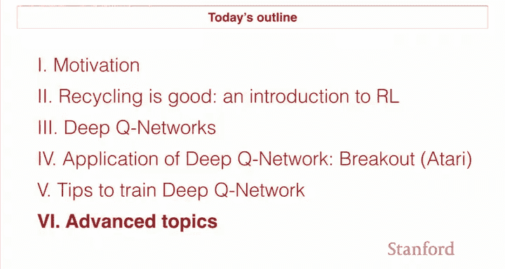

## 高级主题与前沿研究 🔬

**AlphaGo**：
结合了**策略网络**（预测下一步走法）和**价值网络**（评估棋盘胜率），并采用**自我对弈**进行训练，最终击败人类冠军。

**策略梯度方法**：
与DQN学习Q值再选择动作不同，策略梯度方法直接优化**策略函数** `π(a|s; θ)`，通过计算策略性能的梯度来更新参数。例如PPO算法，被用于训练复杂的机器人 locomotion 控制器和 OpenAI Five（Dota 2 AI）。

**元学习**：
目标是让智能体学会“如何学习”。在多个相似任务上训练后，智能体能够仅用少量梯度步骤就适应新任务。

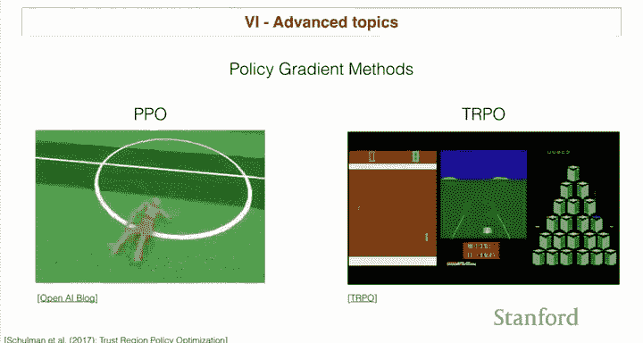

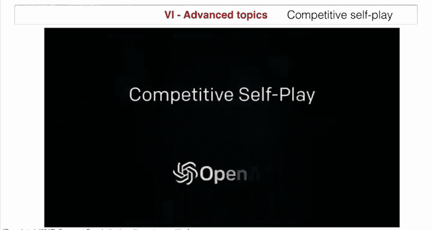

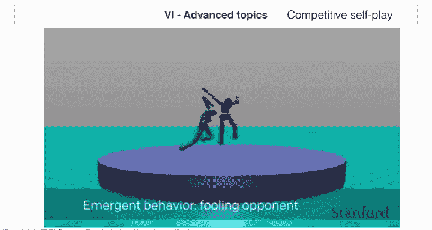

**内在激励探索**：
在奖励稀疏的环境中（如《Montezuma‘s Revenge》），随机探索很难成功。通过给予访问次数少的状态额外的“内在奖励”，鼓励智能体探索未知区域。

**模仿学习**：
当环境奖励难以定义时，可以通过观察专家演示（如人类驾驶）来学习行为策略，然后在此基础上进行强化学习优化。

---

## 总结 📚

本节课我们一起学习了深度强化学习的核心概念。
*   我们首先了解了**强化学习**的动机，它适用于具有**延迟奖励**和需要**序列决策**的问题。
*   我们通过一个简单例子学习了**Q学习**的基本原理，包括**Q表**、**贝尔曼方程**和**策略**。
*   为了应对大规模状态空间，我们引入了**深度Q网络**，用神经网络作为函数逼近器来估计Q值。
*   我们探讨了训练DQN的关键技巧：**经验回放**（打破相关性，提高数据效率）、**ε-贪婪策略**（平衡探索与利用）、**目标网络**（稳定训练目标）以及**输入预处理**（如帧堆叠）。
*   最后，我们简要了解了深度强化学习的前沿方向，如AlphaGo、策略梯度、元学习等，展示了该领域强大的能力和广阔的应用前景。

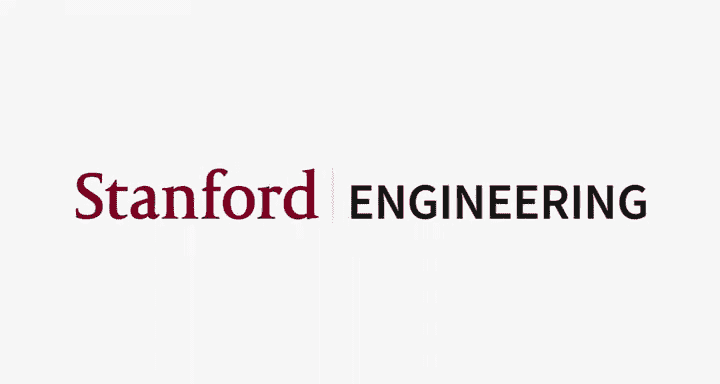

深度强化学习展示了深度学习作为强大函数逼近器，如何与强化学习的决策框架相结合，从而解决前所未有的复杂问题。