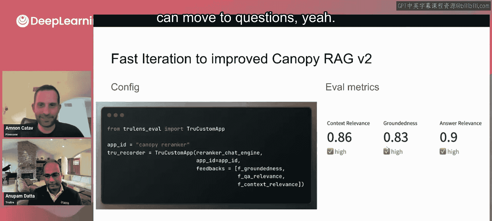

# 构建生产级LLM应用：P1：从原型到生产

在本课程中，我们将学习如何构建高质量、可用于生产环境的大语言模型应用。我们将重点探讨检索增强生成技术，并介绍如何使用Pinecone的Canopy框架和TruEra的TruLens工具来评估、迭代和监控应用，确保其满足生产要求。

## 概述：从实验到生产

2023年是LLM应用的实验和原型验证之年。2024年，我们的目标是将这些应用中的大部分推向生产环境。当前面临的主要挑战是如何构建生产级的LLM应用，这正是本次课程要讨论的核心内容，我们将特别聚焦于检索增强生成技术。

课程结构如下：首先快速介绍构建生产级应用所涉及的内容。接着，Amnon将介绍Pinecone的Canopy框架及其相关工作。然后，我们将探讨如何评估和迭代应用以提升其质量，使其达到生产就绪状态，这部分将由Anupam介绍TruLens和TruEra平台。我们的大部分工作都是开源的，Canopy和TruLens都与各自的生产级系统紧密集成。本课程的关键学习成果是解决构建生产级RAG应用时面临的主要挑战。我们还提供了一个示例笔记本供大家动手实践。

## 引言：为什么需要RAG？

让我们从一个简单的例子开始，说明初次使用LLM时通常会遇到的问题。例如，如果你问ChatGPT“埃隆·马斯克给Twitter起的新名字是什么？”，它可能会回答：“我的知识截止日期是2022年1月，我从未听说过Twitter有任何改名。”但我们都知道，Twitter已经改名为X了。

当你构建LLM应用时，通常希望LLM能够了解最新数据并与世界同步。从根本上说，模型的所有知识都仅限于其在训练期间看到的数据。无论是使用OpenAI的模型还是开源模型，它们通常只使用了某个时间点的网络数据进行训练，并且每年或每隔几个月才重新训练一次。因此，可以说LLM的知识仅限于静态的网络数据，它们无法访问实时网络数据，也无法访问专有数据。

而在构建生产级应用时，你确实需要访问这两类数据，尤其是专有数据。例如，你可能希望LLM能够讨论你组织的文档或Slack频道中的内容。显然，OpenAI和开源团队在训练语言模型时无法使用你的专有数据。

因此，我们需要将这些模型连接到实时网络数据和专有数据。目前最先进的主流方法是使用检索增强生成。

## RAG技术简介

我们假设大部分听众已经了解RAG，这里做一个快速的高层概述。

RAG的核心思想是：在提示中，不仅仅提供用户的问题或查询，而是将其与来自专有数据或实时网络数据的相关片段结合起来。具体来说，就是构建一个提示，说明“这是查询，这是一些相关信息”，然后要求模型生成一个知识丰富的答案。

通常，你的数据量可能非常庞大，可能有数百万甚至数十亿份文档。显然，你无法将所有知识都塞进提示中。因此，你需要使用搜索技术，就像在谷歌上搜索一样，你不可能为每个问题都阅读整个互联网。

当你在自己的数据上进行搜索时，目前通常使用像Pinecone这样的向量数据库。其核心是进行语义搜索，这有助于在PDF或文件等非结构化数据中进行搜索。这需要两个关键组件：向量数据库和嵌入模型。

嵌入模型的作用是将你的数据表示为向量。例如，你将文档和问题都转化为向量，模型经过训练后，会使与查询更相关的文档向量在向量空间中更接近查询向量。

通常的流程是：获取数据，通过嵌入模型得到向量，然后将其存储在向量数据库中。当查询到来时，使用相同或相似的嵌入模型处理查询得到另一个向量，并用它来查询向量数据库。向量数据库的作用是存储海量的嵌入向量，并在查询到来时，快速找到与查询向量最接近的向量，即最相关的文档。

如果查询返回了前K个最相关的文档，我们将它们与查询拼接起来，输入给模型，从而获得能够提供给用户的知识性答案。这样，我们之前讨论的知识陈旧问题就得到了解决。

## 从演示到生产的挑战

幸运的是，构建一个RAG演示或概念验证非常容易。有很多框架如LangChain、LlamaIndex以及我们即将介绍的Canopy，都可以用几行Python代码就让一个RAG系统运行起来。可以说，构建演示很容易。

然而，当你准备将应用投入生产时，真正的挑战才开始出现。正如Anupam所说，2024年是生产之年，我们真正遇到了使用LLM和构建生产级LLM应用的实际问题。

以下是其中一些问题，稍后我们将讨论如何解决它们：
*   **幻觉**：有时你的模型可能会编造虚假信息。在生产应用中，你不希望向用户提供不准确的信息。
*   **上下文溢出**：大多数模型（如GPT）对提示中可以容纳的令牌数量有限制。例如，GPT-3.5的限制是4K个令牌。在进行RAG时，搜索可能会产生大量令牌，很容易超出这个限制，导致错误。
*   **数据预处理与搜索质量**：如何正确地摄取和清理数据以使搜索效果更好？如何将数据分块以输入嵌入模型？如何为你的数据选择最合适的嵌入模型？构建高质量的搜索系统非常困难，需要进行大量调优。

接下来，我们将开始探讨如何利用Canopy和TruLens共同解决这些问题。

## 使用Canopy构建生产级RAG应用

首先介绍Canopy。Canopy是一个用Python编写的开源项目，由Pinecone和社区共同构建，专注于RAG。在开发Canopy时，我们着重思考如何构建一个适合生产级别的框架。这意味着我们进行了大量测试，建立了稳固的持续集成流程，并考虑了生产环境中需要处理的所有事项。

以下是使用Canopy可以获得的一些优势：
*   **端到端RAG应用**：通过命令行或Python代码，可以轻松获得一个可工作的端到端RAG系统。
*   **为规模而建**：基于Pinecone构建，能够处理海量数据。例如，我们曾用Canopy在十亿级文档上构建应用，运行良好。
*   **自动处理上下文溢出**：系统会确保返回的上下文永远不会溢出提示令牌限制。它会进行令牌计数，并只保留最相关的令牌。
*   **基于配置文件构建**：Canopy可以通过YAML配置文件来构建，这是一种无需编写代码的方式。这对于生产环境很重要，因为当生产环境出现问题时，你可能希望进行小的更改而无需修改代码。此外，为不同客户提供不同版本的系统时，最佳实践也是使用配置而非不同的代码库。
*   **提供生产模板**：我们在库中提供了FastAPI应用程序模板，并定期发布Docker镜像，你可以直接拉取并运行一个完整的系统。

以下是一个快速运行Canopy服务的示例。使用命令行工具并指定配置文件，你就可以启动一个FastAPI应用，可以部署在Kubernetes或Docker上，帮助你快速将Canopy投入生产。

这是一个Canopy的默认配置文件示例。你可以看到，你可以轻松地更改系统提示词。在许多LLM库中，很难找到提示词的位置，但在Canopy中，你只需转到配置文件即可修改，无需更改代码。

例如，在红色方框中，我们指定Canopy使用`gpt-3.5-turbo`。如果你想切换到GPT-4，只需更改这个字符串，然后重新部署即可。你也可以轻松切换到其他提供商，如Anthropic或Azure OpenAI，所有这些都可以通过配置完成。

在展示如何使用Canopy构建RAG的笔记本之前，我们需要先讨论一下评估，因为这对我们的客户来说非常重要。

## 评估的重要性与挑战

为什么评估很重要？想象一下，如果你从不评估你的系统，就意味着你无法知道它的好坏，也无法知道如何改进它。通常，随着时间的推移，你最终会得到一个无法满足用户需求、甚至可能提供低质量结果的系统。

但评估本身非常困难。这就像评估多选题考试和评估论文的区别，评估论文要难得多。而评估LLM的输出正是如此，你需要评估一个抽象的答案。即使有工具，也很难像批改论文一样进行比较。因此，评估是一项艰巨的任务，而这正是TruLens可以大显身手的地方。

Anupam将对此进行补充说明。

是的，评估论文与评估多选题的类比非常贴切。本幻灯片的第一点就指出了这一点：很难定义应该使用哪些评估指标来以编程方式评估一篇论文或LLM应用生成的文本。同时，确保这些评估的可靠性和全面性也是一大挑战。

我们稍后将讨论如何应对这一挑战。另一个方面是在应用执行时记录其执行轨迹。你需要对整个过程进行细粒度的日志记录，确保提示、响应和中间结果都被记录下来，并且能够大规模处理，以便后续可以将这些执行轨迹或其部分用于评估和监控。

第三点是在生产环境中，随着数据量和负载的增加，如何可扩展且经济高效地评估和监控应用。你希望在开发阶段，当开发者构建应用时，就能够评估、调试和改进它们。然后，当应用进入生产环境，数据量可能大得多时，你仍然需要以低成本、低延迟的方式进行评估和监控，这同样是一个巨大的挑战。

最后一点是快速迭代以改进应用。我们将在稍后的笔记本演示中深入探讨这一点。当你拥有应用的第一个版本，但评估结果显示其表现不佳时，如何快速迭代？迭代速度变得极其重要。

随着人们开始大规模部署生成式AI应用，解决上述挑战变得至关重要。

## 评估框架与RAG三元组

感谢Anupam。我同意所有这些观点。我认为，如果你能妥善解决所有这些要点，并使用一个可扩展的系统，你确实可以获得一个高质量的系统。

现在，让我们切换视角，看看如何构建。到目前为止，我们已经做了介绍，讨论了问题，并简要介绍了Canopy。接下来，我们将通过笔记本向你展示如何使用Canopy和Pinecone构建RAG。然后，我们将继续讨论TruLens，并展示如何将它们结合起来。

这是我们将要使用的笔记本，你可以在YouTube频道的描述中找到它。现在，我们将快速浏览一遍，重点关注构建初始默认Canopy系统的部分。

首先，我们需要安装依赖项：`canopy`、`truera`以及其他一些本笔记本所需的库。

这里需要提供一些API密钥，例如Pinecone API密钥、OpenAI API密钥，以及本示例中所需的Cohere API密钥。当然，并非总是需要所有这些密钥。

这里需要指定Pinecone的配置，定义运行环境。你可以配置不同的云提供商。在本示例中，为了简化，我们使用Pinecone的免费试用版配置。这里有一个链接，你可以了解如何使用其他环境。

接下来，我们下载一些公开数据，并解释这些数据是什么，因为我们将在整个笔记本中使用它。这些数据是Pinecone文档的爬取内容。

例如，这是关于“限制”页面的爬取内容，其中解释了使用Pinecone时的各种限制。你可以看到最大向量维度是20k，或者查询中允许的最大top_k值是10k。我们将尝试记住这些数字，稍后会用到。

现在，让我们继续。数据准备就绪后，我们要构建Canopy系统。首先，我们需要构建一个分词器。分词器的作用是将字符串分割成LLM可以读取的基本单位——令牌。在Pinecone中需要分词器的主要原因是我们之前讨论过的上下文溢出问题。Canopy需要一种方法来以与你的LLM相同的方式计算令牌数，以确保不会溢出提示。

因此，你需要确保构建的分词器与你的LLM兼容。

接下来，我们将获取这些数据，并将其上传到Pinecone或Canopy。在Canopy中，我们有一个称为“知识库”的概念，它负责管理你的数据或知识。它建立在Pinecone索引之上，在本例中我们称之为“pcone-docs”。

首先，我们构建这个知识库实例，并创建底层的Canopy索引（即Pinecone索引）。然后，我们连接到这个知识库，确保API密钥和索引本身都已设置好。接着，我们实际上传或摄取这些文档。知识库还负责协调嵌入过程。如你所见，我创建了一个包含文本数据的文档对象，然后将其上传到知识库，并通过Canopy存储在Pinecone中。

现在，所有数据都已存入Canopy，我们想要开始与其聊天或构建我们的聊天机器人。首先，我们需要构建一个称为“上下文引擎”的东西。其思想是，知识库只是一个可以查询并返回前K个结果（如前10个）的组件。而上下文引擎是知识库之上的一层，当它收到查询时，实际上会返回一段文本。正是这个组件确保你的上下文不会溢出。你可以给它一个预算，例如“对于这个查询，给我1000个令牌”，它会确保你最多得到1000个令牌。这就是上下文引擎的主要思想。

接下来是最有趣的部分：聊天引擎。这是你将与之对话的组件。聊天引擎是主要的协调器。Canopy的一个非常有趣的特点是，我们使聊天引擎与OpenAI API完全兼容。这意味着Canopy聊天引擎的输入和输出格式与OpenAI相同。

例如，这里我们构建了一个非常标准的聊天历史记录，就像你在OpenAI中做的那样。我们将问我们的聊天机器人：“Pinecone查询的最大top_k值是多少？” 然后，所有习惯使用OpenAI的人都会观察到，这里的输出格式与OpenAI相同。

我们只需调用聊天引擎的聊天功能，提供聊天历史记录，就能得到答案。答案是：“Pinecone中top_k的最大值是10k。” 对于那些一直关注的人来说，这是正确答案。至少目前看来，我们很满意。

现在，让我们把话题交还给Anupam，解释我们如何进行评估，以及如何将TruLens与Canopy结合起来。

## 使用TruLens进行评估与迭代

好的，谢谢。让我再次分享屏幕。我将先讨论一些关于评估和迭代的更一般的概念性要点，然后再回到同一个笔记本，看看这些概念如何与Amnon刚刚展示的Canopy RAG应用结合。

Canopy的一个很酷的地方在于，它将应用的配置与代码很好地分离开来。你可以在YAML配置文件中更改许多超参数，而无需触及代码，这使得在生产环境中维护变得更加容易。我非常喜欢这个方面。

现在，让我们深入探讨评估和迭代。这是我们如何看待评估和迭代整体流程的一个快速概览。

当开发者构建像Amnon刚刚展示的RAG这样的应用时，你可以使用我们的开源库TruLens来评估和调试这些应用，以达到生产就绪的高质量水平。这个快速迭代循环非常有价值，我们稍后将在笔记本中看到它的实际应用。

一旦应用进入生产环境，还需要进行生产监控。在思考一个通用的评估框架时，以下是一些我希望大家记住的关键支柱：
*   **全面性**：确保评估既广泛又深入。
*   **可扩展性**：开发者可以添加自己的评估。虽然有很多开箱即用的评估，但根据你的用例和应用，添加自定义评估也很容易。
*   **可靠性**：评估本身的可靠性。
*   **实验跟踪**：这对于选择最佳应用配置非常有帮助，我们将在实际操作中看到这一点。

在调试方面，我们发现，拥有执行轨迹的细粒度日志记录非常重要，这样你就可以通过我们所谓的“镜头”对其部分进行细粒度评估。我稍后会举例说明。一旦进入生产监控，扩展到大数据量、获取警报以及确保生产环境中的评估比开发环境成本更低、延迟更低也极其重要。否则，监控成本可能会达到仅运行应用成本的十倍。在这方面，我们做了一些额外的工作，例如使用更小的模型等。今天我们不会深入讨论，我只是想在大局上给大家一个概念，然后再深入评估和调试部分。

那么，在这种背景下，什么样的评估是有意义的呢？去年我们引入了一个概念，称为“RAG三元组”，用于防范幻觉。现在，RAG三元组已被广泛采用，成为该领域如何开始进行评估以防范幻觉的事实标准。

它非常遵循Amnon展示的RAG结构：用户提出查询，从向量数据库中检索出一组上下文或块，然后这些内容被总结以产生最终响应。总结是由LLM完成的。沿着每条边，都存在你想要防范的故障模式，而评估有助于捕捉这些故障。

以下是RAG三元组的三个评估维度：
*   **上下文相关性**：检查检索到的上下文是否与查询相关。上下文相关性之所以重要，是因为检索步骤并不完美，因为它依赖于查询与先前存入向量数据库（如Pinecone）的块之间的嵌入相似性。嵌入相似性可能效果不错，但并非完美，我们稍后会看到一些失败案例。评估可以帮助捕捉这一点。
*   **答案依据性**：检查我们得到的最终响应是否每一句话都有检索到的上下文片段作为依据或支持，是否可以追溯到那些检索到的上下文片段。这一点很重要，因为即使你使用了带有向量数据库作为知识库的RAG，LLM在最后一步生成响应时仍然可能产生幻觉。我们稍后会看到幻觉是如何产生的具体例子。一种理解方式是，LLM非常“渴望取悦”，它们的任务是生成下一个词。特别是当检索到的上下文片段不包含所问问题的答案时，LLM会尝试用之前学到的知识填补空白，在这个过程中就可能引入幻觉。答案依据性评估可以防范这一点。
*   **答案相关性**：检查答案是否与提出的查询相关。

通过这三个评估，我们可以对RAG应用进行相当稳健的评估，防范幻觉。这些并不是TruLens中唯一的开箱即用评估。你还有许多其他评估来确保应用诚实、无害、有帮助。RAG三元组属于这个范畴，你可以在图中看到答案相关性、答案依据性和上下文相关性。此外，还有诸如毒性、刻板印象、防范越狱攻击、连贯性、简洁性等语言评估。所有这些对于构建高质量、可信任并投入生产的应用都非常有价值。

自定义评估是我们看到用户大量使用的功能，他们可以添加自己的评估或反馈函数到代码中，评估开箱即用评估未涵盖的其他维度。由于这也是一个社区努力，我们看到了社区为开源项目做出贡献的方式，每个人都可以从中受益。如果你在商业应用中使用它，也不必贡献回来，因为它不是GPL许可证，而是MIT许可证，你可以保留供自己使用。

让我给你一些这些评估失败的例子，然后我们再回到Amnon开始的笔记本，看看它如何与Canopy结合。但我希望你们能掌握一些与TruLens或Canopy无关的通用学习要点。这些是关于如何评估和改进你的应用的一般原则，现在正开始被广泛采用。

在这个RAG示例中，我们索引了TruEra网站，并询问“Saurabh是谁？”（Saurabh是我的联合创始人，也是我以前的博士生）。RAG的回应大部分是正确的，除了最后一句话。最后一句话提到他是英格兰银行AI公私论坛的成员，这并不准确。

当我们用TruLens进行上下文相关性评估时，我们看到以下情况：前两行是从Pinecone向量数据库中检索到的四个上下文片段中的两个，它们确实是关于Saurabh的。底部两个则不是。当我们使用开箱即用的评估进行自动化的上下文相关性评估时，前两个被正确评估为相关，得分很高（在0到1的尺度上得分为1）。而底部两个得分很低，因为它们是关于另一个在TruEra工作的人——Shami。事实上，那个不准确的最后一句话正是来自第三和第四个上下文片段。这就是不准确性潜入的方式。这是一个检索失败的例子，但自动化的上下文相关性评估正确地检测到了它。因此，你可以使用一种基于上下文过滤的形式，例如，只有当评估分数高于0.8时，才将其转发给LLM以生成最终响应。如果你设置了这样的基于阈值的上下文过滤，那么只有前两个检索到的上下文片段会进入LLM进行总结，这样你就