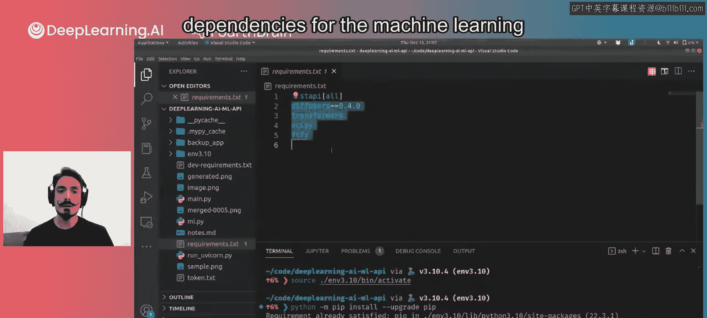
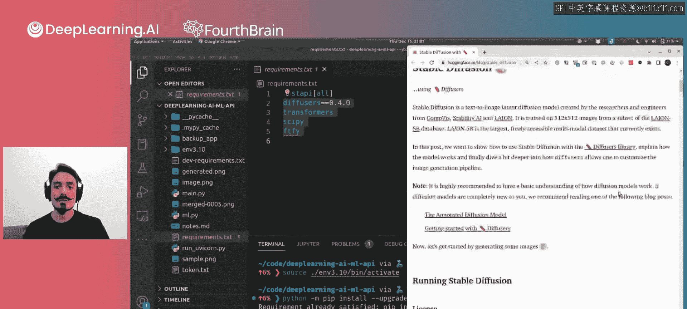
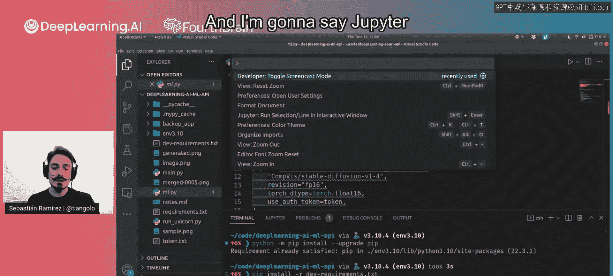
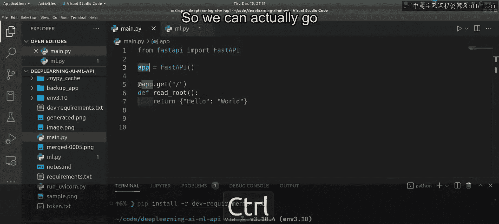
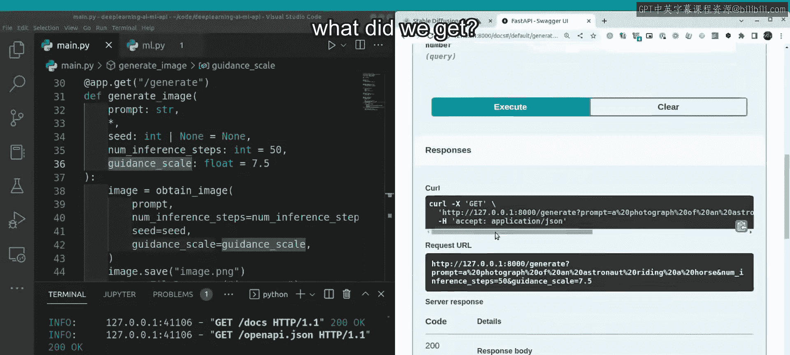
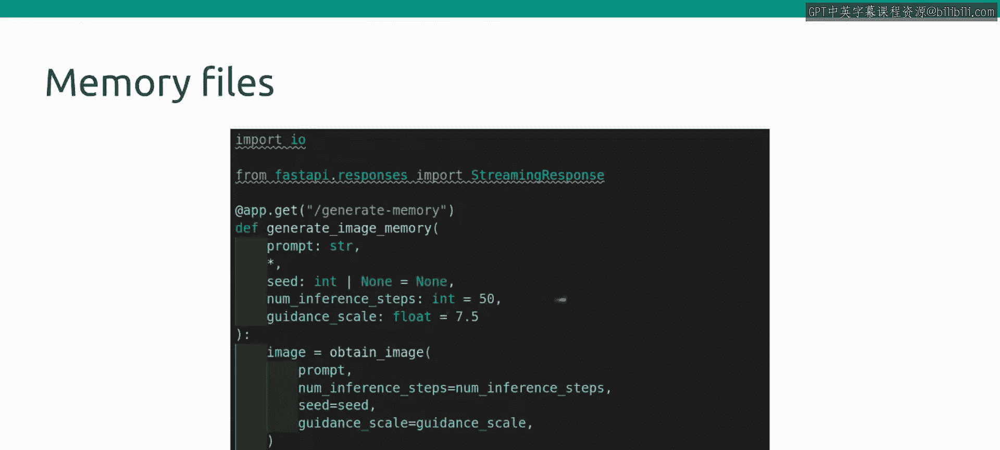

# FastAPI 机器学习应用开发：P1：使用 FastAPI 构建机器学习 Web 应用


在本教程中，我们将学习如何使用 FastAPI 框架，快速构建一个能够生成 AI 图像的机器学习 Web 应用程序。我们将从环境配置开始，逐步实现一个完整的 API，并集成 Stable Diffusion 模型来生成图像。

---

## 环境配置与项目初始化


首先，我们需要设置 Python 开发环境并安装必要的依赖包。

以下是配置步骤：

1.  **创建虚拟环境**：使用 Python 内置的 `venv` 模块创建一个独立的 Python 环境。
    ```bash
    python -m venv myenv
    ```

2.  **激活虚拟环境**：
    *   **Linux/Mac**:
        ```bash
        source myenv/bin/activate
        ```
    *   **Windows**:
        ```bash
        myenv\Scripts\activate
        ```





3.  **升级 pip**：确保使用最新版本的 pip 包管理器，以避免安装依赖时出现兼容性问题。
    ```bash
    python -m pip install --upgrade pip
    ```

4.  **安装项目依赖**：我们将安装 FastAPI（包含 Uvicorn 服务器）以及运行 Stable Diffusion 模型所需的机器学习库。
    ```bash
    pip install "fastapi[all]" diffusers transformers accelerate torch
    ```



---

## 机器学习模型集成

上一节我们完成了环境搭建，本节中我们来看看如何集成并测试 Stable Diffusion 模型。

我们首先创建一个 Python 文件（例如 `ml_model.py`）来加载和使用模型。以下代码基于 Hugging Face Diffusers 库的示例。

```python
# ml_model.py
import torch
from diffusers import StableDiffusionPipeline
from pathlib import Path

# 从文件读取 Hugging Face 令牌（用于访问模型）
token_path = Path("token.txt")
token = token_path.read_text().strip()

# 加载预训练的 Stable Diffusion 模型管道
# 首次运行会下载模型权重，需要较长时间
pipe = StableDiffusionPipeline.from_pretrained(
    "CompVis/stable-diffusion-v1-4",
    use_auth_token=token
)

# 将模型移至 GPU（如果可用）以加速推理
pipe = pipe.to("cuda" if torch.cuda.is_available() else "cpu")

def generate_image(prompt: str, seed: int = None, num_inference_steps: int = 50, guidance_scale: float = 7.5):
    """
    根据文本提示生成图像。
    
    参数:
        prompt: 描述图像的文本。
        seed: 随机种子，用于生成可重复的结果。
        num_inference_steps: 去噪步数，影响图像质量和生成速度。
        guidance_scale: 指导尺度，控制生成结果与提示的匹配程度。
    
    返回:
        生成的 PIL 图像对象。
    """
    generator = None
    if seed is not None:
        generator = torch.Generator(device="cuda").manual_seed(seed)
    
    # 执行图像生成
    result = pipe(prompt, num_inference_steps=num_inference_steps, guidance_scale=guidance_scale, generator=generator)
    image = result.images[0]
    return image

# 测试函数
if __name__ == "__main__":
    test_prompt = "a photograph of an astronaut riding a horse"
    test_image = generate_image(test_prompt, num_inference_steps=5, seed=42)
    test_image.save("test_output.png")
    print("测试图像已保存为 test_output.png")
```

**关键点说明**：
*   `StableDiffusionPipeline.from_pretrained` 会从 Hugging Face 模型中心下载模型。
*   我们将模型逻辑封装在 `generate_image` 函数中，这样可以在 API 中按需调用，而不是在导入模块时就运行。
*   函数参数（如 `num_inference_steps`）允许我们控制生成过程。

---



## 构建 FastAPI 应用基础

现在我们已经有了可用的模型函数，接下来开始构建 Web API 的核心部分。

我们创建一个新的文件 `main.py` 来编写 FastAPI 应用。

```python
# main.py
from fastapi import FastAPI

# 创建 FastAPI 应用实例
app = FastAPI()

# 定义一个根路径的 GET 端点
@app.get("/")
def read_root():
    return {"message": "Hello World"}

# 定义一个带路径参数的 GET 端点
@app.get("/items/{item_id}")
def read_item(item_id: int):
    return {"item_id": item_id}
```

**代码解析**：
*   `FastAPI()` 是应用的主类。
*   使用装饰器（如 `@app.get("/")`）将 Python 函数绑定到特定的 URL 路径和 HTTP 方法（GET、POST 等）。
*   `item_id: int` 是一个**类型注解**。FastAPI 利用它来自动将 URL 中的字符串转换为整数，并进行数据验证。如果传入 `items/foo`，FastAPI 会自动返回错误，提示 `item_id` 应为整数。

---

## 运行与测试 API

让我们启动服务器并测试我们刚刚创建的基础 API。

1.  **启动开发服务器**：使用 Uvicorn 运行应用。`--reload` 参数使服务器在代码更改时自动重启，仅用于开发。
    ```bash
    uvicorn main:app --reload
    ```
    *   `main`：Python 模块名（即 `main.py`）。
    *   `app`：在 `main.py` 中创建的 FastAPI 实例对象。

2.  **访问 API**：
    *   打开浏览器，访问 `http://127.0.0.1:8000`，你会看到 `{"message": "Hello World"}`。
    *   访问 `http://127.0.0.1:8000/items/7`，你会看到 `{"item_id": 7}`。
    *   访问 `http://127.0.0.1:8000/items/foo`，你会看到一个自动生成的错误响应，指出 `item_id` 应为整数。

3.  **访问交互式 API 文档**：FastAPI 的一大亮点是自动生成的交互式文档。
    *   访问 `http://127.0.0.1:8000/docs`，你会看到基于 Swagger UI 的文档页面，可以直接在浏览器中测试各个端点。
    *   访问 `http://127.0.0.1:8000/redoc`，可以看到另一种风格的文档（ReDoc）。

---

## 处理请求数据与 Pydantic 模型

在构建 Web API 时，我们经常需要接收客户端发送的复杂数据（如 JSON）。FastAPI 使用 **Pydantic** 库来轻松定义、验证和序列化这些数据。



上一节我们介绍了基础端点，本节中我们来看看如何使用 Pydantic 模型来处理 POST 请求中的数据。

```python
# main.py (续)
from pydantic import BaseModel
from typing import List, Optional

# 定义一个 Pydantic 模型，描述我们期望接收的数据结构
class Item(BaseModel):
    name: str
    price: float
    tags: List[str] = []  # 默认值为空列表



# 创建一个处理 POST 请求的端点
@app.post("/items/")
def create_item(item: Item):
    """
    接收一个 Item 对象（JSON 格式），并返回它。
    FastAPI 会自动验证请求体是否符合 Item 模型的定义。
    """
    return item
```

**操作步骤**：
1.  保存代码，Uvicorn 服务器会自动重启。
2.  打开 `http://127.0.0.1:8000/docs`。
3.  找到 `POST /items/` 端点，点击 “Try it out”。
4.  在请求体编辑框中输入 JSON，例如：
    ```json
    {
      "name": "Foo",
      "price": 42.5,
      "tags": ["tag1", "tag2"]
    }
    ```
5.  点击 “Execute”。你会看到服务器返回了同样的数据。
6.  尝试发送无效数据（例如缺少 `name` 字段，或 `price` 是字符串），观察 FastAPI 如何自动返回详细的验证错误信息。


**优势**：
*   **自动验证**：确保输入数据符合预期格式。
*   **自动文档**：`/docs` 页面中的示例和 Schema 直接来自 Pydantic 模型。
*   **编辑器支持**：在代码中，`item.name` 会有代码补全，因为编辑器知道它的类型是 `str`。

---

## 集成图像生成 API

现在，我们将机器学习模型与 FastAPI 结合起来，创建一个真正的图像生成 API。

首先，我们需要从之前创建的 `ml_model.py` 文件中导入生成函数。为了避免每次代码改动都重新加载庞大的模型（导致开发服务器重启极慢），我们暂时关闭 `--reload` 模式。

```python
# main.py (续)
from fastapi.responses import FileResponse
from ml_model import generate_image  # 导入我们之前写的函数
import io

@app.get("/generate/")
def generate(
    prompt: str,
    seed: Optional[int] = None,
    num_inference_steps: int = 50,
    guidance_scale: float = 7.5
):
    """
    图像生成端点。
    参数通过查询字符串（Query String）传递。
    例如： /generate/?prompt=a+cat&num_inference_steps=30
    """
    # 调用机器学习模型生成图像
    image = generate_image(
        prompt=prompt,
        seed=seed,
        num_inference_steps=num_inference_steps,
        guidance_scale=guidance_scale
    )
    
    # 方法1：保存到文件后返回（简单，但可能有多线程写入冲突）
    # image.save("generated_image.png")
    # return FileResponse("generated_image.png", media_type="image/png")
    
    # 方法2：使用内存流，避免磁盘读写（推荐用于生产环境）
    img_byte_arr = io.BytesIO()
    image.save(img_byte_arr, format='PNG')
    img_byte_arr.seek(0)  # 将指针移回流的开头
    return FileResponse(img_byte_arr, media_type="image/png", filename="generated.png")
```

**关键点说明**：
1.  **查询参数**：函数参数（如 `prompt`, `seed`）没有出现在路径中，因此 FastAPI 会从 URL 的查询字符串（`?` 之后的部分）中获取它们。
2.  **`Optional[int]`**：表示 `seed` 参数是可选的，可以为 `None`。
3.  **`FileResponse`**：这是 FastAPI 提供的一个响应类，用于高效地发送文件。我们使用 `io.BytesIO()` 在内存中创建一个“虚拟文件”，将图像保存到其中，然后直接返回这个内存流的内容，避免了物理磁盘的写入，性能更好且更安全。

**运行与测试**：
1.  停止之前的服务器（如果正在运行）。
2.  启动服务器（**不带 `--reload`**，因为加载模型很慢）：
    ```bash
    uvicorn main:app --host 0.0.0.0 --port 8000
    ```
3.  等待模型加载完成（控制台输出稳定后）。
4.  打开浏览器，访问：
    ```
    http://127.0.0.1:8000/generate/?prompt=a%20photograph%20of%20an%20astronaut%20riding%20a%20horse&num_inference_steps=25
    ```
    浏览器应该会开始下载生成的 PNG 图像。

你也可以直接在 `/docs` 页面测试这个端点，输入提示词和其他参数，点击执行后，响应结果区域会显示生成的图片。

---

## 部署与性能考量

在开发完成后，我们需要考虑如何将应用部署到生产环境。

以下是部署 FastAPI 应用的一般步骤和最佳实践：

1.  **选择服务器**：生产环境应使用像 **Gunicorn**（配合 Uvicorn Worker）或直接使用 **Uvicorn**（对于轻量级或 ASGI 原生环境）这样的生产级 ASGI 服务器。
    ```bash
    # 使用 Gunicorn 启动多个 Uvicorn worker 进程
    gunicorn main:app -w 4 -k uvicorn.workers.UvicornWorker
    ```

2.  **容器化（推荐）**：使用 Docker 将应用及其所有依赖打包成容器镜像。这确保了环境一致性，便于在 Kubernetes、AWS ECS、Google Cloud Run 等平台上进行部署和水平扩展。
    ```dockerfile
    # Dockerfile 示例
    FROM python:3.9-slim
    WORKDIR /app
    COPY requirements.txt .
    RUN pip install --no-cache-dir -r requirements.txt
    COPY . .
    CMD ["uvicorn", "main:app", "--host", "0.0.0.0", "--port", "80"]
    ```

3.  **无服务器部署**：对于事件驱动或流量波动大的场景，可以考虑无服务器方案。需要使用 **Mangum** 等适配器将 FastAPI 应用包装成与 AWS Lambda 兼容的格式。
    ```python
    # 在 lambda_handler.py 中
    from mangum import Mangum
    from main import app
    handler = Mangum(app)
    ```

4.  **性能优化**：
    *   **水平扩展**：对于计算密集型任务（如 ML 推理），最简单的扩展方式是增加应用实例（容器/Pod）的数量，通过负载均衡器分发请求。
    *   **异步处理**：如果模型推理时间很长，可以考虑使用后台任务（FastAPI 支持 `BackgroundTasks`）或消息队列（如 Celery + Redis）来异步处理生成请求，避免阻塞 API 响应。
    *   **模型加载优化**：使用 `@lru_cache` 装饰器缓存加载的模型，确保在多个请求间复用同一个模型实例，而不是每次调用都加载。
        ```python
        from functools import lru_cache
        
        @lru_cache()
        def get_model_pipeline():
            # 加载模型的代码
            pipe = StableDiffusionPipeline.from_pretrained(...)
            return pipe
        ```

---

## 总结

本节课中我们一起学习了如何使用 FastAPI 快速构建一个功能完整的机器学习 Web 应用。我们从零开始，完成了以下步骤：

1.  **环境配置**：建立了独立的 Python 虚拟环境并安装了所有依赖。
2.  **模型集成**：使用 Hugging Face Diffusers 库加载了 Stable Diffusion 模型，并将其封装成可调用的函数。
3.  **API 开发**：使用 FastAPI 创建了多个端点，包括简单的信息返回、带参数的路由、以及处理复杂 JSON 请求体的 POST 端点。
4.  **核心功能实现**：成功将图像生成模型集成到 API 中，创建了 `/generate/` 端点，它接收文本提示和其他参数，并返回生成的图像。
5.  **数据验证与文档**：利用 Pydantic 模型和 Python 类型注解，获得了自动的数据验证、序列化以及交互式 API 文档。
6.  **部署与优化**：探讨了将应用部署到生产环境的不同方式（容器、无服务器）以及性能扩展的基本策略。

FastAPI 以其高性能、易用性、对现代 Python 特性（如异步和类型提示）的深度集成，以及自动生成的交互式文档，使其成为构建机器学习 API 和后端服务的绝佳选择。希望本教程能帮助你快速上手，并将这些概念应用到自己的项目中。