# LLM Agent Fine-Tuning： 1： 课程概述与RAG基础

在本节课中，我们将学习如何对大型语言模型（LLM）智能体进行微调，以增强任务自动化能力。我们将从检索增强生成（RAG）的基础知识开始，逐步深入到智能体的构建、评估与微调技术。

大家好，我是Diana Chan Morgan，在DeepLearning.AI负责社区事务。今天的研讨会是我们今年的最后一次活动，主题是围绕微调LLM智能体以实现应用和自动化。在本次课程中，你将发现前沿的微调技术，例如用于低秩适应的LoRA、指标与日志记录、使用Weights & Biases进行全面的日志记录、揭示Weights & Biases的调试能力、学习如何利用追踪来定位问题、通过提示工程走向成功，以及使用Weights & Biases进行实践评估。

今天的主讲人是Anish。Anish热衷于将机器学习转化为实用的产品，他的经验涵盖传统机器学习、深度学习和推荐系统。他是一位活跃的演讲者和开发者，致力于通过工具、课程和资源来普及机器学习。

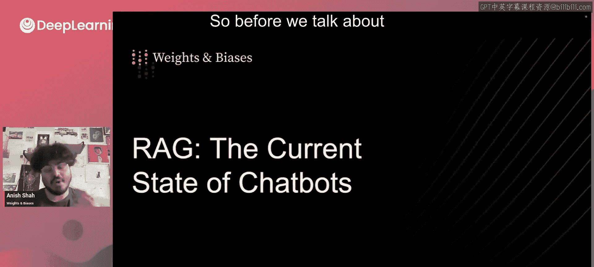

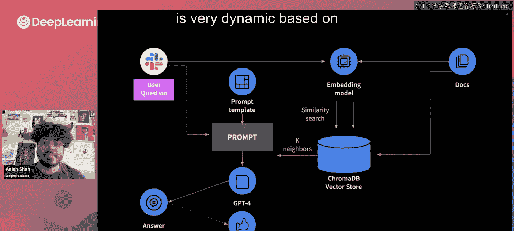

## 当前聊天机器人的状态

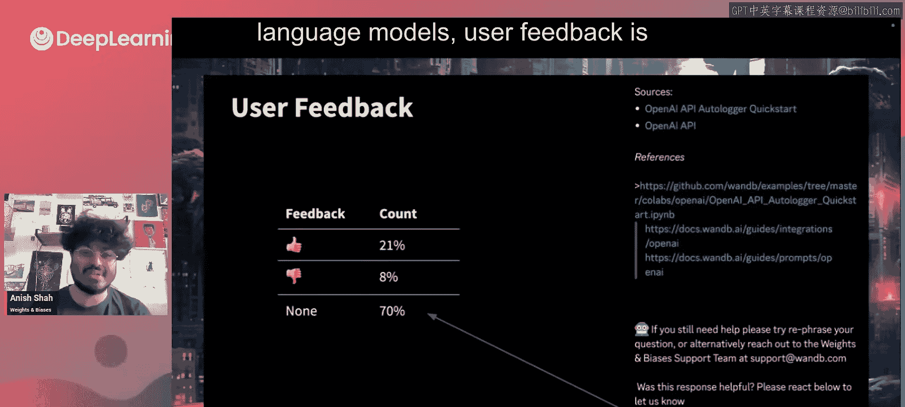

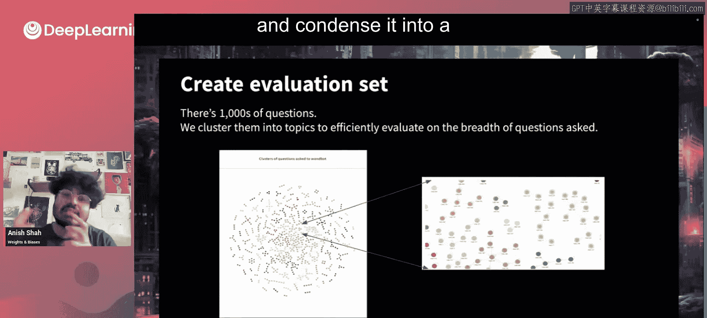

在讨论智能体之前，我们先简要回顾一下当前聊天机器人的状态。对于那些厌倦了如今常见的RAG演示的人来说，RAG是一个框架，用于指导如何将适当的上下文整合到你与大型语言模型的交互中。

例如，在使用ChatGPT时，当你提出与财务文档、医疗记录甚至编程相关的问题时，确保你提供给ChatGPT的内容包含了你试图解决问题的完整上下文是合理的。

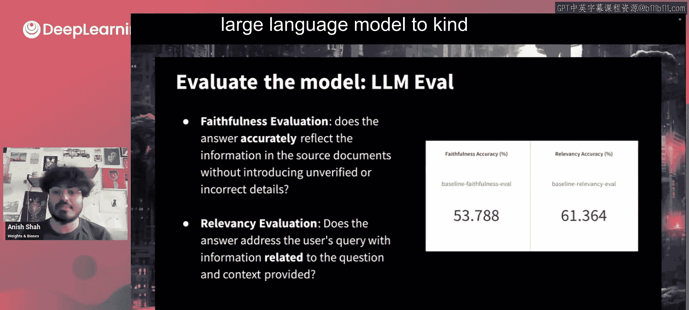

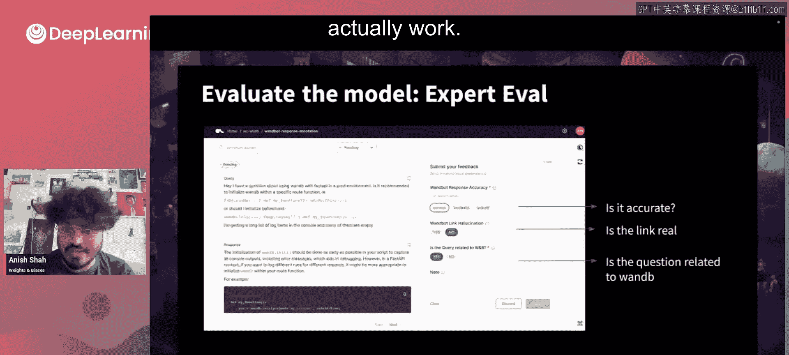

## RAG的工作原理

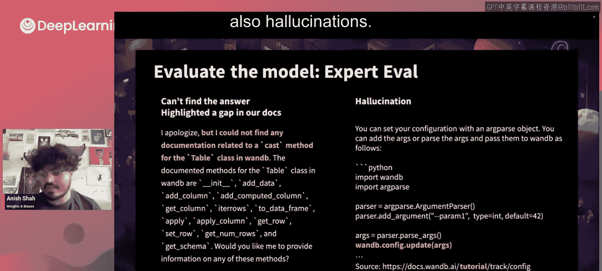

那么，这个上下文是什么样的呢？目前有很多高级技术，使用有趣的嵌入模型和像向量数据库这样的高性能数据库，基本上都是为了解决找到正确的上下文并提供给你的ChatGPT类应用的能力，从而真正解决你或用户的问题。很多时候，这个上下文的形式会根据用户提问的性质而非常动态。

由于RAG流程的动态特性以及大型语言模型的非确定性，用户反馈在你构建的所有应用中都是至关重要的。

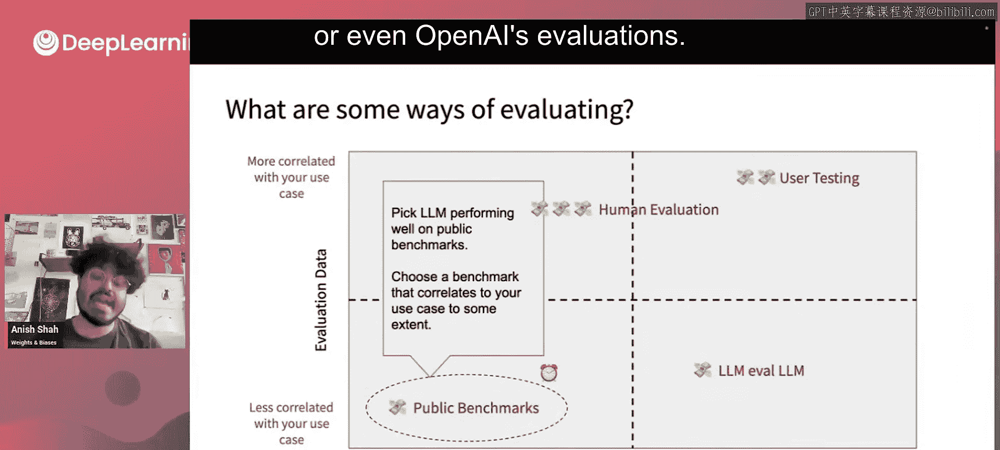

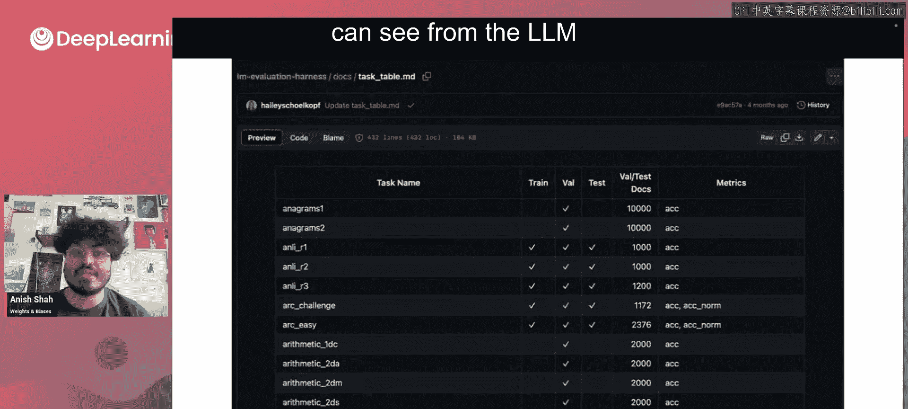

## 评估方法

从评估的角度来看，你可能会收集用户的所有“赞”和“踩”以及向你的应用提出的所有问题，并将其浓缩成一个更小的评估集。

然后，你可能会从这个评估集中选取某些问题，并用它们来实际评估你的模型表现如何。

我们通常将评估集浓缩成更易于处理的形式，然后运行评估。目前流行的两种评估框架是“LLM即法官”和“人在回路”。“LLM即法官”使用LLM来评估其他LLM在诸如“忠实度”（给定文档的答案准确性）和“相关性”（文档对答案的有用性）等指标上的表现。这对于大型语言模型执行评估非常有用。

然后，你还需要最重要的组成部分，即“人在回路”：让专家实际评估答案是否正确，并确保诸如幻觉和超链接等信息确实有效。

我们这样做是为了发现问题，例如知识库中的空白、大型语言模型自身的知识空白，或者幻觉问题——即使提供了正确的上下文，大型语言模型也可能编造某些答案或超链接。

## 传统评估与LLM评估的差异

在传统评估中，我们了解用户如何使用我们的应用。当我说传统机器学习时，我想到的是例如“将这张图片分类为猫或狗”这样的任务，你通常知道与用于训练模型的数据相关的目标分布。

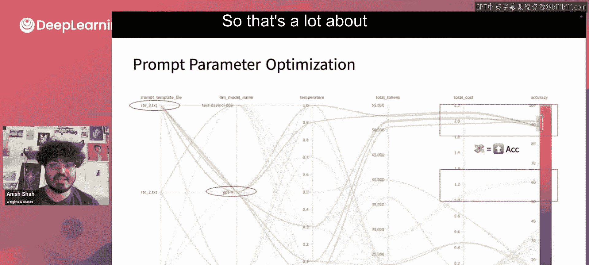

但在大型语言模型的情况下，我们不知道这些信息。我们无法访问跨越整个互联网、规模达TB级的完整预训练数据语料库，我们也不确切知道用户将如何使用我们的聊天机器人。即使是在最近一家著名汽车公司的案例中，我们也看到用户与其聊天机器人的互动方式非常广泛，这完全取决于用户想用这个机器人做什么，无论是恶意的还是与公司查询相关的。

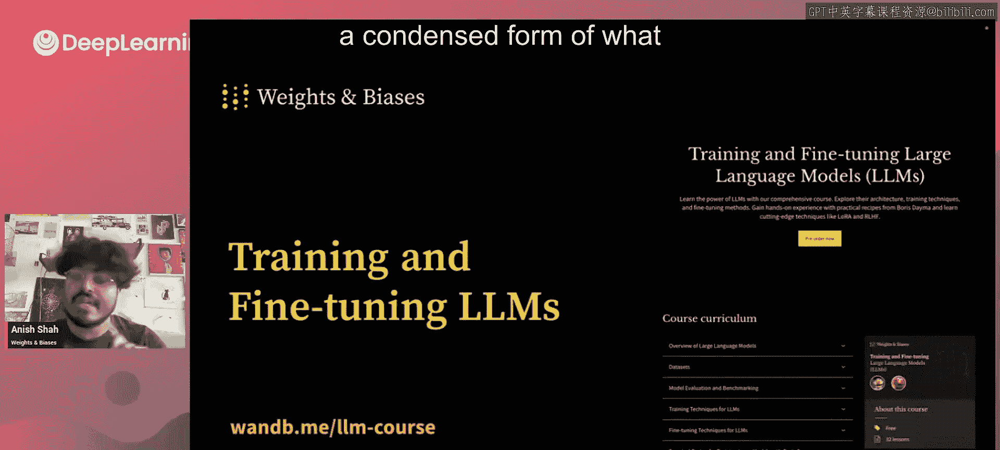

因此，在我们实际发布产品之前，我们无法访问训练分布和用户在产品中的分布，我们必须从不同的框架来对待评估。

## 评估框架

一个非常流行的方法是确保我们的大型语言模型始终在一组预先定义的标准基准测试中表现良好。这些基准测试现在通常被分组在诸如“LLM评估工具链”或OpenAI的评估等工具中。

这是你可以从LLM评估工具链中看到的一些任务的示例。

下一个黄金标准是聘请人员，让了解你的用户分布和训练数据的真实人类和专家坐下来，判断大型语言模型在给定上下文的情况下是否恰当地回答了问题。

然后，最有用但最难收集的是用户测试。此时，你要么与客户紧密合作，要么必须将你的应用发布到世界上，并使用我之前展示的系统来浓缩、隔离并挖掘用户行为，以确保你真正收集到用户在生产环境中如何“破坏”你的聊天机器人的广度和极端情况。

你还可以让大型语言模型评估其他大型语言模型，就像我之前提到的忠实度、准确性和相关性准确性。

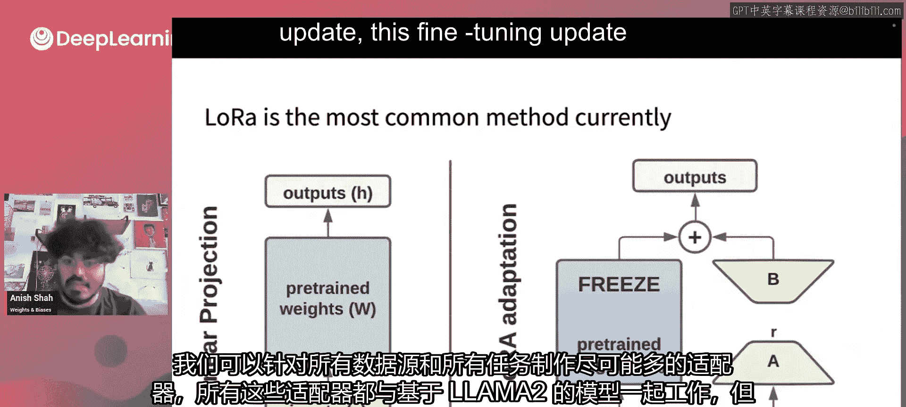

## 三种评估系统

总的来说，这可以分解为我们目前作为个体用户可以尝试评估模型的三种系统。

第一种是直接观察，你从几个例子开始，然后迭代它们，直接从大型语言模型或你的应用的输入和输出中理解，看看大型语言模型回应的答案是否与用户提出的问题相关。这里可以看到一个例子，这是一个Weights & Biases的追踪图，我们可以看到有几个步骤实际上包含了我们如何解决这个文本到SQL问题的过程。我们可以看到有LM链、转换链，而这个LM链使用了OpenAI。如果我们深入查看，我们可以看到传递给LLM的完整用户提示，以及该大型语言模型的响应。我们还可以访问与此模型相关的所有元数据，这个实验是几个月前运行的。因此，在任何时候，如果我们想针对我们的大型语言模型重新运行类似的测试问题集合，我们能够将其与三个月前的更改进行比较。我发现这一点非常重要，因为大型语言模型的更新在闭源模型提供商那里经常发生。

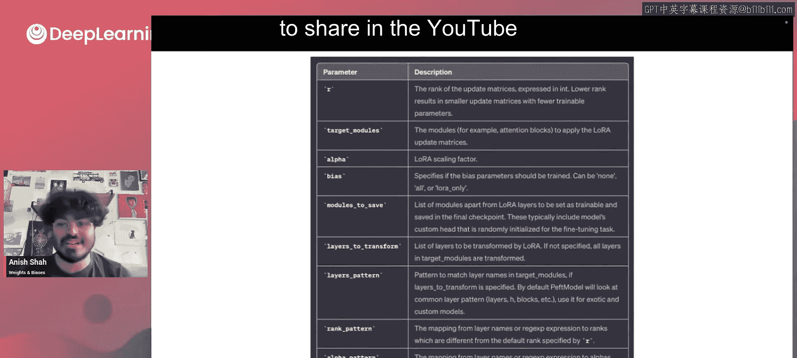

然后，我们有基于监督的方法，我们可能想要做的是，在存在与大型语言模型相关的明确答案的情况下，例如多项选择答案或直接寻找特定的关键短语或单词，像Excel这样的简单表格在这里很有用，因为我们能够汇总预测并理解，嘿，这是我们预测列中所有错误发生的地方，并隔离问题发生的行，或者隔离所有正确答案发生的地方，看看我们模型的思维过程中实际存在的问题在哪里。

这可以在这里看到。我们可能想要深入理解我们模型的所有表达，这里是发布的表达。这里是与此响应相关的所有不同元数据，使用标准的表格操作，例如，真实结果不等于预测结果的情况。这在那种情况下非常有用。现在我们可以看到所有发生的错误，并隔离我的大型语言模型通常在哪些类型的问题上失败。

最后一种是LLM评估其他LLM。在这种情况下，你可能想尝试使用一个LLM来明确评估我们大型语言模型的输出。这在自动化的情况下很有用。例如，在这种情况下，我可能想测试三种不同的提示。我想自动化评分的部分，所以与其有一个直接的分数，我可能在这里有一个LLM关联的分数，并能够针对各种提示模板进行测试。

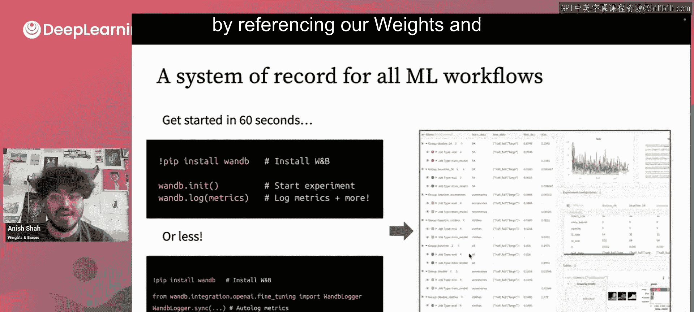

这可以在这里看到类似的东西，我们针对不同的大型语言模型和模板测试不同的嵌入模型，以查看最终的F1分数重叠情况。

所有这些评估都在代码本身中与我们的Weights & Biases日志记录器和Weights & Biases界面一起进行。我们让你非常容易地进行这种超参数搜索或将指标和细节直接保存到仪表板。Weights & Biases是信息的集中记录系统，我很快就会更多地谈到这一点。

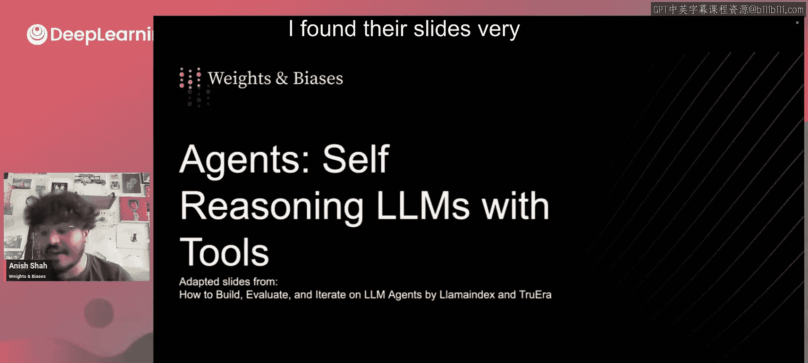

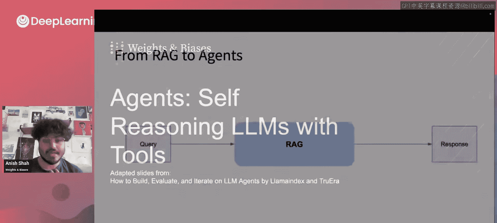

## 从RAG到微调

以上是关于RAG如何工作以及如何评估RAG的很多内容，所有这些都与智能体高度相关。实际上，许多这些评估流程，例如，都在智能体工作流中得到了模仿。但这是我们围绕使用LLM改进流程。实际上，我们想在这种情况下改进我们的LLM。

我们想要做的是实际微调我们的大型语言模型。现在我将展示我们在“微调大型语言模型”课程中所教授内容的浓缩形式。

本质上，我们可能想要微调大型语言模型的原因，除了针对我们数据的特异性（我们的大型语言模型可能缺少某些知识）之外，还为了使它适应我们关心的任务，确保在我们教它纠正错误后，它总能正确回答数学问题。我们真正关心的是，我们也在减少令牌使用。我们仍然生活在一个令牌经济中，每个单词和每个短语传递给大型语言模型都会产生成本。因此，通过直接将这种行为教给我们的大型语言模型来减少提示的复杂性，可以减少我们需要使用的单词数量，并降低与这些单词相关的成本。

## 强化学习与人类反馈

我想快速回顾一下一个花哨的术语：基于人类反馈的强化学习。这个RLHF过程是我们对大型语言模型进行的微调过程，以确保它像人类一样说话。在基线水平上，大型语言模型只会简单地完成与其相关的提示。通过RLHF，我们教会了大型语言模型像人类一样说话和回应，并考虑它被给予的输入文本是什么样的。所有这些都是通过在大型语言模型的训练过程中提供额外数据来完成的，而这些大型语言模型通常是在互联网规模的数据上进行训练的。

## 参数高效微调

这种微调过程不同于RLHF。我们将更多地使用参数高效微调。训练一个大型语言模型既不便宜也不高效，它需要分布在集群上的大量GPU、大量数据和时间。不幸的是，我自己不像谷歌那样的公司，我无法轻易负担或获得这些资源。但我确实拥有的是数据和我之前从RAG应用中评估的用户行为数据，这些数据通常用于理解我的大型语言模型的错误来自哪里。我拥有这些数据，这些数据对我们来说非常强大，不仅因为我们在评估工作中看到了其价值，还在于能够利用这些相同的数据来提高这些大型语言模型的能力。我们正处于这样一个阶段：评估和用户反馈数据可以直接用于改进我们的大型语言模型。

## LoRA技术

我们为此使用LoRA。我不会坐在这里解释LoRA或线性代数的数学之美，但我要说的是，LoRA对我们来说非常有用，因为它允许我们隔离大型语言模型的特定组件，以减少训练模型所需的数据量、时间和GPU资源。

这是因为我们从大量不同的研究中认识到，通过仅选择大型语言模型中非常有用的层，并迭代地改进那些与其思维过程相对应的底层数字，就可以提高这些大型语言模型的行为能力。LoRA在这里很有用，因为它将其视为一个非常巧妙的数学问题：与其让我们直接更新大型语言模型本身（这对我们的用例来说效率低下），不如说它表示我们可以将想要应用于模型的更新视为一组独立的数学矩阵。因为我们可以将这两个问题分开，这些可以应用于原始大型语言模型本身的独立数学矩阵，它们本身比模型小得多，并且计算起来也容易得多。

简单来说，你可以将这个几GB的大型语言模型，微调成一个我们称之为“适配器”的、只有几MB大小的文件。这对我们来说非常有用，因为这个几MB的小文件可以应用到我们的大型语言模型上。这意味着我们不仅可以拥有一个与此大型语言模型配合使用的适配器，还可以拥有一系列适配器。我们可以在所有数据源和所有任务上制作尽可能多的适配器，它们都能与像Llama 2这样的基础模型配合工作，但彼此独立存在。只有当我们需要用特定行为运行Llama 2模型时，我们才需要应用这个在LoRA过程中完成的微调更新。

## LoRA参数

LoRA中有很多有趣的参数需要调整，最有用的特别是`r`，它是你创建的底层矩阵的固有秩。简单来说，调整秩会增加训练的复杂性，但也会增加训练过程本身更新的特异性程度，从而影响在我们已经由大型语言模型生成的错误数据上进行微调时，事物被记住的程度。

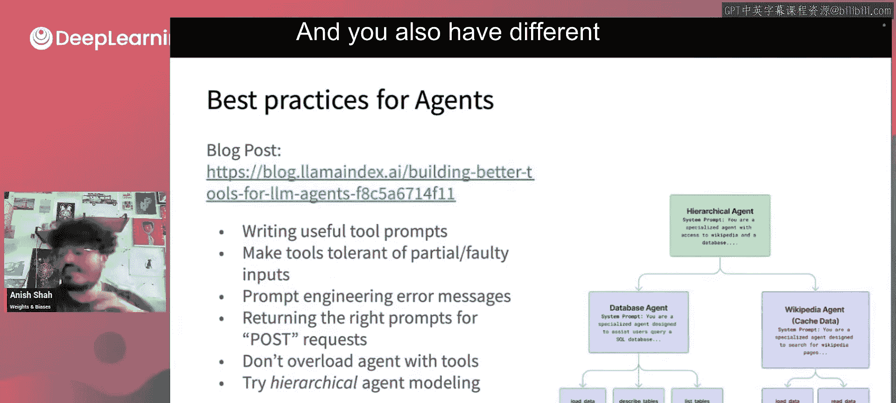

我将把这些参数留待以后研究，幻灯片将会分享。但有一些由PyTorch Lightning团队分享的启发式方法，我建议稍后查看，希望我能在YouTube链接中分享。

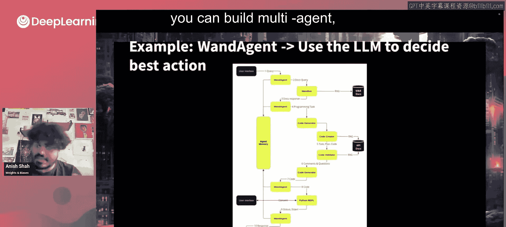

## 其他微调技术

LoRA并不是唯一存在的技术。一个非常直观的技术是提示词微调本身，我们使用大型语言模型来生成解决任务的最佳提示。我们以一种非常机器学习特定的方式来做这件事，实际上我们进行完整的机器学习反向传播过程。但这只是说，有很多有趣的方法可以有效地保持大型语言模型的当前状态不变，并且只提取使大型语言模型更适合我们的用例、更能纠正它之前所犯错误所需的全部知识。

## 数据格式化

为了让评估始终牢记在心，LoRA效果很好，这张图表有效地展示了这一点。为了为LoRA格式化我们的数据，它与你看到的指令微调数据集非常相似。因此，根据你使用的特定模型，你可能需要做的是理解你实际上想要如何格式化你的数据，以便它能够以对你的用户有意义的方式被正确地提示。例如，如果你想将某些东西分类为安全或不安全，你可以看到任务类型“策略”在提示和响应分类中是一致的。当它是安全和不安全时，不同的是这个对话和输出格式。

例如，在低秩适应的情况下，这部分可以有效地为你的建模保持不变。因为你提供给大型语言模型的每个特定数据点，都可以在本质上预先添加任何你希望大型语言模型在意识到“哦，我已经为此任务更新了，这些特定的令牌集合甚至能更好地引导我解决我为之微调的任务”之前就识别出的预设性质。

## Weights & Biases平台

Weights & Biases是一个非常有用的平台，用于集中所有这些信息。许多受欢迎的团队使用我们进行训练和微调，特别是你可以看到我们能够整合所有不同的实验，无论是微调GPT-3.5（我们稍后会做），还是如果你使用像PyTorch Lightning这样的框架直接训练像大型语言模型这样复杂的东西。

使用Weights & Biases实际上非常容易上手，只需几行代码就可以将所有指标、提示或其他你想要的信息存储到我们的平台。如果你使用我们的集成之一，比如在微调OpenAI的情况下，我们有一个集成，可以将所有训练数据同步到仪表板，以及你使用的训练数据的引用和任何输出模型元数据，这样你就可以通过引用我们的Weights & Biases仪表板轻松加载你的微调模型。

我将在屏幕上快速展示一下，只是为了说明我们正在围绕MLOps空间和LLMOps空间直接构建一系列不同的工具。

## 过渡到智能体

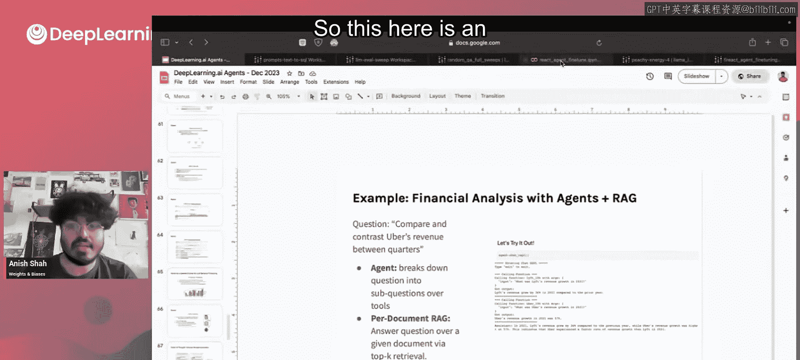

现在让我们进入智能体部分。关于RAG的讨论很有趣，关于微调的讨论也很有趣，看看这两个组件如何关联在一起，我们如何利用传统RAG流程中的错误来提高大型语言模型的整体能力。

但让我们看看智能体如何融入其中，并使能够动态推理我们想要如何解决问题的过程变得更好。

我将实际改编上周来自Llama Index和TruEra团队的演讲幻灯片，他们谈到了如何构建、评估和迭代LLM智能体。我发现他们的幻灯片非常有用，所以我现在将在这里简要展示它们。

## 智能体的作用

总的来说，我们现在所做的是预先构建了用户与大型语言模型交互的行为方式，即通过RAG。我们预先编写了模板，预先设置了所有数据库，所以RAG将始终具有一致的行为。

但问题是，在用户的应用变得因任务、用例和行为而异的情况下，我们已经预先规定了所有这些行为。这种类似RAG的行为和这种预先规定的行为就更容易被打破。

我们为一个级别的RAG使用的提示可能并不适合每一次用户交互。

因此，我们转而使用智能体，有效地作为我们查询的路由器，能够动态理解用户查询的核心本质，然后决定采取哪种适当的行动。在这种情况下，智能体可能决定我们的RAG流程是解决这个传入用户查询的最佳方法。

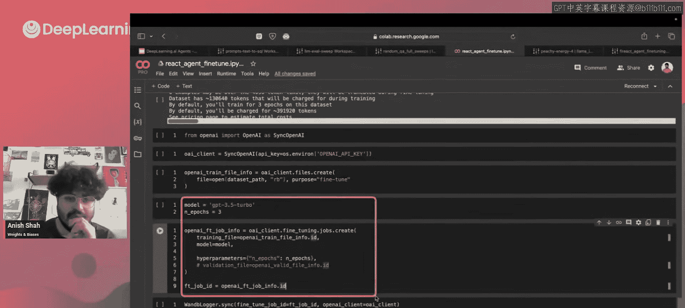

## 智能体的形式

智能体有几种形式。一种非常有用的形式是专门的数据智能体，它类似于检索，但它可以访问实时信息。在智能体类似于人类的情况下，一旦我们理解了如何正确使用工具，我们就进化了。工具使用对智能体非常有用，因为工具在我们的情况下可以是任何函数。

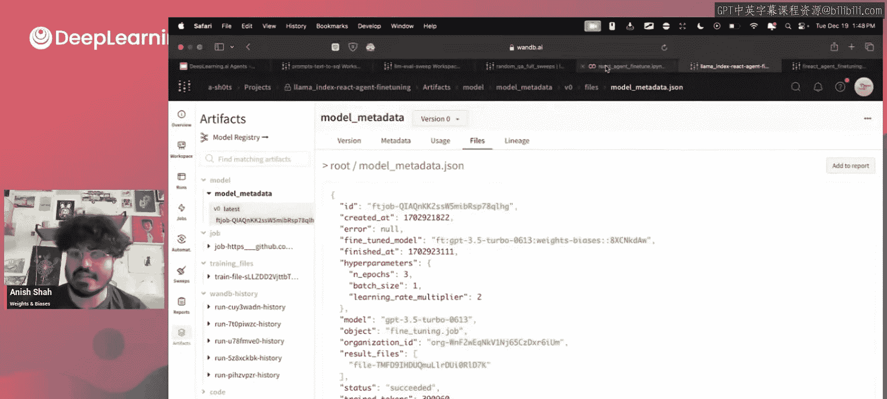

它实际上也可以是任何API调用。例如，我可以让我的大型语言模型理解它缺少某些信息，并像我们一样理解我们需要去谷歌搜索。

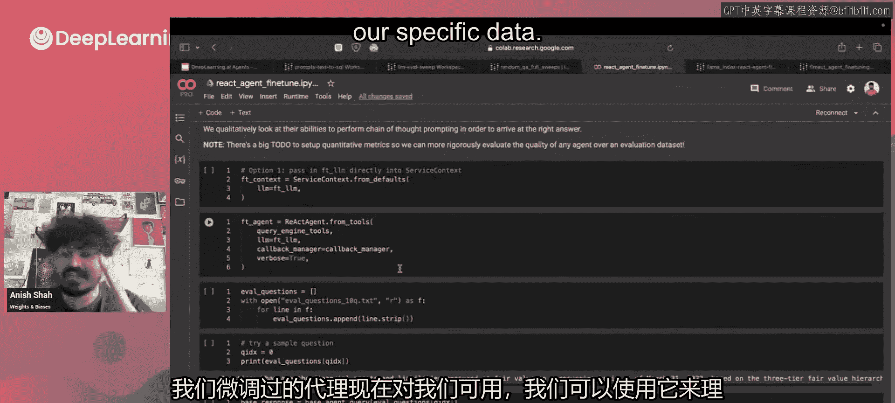

然后它去谷歌搜索前三个合适的响应。也许对我们中的一些人来说，它可能只是阅读标题中显示的小片段，并使用该信息来制定响应。智能体不仅可以访问数据，还可以访问多个工具本身。所以也许可以访问谷歌和你的日历，以及预订航班的能力，以非常有用且范围广泛的方式执行操作的能力。因此，不仅能够获取信息并返回响应，还能获取信息并执行有助于我们其他工作流的操作，例如，一旦查询到最便宜的航班是什么，就确保它有权在我们的账户上预订。

## 数据智能体的工作流

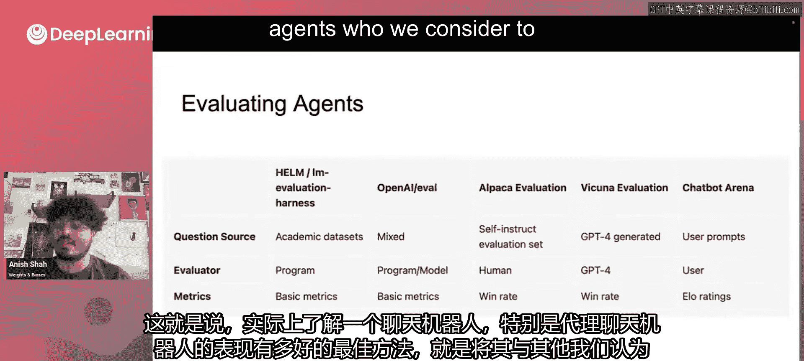

正如我之前提到的，数据智能体可能希望从许多不同的来源读取信息，甚至可能是迭代式的，可能希望分几个步骤分析一个文件，然后将其输出发布到世界。在这种情况下，我们可能会阅读最近的电子邮件，检索与电子邮件和用户提出的问题相关的上下文，分析适当的文件，无论是一个还是五个，并继续分析这些文件，直到满足停止标准。

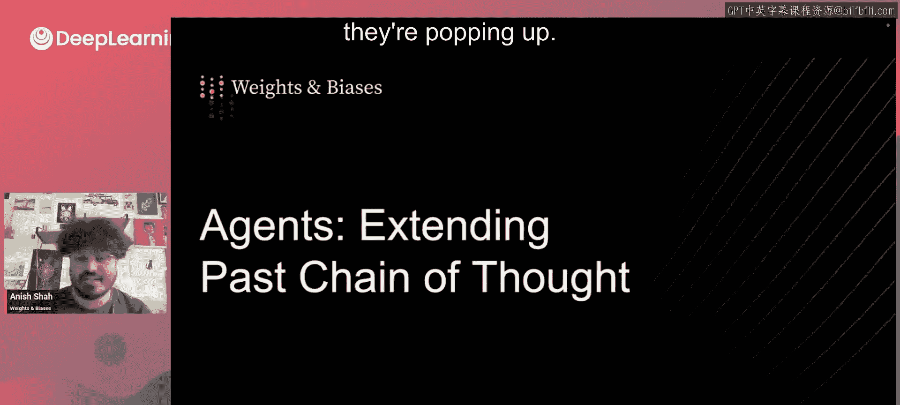

制定一个响应，并将该响应发送回我的Slack频道，例如。

这就是智能体的全部广度和力量，但在我们的智能体进行的每一次不同的交互中，都有一个可能发生故障的点。它可能在阅读最新电子邮件时失败，可能在检索上下文时失败，可能在迭代分析文件的过程中失败，也可能在为我们适当地发送Slack消息时失败。

## 智能体的通用形式

我之前展示的内容的一个更通用的形式可以在这里看到，你有一个智能体。给定一条消息，智能体能够决定是否要使用RAG流程、预订机票或发送Slack消息。但另一个有用的外部部分是它能够访问记忆，所以在智能体决策的完整序列中，它有一个便签本可以查看，说，好的，在这一点上，我已经阅读了电子邮件，我已经检索了上下文，现在下一步是什么，智能体可以问自己，因为它持续与工具及其自身的记忆交互，就像我们人类一样。

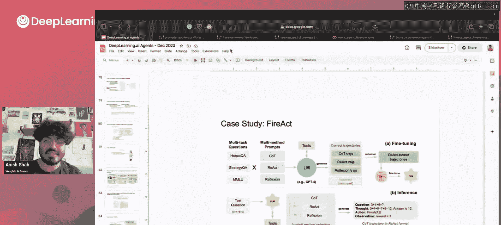

## RAG作为工具

回到之前展示的RAG流程，RAG本身只是一个工具。它是一个工具，我们预先规定了某种类型的用户问题应如何回答以及答案如何与数据库相关联。在这个具体的例子中，我们可能有一个与某些数字相关的数据库。也许是关于Uber的一些数字？但与其让我们说，嘿，总是读取这两个数据库并将其作为响应提供给大型语言模型，我们更希望发生的是，我们希望我们的智能体理解我们的问题可能是类似于“比较Lift和Uber的财务状况”这样的内容，它将决定选择这两个数据库作为数据源，然后将其传递给我们的RAG流程的其余部分，例如。因此，它能够动态选择哪些数据是合适的，并且动态选择这些数据应该传递到哪个特定的工作流以获得正确答案。

## 智能体的失败点

那么，智能体可能发生故障的地方在哪里呢？在工具使用的任何时刻，无论是选择正确的数据库还是预订航班，它都可能选择错误的工具。它可能会说，哦，与其预订航班，我可能想更多地谷歌搜索，陷入无限循环地反复谷歌搜索价格，而不是执行我们实际想要做的完整操作，即为我们预订航班。这就是错误路径的情况，没有选择正确的数据库或正确的预订工具。

我们还遇到了无限循环的问题，它可能对自己说找不到答案，所以不断地反复谷歌搜索，没有意识到在其记忆便签本中，谷歌返回了一个特定的答案，实际上解决了我们想要的答案。它太忙于查看其完整的记忆和所有不同的尝试，并意识到正确的答案在这个过程中丢失了。

我们还有失败的API调用，可能在某个环节，服务被关闭了，而智能体没有意识到这一点，会不断地向一个失效的服务发送API请求，陷入我们之前提到的错误路径和无限循环问题。

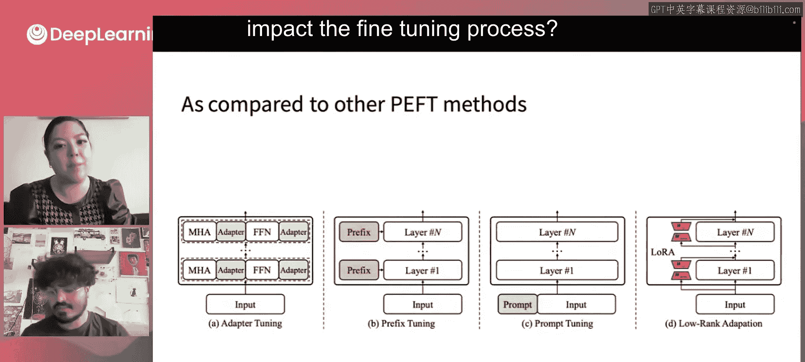

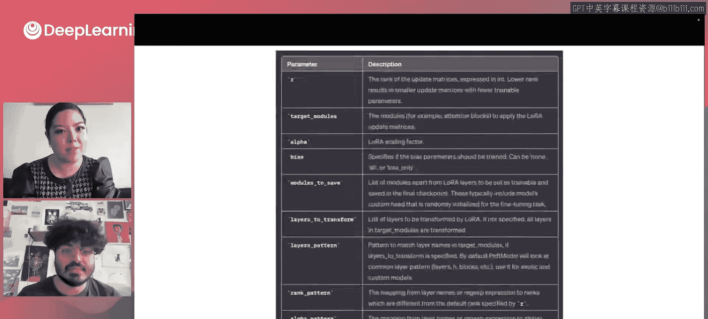

最后，最重要的一点是，智能体可能只是编造东西。鉴于完整的上下文和前面提到的所有问题，它可能会说，好吧，我无法访问我需要的工具，我无法从数据库中适当地提取数据，我也不知道该把它放在哪里，作为LLM，我只会编造一个看起来正确的答案。这就是我们看到许多故障和错误发生的地方，不仅在于大型语言模型在内部选择正确工具和组件的能力，还在于返回一个针对用户问题的适当响应。

## 评估方法依然重要

这就是为什么我之前在RAG部分提到的所有评估方法仍然都适用。你仍然需要检查运行此智能体背后的大型语言模型的相关性和事实性，但你也需要确保你有适当的评估任务。

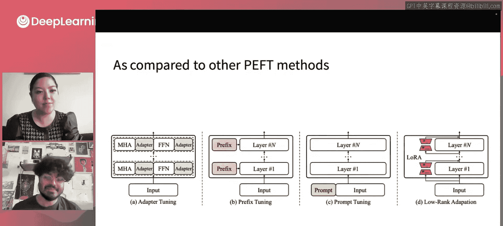

例如，在LLM评估工具链的情况下，你要确保每次改进智能体或从RAG转向智能体