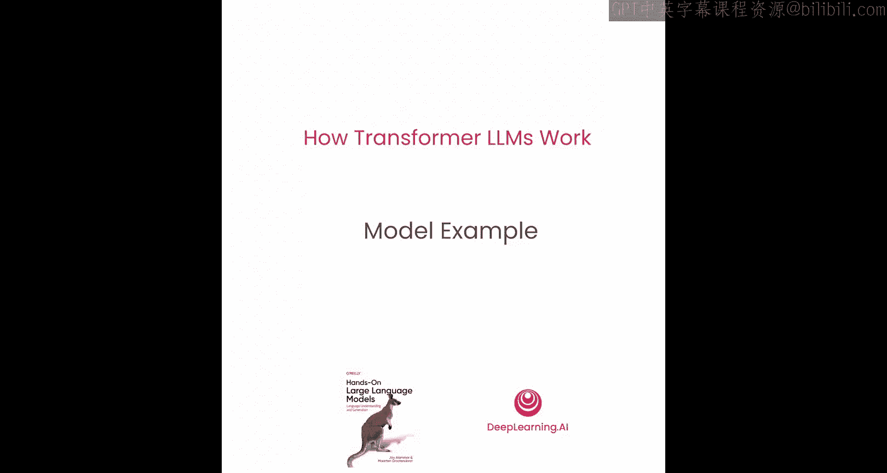
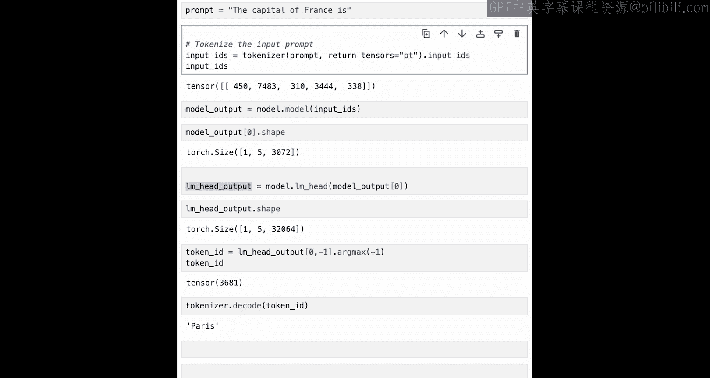
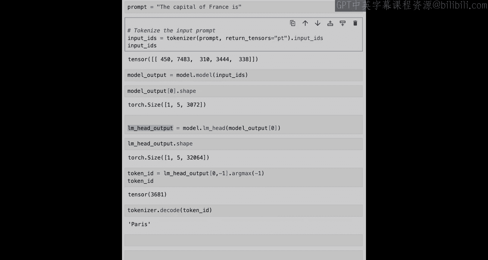

# Transformer大语言模型工作原理：10：模型示例 🧠



在本节课中，我们将通过一个具体的代码示例，探索Transformer模型的架构。我们将使用Hugging Face Transformers库来加载一个语言模型，并观察从输入文本到模型生成输出的完整流程。这有助于巩固我们之前学到的所有组件知识。


---

## 模型与分词器加载

上一节我们介绍了Transformer的各个组件，本节中我们来看看如何用代码实际使用一个模型。

首先，我们需要加载一个预训练的语言模型及其对应的分词器。这里我们以Phi3 Mini模型为例。

```python
# 导入必要的库并忽略一些警告
import warnings
warnings.filterwarnings('ignore')

from transformers import AutoModelForCausalLM, AutoTokenizer, pipeline

# 加载模型和分词器
model_name = "microsoft/phi-3-mini-4k-instruct"
tokenizer = AutoTokenizer.from_pretrained(model_name)
model = AutoModelForCausalLM.from_pretrained(model_name)
```

加载完成后，我们可以定义一个Hugging Face的`pipeline`。这是一个代码抽象层，能让我们更轻松地使用LLM生成文本。

```python
# 定义文本生成管道
text_generation_pipeline = pipeline(
    "text-generation",
    model=model,
    tokenizer=tokenizer,
    max_new_tokens=50,        # 生成50个新令牌
    do_sample=False           # 使用贪婪解码（相当于温度=0）
)
```

`do_sample=False`参数意味着我们使用贪婪解码。正如我们之前所学，模型会为每个输出令牌计算概率，并选择概率最高的那个令牌。

---

## 生成第一个输出

现在，我们可以声明一个提示词并将其传递给模型进行处理。

```python
# 定义提示词
prompt = "Write an email apologizing to Sarah for the tragic gardening mishap. Explain how it happened."

# 将提示词传递给管道以生成文本
generated_output = text_generation_pipeline(prompt)
print(generated_output[0]['generated_text'])
```

模型处理这个提示词并生成输出。输出结果可能如下：

> “Email to Sarah, Subject: Apology for the Gardening Incident...（邮件正文）...”

模型生成了大约50个令牌，并在最后一个令牌中间停止。你可以尝试修改提示词，观察模型的不同响应。在CPU上运行可能需要一些时间，这也是工业界通常使用优化过的GPU并关注生成效率的原因。

---

## 探索模型架构

许多用户可能只通过聊天界面使用过语言模型。如果你第一次通过代码生成文本，那么恭喜你，你现在对这些模型有了更深的理解。如果你之前见过，接下来我们将展示Hugging Face库让你能做的几件很酷的事情，特别是理解模型的层次结构。

加载模型后，我们可以直接打印它以查看其架构。

```python
# 打印模型结构
print(model)
```

输出会显示模型的层次结构。对于Phi-3这样的因果语言模型（即自回归解码器模型），其注意力机制只关注前面的令牌。

以下是模型结构的关键部分：
*   **模型类型**：`Phi3ForCausalLM`，用于因果语言建模。
*   **主要组件**：
    1.  **模型主体**：包含所有Transformer块（层）。
    2.  **词嵌入层**：令牌矩阵。该模型的词汇表包含32000个令牌，模型维度是3072。
    3.  **Transformer解码器层**：共有32层。每一层都包含：
        *   **自注意力机制**
        *   **旋转位置编码**
        *   **多层感知机**：即前馈神经网络。它将维度投影到更高的16000维，然后再投影回3072维。
        *   **激活函数**和**层归一化**
    4.  **语言建模头**：在模型末端。它接收最终的3072维向量，并为词汇表中的每个令牌输出一个分数。

---

## 访问模型内部

Hugging Face允许我们深入访问模型的各个层和矩阵。

```python
# 访问嵌入层矩阵
embedding_matrix = model.model.embed_tokens.weight
print(f"嵌入层形状: {embedding_matrix.shape}")  # 应为 (vocab_size, model_dim)

# 访问第一个Transformer块
first_transformer_block = model.model.layers[0]
print(first_transformer_block)
```

通过这种方式，你可以查看每一层的输入输出尺寸，甚至可以访问实际的权重矩阵。

---

## 分步观察处理流程

让我们回到文本生成，但这次不用`pipeline`，而是分步观察信息是如何被处理的。`pipeline`为我们抽象了一些步骤，现在我们来手动看看其中的机制。

首先，对提示词进行分词。

```python
# 手动分词
prompt = "The capital of France is"
inputs = tokenizer(prompt, return_tensors="pt")
input_ids = inputs["input_ids"]
print("分词后的输入ID:", input_ids)
print("解码回文本:", tokenizer.decode(input_ids[0]))
```

分词器将文本字符串“The capital of France is”转换为一系列令牌ID，例如 `[token_1, token_2, token_3, token_4, token_5]`。模型只看到这些数字列表。

接下来，将这些ID输入到模型的主体部分（不经过语言建模头），即流经堆叠的Transformer块。

```python
# 将输入传递给模型（仅通过Transformer块）
with torch.no_grad():
    transformer_output = model.model(input_ids)
print("Transformer块输出形状:", transformer_output.last_hidden_state.shape)
```

输出形状可能是 `(1, 5, 3072)`。
*   `1`：批处理维度（我们只输入了一个文本）。
*   `5`：序列中的令牌数量。
*   `3072`：每个输出向量的维度（模型维度）。

你可以将其想象为我们之前见过的可视化图表：每个令牌对应一个3072维的向量，5个令牌就构成了这个矩阵。

然后，我们可以将这个输出独立地传递给语言建模头。

```python
# 将Transformer输出传递给语言建模头
lm_head_output = model.lm_head(transformer_output.last_hidden_state)
print("语言建模头输出形状:", lm_head_output.shape)  # 应为 (1, 5, 32000)
```

现在形状变为 `(1, 5, 32000)`。32000就是词汇表大小，这些是每个位置上对所有可能令牌的预测分数。

要得到模型为这个提示词生成的下一个令牌，我们取最后一个令牌位置的分数，并选择分数最高的那个ID。

```python
# 获取下一个令牌的预测（贪婪解码）
next_token_scores = lm_head_output[0, -1, :]  # 取序列中最后一个令牌的分数
next_token_id = torch.argmax(next_token_scores).item()
print("预测的下一个令牌ID:", next_token_id)
print("解码为文本:", tokenizer.decode([next_token_id]))
```

运行后，模型预测的下一个令牌ID可能是 `3681`，解码回文本就是 **“Paris”**。

---

## 总结与思考

本节课中我们一起学习了如何通过Hugging Face Transformers库实际操作一个Transformer语言模型。我们：

1.  **加载了模型和分词器**，并设置了文本生成管道。
2.  **生成了文本**，观察了从提示词到完整回复的流程。
3.  **探索了模型架构**，理解了其层次结构，包括嵌入层、32个Transformer解码块和语言建模头。
4.  **分步剖析了生成过程**：从文本分词为ID，到通过Transformer块获取隐藏状态，最后经语言建模头得到预测令牌。

这个过程揭示了两件引人深思的事：
1.  这个软件（模型）能够编码关于世界的复杂信息，并可以运行在你的电脑或手机上。
2.  模型从未真正“看到”人类语言。它只处理令牌ID列表（数字），也只输出ID列表。它接触的一切都是“令牌编号xxx”。语言模型以这种方式运作，它们并非以人类的方式理解语言，而是通过令牌索引的列表进行推理。





这让我们对Transformer大语言模型的工作原理有了更具体、更深入的认识。在下一课中，我们将探讨大语言模型的其他近期改进。