# Transformer大语言模型工作原理：11：现代改进 🚀

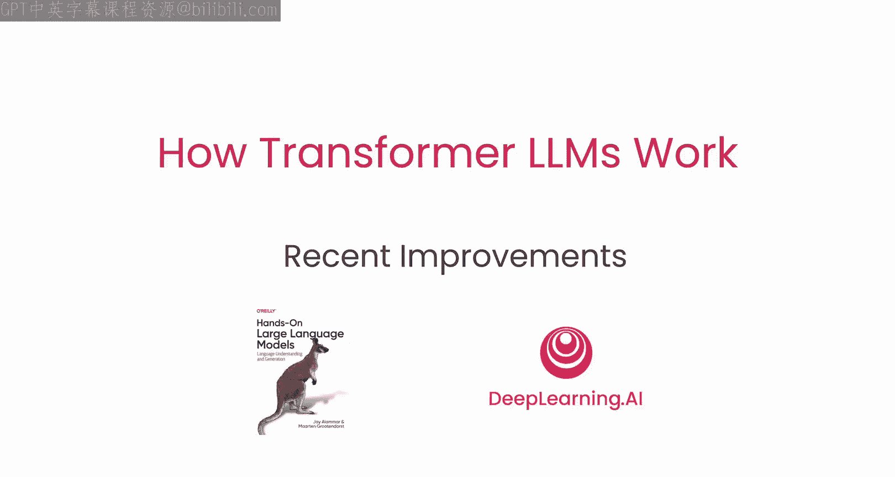

在本节课中，我们将探讨Transformer大语言模型的基本工作原理之后，现代模型所采用的一些关键改进技术。我们将了解模型架构的演变、更高效的位置编码方法，以及混合专家模型等新概念。

## 从原始Transformer到现代架构 🔄

上一节我们介绍了Transformer解码器的基本工作原理。本节中，我们来看看现代模型架构与2017年原始论文中的设计有何不同。

下图展示了原始Transformer解码器的简化视图。输入提示中的单词被切分成**词元**，并转换为**向量**。由于模型需要理解词序，因此需要通过**位置编码**为这些向量添加位置信息。否则，模型会将输入视为无序的词袋。

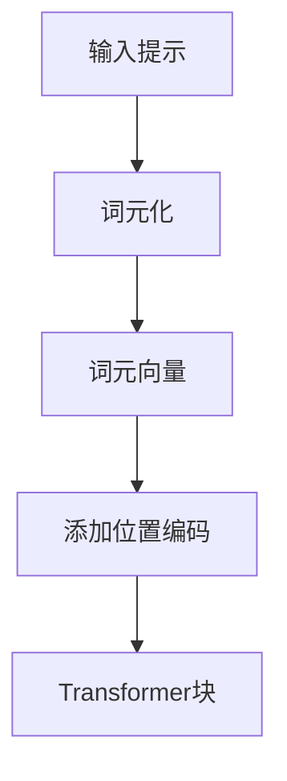

右侧的图源自原始Transformer论文。需要指出的是，原始模型是一个**编码器-解码器模型**，包含图中所示的编码器和解码器组件。然而，目前存在的大多数大语言模型主要是**解码器模型**，没有这个编码器组件。

我们主要关注的正是这些解码器块，它们解释了您所交互的绝大多数语言模型的构建和运行方式。虽然仍有一些编码器-解码器模型存在，但主流的文本生成大语言模型都是解码器模型。编码器模型则用于像BERT这类模型中，执行文本嵌入、重排序等不一定需要文本生成的NLP任务。

## 架构演变：关键改进点 ⚙️

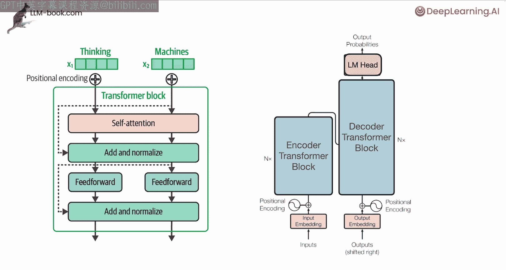

如果将原始Transformer块与现代（2024年）的Transformer块并置比较，会发现它们非常接近，但也存在一些重要变化。

以下是现代架构的主要改进：

1.  **位置编码的演变**：位置信息不再在模型处理的初始步骤添加。现代模型使用**旋转位置编码**，在自注意力层级别添加位置信息。
2.  **层归一化的位置**：层归一化移到了自注意力和前馈神经网络层之前。一些实验结果表明，这种设置能使模型表现更好。
3.  **注意力机制的进化**：模型使用**分组查询注意力**作为自注意力机制。我们之前讨论过自注意力机制的演变。
4.  **残差连接**：无论是原始Transformer还是当前模型，都保留了**残差连接**。这些连接环绕各层，将信息从层的开始重新打包并添加回表示中，这一点至关重要。

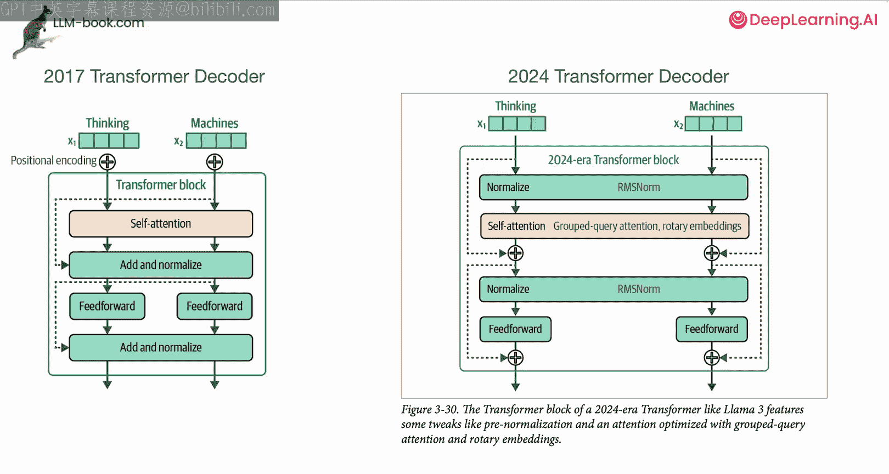

## 深入理解旋转位置编码 🔄

为了理解旋转位置编码，我们需要先简要讨论一下训练过程。

大语言模型的训练分为多个步骤。第一步是**基础训练**，即下一个词预测任务，这也就是它们被称为“语言模型”的原因。

在训练时，我们以批次的方式处理数据。假设训练一个上下文长度为16K的模型，单个文档或许多短文档可能无法填满这个空间。因此，需要添加**填充**。

最初可能想到的简单方法是，每个批次行对应一个文档，上下文的大部分都是未使用的填充。这是一种低效的数据打包方式。

实际上，更高效的训练数据打包方式如下图所示：将多个短文档打包到一个批次行中。这样填充更少，能更充分地利用计算资源，因为GPU无论处理的是文档还是填充，都会进行运算。

这种训练方式也对架构，特别是位置编码，产生了影响。

在静态位置编码方法中，可以为第一个词元分配一个始终表示“这是位置一”的位置向量，依此类推。这些方法可以是学习得到的，也可以是算法生成的（例如使用正弦和余弦的组合），模型会逐渐学习到向量中的这类信息表示词元在上下文中的位置。

然而，当使用高效打包方式训练时（例如处理批次中的第二个文档），模型需要一种位置编码方法，能够表明“这是文档二的第一个词元”，而不是简单地累加之前的所有词元计数。这就是为什么许多新模型采用像旋转位置编码这类更动态方法的部分原因。

旋转位置编码将位置信息添加在每个Transformer块的**自注意力层**。具体来说，是在自注意力两个步骤中的第一步——相关性评分步骤之前。它通过一种公式将位置信息添加到**查询向量**和**键向量**中。因此，这些向量包含了表示先后顺序的位置信息，而这是左侧集合（未添加前）所没有的。

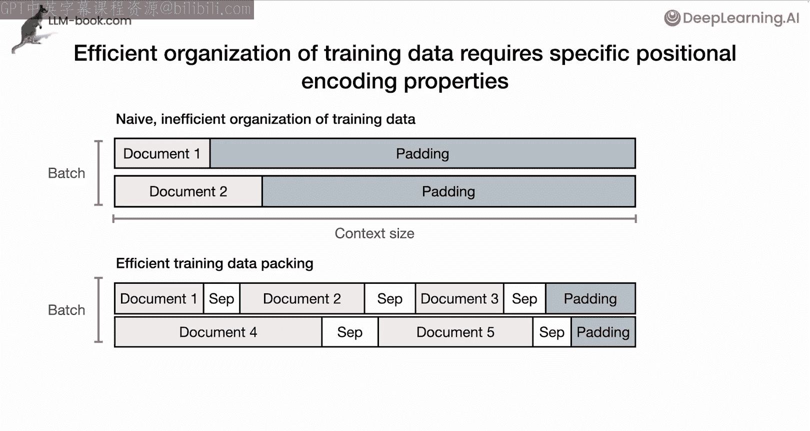

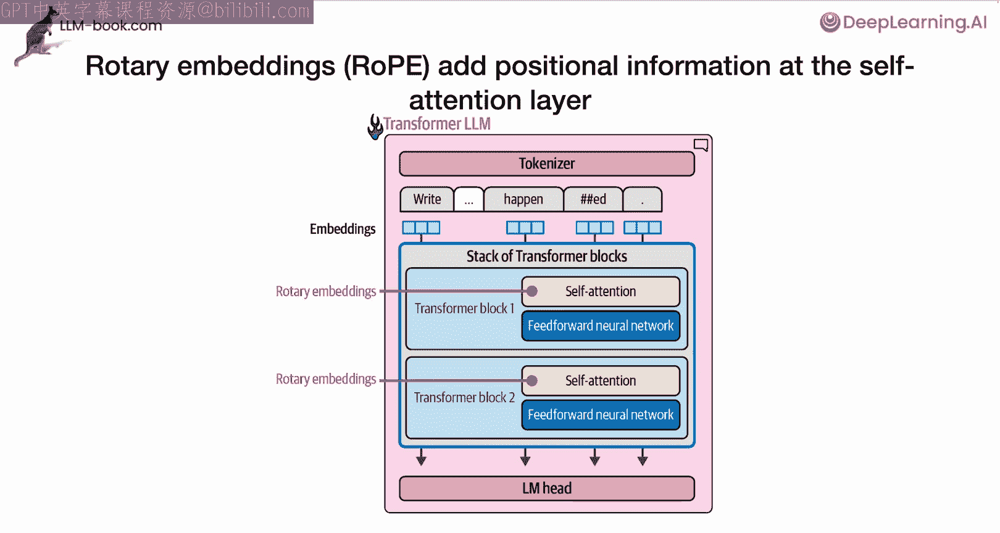

## 混合专家模型：提升质量的新途径 🧠

您可能遇到的另一个近期发展是**混合专家**的概念。这是一种使用多个子模型来提升大语言模型质量的方法。

需要明确的是，并非所有大语言模型都变成了混合专家模型。您可以将其视为Transformer语言模型的一个变体，而不是替代我们目前课程中介绍的这些密集模型。

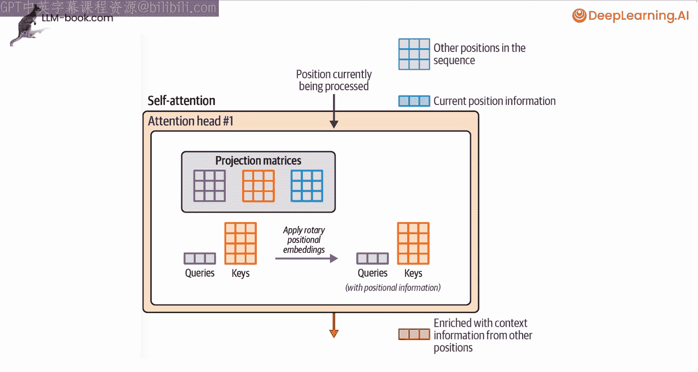

混合专家模型的核心思想是：在每一层中，都有多个子神经网络，每个子网络被称为一个**专家**。同时，每一层还有一个**路由器**，负责决定应该由哪些专家来处理当前的词元或向量。

以下是关于混合专家模型的一些关键直觉：

*   不要将每个专家视为一个单一的整体组件。**每一层都有自己的一组专家**。
*   这些专家并非专门针对特定领域（如心理学专家或生物学专家）。相反，它们可能倾向于关注特定类型的词元（如标点符号或动词），并专注于如何最好地处理它们。
*   在使用混合专家模型时，一个词元不会被固定分配给某一个专家。例如，在**第一层**可能被分配给专家A，而在**第二层**可能使用专家C或D。这种路由发生在每一层，每一层都会将信息路由到该层合适的专家。
*   存在不同的使用方法，例如，每一层可能将信息路由到两个不同的专家，然后将两者的信息合并回来。

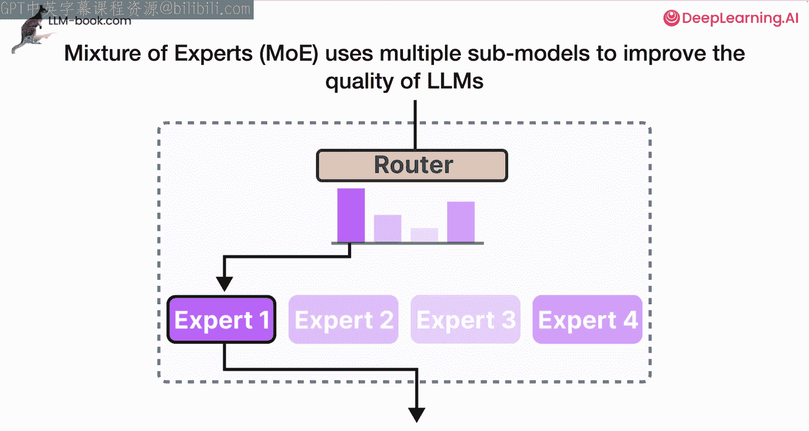

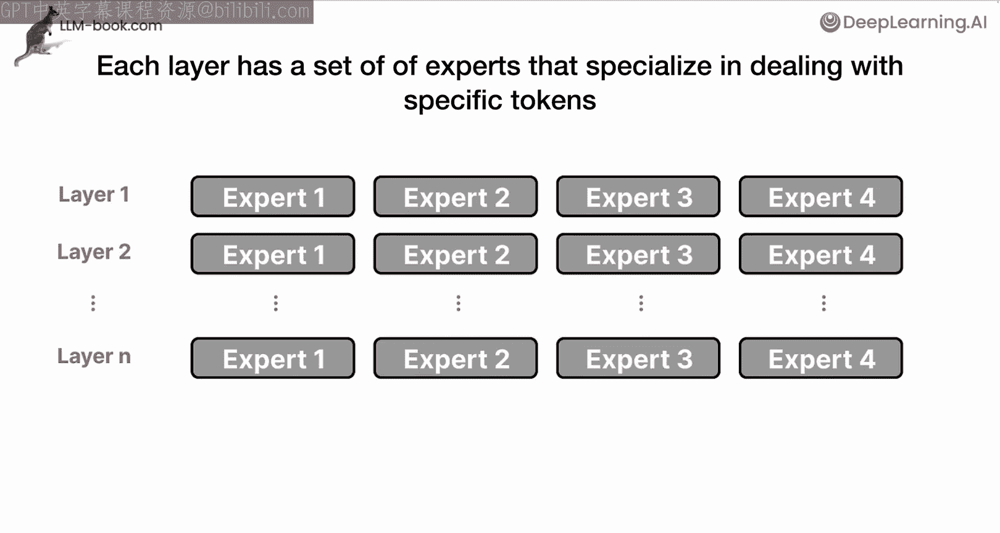

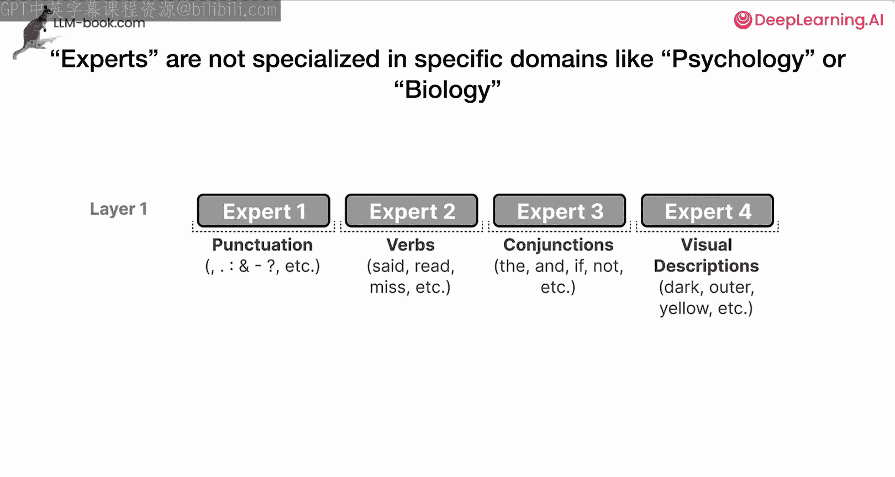

从结构上看，混合专家层是**前馈神经网络**的一部分。在这里，您会有多个这样的网络，每个都被称为一个专家。除了这些专家，混合专家层还有这个**路由器**，它本质上是一个分类器，针对当前这类词元，判断哪个专家最适合处理它。

您可以将其视为一个分类得分：路由器判定，为了处理这个词元，某个专家将能最好地完成这项工作。然后，前馈神经网络的处理就应用于这个词元，完成该层的处理步骤。

本节课是对混合专家模型的高层次概览，下一课我们将更深入地探讨它们的工作原理。

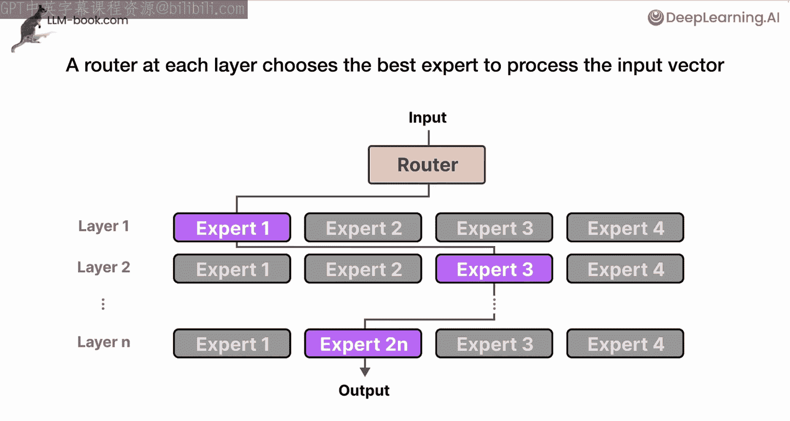

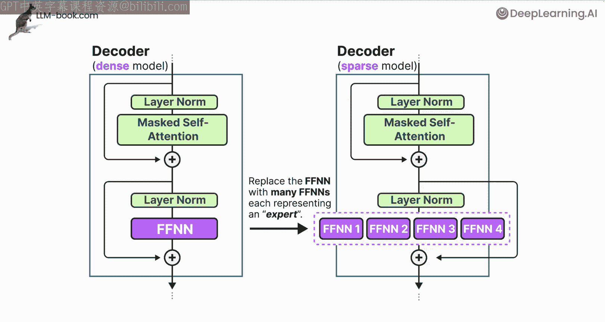

## 总结 📝

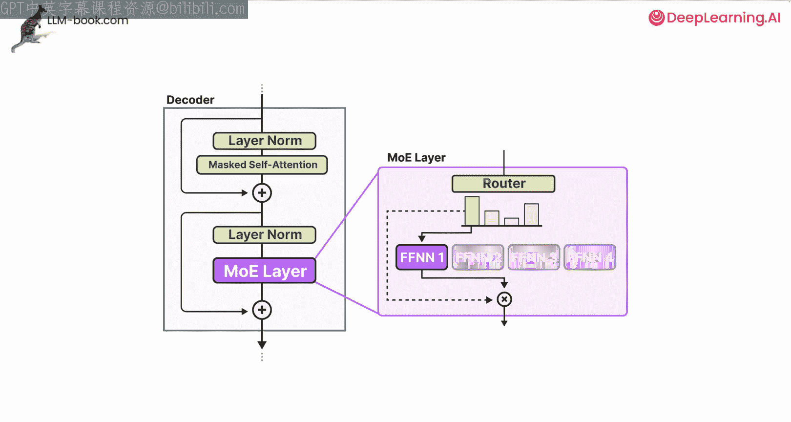

本节课我们一起学习了Transformer大语言模型的现代改进。我们回顾了从原始编码器-解码器架构到现代主流解码器模型的演变，探讨了**旋转位置编码**如何更动态、高效地处理序列位置信息，并初步了解了**混合专家模型**这一通过路由机制激活不同子网络来提升模型性能与效率的新范式。这些改进共同推动了大语言模型能力边界的不断扩展。