# Transformer大语言模型工作原理：12：混合专家模型 (MoE)

在本节课中，我们将学习Transformer大语言模型的一项重要改进技术——混合专家模型。我们将了解其核心组件、工作原理以及它如何影响模型的性能和资源消耗。

## 概述

混合专家模型是对Transformer架构的一种激动人心的改进。这项技术通过引入动态选择的“专家”来扩展Transformer模型。本节我们将重点学习它的两个主要组成部分：专家和路由器。

## 回顾Transformer解码器块

在深入探讨混合专家模型之前，我们先简要回顾一下Transformer解码器块的工作原理。

解码器的输入通常是代表输入词元的几个向量。这些向量首先经过层归一化处理，然后传递给注意力机制。

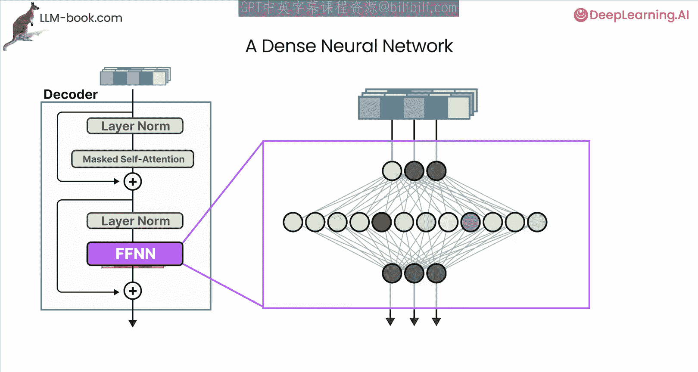

注意力机制对输入应用掩码自注意力，根据每个词元在所有其他词元上下文中的相对重要性进行加权。这个输出与未经处理的输入聚合在一起，形成直接和间接两条路径。这是Transformer模型中最重要的组件之一，它让向量中存储了更多的上下文信息。

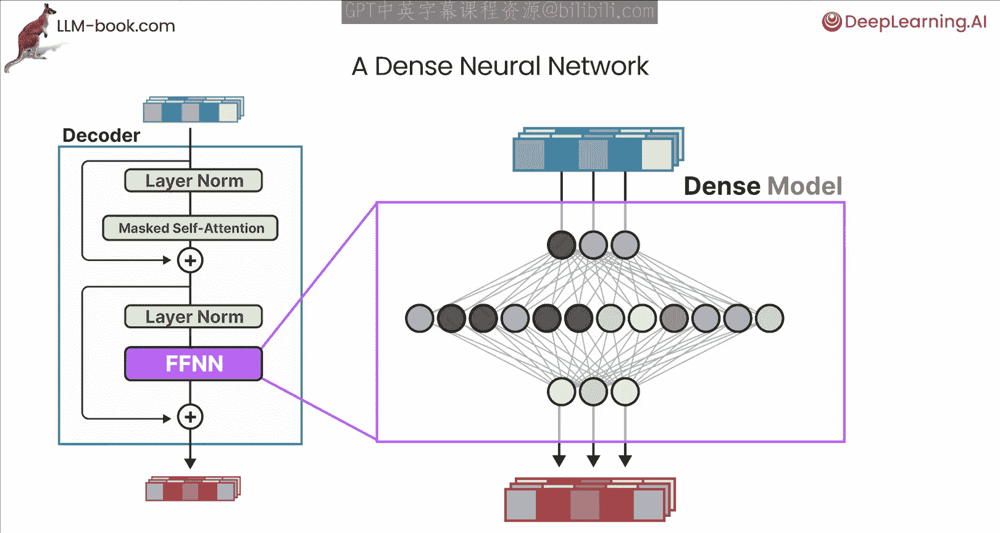

接着，数据再次经过层归一化，然后由一个前馈神经网络处理。这个网络通常是语言模型中最大的组件之一，因为它试图在注意力机制处理过的信息中找到复杂的关系。

前馈神经网络通过一个或多个隐藏层处理输入。这被称为**密集网络**，因为网络的所有参数都会被激活并使用。

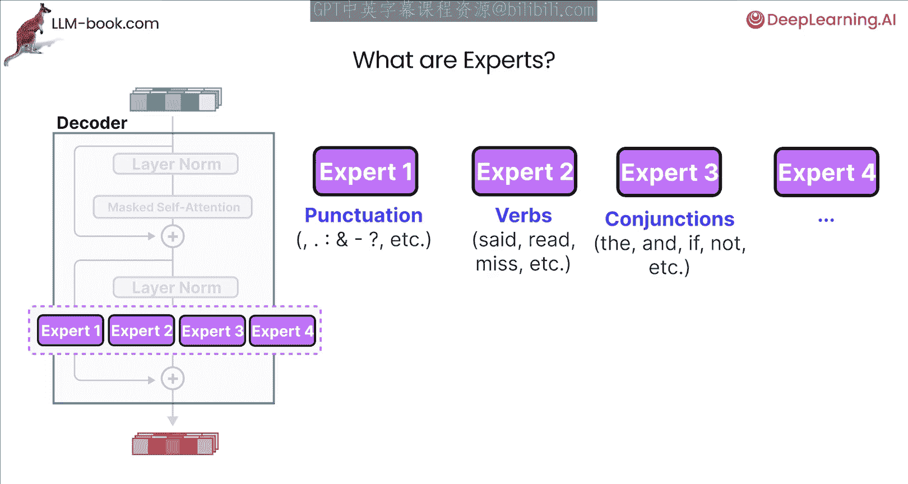

## 混合专家模型的核心思想

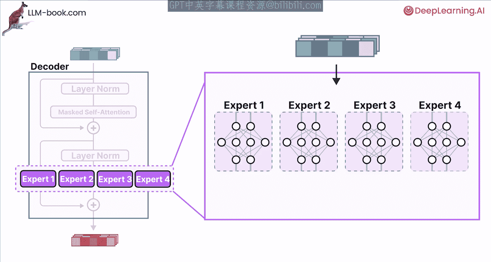

混合专家模型是一种与前馈神经网络相关的技术。它不再使用单一的网络，而是拥有多个可供选择的网络，每个网络被称为一个“专家”。

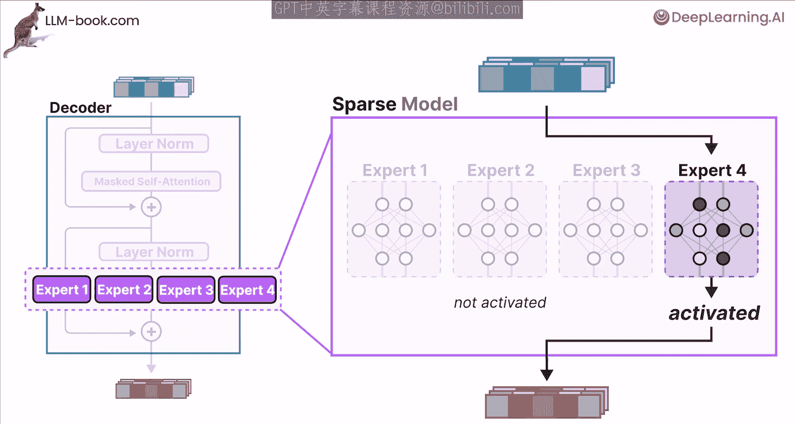

需要注意的是，这里的“专家”并非指专门研究心理学或生物学等特定领域的专家。它最多是在词元级别学习句法信息，例如标点符号、动词和连词。

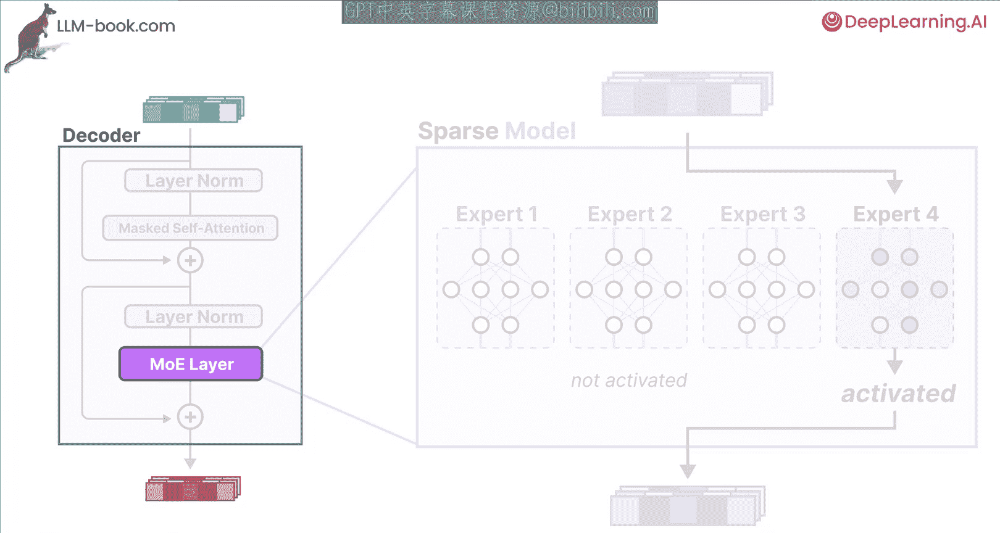

## MoE层的构成

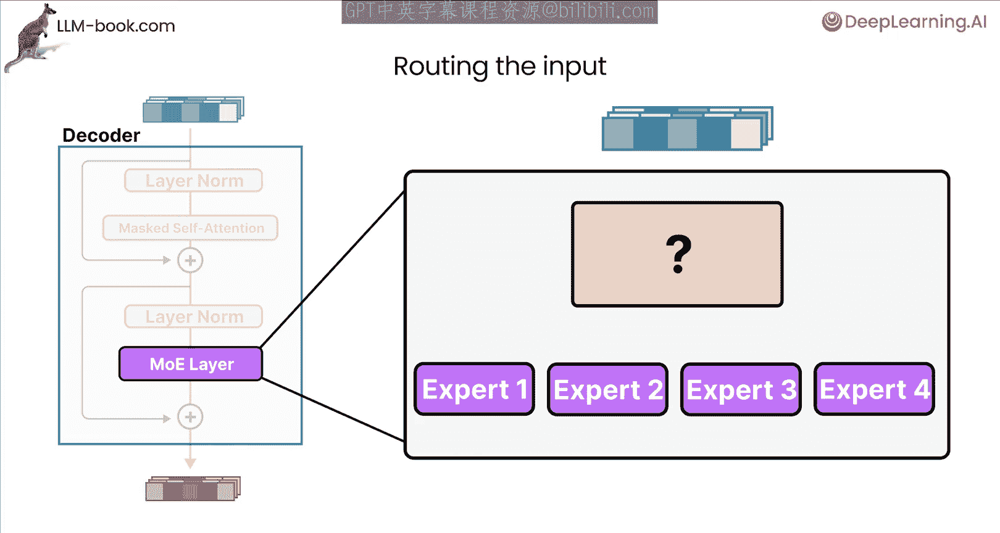

现在，单一的前馈神经网络由四个网络组成，每个都称为一个专家。当输入流经这个专家层时，会选择一个或多个专家来处理输入。这会使其他专家处于未激活状态，因此这被称为**稀疏模型**，因为在任何给定时间只激活一部分专家。

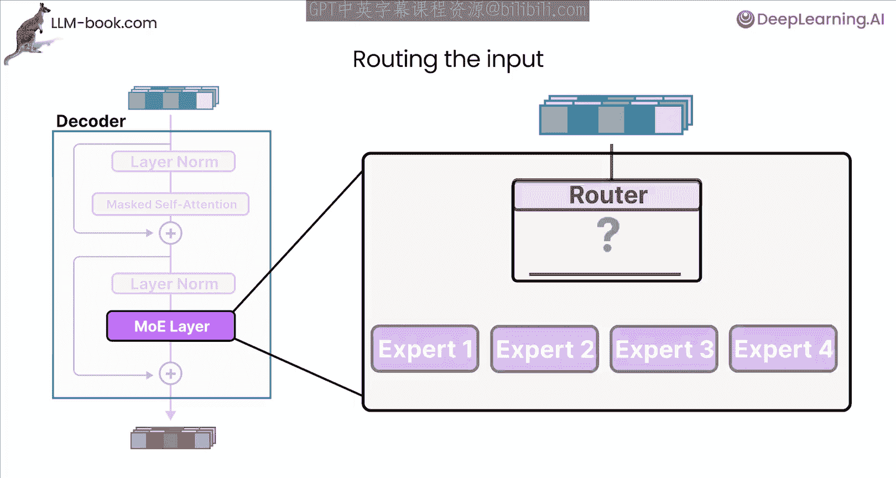

这个稀疏模型通常被称为混合专家层或MoE层。因此，MoE层由一个或多个专家组成，每个专家都是一个前馈神经网络，负责接收输入数据，并选择最适合该特定输入的专家来生成输出。

## 路由器的作用

那么，如何知道哪个输入应该交给哪个专家处理呢？这就是路由器的作用。它的主要工作是决定输入应该路由到哪个专家。

与专家类似，路由器本身也是一个前馈神经网络，但规模要小得多，因为它只负责路由输入。对于每个专家，路由器会生成一个概率分数，表示该专家适合处理该特定输入的可能性。

在生成每个专家的概率分数后，路由器根据这些分数选择专家。一种策略是选择概率最高的专家，但也存在其他可能为输出引入更多创造性的策略。

最终输出可以基于单个专家的输出生成，也可以选择多个专家并聚合它们的输出。这个聚合过程通常是一个加权平均，路由器赋予较高概率的专家在最终输出中拥有更大的发言权。

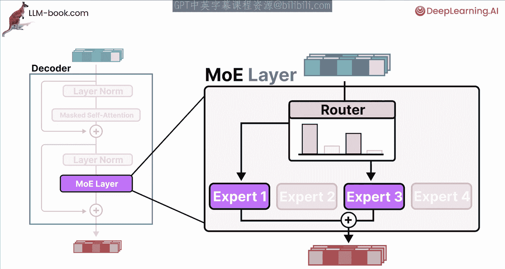

路由器和专家是混合专家模型的两个主要组成部分，也就是我们所说的MoE层。

回顾解码器，你可以用多个专家和一个路由器来替换原来的单一网络。尽管技术实现可能很困难，并且存在对单个专家过拟合的实际问题，但混合专家模型可以通过这两个组件来概括。

## MoE模型的参数与计算优势

混合专家模型的一个主要优势在于其计算需求。虽然拥有多个专家而不是单个专家似乎只会增加计算需求，但实际上情况更为微妙。

使用混合专家模型的参数大致分布在五个不同的地方：
1.  输入嵌入层。
2.  掩码自注意力层。
3.  路由器。
4.  专家网络。
5.  输出嵌入层。

当我们加载模型时，需要加载所有参数。这些被称为**稀疏参数**，因为它们并非全部被同时使用。所有专家都会被加载，尽管只使用其中之一。相比之下，**活跃参数**是那些实际用于混合专家模型推理的参数。由于并非所有专家都被使用，因此，虽然需要加载模型的所有参数，但只使用了其中的一个子集（一个或多个专家）。

因此，由于存在多个专家，加载模型所需的内存相对较高，但在推理过程中，由于并非所有专家都被使用，内存消耗相对较低。

## 案例分析：Mixtral 8x7B模型

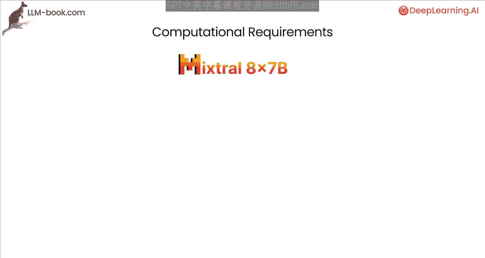

让我们通过一个例子来探索这一点，并计算一个模型的参数。我们将要探索的模型是Mixtral 8x7B。正如其名称所示，它是一个混合专家模型，拥有8个专家，每个专家有70亿参数。

Mixtral的共享参数是那些始终被使用的参数，无论是在加载模型时还是在运行推理时。最大数量的参数可以在注意力机制中找到，超过10亿个参数。请注意，路由器是一个相对较小的模型，只有32，000个参数。

Mixtral确实有八个专家。但每个专家实际上有56亿参数，而不是名称中暗示的70亿。很可能是作者将共享参数加到了专家的参数中，这确实会得到70亿参数。这有点误导性，因为共享参数不应计入专家参数，因为它们不是专家特有的。

专家们总共构成了450亿参数，这是该模型参数的主要部分。所以当你加载Mixtral时，你将加载全部460亿参数。

然而，运行模型和执行推理只需要共享参数。Mixtral在给定时间只选择两个专家，这大大减少了推理过程中的参数数量。尽管稀疏参数在推理时看起来很大，但模型实际使用的资源要少得多。这使得MoE模型在生产环境中运行时表现出色。

## 架构的优缺点

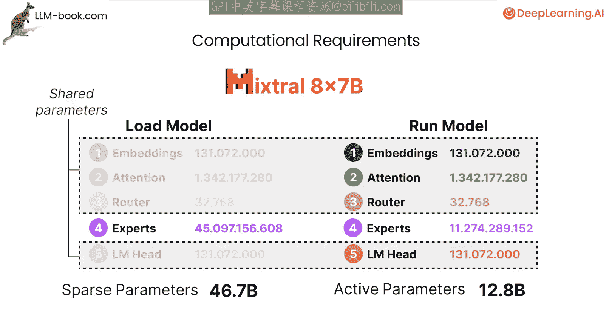

这种架构有一些优点和缺点。

**优点：**
*   运行推理需要更少的GPU内存。
*   其性能往往高于传统模型，因为专家有助于消除计算冗余。
*   架构在所选用的专家方面具有灵活性。

**缺点：**
*   加载模型需要大量内存。
*   存在对单个专家过拟合的风险，这需要仔细平衡模型。
*   架构更复杂，需要仔细训练。

此外，由于MoE层只影响前馈神经网络而不影响注意力机制，非Transformer模型也可以拥有MoE层。例如，作为Transformer替代品的状态空间模型，如Mamba和Jamba，也有MoE变体。这使得MoE成为在整个大语言模型领域中非常有趣且有用的架构。

## 总结

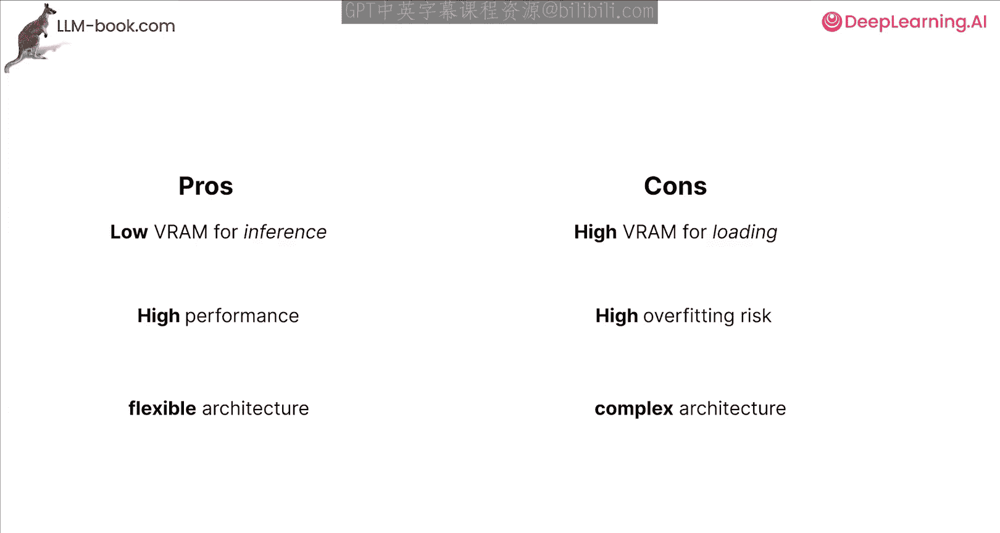

本节课中，我们一起学习了Transformer大语言模型的混合专家模型技术。我们了解了MoE层由多个专家网络和一个路由器组成，它通过稀疏激活的方式，在保持强大性能的同时，显著降低了推理时的计算资源消耗。我们还以Mixtral 8x7B为例，分析了其参数构成和计算优势。最后，我们探讨了该架构的优缺点及其在更广泛模型领域的适用性。