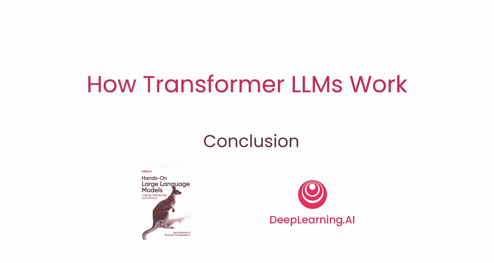

# 吴恩达《Transformer大语言模型工作原理》：13：总结 🎉

在本节课中，我们将对Transformer大语言模型的核心工作原理进行总结。我们已经学习了从自注意力机制到模型架构的各个关键部分，现在让我们回顾一下整个知识体系。

## 概述

通过本系列课程的学习，我们深入探讨了Transformer架构如何构成现代大语言模型的基础。我们理解了模型如何读取、处理并生成人类语言，而不再将其视为一个神秘的黑箱。

## 核心要点回顾

以下是本课程所涵盖的核心概念总结：

1.  **自注意力机制**：这是Transformer的核心，允许模型在处理一个词时，权衡序列中所有其他词的重要性。其核心公式可表示为：
    **Attention(Q, K, V) = softmax(QK^T / √d_k) V**

2.  **Transformer架构**：模型主要由编码器和解码器堆叠而成，但现代大语言模型通常仅使用解码器部分。其关键组件包括多头注意力层和前馈神经网络层。

3.  **训练与推理**：模型通过预测下一个词的任务进行训练，并在推理时通过自回归方式逐个生成词元。

4.  **上下文窗口**：模型能够处理的输入序列长度是有限的，这定义了其“记忆”或理解范围。

## 学习收获

上一节我们详细剖析了模型的生成过程，本节中我们来进行最终总结。掌握这些原理意味着：

*   你能够理解模型生成文本背后的逻辑，而不仅仅是调用API。
*   你可以更有效地设计提示词，引导模型产生更符合预期的输出。
*   你对模型的优势和局限性有了更清晰的认识，能更好地评估其输出结果。

## 结语

本节课中我们一起学习了Transformer大语言模型的基本工作原理。Martin和我希望你现在能够将大语言模型视为一个内部机制可知的系统，而不仅仅是一个黑箱。这种理解将帮助你更有效、更自信地使用它们。

至此，恭喜你！你现在对大语言模型和Transformer有了扎实的理解。