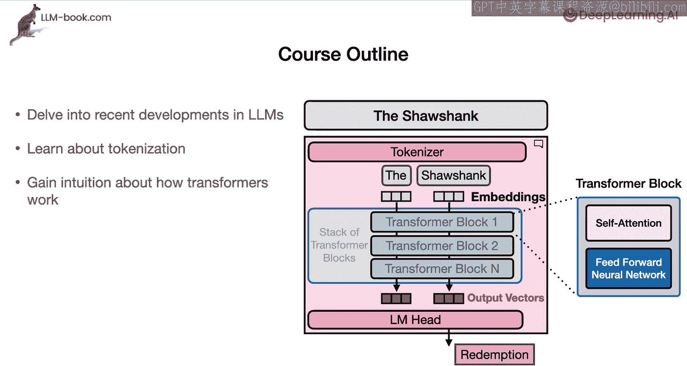
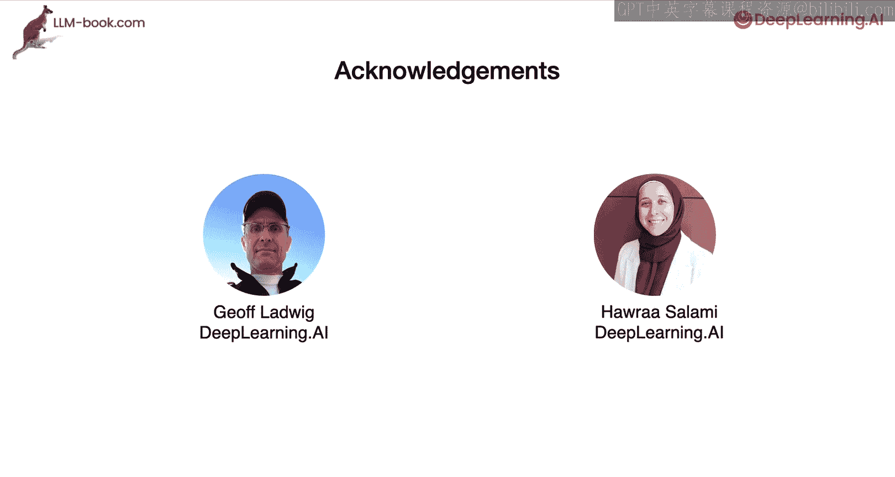
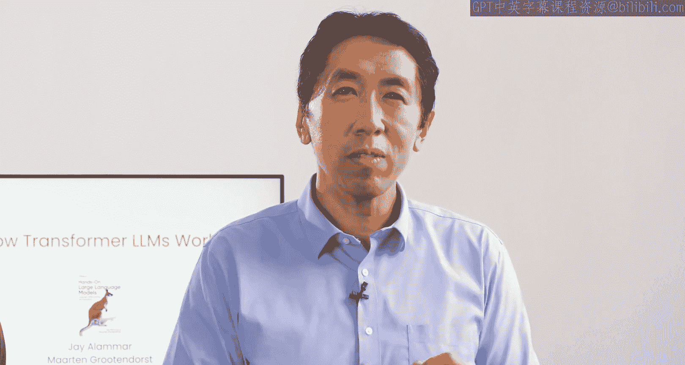

# Transformer大语言模型工作原理：1：课程介绍 🧠

在本节课中，我们将要学习Transformer架构的核心组件，这一架构彻底改变了语言处理领域。课程将由J Lmar和Martin Rutenzs两位讲师共同讲授，他们合著的《动手学大语言模型》一书清晰地阐释了LLM的底层架构与Transformer的原理。

我们很高兴能在此与大家分享这些知识。撰写本书的初衷，是希望提供一个易于理解的、基于Transformer的大语言模型入门指南。而本课程则让我们有机会亲自讲解这些内容。

我们的目标是，当你完成本课程后，能够阅读描述模型的学术论文，理解其中用于阐述架构的细节，并且这些直观理解也能帮助你更好地使用大语言模型。

---

## 课程核心主题：Transformer

上一节我们介绍了课程目标，本节中我们来看看本课程的核心主题——Transformer。

Transformer架构最初由Ashush Vaswani等人在2017年的论文《Attention Is All You Need》中提出，用于机器翻译任务。其核心思想是输入一个英文句子，让网络输出一个德文句子。后来人们发现，同样的架构也非常擅长输入一个提示（例如一个问题），并输出对该提示的回应（例如答案）。这为早期大语言模型的兴起奠定了基础。

原始的Transformer架构主要由两个部分组成：**编码器**和**解码器**。

以英译德为例：
*   **编码器**预处理整个输入的英文文本，提取执行翻译所需的上下文信息。
*   **解码器**则利用编码后的上下文来生成德文。

如今许多语言模型都基于编码器和解码器的思想构建。
*   **编码器模型**为输入文本提供丰富的、上下文敏感的表示，是BERT模型以及大多数用于RAG应用的嵌入模型的基础。
*   **解码器模型**执行文本生成任务，如总结文本、编写代码、回答问题，是大多数流行聊天模型（如OpenAI、Anthropic、Cohere和Meta的模型）的基础。

---

## 你将学到什么

在了解了Transformer的概貌后，接下来我们简要概述你将在本课程中学到的具体内容。

以下是课程内容大纲：

1.  **大语言模型的发展历程**：你将首先深入了解LLM的最新发展，看一系列日益复杂的构建模块如何最终形成现代的Transformer。
2.  **分词**：你将学习分词技术，即如何将文本分解成由单词或词片段组成的令牌，以便输入给大语言模型。
3.  **Transformer网络工作原理**：之后，你将直观理解Transformer网络（特别是仅解码器模型）的工作原理。

---

## 生成模型的工作流程

上一节我们列出了课程大纲，本节中我们重点看看生成模型的具体工作流程。

一个生成模型接收文本提示，并通过一次生成一个令牌来生成回复文本。

以下是生成过程的工作原理：

1.  **嵌入**：模型首先将每个输入令牌映射为一个**嵌入向量**，该向量捕获了该令牌的语义。
    *   代码表示：`embedding_vector = embedding_layer(input_token)`
2.  **Transformer块处理**：然后，模型将这些令牌嵌入向量通过一堆**Transformer块**。
    *   每个块都是一个特定的神经网络架构，设计用于从数据中灵活学习，并能很好地利用GPU进行扩展。
    *   你将学习每个块如何由**注意力层**和**前馈网络**组成。
    *   公式示意（简化）：`output = FeedForward(Attention(embedding_vector))`
3.  **语言建模头**：最后，模型使用Transformer块的输出向量，并将其传递给最后一个组件——**语言建模头**，由它来生成输出令牌。

---

## 结语与致谢

在本节课中，我们一起学习了Transformer架构的起源、核心组件（编码器与解码器）以及本课程的知识路线图。

我想感谢来自deeplearning.ai的Jeff Ludwig和Harra Salami对本课程提供的帮助。

我知道对一些人来说，Transformer可能有点像魔法。事实上，我听说有些人在了解其工作原理后的普遍反应是：“哦，就这样？” 😊

我认为这种反应的部分原因在于，大语言模型的“魔力”实际上来自两部分：
1.  **Transformer架构**（你即将学习，非常值得掌握）。
2.  模型从中学习的**海量且极其丰富的数据**。

因此，虽然LLM的魔力不仅来自Transformer架构，也来自数据，但扎实理解这个架构在做什么，将使你更好地理解它们为何以特定方式运行，以及如何使用它们。

现在，让我们和Martin一起开始第一课。😊

