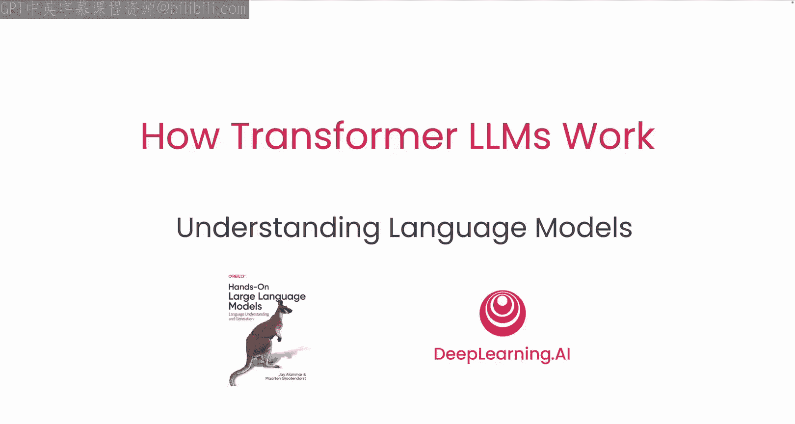
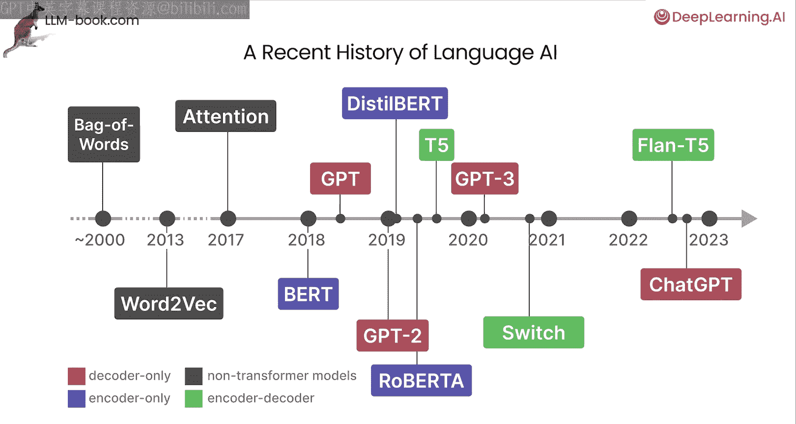
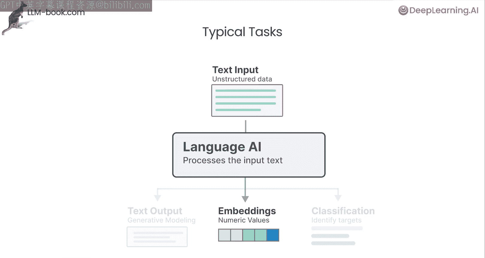
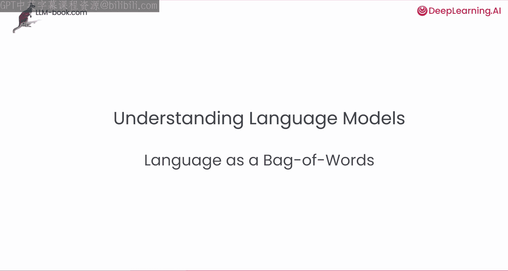
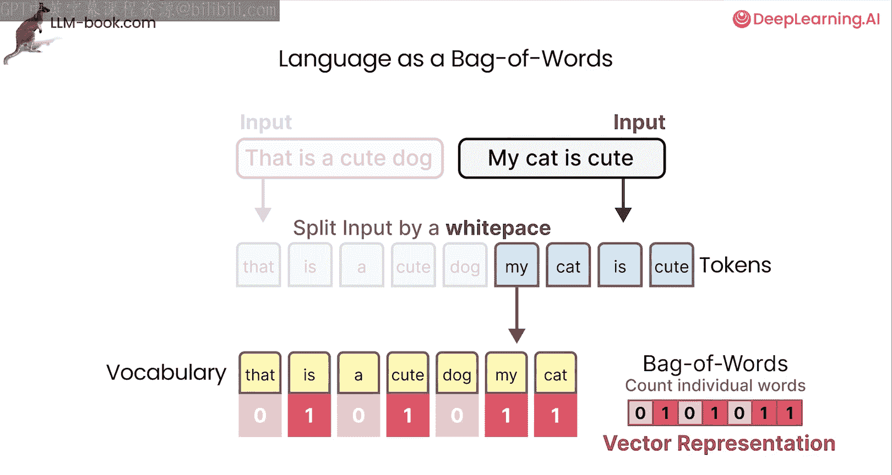
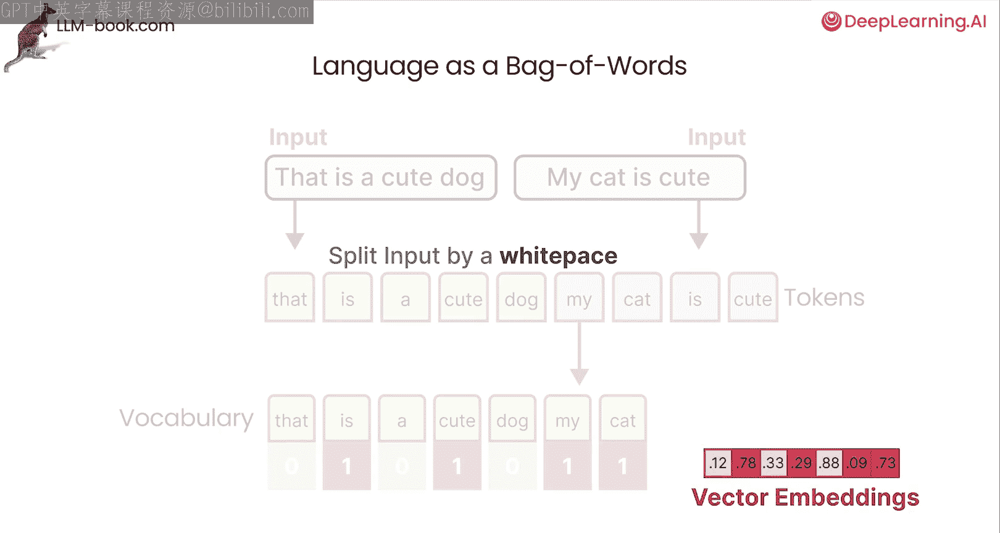

# Transformer大语言模型工作原理：2：理解语言模型（Word2Vec词嵌入）

在本节课中，我们将学习语言如何被数值化表示的演变过程。我们将从词袋模型开始，这是一种将单词表示为大型稀疏向量或数字数组的算法。接着，我们会探讨Word2Vec，其词表示方法能在几个相邻单词的上下文中捕捉单词的含义。最后，我们将介绍Transformer模型，其密集向量能在句子或段落的上下文中捕捉单词的含义。

好的，让我们开始吧。我将用一些图示来帮助阐明这些概念。

## 语言AI的演进历程

虽然我们将探索语言AI和语言模型更近期的历史，但理解我们的起点非常重要。早期的技术，如词袋模型和Word2Vec，可以说是我们今天所用技术的基础。尽管它们缺乏上下文感知的表示，但它们通常是很好的入门基线。

我们称这些为非Transformer模型，因为当今的模型通常完全由Transformer模型驱动，这与这些强大的基线模型形成对比。接着，我们有仅编码器模型，它们非常擅长用数值表示语言。相反，仅解码器模型本质上是生成式的，其主要用途是生成文本。最后，我们有编码器-解码器模型，它们试图兼收两者之长。

在我们探索语言AI这段更近期的历史时，你将了解这些非Transformer模型、编码器、解码器以及它们之间的关系。

## 语言的数值化挑战

然而，语言对计算机来说是一个棘手的概念。文本本质上是非结构化的，当用0和1或单个字符表示时，其含义会丢失。

因此，在整个语言AI的历史中，人们一直非常关注如何以结构化的方式表示语言，以便计算机能更容易地使用它。从生成文本到创建数值表示，再到对文本输入进行分类，这些只是你可以用语言AI完成的众多任务中的一小部分。

## 词袋模型：基础表示法

在语言AI领域的初期，重点主要是通过表示语言来分析非结构化数据。第一种至今仍非常相关的方法是将语言表示为词袋。

想象你有一段输入文本：“That is a cute dog.”。为了表示这个句子，你可以将其分解成更小的片段。

以下是具体步骤：

1.  **分词**：首先，通过空格将文本分割成单词。这个将输入文本转换成片段的过程称为**分词**，每个单独的单词称为一个**词元**。请注意，一个词元可以比一个完整的单词更小，但我们将在下一课中更详细地讲解分词。
2.  **创建词汇表**：你可以对另一个文档“My cat is cute.”执行相同的分词过程。虽然文档相似，但它们包含不同的单词，具有不同的含义。现在你有了两组词元，可以创建一个叫做**词汇表**的东西。这个词汇表包含在两个输入文档中找到的所有**唯一**单词或词元。因此，词汇表中的单词数量将少于生成的词元总数。我们通常将词汇表中的词元或单词数量称为**词汇表大小**。
3.  **生成数值表示**：为了用数值表示我们的一个输入，让我们稍微关注一下第二个输入“My cat is cute.”。这个输入有四个词元，与词汇表中的一些单词匹配。现在，你可以计算某个词元在我们已创建的词汇表中出现的频率。在这个例子中，每个词元出现一次。然而，你还必须注意词汇表中那些没有在输入中出现的单词。一个句子不仅赋予它所包含的单词以意义，也赋予它不包含的单词以意义。
4.  **形成向量**：现在你已经计算了输入中的单词或词元在词汇表中出现的频率，你就创建了你的数值表示。这被称为**词袋**，它所做的无非是统计词汇表中出现的单个单词。因此，“My cat is cute”的数值表示，按照特定的顺序，是 `[0, 1, 0, 1, 0, 1, 1]`。顺序很重要，因为它允许我们将不同的句子相互比较。在实践中，我们称这种向量表示为**向量**——一个代表输入的数字值列表。在这个例子中，这些值是计数，具有明确的含义，即词汇表中的单词在输入中出现的次数。

在更复杂和先进的模型中，向量表示通常没有如此直观的含义，其值介于0和1之间。

让我们进入下一个视频，学习这些向量嵌入是如何创建的。

## 总结

本节课中，我们一起学习了语言数值化表示的基础知识。我们从理解语言对计算机的挑战开始，然后深入探讨了词袋模型这一基础方法。词袋模型通过创建词汇表和统计词频，将文本转换为稀疏的数值向量，为后续更复杂的模型（如Word2Vec和Transformer）奠定了基础。下一节，我们将探索如何生成更密集、更能捕捉语义关系的词向量嵌入。