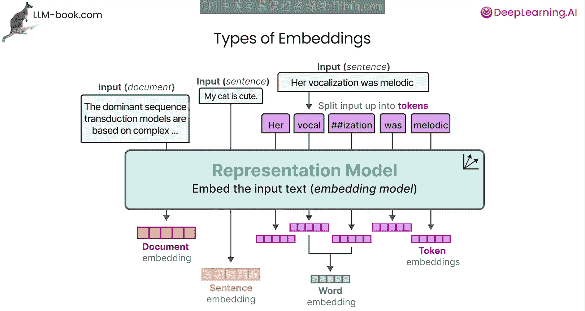

# 大语言模型工作原理：P3：理解语言模型（词嵌入）🔍

在本节课中，我们将学习词嵌入（Word Embeddings）这一核心概念。词嵌入是将单词或文本片段转换为数值向量的技术，它是现代语言模型理解语义的基础。我们将从简单的词袋模型出发，探讨其局限性，然后深入了解Word2Vec如何通过神经网络学习单词的语义表示。

## 从词袋模型到语义理解

上一节我们介绍了词袋模型的基本概念。本节中我们来看看词袋模型的一个主要缺陷。

词袋模型虽然是一种优雅的方法，但存在一个缺陷。它将语言视为几乎字面上的“词袋”，而忽略了文本的语义本质或含义。

## Word2Vec：语义表示的突破

为了解决上述问题，研究人员开发了能够捕捉语义的嵌入方法。Word2Vec于2013年发布，是首次成功尝试在嵌入中捕捉文本含义的方法之一。

Word2Vec通过在海量文本数据（如整个维基百科）上进行训练，来学习单词的语义表示。

为了生成这些语义表示，Word2Vec利用了神经网络。这些网络由相互连接的节点层组成，用于处理信息。

神经网络可以有很多层，其中每个连接都有一个特定的权重，该权重取决于输入。这些权重通常被称为模型的**参数**。

以下是Word2Vec的核心工作原理：
*   **初始化**：首先为词汇表中的每个单词分配一个向量嵌入，例如每个单词有5个值，这些值用随机数初始化。
*   **训练过程**：在每个训练步骤中，从训练数据中取出单词对，模型尝试预测它们在句子中是否可能是相邻的。
*   **学习关系**：在这个训练过程中，Word2Vec学习单词之间的关系，并将这些信息提炼到嵌入向量中。
*   **结果**：如果两个单词倾向于有相同的邻居，它们的嵌入向量就会彼此更接近，反之亦然。

最终得到的嵌入向量捕捉了单词的含义。

## 词嵌入如何表示含义

但“捕捉含义”究竟意味着什么？为了说明这一现象，让我们来看一个例子。

假设你有一个单词“cats”的嵌入向量。这个嵌入向量包含介于-1和1之间的生成值。

嵌入试图通过表示单词的属性来捕捉含义。例如，单词“cats”可能在“newborn”（新生儿）、“human”（人类）和“fruit”（水果）这些属性上得分较低，而在“animal”（动物）和“plural”（复数）这些属性上得分较高。

嵌入所具有的属性或值的数量被称为**维度数**，通常是一个固定的大小。

其他单词也是如此，例如“puppy”（小狗）在“animal”和“newborn”上得分高，但在其他所有属性上得分低。通过对多个单词进行这样的处理，你可以使用这些值来获取这些单词含义的近似表示。

需要注意的是，维度数可以非常大，拥有超过1000个值的嵌入向量并不少见。然而，在实践中，你实际上并不知道这些属性具体代表什么，因为它们是通过复杂的数学计算学习到的。

## 嵌入的比较与应用

这些属性确实允许你比较嵌入向量，从而比较单词。含义相似的单词会聚集在一起，而不同的单词则相距较远。

某些单词的相似或相异程度取决于训练数据。

至此，我们探讨了词嵌入，但我们可以使用许多类型的嵌入。

当我们谈论像Word2Vec这样将文本输入转换为嵌入的模型时，我们将其称为**表示模型**，因为它试图将文本表示为数值。

## 从单词到句子：不同粒度的嵌入

想象一下你有一些输入。例如，句子“The vocalization was melodic.”（这段发声很悦耳。）

通过**分词**，你可以将该句子分割成词元。请注意，这个过程实际上并不是按空格分割输入。单词“vocalization”被分割成“vocal”和“ization”。这样做的原因是，执行分词的模型（也称为分词器）有一个固定的词汇表。因此，它们无法表示所有存在的单词，有时必须找到单词的组合。

你将单个词元输入表示模型，模型会为每个词元生成一个嵌入向量。

请注意，单词“vocalization”包含词元“vocal”和“ization”。因此，当你对这些词元的嵌入向量取平均值时，你就得到了一个词嵌入，因为它现在代表了整个单词。

类似的技术可以用于整个句子，以创建**句子嵌入**。同样，对于更长的文本，如文档，可以创建**文档嵌入**。

这些只是众多现有嵌入类型中的几种。

## 总结

本节课中我们一起学习了词嵌入的基本原理。我们了解到，词袋模型忽略了语义，而Word2Vec等模型通过神经网络，根据单词在上下文中的共现关系来学习其向量表示，从而捕捉语义。词嵌入的维度代表了单词的各种潜在属性，相似的单词在向量空间中距离更近。此外，嵌入技术可以应用于不同粒度的文本单元，如词元、单词、句子和文档。下一节，我们将学习如何编码和解码上下文信息，而不仅仅是静态的表示。

