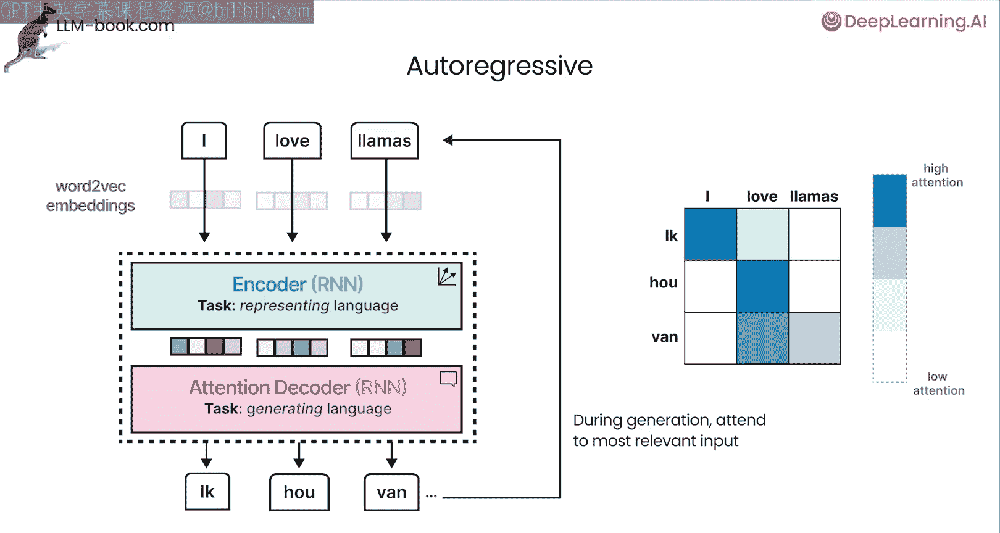

# 大语言模型工作原理：P4：理解语言模型（使用注意力机制编码与解码上下文）

在本节课中，我们将要学习语言模型如何利用注意力机制来编码和解码文本的上下文信息。我们将从静态词嵌入的局限性开始，探讨循环神经网络（RNN）的编码-解码架构，并最终引入注意力机制这一关键改进。

## 概述

上一节我们介绍了词和标记的嵌入技术，但其上下文理解能力有限。本节中，我们将探索如何使用注意力机制来编码和解码上下文。

## 静态词嵌入的局限性

像Word2Vec这样的方法会为每个词创建静态嵌入。无论上下文如何，同一个词生成的嵌入是相同的。例如，单词“bank”既可以指金融机构，也可以指河岸。它的含义，以及其嵌入表示，应该根据上下文的不同而改变。

捕获文本的上下文对于执行某些语言任务（如翻译）至关重要。

## 循环神经网络（RNN）的编码与解码

编码这种文本的一个步骤是通过循环神经网络（RNN）实现的。RNN是神经网络的一种变体，可以将序列作为额外输入进行建模。

以下是RNN用于的两个主要任务：

*   **编码**：表示输入句子。
*   **解码**：生成输出句子。

让我们通过展示如何将输入句子“I love Lamas”翻译成荷兰语来探索这个过程。

文本被传递给编码器，编码器尝试通过嵌入来表示整个序列。解码器然后使用这些嵌入来生成语言。在这里，它将英语的“I love Lamas”翻译成了荷兰语的“Ihaon Lamas”。

这种架构中的每一步都是**自回归**的。当生成下一个词时，该架构需要消耗所有先前生成的词。例如，你输入“I love Lamas”。模型然后生成第一个标记“I”。为了生成下一个标记，输出的“I”被追加到输入中。在步骤2，输入变成了“I love Lamas I”，这反过来生成了输出“haon”。你可以继续这个过程，每一步都用先前生成的标记不断更新输入，直到整个输出生成完毕。大多数模型都是自回归的，因此每次只生成一个标记。

## 编码与解码的细节

让我们更详细地探讨这个编码和解码过程。

你再次从输入句子“I love Lamas”开始，它被分词成标记。我们可以使用Word2Vec来创建嵌入作为输入，尽管这些嵌入本身是静态的。编码器一次性处理整个序列，并考虑嵌入的上下文。编码步骤旨在尽可能好地表示输入，并以嵌入的形式生成上下文。

解码器则负责生成语言。它通过利用先前生成的上下文嵌入来最终生成输出。正如我们之前探讨的，这些输出标记是逐个生成的，这被称为自回归。

然而，这种上下文嵌入使得处理更长的句子变得困难，因为它仅仅是一个代表整个输入的单一嵌入。因此，单一的嵌入可能无法捕获一个长而复杂序列的全部上下文。

## 注意力机制的引入

2014年，一个名为**注意力**的解决方案被引入，极大地改进了原始架构。注意力机制允许模型专注于输入序列中彼此相关的部分，或者说“关注”彼此，并放大它们的信号。它选择性地确定给定句子中哪些词最重要。

以我们的输入和输出序列为例。具有相似含义的词，如“I”和荷兰语“Ich”（它们是同义词），具有更高的注意力权重，因为它们更相关。“I”和“Lamas”的注意力权重较低，因为在这个特定的句子中它们彼此关联不大。所有其他词也是如此。

通过将这种注意力机制添加到解码步骤，RNN可以为序列中与潜在输出相关的每个输入词生成信号。

你可以再次使用Word2Vec嵌入来表示输入，并将它们传递给编码器。与仅将一个上下文嵌入传递给解码器不同，所有输入词的**隐藏状态**都被传递给了解码器。一个词的隐藏状态是来自RNN隐藏层的内部因子，它包含了关于之前词的信息。解码器然后使用注意力机制来查看整个序列。最后，这再次生成了语言。

由于这种注意力机制，输出往往会好得多，因为你现在使用每个标记/词的嵌入来查看整个序列，而不是使用更小、更有限的上下文嵌入。

因此，在生成过程中，模型在生成了“Ihaon”之后，会关注最相关的输入（使用输入“I love Lamas”）。注意力机制会突出显示在这个特定例子中更相关的词。

## 总结

本节课中，我们一起学习了语言模型如何从静态词嵌入发展到使用RNN进行序列编码与解码，并最终引入了注意力机制来解决长序列上下文信息丢失的问题。注意力机制通过让模型在生成每个词时“关注”输入序列中最相关的部分，显著提升了语言生成任务（如翻译）的质量。然而，这种架构的顺序性质阻碍了模型训练过程中的并行化。下一节，我们将学习注意力机制如何在Transformer模型中得到应用。