# Transformer大语言模型工作原理：5：理解语言模型（Transformer）

## 概述
在本节课中，我们将要学习Transformer架构如何成为现代大语言模型的核心。我们将从经典的编码器-解码器结构开始，探讨其如何演变为BERT和GPT等不同风格的模型，并理解上下文长度、参数规模等关键概念。

上一节我们介绍了注意力机制的主要技术。本节中，我们来看看这项技术如何进一步发展，并至今仍驱动着许多大语言模型。

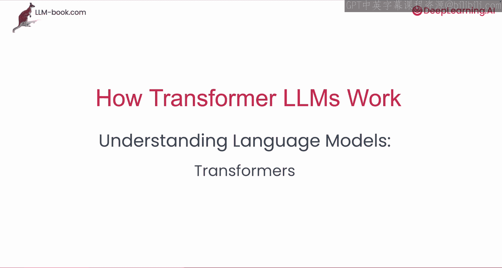

注意力机制真正的力量，以及驱动大多数大语言模型惊人能力的原因，首次在《Attention Is All You Need》这篇论文中得到探索。这篇论文引入了Transformer架构，该架构完全基于注意力机制，而不使用循环神经网络。

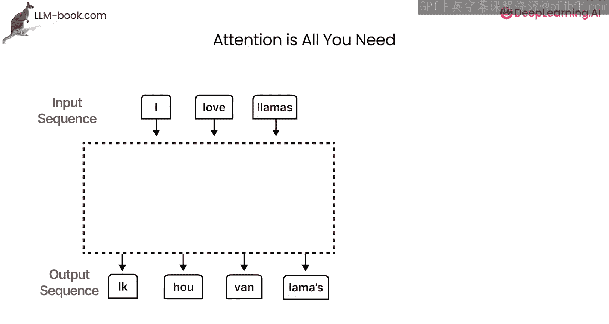

这种架构允许模型并行训练，与基于RNN的模型相比，显著加快了计算速度，因为RNN模型无法并行化。让我们探索一下这个Transformer是如何工作的。假设你拥有和之前相同的输入和输出序列。

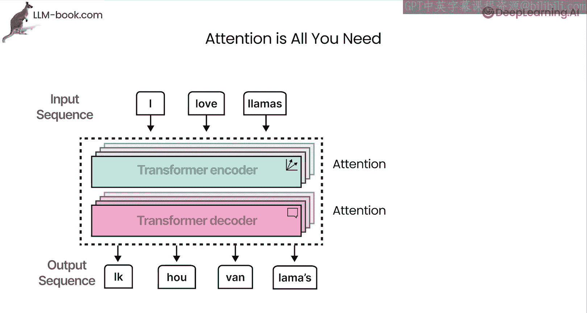

Transformer由堆叠的编码器和解码器块组成。这些块都拥有你之前见过的相同的注意力机制。通过堆叠这些块，你放大了编码器和解码器的能力。

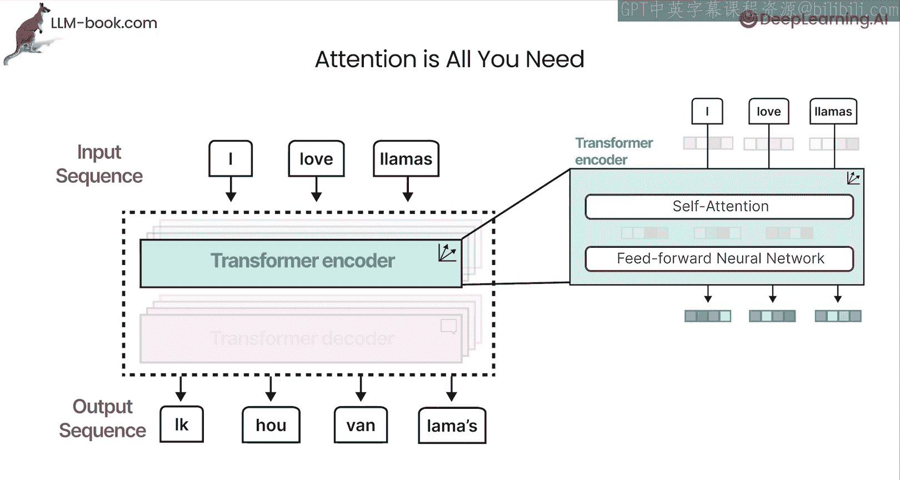

让我们更仔细地看看编码器。大语言模型的输入被转换为嵌入向量。但我们不是从词到向量的嵌入开始，而是从随机值开始。然后，自注意力机制（一种仅关注输入的注意力）处理这些嵌入并更新它们。这些更新后的嵌入向量由于注意力机制而包含了更多上下文信息。它们被传递到一个前馈神经网络，这是一个我们之前探索过的类似网络，最终生成具有上下文信息的词嵌入向量。请记住，编码器旨在表示文本，并且在生成嵌入向量方面做得很好。

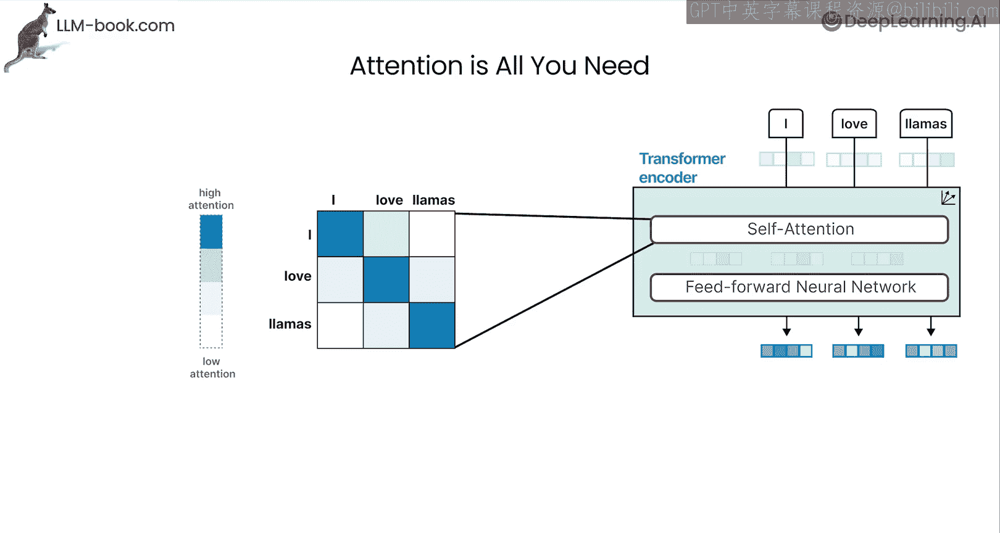

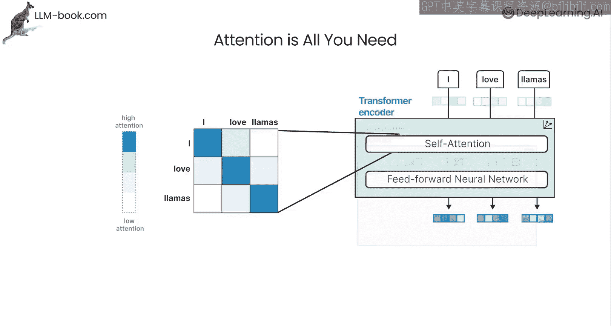

自注意力是一种注意力机制，它不处理两个独立的序列，而是只处理一个序列，即输入序列，通过将其与自身进行比较。

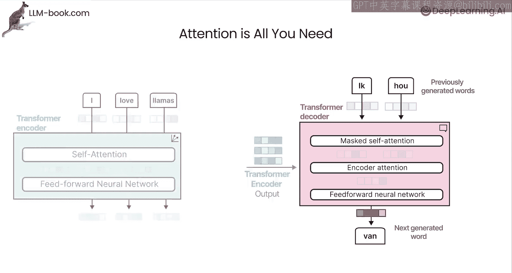

现在，在编码器完成信息处理后，下一步是解码器的工作。解码器可以接收任何先前生成的词。并将其传递给掩码自注意力机制，类似于编码器处理这些嵌入向量的过程。生成中间嵌入向量，并将其与编码器的嵌入向量一起传递给另一个注意力网络。从而同时处理已生成的内容和你已有的内容。这个输出被传递到一个神经网络，最终生成序列中的下一个词。

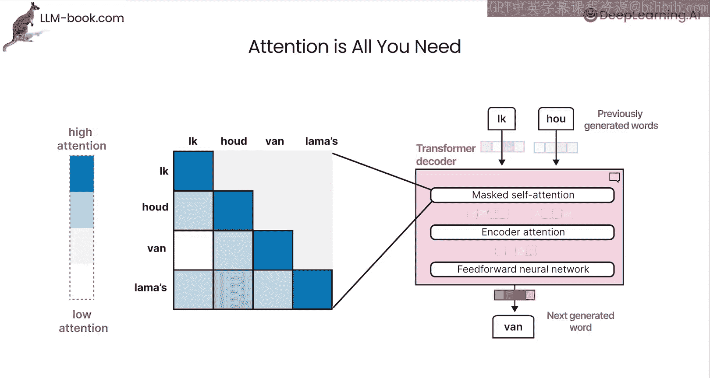

掩码自注意力类似于自注意力，但移除了上三角矩阵中的所有值。因此，它屏蔽了未来的位置，使得任何给定的标记只能关注出现在它之前的标记。这有助于在生成输出时防止信息泄露。

原始的Transformer模型是一种编码器-解码器架构，非常适用于翻译任务，但不易用于其他任务，如文本分类。2018年，引入了一种名为BERT的新架构。BERT代表来自Transformer的双向编码器表示，它可以被用于多种任务。BERT是一种仅编码器架构，专注于表示语言和生成具有上下文信息的词嵌入向量。这些编码器块与我们之前看到的相同：自注意力，后接神经网络。输入包含一个额外的标记，即CLS或分类标记，它被用作整个输入的表示。通常，我们使用CLS标记作为输入嵌入向量，用于在特定任务（如分类）上微调模型。

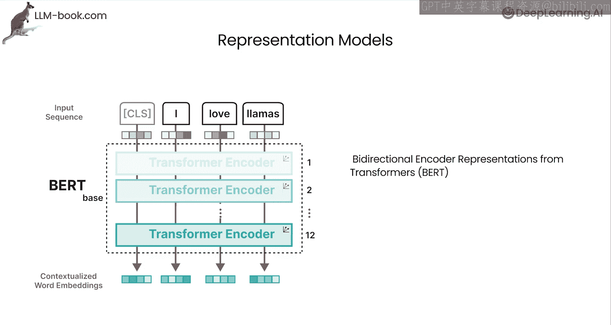

要训练一个类似BERT的模型，你可以使用一种称为掩码语言建模的技术。你首先从输入序列中随机掩码一些词。然后让模型预测这些被掩码的词。通过这样做，模型在尝试解构这些被掩码的词的过程中学习表示语言。

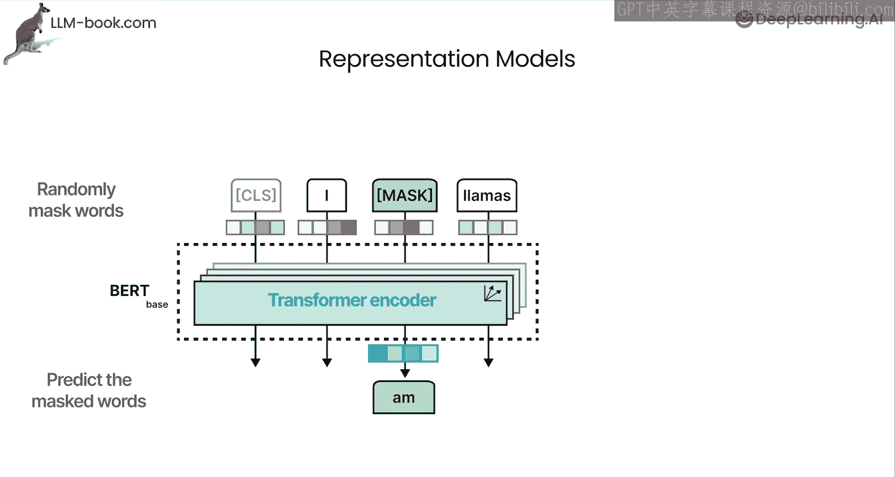

训练通常采用两步法。首先，你在大量数据上应用掩码语言建模，这被称为预训练。之后，你可以在许多下游任务上微调你的预训练模型，包括分类。

相比之下，生成模型使用不同的架构。假设你再次有另一个输入序列和随机初始化的嵌入向量。输入然后仅传递给解码器，因为生成模型倾向于只堆叠解码器。最早的实现之一叫做GPT或GPT-1。它代表生成式预训练Transformer，因为它使用了Transformer解码器。一个解码器块再次使用掩码自注意力，然后将其传递给一个神经网络。请注意，它不使用我们之前探索过的任何编码器。最后，生成下一个词。

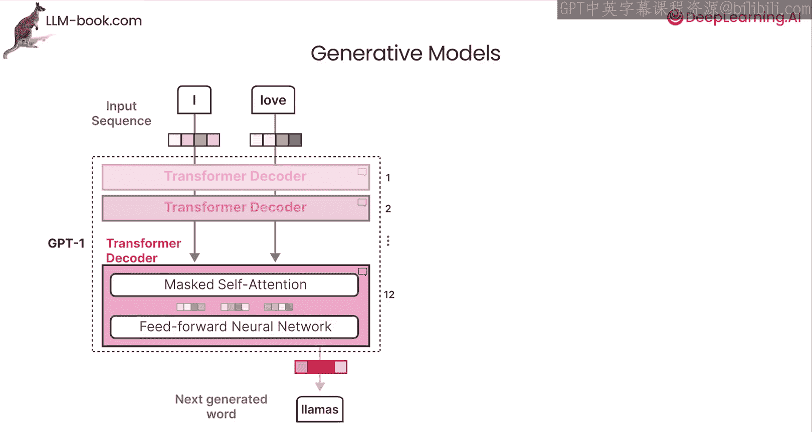

以下是你会最常看到的两种风格：像ChatGPT这样的生成模型和像嵌入模型这样的表示模型。

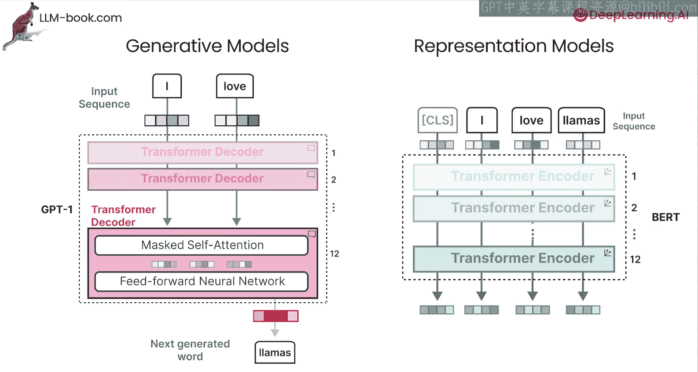

这些模型有一个共同点，称为上下文长度。你从一个输入序列开始，在这个例子中，我们向生成模型询问“告诉我一些关于大语言模型的事情”。现在，假设你已经生成了一些标记。原始查询，加上先前生成的标记，代表了当前的上下文长度。这是当前正在处理的标记数量。相比之下，像GPT-1甚至表示模型这样的生成式大语言模型可以有一个最大上下文长度。例如，512。这意味着模型在给定时间只能处理512个标记。请注意，这也包括正在生成的标记，因为它们会更新当前的上下文长度。

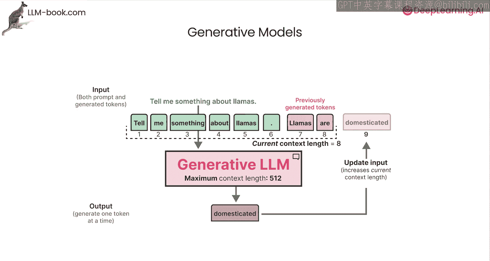

这些生成模型构成了大语言模型的主体。GPT-1已经拥有超过1亿个参数。下一个版本，GPT-2拥有超过10亿个参数，而GPT-3已经拥有1750亿个参数。随着参数数量的增长，它们的能力也随之增长。这就是为什么你经常会看到如此庞大的模型。

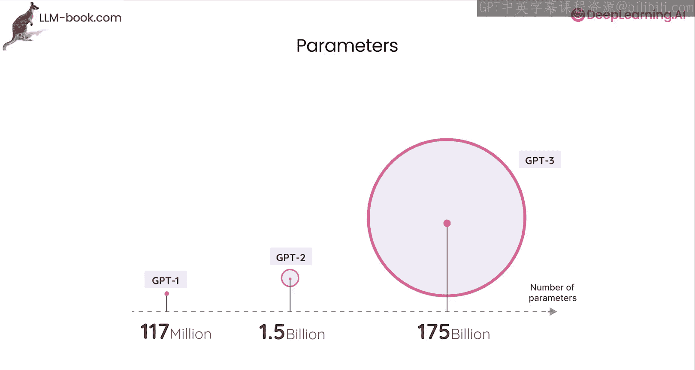

回顾我们戏称为生成式AI元年的那一年，一切都始于众所周知的ChatGPT模型，或者更准确地说，是GPT-3.5。随着ChatGPT的成功，许多其他专有模型很快跟进。开源模型也迅速跟进。这些模型的权重是公开可用的，供我们使用。其中一些甚至可以免费用于商业目的。

让我们进入下一课，学习关于标记和嵌入向量的知识。

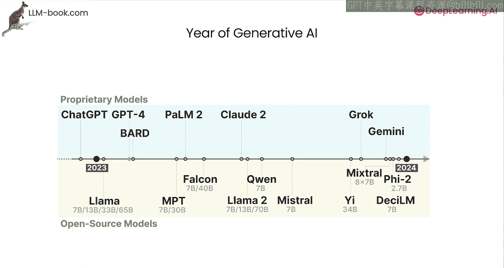

## 总结
本节课中我们一起学习了Transformer架构如何成为现代大语言模型的基石。我们探讨了编码器-解码器结构、自注意力与掩码自注意力的区别，以及由此衍生出的BERT和GPT两种主要模型范式。我们还了解了上下文长度、模型参数规模等关键概念，并回顾了生成式AI的发展历程。理解这些基础是掌握大语言模型工作原理的重要一步。