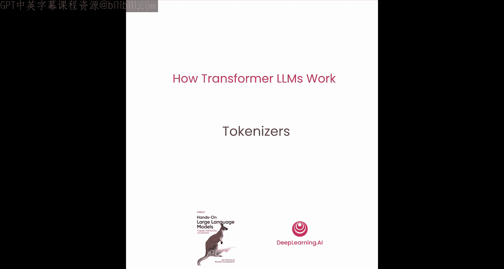
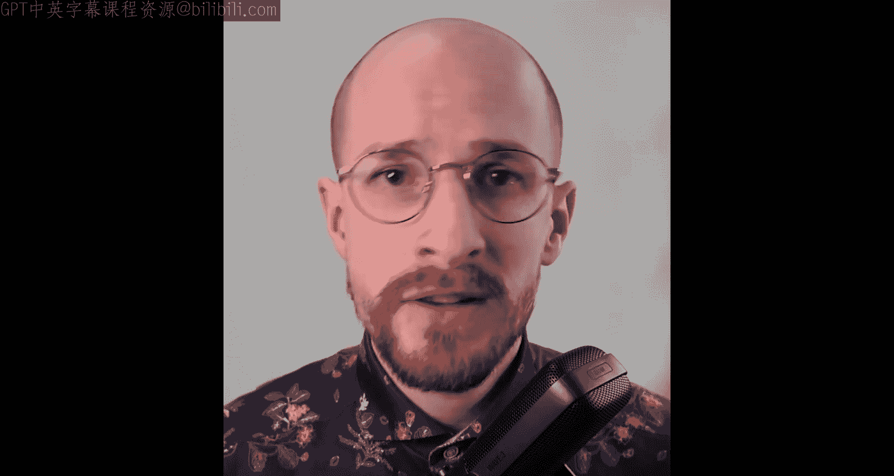
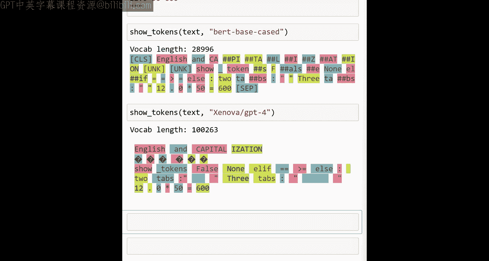

# 大语言模型工作原理：6：分词器详解 🧩



在本节课中，我们将学习大语言模型如何处理文本输入。具体来说，我们将深入探讨“分词”这一关键步骤，了解文本如何被分解成更小的单元（即词元），以及这些词元如何被转换为模型可以理解的数字表示。

## 概述



上一节我们介绍了词义如何在向量中表示，并简要提到了词元可以是单词或单词片段。本节中，我们将详细说明什么是词元，以及它们如何帮助Transformer模型完成工作。

## 什么是分词？

想象你有一个输入句子，例如“half the barts, who”。

为了让语言模型处理这段输入文本，它首先会将文本分解成更小的片段。每个片段被称为一个**词元**。这个分解文本的过程被称为**分词**。

随后，每个词元会被转换为一种数字表示，也称为**嵌入**。这些是向量值，代表了给定文本的语义本质。

这些嵌入是静态的，每个嵌入的创建都独立于所有其他嵌入和词元。大语言模型会处理这些嵌入，并将其转换为**上下文化嵌入**。这些上下文化嵌入仍然为每个输入词元生成一个，但经过了处理，以便考虑所有其他词元。

这些嵌入可以作为模型的输出。但在生成式模型中，它们也被模型用来创建输出，这个输出可以是另一个词元。

## 分词过程详解

让我们详细探讨这个分词过程是如何工作的。

给定一个输入句子“have the bar who”，它被分词或编码成更小的片段。

词元可以是整个单词，也可以是单词的一部分。当这些片段组合起来时，它们就形成了原始单词。这个过程是必要的，因为词元有一个有限的词元数量或词汇表。因此，每当遇到未知单词时，它仍然可以通过这些子词元来表示。

每个词元都有一个关联的固定ID，以便轻松编码和解码词元。这些ID被输入到语言模型中，模型内部会创建词元嵌入。生成式模型的输出将是另一个词元ID，然后被解码以表示实际的词元或单词。

## 不同的分词级别

我们可以探索许多不同的分词级别。当你有一个输入“half the bar who proceed it together with a special symbol 😊”时：

以下是不同级别的分词方式：

*   **单词词元**：整个序列由单词表示。
*   **子词词元**：我们之前看到的例子，可以是整个单词本身，也可以是原始单词的子片段。如果分词器没有“bars”这个词元，它仍然可以用其“B”和“arts”词元来表示它。
*   **字符词元**：将子词元拆分为字符词元，原始单词中的每个字符对应一个，将整个输入表示为每个单独的字符。
*   **字节词元**：最小的表示是字节，用于在计算机中编码单个文本字符。每个字符都需要这样做。请注意，符号😊需要额外的字节来表示，因为该符号比单个字符表示更复杂。

在实践中，大多数大语言模型的词元都在子词级别工作。它的词汇表很灵活，允许通过其完整表示或使用子词元来表示大多数单词。

## 动手实践：探索不同分词器

现在让我们转到代码笔记本，探索不同的词元。要探索不同的词元，我们首先需要安装transformers包。

```python
pip install transformers
```

这个包不仅用于与分词器交互，也用于使用大语言模型。由于我已经在我的环境中安装了它，我可以直接跳过这一步。

接下来，让我们探索这个分词过程是如何工作的。为此，你需要加载你的分词器。首先需要从transformers导入AutoTokenizer。

```python
from transformers import AutoTokenizer
```

这用于与任何分词器交互。然后，你可以选择任何句子进行处理。在这个例子中，我选择了著名的“Hello world”示例作为要处理的句子。

你将使用的分词器称为基于BERT的cased模型，它是一个预训练的编码器模型，名为BERT。现在我们已经加载了分词器，可以开始处理输入句子了。

你可以使用分词器来处理输入句子并提取词元ID。

```python
tokenizer = AutoTokenizer.from_pretrained("bert-base-cased")
input_sentence = "Hello world!"
token_ids = tokenizer.encode(input_sentence)
print(token_ids)
```

然后你可以打印词元ID，看看这个变量包含什么。请注意，它包含一堆数值，目前还不清楚它们具体代表什么。

正如我们之前看到的，词元ID代表特定的词元，但要获取这些词元，我们首先需要解码它们。你可以使用分词器自带的解码函数来解码这些词元。

```python
for token_id in token_ids:
    decoded_token = tokenizer.decode([token_id])
    print(decoded_token)
```

所以当你遍历词元ID时，可以解码每个词元并打印它。现在你会看到五个被表示的词元。句子“Hello world!”以CLS词元开始，这个CLS词元或我们之前探讨的分类词元代表了整个输入。然后你有“hello”、“world”和感叹号的词元。还有一个特殊字符SEP，它是分隔符词元，标志着一个句子的结束。

为了可视化所有这些不同的词元，你需要一些特殊的代码。在你创建函数之前，首先创建这个颜色列表。这些是RGB颜色，我们将用它们来高亮显示词元，帮助你区分不同的词元。你可以使用任何颜色，这些是为你选择的。

然后是主函数，它叫做`show_tokens`。`show_tokens`允许你通过颜色来分隔每个词元。它接收一个句子和一个名称，即你想要处理的句子和你想要加载的分词器的名称。你以之前相同的方式加载分词器。你为想要处理的分词器选择一个名称。然后你创建词元ID，这些就是你之前看到的那些需要解码的数值。

在清楚它们实际代表什么单词和词元之前，我们将提取词汇表长度，因为看看不同分词器之间的词汇表有何不同也很有趣。

然后每个词元将通过我们之前探讨过的分词器进行解码打印，并且每个词元将被高亮显示。这个高亮显示过程让你可以轻松区分不同分词器使用的技术。

在使用这个函数之前，让我先介绍你将使用的文本。

```python
input_text = "Capitalization, 123, and special symbols like 😊 are included."
```

这段文本包含所有不同类型的单词，以展示这些分词器将如何处理这个特定的输入。请注意，我们有完全大写的单词，里面有数字值，甚至还有特殊符号，以查看分词器在面临这个特定序列时会做什么。

让我们更详细地探索你之前使用的分词器。我们可以使用你之前创建的`show_tokens`函数来做到这一点。你传入输入文本。

运行后，你会看到两条信息。首先，是这个分词器的词汇表长度。它显示了一个接近30000的值，这意味着这个分词器有近30,000个值或词元可以表示。在下面，你会看到它用于表示你输入文本的所有词元。

正如我们之前探讨的，它以CLS词元开始，即分类词元，用于表示整个输入。这个分词器在表示单词“Capitalization”时遇到了很多困难。请注意，它必须将该单词分解成许多词元才能实际表示它。那些井号（`##`）表示这个词元属于前面的词元，它们一起代表一个单词。你还会在这些词元中出现UNK词元，它是未知词元，当它根本不知道如何表示任何词元时使用。

接下来，让我们看看一个更新的分词器与这个BERT模型有何不同。这次我们将使用GPT-4的分词器。它叫做Tiktoken，虽然我们无法访问GPT-4模型本身，因为它是专有的，但分词器仍然可用。你可以运行这个。

你会看到一个词汇表长度，它比你之前探索的BERT模型大三倍多，有100,000个词元。它需要使用更少的词元来表示输入。“Capitalization”现在只有两个词元。而且这个模型，这个分词器，是为生成式表示设计的，所以它没有CLS和SEP分类词元或那些特殊字符。有趣的是，它需要更少的词元来表示这些整个输入。即使是表情符号😊，它也能很好地表示，因为这个模型有如此大的词汇表长度。表示不常见的词元更容易，但有一个权衡。

词汇表长度越大，需要为每个词元计算的嵌入就越多。因此，在选择一个可能拥有百万词元长度的分词器与实际上学习每个词元的表示之间，存在一个权衡。

现在，许多模型都可以在Hugging Face平台上在线找到。在那里，你会发现许多可用的分词器。而且因为分词器本身相对较小，你可以轻松尝试它们。看看它们有何不同，西方语言和东方语言的词元之间有什么变化。

## 总结



本节课中，我们一起学习了**分词**在大语言模型中的关键作用。我们了解到，文本输入首先被分解为词元，词元可以是单词、子词、字符甚至字节。每个词元被赋予一个唯一的ID并转换为嵌入向量，供模型处理。不同的分词器（如BERT和GPT-4使用的）拥有不同的词汇表大小和分词策略，这直接影响模型处理文本的效率和能力。在接下来的课程中，Jay将为你解释大语言模型如何处理词元以生成文本。