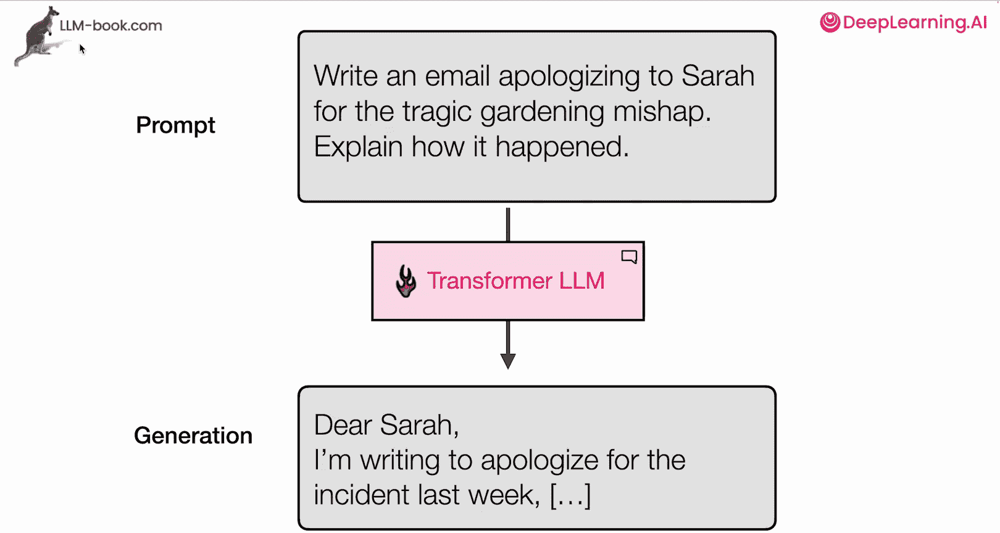
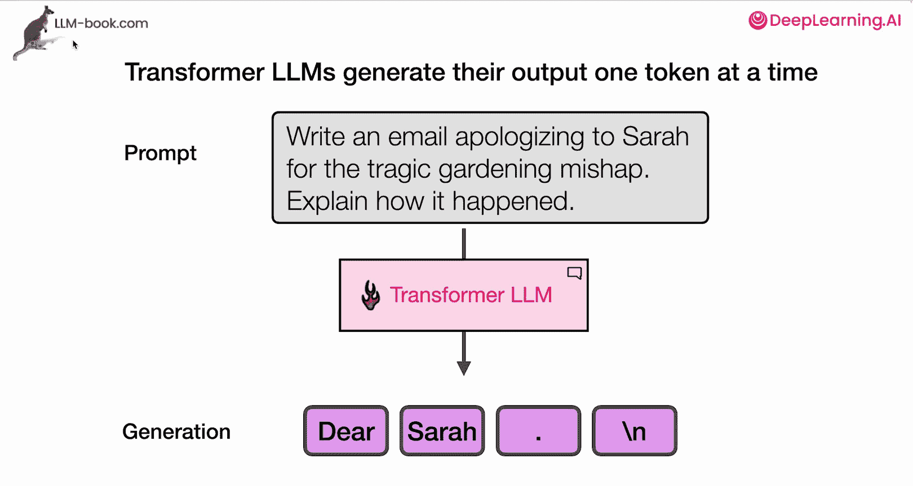
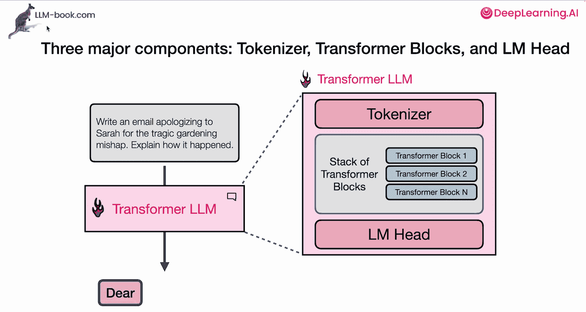
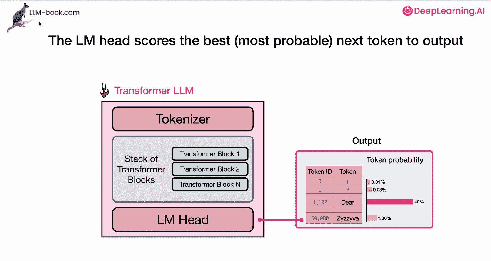
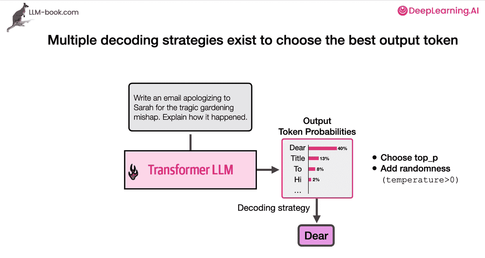
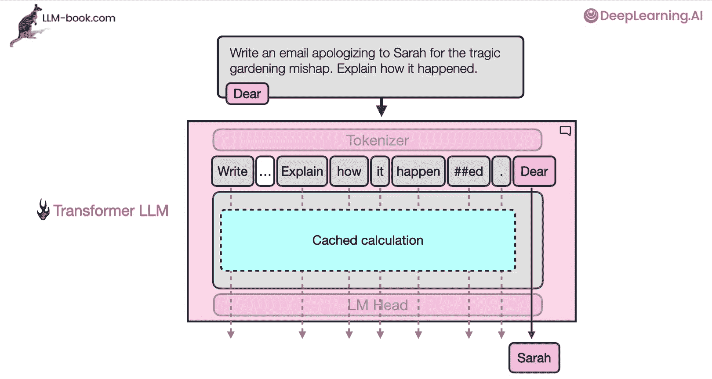

# Transformer大语言模型工作原理：P7：架构概述 🏗️

在本节课中，我们将要学习Transformer大语言模型的整体架构。我们已经了解了语言如何被数字化表示，以及单词如何被转换为词元（Token）和稠密嵌入（Embedding）。现在，我们将深入探讨Transformer的细节。

## 核心工作流程：逐词元生成

理解Transformer工作原理的第一个重要直觉是：它**逐词元地生成**输出文本。

当我们向模型输入一个提示（Prompt）时，模型会生成一段输出文本。这个过程并非一次性生成整段文本，而是像下图所示，一次生成一个词元。我们将分解这些生成步骤，以便理解其底层机制。

## Transformer的三大组件

Transformer主要由三个核心组件构成。我们在之前的课程中已经了解了其中一个。

以下是这三个组件：
1.  **词元化器（Tokenizer）**：这是将输入文本分解为多个词元块的组件。
2.  **Transformer块堆栈（Stack of Transformer Blocks）**：这是模型进行绝大部分计算的地方。神经网络在这里运行，完成几乎所有的“魔法”。通过后续课程的学习，你会发现这并非魔法，而是完全可以理解的。
3.  **语言建模头（Language Modeling Head）**：这是一个神经网络，接收Transformer块堆栈的输出。

词元化器的输出会送入Transformer块堆栈，而Transformer块堆栈的输出最终会送入语言建模头。

接下来，让我们逐一审视这些组件。

### 1. 词元化器与词元嵌入

我们已经学习过词元化器。我们知道词元化器有一个词汇表，可以将文本分解为独立的词元块。假设我们的词汇表包含50000个词元。

模型为词汇表中的每个词元都关联了一个**词元嵌入向量**。因此，如果词汇表有50000个词元，模型就有50000个向量来分别表示它们。在模型开始处理输入时，这些向量会被用来替换对应的词元。

### 2. 语言建模头

在了解了高层次概述后，我们先来看看语言建模头。

在语言模型处理的最后阶段，你拥有所有由词元化器定义的初始词元。最终，模型会根据Transformer堆栈对输入上下文的理解和处理结果，进行一种“评分”或**下一个词元的概率计算**。

语言建模头的结果就是这种词元概率评分。它会为词汇表中的每个词元计算一个概率百分比，所有词元的概率总和为100%。

例如，如果词元“deer”被评分为40%的概率，它就成为概率最高的词元，并可能被选为输出。

### 3. 解码策略

概率最高的词元不一定是最终输出。你可以选择最高概率的词元，这是一种选择下一个（输出）词元的方法，称为**解码策略**。

以下是几种常见的解码策略：
*   **贪婪解码（Greedy Decoding）**：总是选择概率最高的词元。这在很多情况下是一个好策略。当你将温度参数设置为0时，使用的就是这种方法。
*   **Top-p（核采样）**：这种方法会考虑多个高概率的词元。它可能选择“deer”，但在某些情况下，也可能以较低的概率选择下一个概率最高的词元。它参考评分，但不总是选择最高的那个。这对于生成听起来更自然的文本有时很重要，也是为什么使用相同提示多次生成可能会得到不同答案的原因之一，尤其是在温度参数设置为大于0的值时。

## Transformer的关键特性：并行处理

关于Transformer的另一个重要直觉是：它们**并行处理所有输入词元**。这种并行化能力使其比RNN等先前方法效率高得多，可以在相似的时间内，在多个GPU上计算很长的上下文。

你可以将其想象成多条轨道同时穿过Transformer块堆栈。这里的轨道数量就是模型的**上下文长度**。例如，如果一个模型的上下文长度是16000个词元，它就可以同时处理16000个词元。

在解码器型的LLM Transformer中，生成的词元是模型中**最后一个词元位置**的输出。

## 生成循环与KV缓存

生成过程是一个循环。如下图所示，当我们生成了第一个词元后，我们会将整个提示加上刚生成的词元，再次输入给Transformer进行处理。

第一步处理和后续步骤处理有一个关键区别：你可以**缓存中间计算结果**。因为对于相同的输入部分，计算是完全一样的。缓存这些结果可以加速模型的生成过程，这被称为**KV缓存**（K代表键，V代表值，我们将在下一课讲解注意力机制时详细讨论）。

这是使Transformer更快的一项主要技术。从效率指标来看，这涉及到“首词元生成时间”和“后续词元生成时间”的区别。首词元生成时间是指模型处理整个初始提示所需的时间；而生成后续每个词元的过程则略有不同，但由于缓存，速度会更快。

## 总结

本节课中，我们一起学习了Transformer大语言模型的整体架构。我们了解到Transformer通过词元化器、Transformer块堆栈和语言建模头三大组件协同工作。其核心是逐词元生成文本，并利用并行处理所有输入词元的能力来提升效率。生成过程是一个循环，并借助KV缓存技术来加速。最后，语言建模头输出每个词元的概率分布，通过不同的解码策略（如贪婪解码或Top-p）来选择下一个词元，从而产生最终的文本输出。