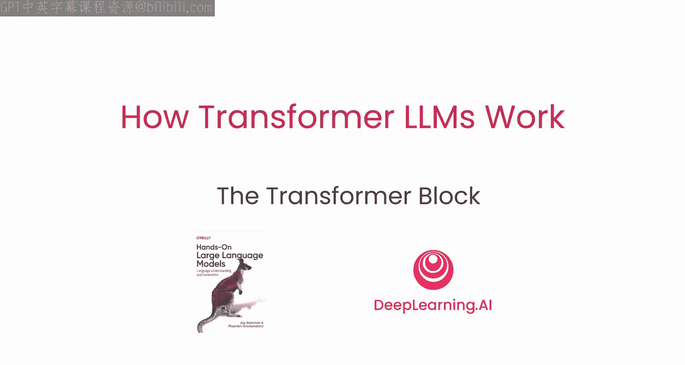
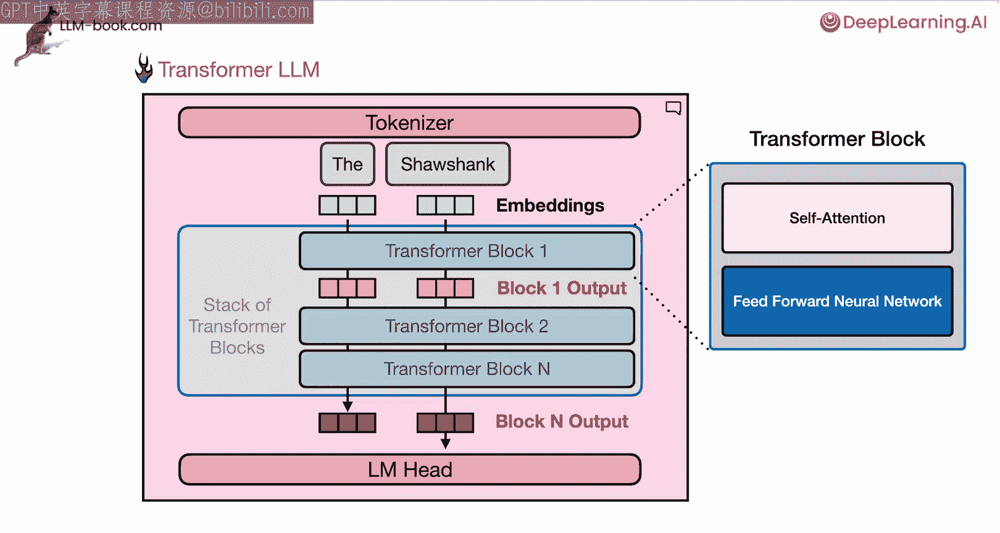
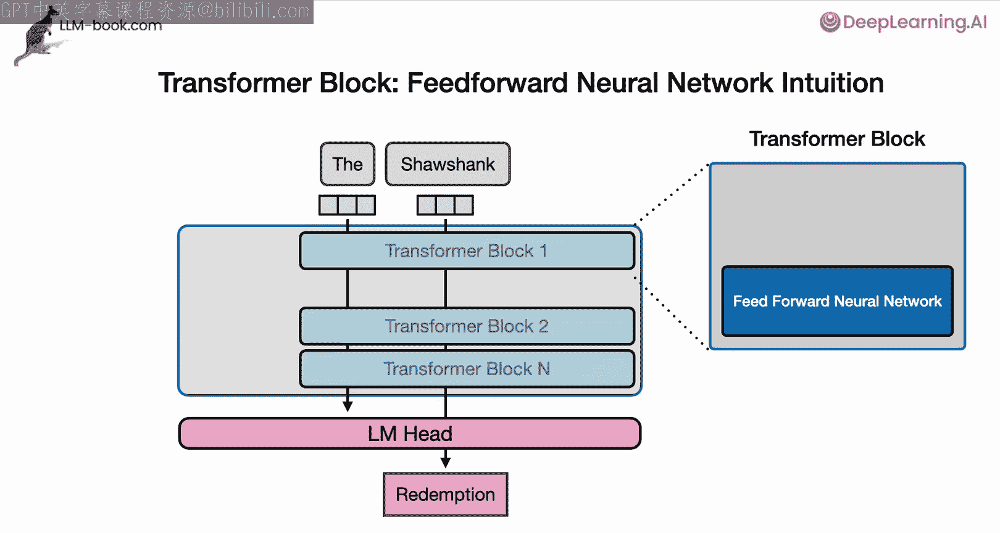
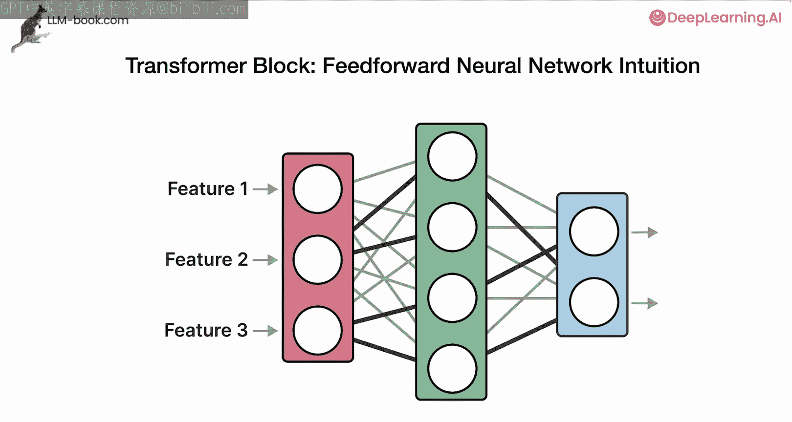
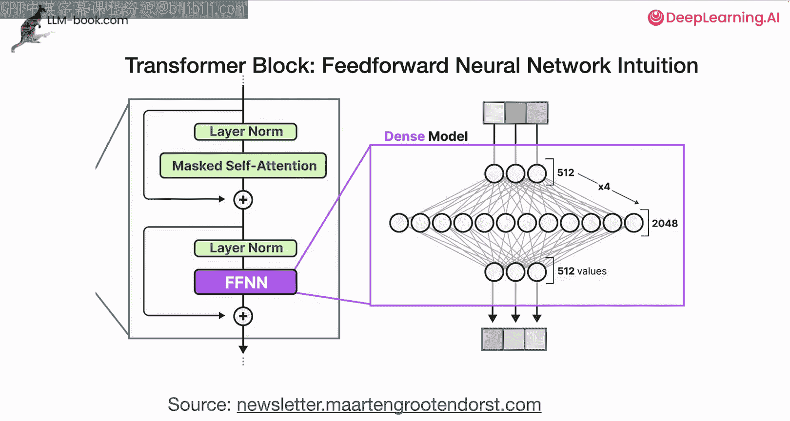
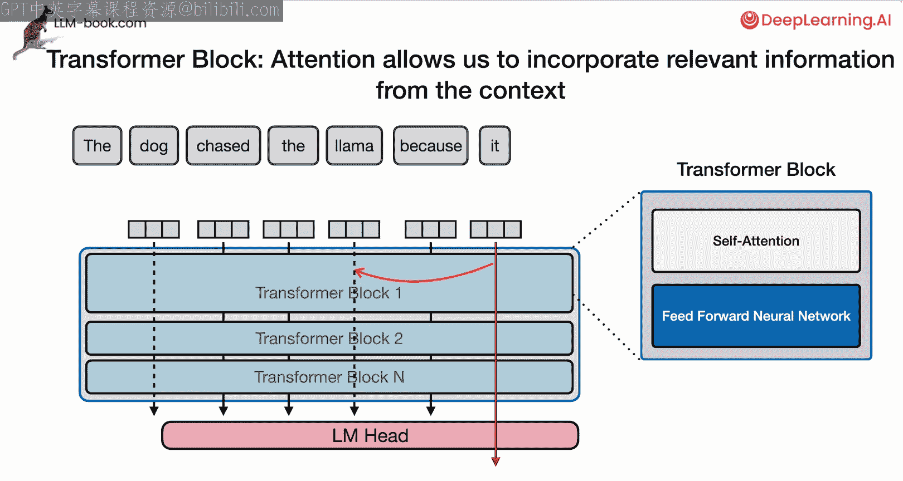
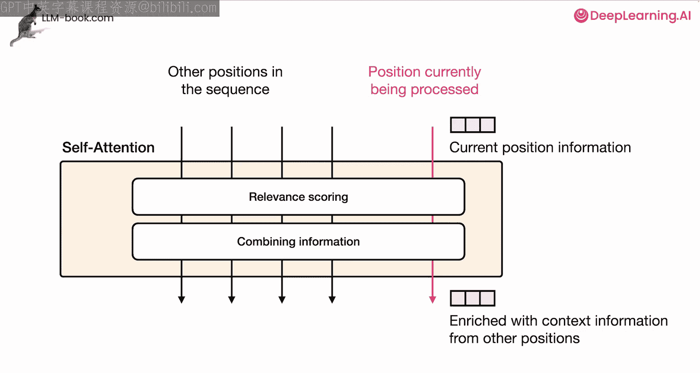

# Transformer大语言模型工作原理：8：Transformer Block 🧱

在本节课中，我们将要学习Transformer架构的核心组成部分——Transformer Block。我们将深入探讨其内部的两个主要组件：自注意力层和前馈神经网络层，并理解它们如何协同工作来处理和理解语言序列。

---

在Transformer架构的概述中，你已经了解到，在分词之后，词元嵌入会通过一个由多个Transformer Block堆叠而成的结构进行处理。现在，让我们深入了解这些Block的细节。

## 数据流概览

让我们看一个基本例子。假设我们有一个提示词：“the Shawshank”。为了理解Transformer Block如何运作，我们需要思考贯穿整个Block堆栈的两条数据流。

首先，我们的分词器将提示词分解为两个词元：“the”是一个词元，“Shawshank”是第二个词元。然后，由于我们拥有每个词元对应的嵌入向量，我们只需将它们替换为向量。这就是我们开始计算的基础。现在，我们已经将语言转化为了数字，可以对其应用大量有趣的微积分运算来预测下一个词是什么。

这些向量流入第一个Transformer Block，该Block会生成一个与其输入尺寸相同的输出向量。在这个过程中，Block内部的组件进行了一些处理，我们稍后会详细讨论。但在深入之前，理解这个总体流程对模型是有用的。

同样的事情发生在第二个Transformer Block上，它并行地处理第一个Block在各个数据流上的输出。这个过程会沿着Transformer Block的列表一直进行下去，直到最后一个Block。然后，最终层（例如，对于提示词中的最后一个词元）的向量被送入语言建模头，该头随后输出或生成预测的下一个词元。

这就是整个流程。一切从开始流向结束，方向单一：从分词器开始，依次经过一个个Transformer Block，最终到达语言建模头。

## Transformer Block的组成

Transformer Block本身由两个主要组件构成：**自注意力层**和**前馈神经网络层**。

### 前馈神经网络层 🧠

首先，让我们从高层次上理解前馈神经网络。如果Transformer Block只有这一层而没有注意力机制，它也能够生成补全。例如，它可能会预测在“Shawshank”之后最可能出现的词元是“Redemption”。这指的是那部著名的电影，因为如果你查看训练数据集（例如来自互联网或维基百科的数据），从统计上看，“Redemption”这个词在大多数情况下经常出现在“Shawshank”之后。

这是前馈神经网络能够做到的事情之一。我们可以将其视为信息的存储器，存储了例如输入词元之后出现的下一个词的统计信息。

这是一个高层次的理解。当然，像许多神经网络一样，它们做的事情可能更复杂一些，但这是理解前馈神经网络的合理起点。这与我们接下来要讨论的自注意力机制形成了对比。

我们在本课程早期已经看过神经网络，它们通常看起来像这样：一个层扩展进入另一个层，然后再收缩回第三个或输出层。这正是前馈神经网络中发生的情况。这些密集层之间的连接处，很可能就是模型所知道的所有信息被存储、建模、解释和插值的地方，从而使模型能够完成那些令人惊叹的事情，比如生成代码、编码关于世界的知识，以及用你选择的语言流利、连贯地与你对话。

### 自注意力层 🔍

另一方面，自注意力机制允许模型关注先前的词元，并将其上下文信息融入到对当前正在查看的词元的理解中。

让我们看这个例子：假设我们有一个提示词“The dog chased the llama because it...”，当模型处理“it”这个词时，它需要融入一些关于“it”指代什么的信息。这里“it”指的是“dog”还是“llama”？对于模型来说，能够感知“it”指代什么非常重要，而这正是自注意力机制所实现的部分功能。

它使模型能够融入一些例如“llama”词元的表示。如果先前的上下文指向这是“llama”，自注意力就允许模型将一些关于“llama”的表示融入到“it”中。因此，当它处理“it”这个词元时，它对“it”指的是“llama”有了一定的“理解”。

这是一个名为“共指消解”的自然语言处理任务。如果只给你这些词，可能很难真正确定“it”指的是“dog”还是“llama”，但在这个例子中，我们假设提示词中先前的词元表明“it”指的是“llama”。

为了从高层次理解注意力，我们可以这样表述：序列中有其他位置，即我们过去处理过的先前词元，然后是我们正在处理的当前位置及其向量表示。如果我们在第一个Transformer Block中，这就是嵌入向量；但如果你在第二、第三或第四个Block中，这就是前一个Block的输出。最终，我们希望这个向量表示能够融入来自其他位置的相关信息。

你可以把这想象成五条数据流，我们基本上是在提取有用的正确信息，以在此步骤中表示模型正在处理的这个词元。这就是自注意力的高层次表述。我们将在下一课中深入更多细节。

自注意力主要做两件事：
1.  **相关性评分**：它为每个输入词元与当前正在处理的词元之间的相关性分配一个分数。
2.  **信息融合**：在评分之后，将来自相关词元的信息融合到当前的表示中。

从高层次看，这就是自注意力机制归结为的两个步骤：相关性评分，然后将来自相关词元的信息融合到我们正在处理和表示的当前向量中。

---

## 总结

本节课中，我们一起学习了Transformer Block的结构和工作流程。我们了解到，每个Block由**前馈神经网络层**和**自注意力层**组成。前馈层像一个存储统计信息的存储器，而自注意力层则负责根据上下文动态调整词元表示，通过**相关性评分**和**信息融合**两个步骤，使模型能够理解词与词之间的关系。在下一课中，我们将进一步探讨自注意力机制的具体实现细节。