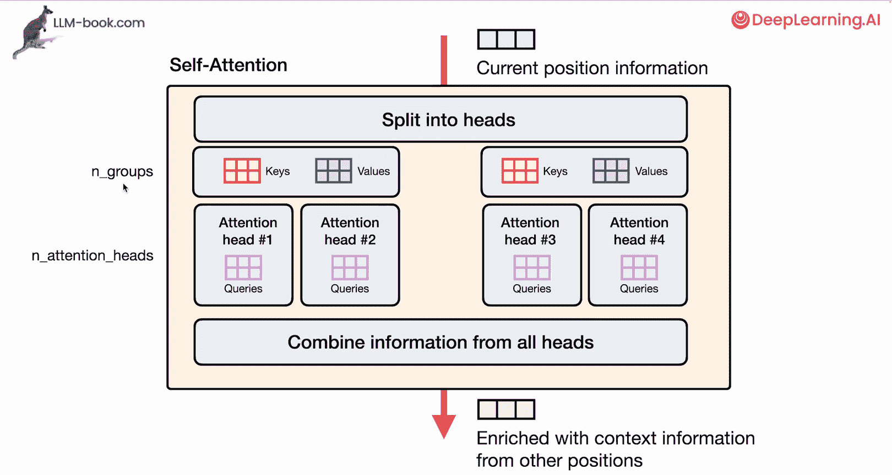
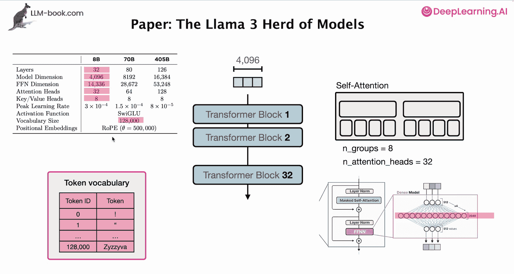
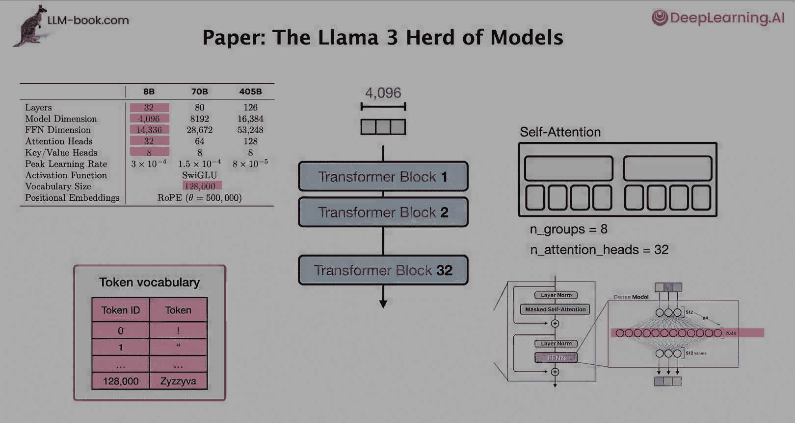

# Transformer大语言模型工作原理：9：自注意力机制详解 🔍

在本节课中，我们将深入探讨Transformer模型的核心组件——自注意力机制。我们将了解其计算步骤、关键概念以及近年来为提高效率而发展的各种注意力变体。

## 概述

自注意力是Transformer模块的关键组成部分。它包含两个主要步骤：相关性评分和信息组合。本节将详细讲解这些步骤的计算方式，并介绍近年来为提高注意力计算效率而提出的几种重要方法。

## 自注意力的两个步骤

上一节我们介绍了自注意力的高层概念，本节中我们来看看其具体的计算细节。

自注意力发生在所谓的“注意力头”内部。我们首先假设当前只使用一个注意力头来处理自注意力。我们有一个正在处理的当前词元，以及序列中位于它之前的其他词元的位置。这些是其他词元的向量表示。

自注意力计算使用三个矩阵：查询投影矩阵、键投影矩阵和值投影矩阵。在Transformer中，查询、键和值是计算中的重要概念。您将了解它们各自的用途。这些权重矩阵用于计算查询、键和值矩阵。通过我们将在接下来的幻灯片中讨论的某种交互，我们可以进行相关性评分，然后组合信息。

假设在查询侧，我们有一个代表当前位置的查询向量。而这个矩阵的每一行代表序列中的一个其他词元。对键和值也进行同样的操作，每一行都是一个代表序列中一个位置的向量。

相关性评分的最终目标类似于这样：我们为序列中的每个词元分配一个分数，告诉我们该词元与当前正在处理的词元的相关性有多高。例如，假设“狗”这个词元具有最高的相关性评分，那么在最终的信息组合步骤中，“狗”这个词元的表示将更多地融入到当前词元的丰富向量中。这就是相关性评分的结果，它为我们提供了这些分数，并且它们的总和为100%。

从技术上讲，这是通过矩阵乘法实现的：我们将与当前词元关联的查询向量乘以代表所有先前词元的键向量。这是一个高层次的直觉。但如果您想了解更多关于注意力如何计算和实现的信息，DeepLearning.AI有一个专门讲解注意力计算和实现的短期课程。如果您想深入了解细节，可以在屏幕上看到相关信息。我强烈推荐Joshua Starmer的课程，他讲解得非常出色。

## 信息组合步骤

现在我们有了相关性分数，就可以开始第二步：组合来自相关词元的信息。这是通过使用与每个词元关联的值向量来完成的。每个词元都有一个与之关联的值向量。我们只需将每个词元的分数乘以其值向量，就得到了这些加权值。其中“狗”的词元将具有最高的加权值，而其他词元的加权值将接近于0，因为我们将它们乘以了较小的数字。

一旦我们有了加权值，只需将它们求和。这个和就是第二步信息组合步骤的输出。

## 多头注意力

如前所述，上述计算发生在一个注意力头内部。但在自注意力中，相同的操作在多个注意力头中并行发生。每个注意力头都有自己的一套键、查询和值权重矩阵。它们分配给各个向量的注意力是不同的。

因此，我们可以将自注意力分为两个部分来看：在分割到各个注意力头之前，有一个将信息分割到各个注意力头的步骤；然后有一个将所有注意力头的信息重新组合在一起，形成自注意力层输出的步骤。

可视化这些键、查询和值矩阵也很重要。我们已经说过，每个注意力头都有自己的一套用于键、查询和值的投影矩阵。有了这个视觉概念，我们现在可以讨论近年来出现的、为当前一代Transformer大语言模型提供动力的、更高效的注意力形式。

## 高效的注意力机制

因为自注意力通常是Transformer中耗时最长、计算需求最大的步骤之一，所以人们提出了让注意力更高效的想法。其中一个想法是**多查询注意力**。其核心思想是：并非每个注意力头都有自己的键和值矩阵，而是让它们共享同一套键矩阵和值矩阵。因此，在整个层中，您只有一套这两个投影权重矩阵。您可以将其视为某种压缩。这样，我们需要计算的参数数量更少，这有助于模型在计算自注意力时更快。

更近期的**分组查询注意力**是一种高效的注意力机制，它允许我们使用多个键和值矩阵，但数量并非与注意力头数量相同，而是一个更小的数字，我们称之为“组”的数量。这比只共享一套键和值矩阵能带来更好的结果。这对于需要更多参数来表示数据的大型模型尤其重要，这些参数是在非常大的训练数据集上真正执行自注意力所必需的。

因此，现在当您阅读描述他们训练模型架构的论文时，如果它们使用了分组查询注意力，您会发现它们不仅会提到使用了多少个注意力头，还会提到使用了多少组键和值。

## 稀疏注意力

另一个近期提高注意力效率的重要想法是**稀疏注意力**。这通常不会在所有层中发生。例如，假设第一层以我们刚刚讨论的方式进行自注意力，其中在处理第7个词元时，它能够关注到序列中所有位于它之前的词元。在越来越大的模型中，如果允许每一层都发生这种情况，计算成本会变得过高。

所以您可能会开始看到，例如，第2层、第4层和第6层可能无法关注历史中的所有词元，而只能关注最后4个、16个或32个词元。这就是所谓的稀疏注意力的想法。

为了建立一种视觉语言来理解它：假设我们正在处理“the”这个词元，它现在不能关注任何先前的词元。假设第二个词元是“dog”，那么“dog”可以关注“the”和“dog”。然后我们有第三个词元“chased”，它能够关注三个词元，所以“chased”可以关注“dog”。这只是为了建立一种视觉语言，用于描述稀疏注意力是什么样子的图表。

这是**完全注意力**，每个词元都可以关注所有先前的词元。我们可以将每一行视为处理中的一个步骤：也许我们生成了这个词元，然后当我们生成它时，我们关注哪里。但稀疏注意力可以是这样的：这是**跨步注意力**，在每个位置，您可以回看最后三到四个词元，但您也可以关注特定的位置，例如，您可以关注位置1和位置4。

稀疏注意力的另一个想法是**固定模式**，在上下文序列中有这些固定的位置，当您到达第4个词元后，您只允许关注从第4个词元到当前位置的词元。

这是一篇名为《用稀疏Transformer生成长序列》的论文中的图表，它更详细地介绍了这些方法的工作原理。

更近期，为了让这些模型能够处理10万甚至100万个词元的上下文大小，出现了像**环形注意力**这样的想法。为此，我强烈建议您查看这篇博客文章《环形注意力详解》，它通过高度可视化和动画的方式解释了环形注意力及其工作原理。

## 应用实例：解读模型架构表

恭喜您坚持到这里！现在您已经了解了所有这些视觉语言，当您阅读像这样的论文时——这是录制时Meta关于Llama 3.1模型的最新论文——当您查看架构部分时，您现在应该具备视觉语言来思考描述模型架构的所有这些参数。

因此，当您看到这样的表格时，您知道每个组件是什么样子。例如，看看这个8B模型，您可以看到它有32层。这看起来像这样：这是它拥有的Transformer块的数量。它有4000的模型维度。这是流经Transformer的向量的维度长度。您看到前馈神经网络有14000的维度。这是前馈神经网络这一部分有多少个单元。您看到它有32个注意力头。您知道这些是什么。您看到它使用了分组查询注意力，带有8个键值头。这就是组的数量。您还看到它有128,000的词汇表大小。您知道这在分词器和模型内部的嵌入矩阵中是如何表示的。您可以看到它使用RoPE进行位置嵌入。这是一种称为旋转位置嵌入的方法，我们将在下一课中讨论。

## 总结

本节课中我们一起学习了自注意力机制的核心计算步骤：相关性评分与信息组合。我们探讨了多头注意力的并行处理方式，并深入了解了为提高Transformer大语言模型效率而发展的关键技术，包括多查询注意力、分组查询注意力、稀疏注意力以及环形注意力。最后，我们应用所学知识解读了实际模型（如Llama 3.1）架构表中的关键参数，巩固了对Transformer自注意力组件及其变体的理解。