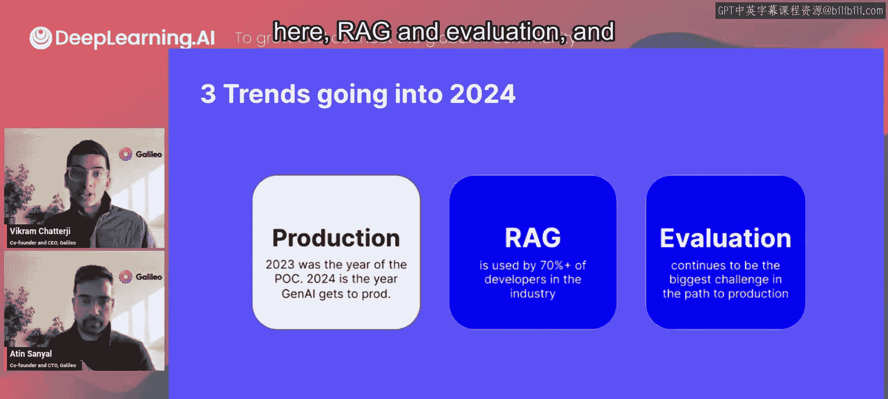
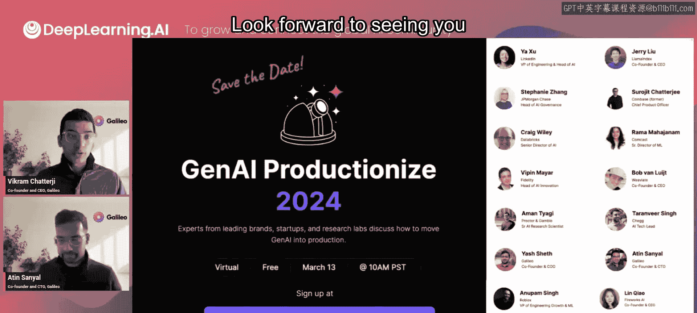
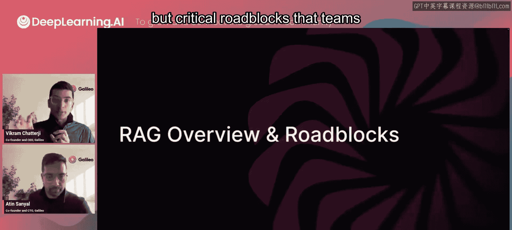
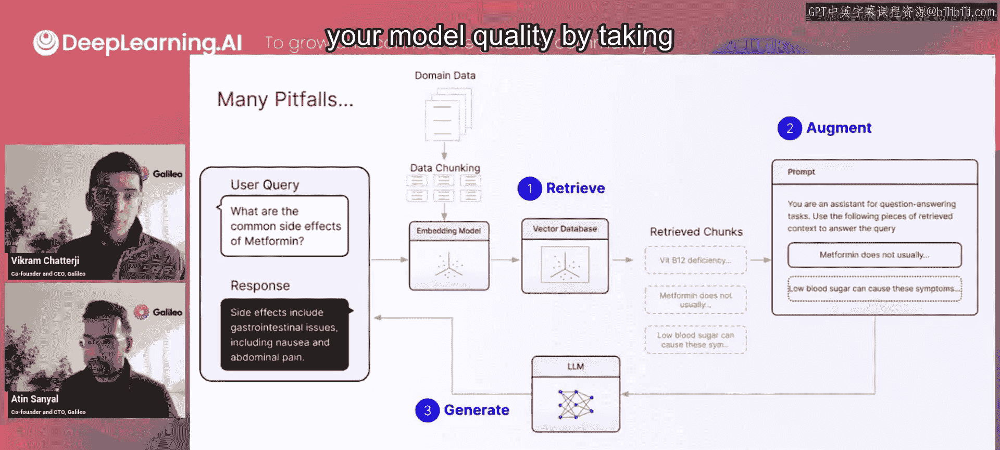
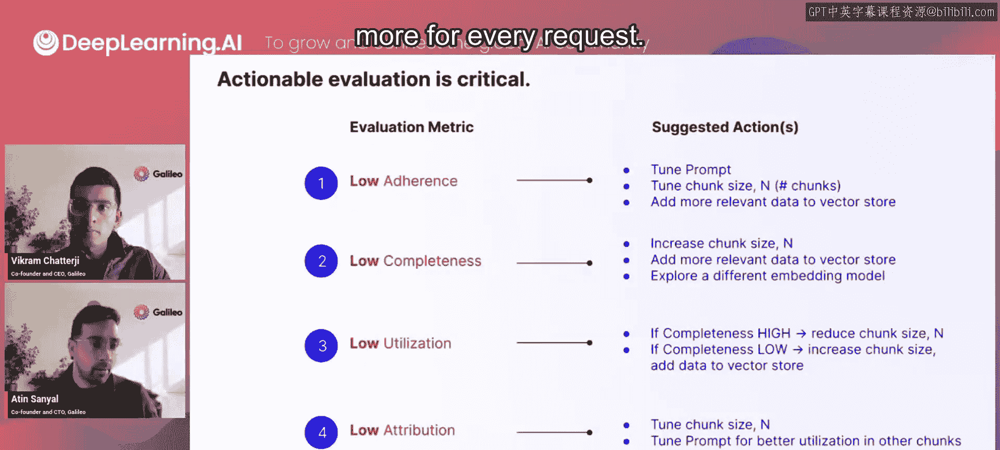
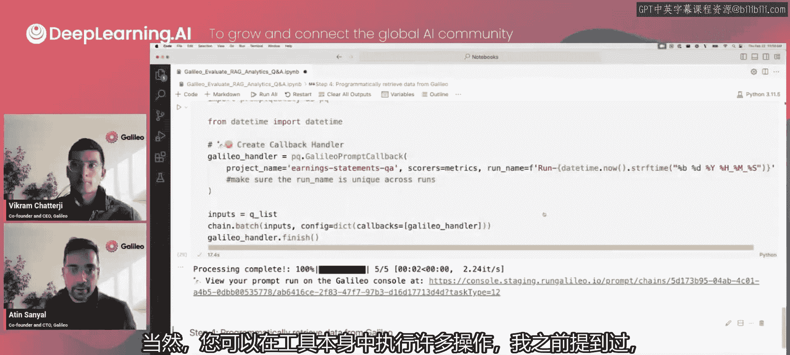
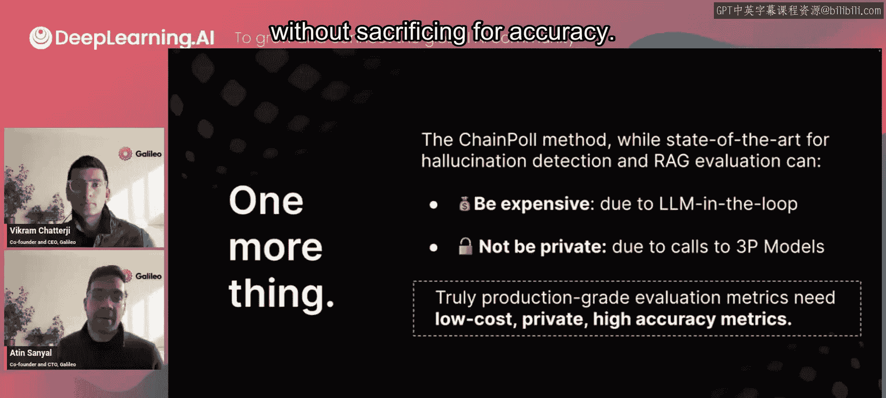
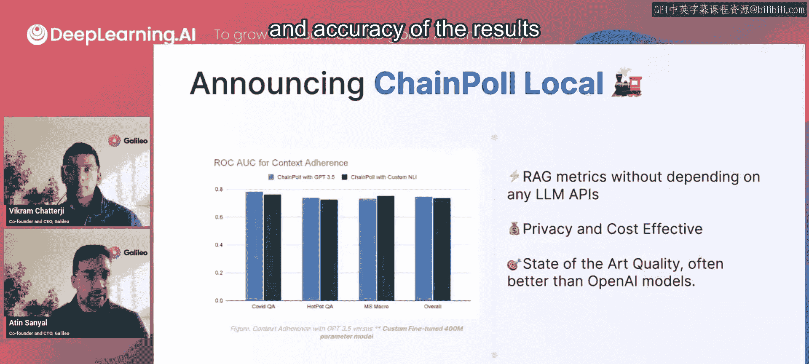

# RAG应用开发：P1：利用强大的RAG分析为您的RAG应用加速 🚀

## 概述

在本节课中，我们将学习检索增强生成（RAG）技术，这是一种构建生成式AI应用的主流方法。我们将探讨开发无错误RAG系统所面临的主要挑战，并学习如何通过强大的评估指标和分析方法来识别和修复问题，从而更快地构建生产就绪的RAG应用。

---

## RAG概述与常见挑战

上一节我们介绍了课程概述，本节中我们来看看RAG的基本概念及其在开发中遇到的核心挑战。

RAG已成为开发生成式AI应用的主导方法。然而，构建无错误的RAG系统面临重大挑战，包括维护文档块质量、优化提示词以及解决输出幻觉问题。

### 从基础提示工程到RAG

最初，我们使用基础的提示工程：将用户查询与系统提示结合，通过模型生成响应。这种方法存在三个主要问题：

1.  **幻觉倾向**：模型可能生成看似合理但不符合事实的响应。例如，当询问药物“二甲双胍”的常见副作用时，模型可能错误地回答“呼吸困难”，而实际上这是其他类似药物的副作用。
2.  **数据限制**：模型仅限于其预训练数据，存在数据不透明和可能过时的问题。
3.  **无法利用专有数据**：无法将公司内部的专有知识库（如医疗数据库）整合到生成式AI系统中。

RAG通过引入外部数据解决了这些问题。其工作流程如下：

1.  **数据分块**：将专有领域数据分割成较小的块。有多种分块策略可供选择。
2.  **嵌入**：使用嵌入模型（如OpenAI的`text-embedding-ada-002`或Hugging Face上的开源模型）将这些数据块映射到高维向量空间。公式可表示为：`embedding_vector = EmbeddingModel(chunk_text)`。
3.  **向量存储与检索**：将向量存储在向量数据库（如Pinecone、Weaviate、Milvus）中。当用户查询时，系统检索与查询最相关的数据块。
4.  **提示增强与生成**：将检索到的相关上下文与原始提示结合，形成增强提示，然后输入给大语言模型以生成最终响应。

通过RAG，模型能够基于提供的专有上下文生成更精确的答案，例如正确回答二甲双胍的副作用包括胃肠道问题（恶心、腹痛）。

### RAG流程中的关键挑战

尽管RAG功能强大，但其流程中的每个环节都可能出现问题：

1.  **文档与分块质量**：需要确保有足够高质量且分布良好的数据，并选择合适的分块大小。
2.  **嵌入模型优化**：嵌入模型有许多参数需要优化，选择不当会影响检索质量。
3.  **检索器质量**：检索到的数据块是否真正有助于生成答案？可能存在检索到的块与答案无关的情况。
4.  **提示词效果**：所使用的提示词是否是当前任务的最佳选择？
5.  **上下文遵循与幻觉**：模型的响应是否严格遵循所提供的上下文？还是回到了预训练数据并产生幻觉？
6.  **答案完整性**：模型是否完整回答了用户查询的所有部分？

因此，对整个RAG技术栈进行仔细的评估和实验，对于开发高质量的应用程序至关重要。

---

## 实用RAG评估指南

上一节我们探讨了RAG的流程与挑战，本节中我们将深入探讨如何系统地评估RAG系统。

任何RAG系统的目标都是：输入最相关的查询、提示和精确的上下文，以输出准确、完整且全面的回答。为了达成这一目标，我们需要回答以下四个关键问题：

以下是评估RAG系统时需要关注的四个核心问题：

1.  **上下文遵循度**：模型的输出在多大程度上遵循了所提供的上下文？这是RAG的基本原则，旨在防止模型产生通用或幻觉的回答。
    *   **示例**：问：“二甲双胍的常见副作用是什么？” 答：“副作用包括恶心和呼吸困难。” 虽然“呼吸困难”不在提供的上下文中，但模型仍将其生成，这表明**上下文遵循度低**，存在幻觉。
2.  **答案完整性**：模型是否回答了查询的所有部分？即使输出遵循上下文，也可能遗漏重要信息。
    *   **示例**：同上问题，模型回答：“副作用包括胃肠道问题，如恶心。” 虽然正确且遵循上下文，但上下文还提到了“乳酸酸中毒”等其他副作用。这表明**答案完整性低**，回答不够全面。
3.  **上下文块归因**：模型的输出是否真正归因于（即使用了）检索到的上下文块？这衡量了检索质量。
    *   **示例**：问：“管理高血压的建议？” 答：“建议包括减肥、改变生活方式和均衡饮食。” 检索到了3个相关块（血压、BMI、饮食管理），但模型主要只使用了BMI相关的块。这表明**归因度低**，可能浪费了上下文令牌，或导致答案不完整。
4.  **块内利用率**：在单个被使用的上下文块内部，模型具体利用了其中的多少内容（如句子、令牌）来生成响应？
    *   **示例**：同上问题，模型回答：“建议包括减少钠摄入和保持健康体重。” 虽然使用了“饮食管理”块，但只聚焦于该块中关于“钠摄入”的一小部分。这表明**块内利用率低**，响应可能过于笼统，或错过了块内的其他有用信息。

### 量化评估指标

为了量化上述问题，我们引入了四个对应的评估指标：

1.  **上下文遵循度**：衡量输出对提供上下文的遵循程度。
2.  **答案完整性**：衡量输出回答查询所有方面的全面性。
3.  **归因度**：衡量有多少个上下文块参与了LLM的决策过程（上下文质量的粗略度量）。
4.  **利用率**：衡量块内精度，即块中有多少句子/令牌被用于推理过程。

这些指标基于我们的研究框架 **ChainPoll**（思维链提示与集成的结合）开发，该框架在检测RAG幻觉等方面优于现有技术。我们在数十个基准数据集上测试，ChainPoll方法在所有这些指标上的表现显著优于标准方法（如RAGAS的忠实度）和GPT基线。

### 根据指标采取行动

检测到指标异常后，应采取相应措施进行优化：

以下是针对不同低分值指标的优化建议：

*   **上下文遵循度低**：
    *   优化提示词，明确指示模型关注上下文特定部分。
    *   调整分块大小，增加数据量。
    *   检查并提升向量存储中的数据质量。
*   **答案完整性低**：
    *   调整分块大小以包含更多或更相关的数据。
    *   尝试不同的嵌入模型，因为嵌入质量直接影响检索到的语义质量。
*   **利用率低**：
    *   如果完整性高但利用率低：**减少分块大小**，避免令牌浪费。
    *   如果完整性也低：**增加分块大小**或添加更多数据，并检查向量存储中的数据。
*   **归因度低**：
    *   调整向量存储参数（如相似度阈值）。
    *   清理向量存储中的数据，移除不相关数据，以便模型能为每个请求归因更多相关块。

这些指标相互关联，共同指导RAG系统的调优。

---

## RAG评估实战演示

上一节我们介绍了评估指标与行动指南，本节中我们通过一个实际案例来演示如何运用这些指标。

我们将构建一个面向数据分析师的问答聊天机器人，其知识库基于财报电话会议记录。技术栈包括：Pinecone（向量存储）、LangChain（构建链）、OpenAI（LLM）和Galileo（评估）。

### 演示步骤

1.  **环境设置与数据准备**：安装必要库，设置环境变量，实例化向量数据库索引，并准备测试问题（如询问各公司不同季度的收入及环比比较）。
2.  **集成Galileo评估**：使用Galileo的Python客户端`promptquality`，初始化我们关注的RAG评估指标（上下文遵循度、答案完整性、归因度、利用率）。通过一行回调代码将Galileo集成到LangChain工作流中。
3.  **运行链并分析结果**：
    *   执行链处理所有测试查询。
    *   在Galileo控制台查看整体实验的指标概览。例如，可能发现“上下文遵循度”和“归因度”普遍偏低。
    *   深入分析单个查询：
        *   **案例一（高完整性，低遵循/利用率）**：查询“Costco Q1收入及与上季度对比”。模型给出了收入数字和增长百分比，完整性高。但通过检查归因的上下文块发现，模型误将“同比增长6.1%”当成了“环比增长”，导致**上下文遵循度低**，产生事实性幻觉。Galileo自动提供了此错误的解释。
        *   **案例二（多项指标低）**：查询“Gap Q3收入及与上季度对比”。模型回答“信息不存在”。检查发现，归因的上下文块中确实包含相关数据（如“净销售额38亿”），但查询中的“收入”与上下文中的“净销售额”表述不一致，导致模型未能正确识别和利用信息。这解释了为何**归因度**有信号但**遵循度**、**完整性**和**利用率**都低。
4.  **洞察与价值**：演示展示了如何快速定位难以发现的幻觉、检索失败和提示词问题。无需手动阅读大量上下文，利用Galileo提供的指标和自动解释，能在几秒内完成根本原因分析，极大提升了调试效率。

---

## 进阶：低成本私有化评估方案

在上一节的演示中，我们看到了强大评估工具的价值。但ChainPoll等方法可能涉及调用外部LLM API，带来成本和隐私顾虑。

为了解决这个问题，我们推出了 **ChainPoll Local**。这是ChainPoll的演进版本，旨在以私有、零成本的方式提供生产级评估指标。

*   **原理**：我们用内部训练的、轻量级的Galileo微调模型（约4亿参数）替代了对OpenAI等外部LLM的依赖。这些模型可以在CPU上运行。
*   **优势**：
    *   **零成本**：无需支付第三方API费用。
    *   **完全私有**：所有数据处理和评估均在本地或私有环境进行，数据无需外传。
    *   **保持高精度**：实验结果显示，在某些数据集上，ChainPoll Local的微调模型性能甚至优于使用OpenAI模型的原始ChainPoll方法，且准确率没有牺牲。

ChainPoll Local使得团队能够在严格的数据安全要求下，依然进行高效、深入的RAG系统评估与优化。

---

## 总结

在本节课中，我们一起学习了：

1.  **RAG的核心价值与挑战**：RAG通过引入外部专有数据，有效缓解了LLM的幻觉问题、数据局限性和无法利用内部知识的问题。但其开发过程在数据质量、检索、提示词和输出控制等方面存在诸多挑战。
2.  **系统的评估框架**：我们介绍了四个关键的评估维度（上下文遵循度、答案完整性、归因度、利用率）及其对应的量化指标。这些指标是诊断RAG系统健康状况的“指南针”。
3.  **从指标到行动**：针对每个指标的低分情况，我们提供了具体的优化建议，例如调整分块策略、优化提示词、更换嵌入模型或清理数据。
4.  **实战演示与工具价值**：通过一个财报分析机器人的案例，我们演示了如何利用Galileo等工具快速定位幻觉、检索失败等复杂问题，将调试时间从数小时缩短至数秒。
5.  **私有化评估方案**：介绍了ChainPoll Local，它能够在保证数据隐私、控制成本的前提下，提供强大的RAG评估能力，满足企业级部署的需求。

通过掌握这些评估方法和工具，您可以更有信心地构建、调试和生产化高质量的RAG应用程序，加速从原型到产品的进程。