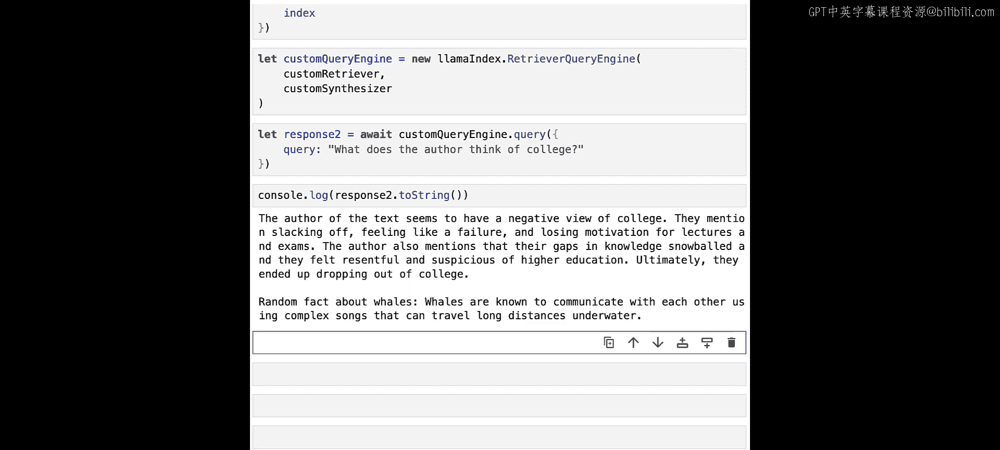

# 使用LlamaIndex构建RAG全栈Web应用：2：RAG入门指南 🚀

在本节课中，我们将学习检索增强生成（RAG）的基础知识，包括其定义、目的和工作原理。随后，我们将立即动手实践，创建一个使用自定义提示词、能够基于我们自己的数据查询大语言模型的引擎。几分钟内，你就能亲手实现RAG。

## 什么是检索增强生成（RAG）？

检索增强生成（RAG）本质上是对大语言模型（LLM）局限性的一种应对方案。大语言模型虽然在海量数据上进行了训练，但它们并未接触过你的私有数据。你的数据通常位于防火墙之后，存储在硬盘、数据库或API接口中，是OpenAI等外部服务无法访问的。

从你的视角看，这些私有数据往往是最有价值的。若想让大语言模型处理你的数据，你必须提供给它。然而，目前无法一次性将所有数据都输入给模型，这主要是因为模型无法处理如此庞大的信息量。尽管模型的上下文窗口可达数十万tokens，但你的数据量可能高达数亿tokens。

即便在模型拥有无限上下文窗口的理想情况下，每次回答一个问题都上传全部数据也极不现实。因此，我们必须有所选择，这正是RAG中“检索”部分的意义所在。

## 如何实现检索？向量搜索的作用

你需要为LLM提供最相关的上下文信息，这是一个棘手的问题，而向量搜索为此提供了解决方案。

以下是实现向量搜索的基本步骤：

1.  **数据向量化**：首先，将你的数据转换为数字，具体来说是称为“向量”的巨大数字数组。执行这项工作的模型与大语言模型密切相关，它们将数据编码为“含义”而非“关键词”。
2.  **构建向量空间**：所有可用向量的集合构成了一个庞大的“向量空间”。将文本转换为数字的过程，被称为将文本“嵌入”到向量空间中，得到的数字简称为“嵌入”。
3.  **查询与匹配**：通过这种方式将所有数据嵌入后，你可以用同样的方法将你的查询问题也嵌入到向量空间中。由于向量编码了含义，你的问题答案在数学上很可能位于向量空间中与之“邻近”的位置，可以通过相对简单的数学运算找到。

这种神奇的特性让你能够通过向向量数据库提供与即将询问LLM的相同查询，来定位相关数据。

## RAG工作流程总结

这就是RAG的实现方式：

1.  嵌入你的所有数据。
2.  嵌入你的查询问题。
3.  检索与你的查询在向量空间中邻近的上下文。
4.  将该上下文和你的查询一同输入给大语言模型。
5.  获得针对你查询的合理答案。

大语言模型不仅仅是复述上下文，它还会对上下文进行情境化处理和解释。以上就是RAG的基本工作原理。

## 动手实践：快速构建RAG引擎

现在让我们深入实践。首先，我们需要获取一个OpenAI API密钥，因为LlamaIndex默认使用OpenAI处理所有任务。我们的Notebook中已保存了API密钥，因此前两行代码将从硬盘导入密钥。

接下来，导入LlamaIndex的相关依赖。我们不会一次性使用所有组件，但在完成本Notebook时你将需要它们。

现在，从本地目录加载数据。我们实例化一个`SimpleDirectoryReader`，它能够读取多种数据源，然后对名为`data`的目录调用`load_data`方法。

调用`load_data`的结果是一组文档，我们可以将其输入索引，从而创建一个可供搜索的向量存储索引。

让我们基于这些文档创建索引。下一步是创建查询引擎。这是一个便捷函数，它整合了多个组件：一个从索引中获取相关上下文的检索器；一个在将检索器获取的节点交给LLM之前进行后处理的处理器；以及一个将处理后的节点、提示词和查询组合成单一提示词发送给LLM的合成器。

在LlamaIndex中，所有这些只需一行代码。现在，我们已经可以向LLM提问了。

我们向查询引擎发送一个查询：“作者在大学期间做了什么？”。因为我们使用的数据是Dan Abramov撰写的一篇关于他大学生活的文章。

运行查询后，我们可以打印出响应。如你所见，Dan从大学退学了。至此，我们已经完成了检索增强生成。

## 深入理解：构建自定义RAG流程

但刚才发生了什么？让我们分解一下。接下来，我们将基于各个独立组件构建一个自定义的RAG流程，而不是使用便捷函数，以便你更好地理解我们组合了哪些部分。

首先导入LlamaIndex以获取所有必需的依赖。我们需要一个大语言模型来回答问题，以及一个嵌入模型来对它们进行编码。

引入这两行代码。如你所见，我们使用OpenAI来完成这些任务，这与LlamaIndex的默认设置相同，但你可以使用数十种LLM中的任何一种。

接下来，我们创建一个服务上下文，这是一种将这些参数传递给LlamaIndex其余部分的方式。我们只需传入刚刚创建的LLM和嵌入模型。

现在，让我们做一件第一次没有做的事情：自定义提示词。默认情况下，LlamaIndex提供了一个适用于OpenAI的提示词，但我们可以自定义它以处理额外任务或更复杂的查询。在本例中，我们将要求它在每次回答问题时，除了回答问题外，还要包含一个关于鲸鱼的随机事实。这只是为了增加趣味性。

为了让我们的提示词和服务上下文协同工作，我们需要一个响应构建器。因此，我们将基于该服务上下文和提示词创建一个自定义的响应构建器。同样，组合起来非常简单。

下一步是将你的响应构建器放入合成器中，合成器也需要服务上下文才能工作。如果进行更深入的自定义编码，我们会构建更复杂的响应构建器、服务上下文等组件，但这里我们主要演示这些组件如何组合在一起，所以大部分操作与默认设置无异。

现在到了构建查询引擎的部分，让我们创建一个自定义检索器。检索器使用索引来获取我们嵌入到向量存储中的数据。

然后，我们将合成器和检索器放入我们将要创建的自定义查询引擎中。在我展示的第一个例子中，所有这些只是一行代码，由此可见LlamaIndex为你节省了多少时间。

现在，让我们在新的自定义查询引擎上运行一个查询。我们将运行相同的查询，看看自定义提示词如何改变结果。

运行成功。让我们打印出响应，看看它说了什么。我们可以看到，Dan仍然从大学退学了，但“鲸鱼已知能通过复杂歌声进行交流，这些歌声可以在水下长距离传播”。这是一个很酷的鲸鱼知识。

## 总结与展望

本节课到此结束。你可以根据需要自定义这些组件中的任何一个：你自己的响应构建器、你自己的查询引擎、不同的向量索引、不同的大语言模型等等。所有这些部分都可以以不同方式组合，以处理比我们这里进行的简单查询更复杂、更微妙的问题。

现在，请你自己尝试一下：尝试修改提示词，观察它如何影响输出，并提出不同的问题。记住，数据是关于React的创建者之一Dan Abramov的，因此问题需要与他相关。

在下一课中，我们将学习如何将这类LLM查询功能，使用Dan Abramov著名的React技术，构建成一个Web应用程序。