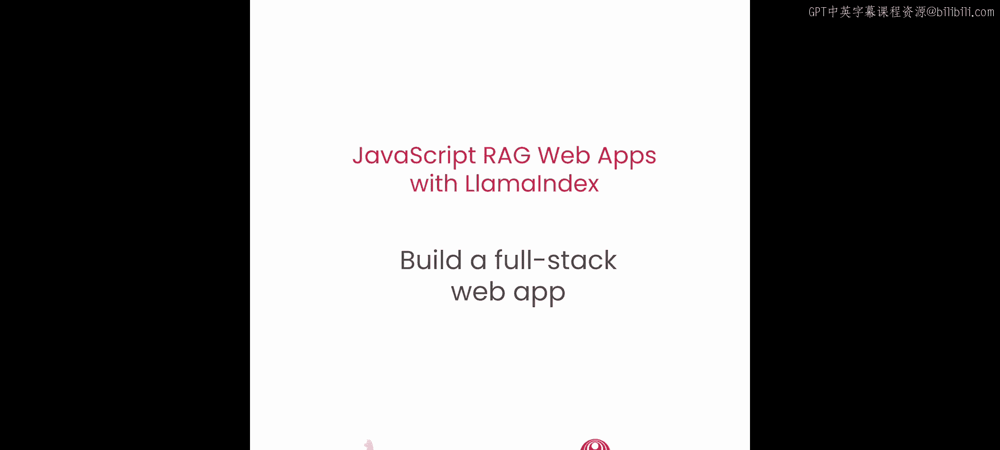
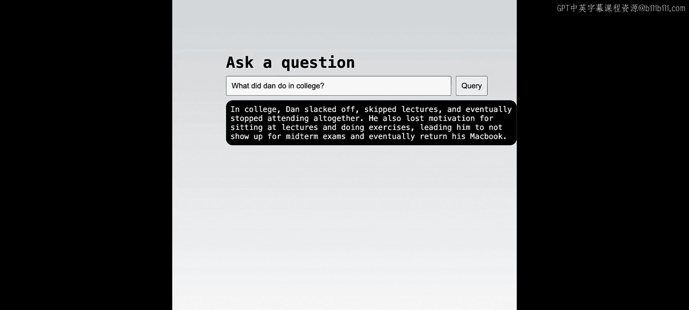

# 使用LlamaIndex构建RAG全栈Web应用：P3：构建全栈Web应用 🚀



在本节课中，我们将学习如何构建一个完整的全栈Web应用。我们将首先创建一个简单的后端Web API，然后将其与LlamaIndex集成以处理RAG查询。接着，我们将使用React构建一个交互式前端组件，该组件会调用我们的API并将查询结果显示给用户。让我们开始吧。

## 从后端API开始

上一节我们介绍了RAG查询的基础知识。本节中，我们来看看如何将这些功能封装成一个Web API。

首先，我们需要创建一个简单的Web服务器。这个服务器将作为Web API，接收网络请求并返回我们的数据。


以下是一个基础服务器的代码示例：

```javascript
const handler = async (req) => {
  const text = "Hello world";
  const encoder = new TextEncoder();
  const encodedText = encoder.encode(text);
  return new Response(encodedText, { status: 200 });
};
```

如你所见，处理程序接收一个请求对象（`req`）。这次我们的响应将是经典的“Hello world”文本字符串，需要使用文本编码器进行编码。然后，我们返回一个内置的`Response`对象，并设置HTTP状态码为200，表示请求成功。

在Deno中构建Web服务器非常简单。我们使用`Deno.serve`对象，在端口8001上启动，并传入处理程序。

```javascript
Deno.serve({ port: 8001 }, handler);
```

服务器现在在`localhost:8001`上监听。为了验证它是否正常工作，我们可以使用内置的`fetch`命令向服务器发起请求。

```javascript
const response = await fetch("http://localhost:8001");
const text = await response.text();
console.log(text); // 输出: Hello world
```

现在我们已经有了服务器，并向它发出了请求，也得到了响应。让我们关闭这个服务器，开始做一些更复杂的事情。

**请注意**：每次运行服务器都会占用你指定的端口。如果你忘记关闭服务器，将无法在同一端口上启动新服务器。如果尝试在端口8001上启动时遇到错误，请尝试使用端口8002。

## 构建RAG查询API

接下来，我们将构建一个更复杂的服务器，它可以运行RAG查询，就像我们在上一课中所做的那样，但以Web API的形式进行响应。

为此，我们将引入上一课中的所有代码：导入依赖项、设置密钥、加载文档、构建索引和查询引擎。这部分代码与上一课完全相同。

现在，我们将创建一个新的处理程序，它接收查询输入，并从我们刚刚创建的查询引擎中获取响应。

让我们逐行分析这个新的处理程序：

```javascript
const ragHandler = async (req) => {
  // 检查请求方法是否为POST
  if (req.method === "POST") {
    // 期望传入的请求体是一个JSON对象，其中包含“query”键
    const data = await req.json();
    const query = data.query;

    // 使用查询引擎获取答案
    const answer = await queryEngine.query(query);

    // 将答案构建成JSON响应
    const responseBody = JSON.stringify({ response: answer.toString() });
    return new Response(responseBody, {
      status: 200,
      headers: { "Content-Type": "application/json" }
    });
  } else {
    // 如果不是POST请求，返回404
    return new Response("Not Found", { status: 404 });
  }
};
```

处理程序首先检查请求方法是否为`POST`。它期望传入的请求体是一个JSON对象，其中`query`键包含查询文本。然后，它使用这个查询来调用我们的查询引擎。得到的答案被包装成一个JSON对象，其中`response`键包含答案的字符串形式。最后，我们返回一个状态码为200的`Response`对象。

如果请求方法不是`POST`，为了保持整洁，我们将返回“Not Found”和404状态码。

最后，我们在端口8002上设置服务器，就像上次一样。

```javascript
Deno.serve({ port: 8002 }, ragHandler);
```

现在，让我们向这个新的Web API发起一个查询。首先设置查询内容，然后像之前一样执行`fetch`请求。不过，这次请求将发送到端口8002，并且是一个`POST`请求，因为我们的处理程序只响应`POST`方法。

我们还需要将内容类型设置为`application/json`，这样服务器就知道我们发送的是JSON请求，而不是纯文本。

```javascript
const query = { query: "What was Dan's experience in college?" };
const response = await fetch("http://localhost:8002", {
  method: "POST",
  headers: { "Content-Type": "application/json" },
  body: JSON.stringify(query)
});

const result = await response.json();
console.log(result.response);
```

如你所见，我们得到了更多关于Dan大学不愉快经历的信息。完成后，为了保持整洁，我们将关闭服务器。

在开始下一部分之前，请尝试修改上面的代码，感受一下。尝试返回不同的字符串，并像在第一课中那样运行不同的查询。

## 构建交互式React前端

在上一节，我们学习了如何在命令行中发起简单的Web请求。本节中，我们将使用真实的浏览器来完成这个任务。我们将使用一个已经为你设置好的Web应用的开发版本。

我们将使用一些预先设置好的工具函数来运行前端和后端服务器。你不需要深入了解这些函数的具体实现，但如果你感兴趣，可以查看代码。

首先，运行前端服务器，然后运行后端服务器。

现在我们的前端和后端都在运行了，让我们创建一个React组件，它最初是一个简单的计数器。

### 创建基础React组件

在React中，所有组件都是函数。我们将首先创建一个最简单的React组件，它只显示一个设置为0的计数器和一个按钮。

```jsx
function Counter() {
  return (
    <div>
      <h1>Counter: 0</h1>
      <button>Increment</button>
    </div>
  );
}
```

这个函数返回的内容看起来像HTML（实际上是JSX），它最终会被编译成HTML。目前，我们只是提供了一个标题为“Counter”的`<h1>`和一个按钮。

使用工具函数`addToFrontend`将这个组件插入到我们的Web应用中。在浏览器中，JSX被渲染成非常简单的HTML：计数器设置为0，还有一个名为“Increment”的按钮（目前点击它没有任何效果）。

### 添加变量和交互性

下一步，我们将修改现有的函数，添加一个变量。我们创建一个名为`count`的变量，将其设置为10，并将这个变量插入到原来显示“0”的位置。

```jsx
function Counter() {
  const count = 10;
  return (
    <div>
      <h1>Counter: {count}</h1>
      <button>Increment</button>
    </div>
  );
}
```

现在，计数器显示的是变量`count`的值（10）。

接下来，让我们添加真正的交互性。在这个版本的函数中，我们将`count`转换为一对函数：`count`和`setCount`，它们使用了`useState`钩子。你不需要知道`useState`的具体工作原理，但它是React处理变量及其变化的基础方式。

我们还创建了一个名为`increment`的函数，每次调用时给数字加1，然后调用`setCount`来更新React中该变量的值。同时，我们修改了按钮，使其在点击时调用`increment`函数。

```jsx
import { useState } from 'react';

function Counter() {
  const [count, setCount] = useState(0);

  function increment() {
    setCount(count + 1);
  }

  return (
    <div>
      <h1>Counter: {count}</h1>
      <button onClick={increment}>Increment</button>
    </div>
  );
}
```

现在，计数器从0开始，但当我们点击按钮时，数字会增加。我们已经构建了一个交互式的React组件！至此，你已经制作了一个真正的React应用，正走在成为Web开发者的路上。

下一步是制作一个向我们的服务器提问的应用，而不仅仅是增加一个计数器。

### 构建查询前端组件

在这个版本中，我们将创建一个名为`QuerySender`的组件。它将提供一个文本输入框、一个按钮以及一个显示答案的区域。

```jsx
function QuerySender() {
  return (
    <div>
      <h1>Ask a Question</h1>
      <form>
        <input type="text" />
        <button type="submit">Query</button>
      </form>
      <div id="answer">
        {/* 答案将显示在这里 */}
      </div>
    </div>
  );
}
```

我们有一个`<h1>`标题，一个包含文本输入框和按钮的`<form>`，以及一个用于放置答案的`<div>`。目前点击按钮没有任何反应，这没关系，我们接下来就添加交互性。

你可能会好奇所有的样式（比如黑色的框、灰色的背景）是从哪里来的。这些背景样式我们已经为你处理好了。

就像第一次添加交互性时一样，我们将添加一些变量和一个改变它们的函数。我们将创建`query`和`setQuery`，并使用`useState`来组合它们。

你可以把它们想象成之前的`count`，只不过它们包含的是我们的问题字符串。我们还有一个`handleChange`函数，它将把我们的`query`设置为`e.target.value`（即用户在文本框中输入的字符串值）。当用户点击按钮时，我们会把这个答案放入`query`变量中，然后它就会显示在答案区域。

```jsx
import { useState } from 'react';

function QuerySender() {
  const [query, setQuery] = useState('');
  const [answer, setAnswer] = useState('');

  function handleChange(e) {
    setQuery(e.target.value);
  }

  function handleSubmit(e) {
    e.preventDefault(); // 阻止表单默认的页面刷新行为
    setAnswer(query + ' is the answer');
  }

  return (
    <div>
      <h1>Ask a Question</h1>
      <form onSubmit={handleSubmit}>
        <input type="text" value={query} onChange={handleChange} />
        <button type="submit">Query</button>
      </form>
      <div>Answer: {answer}</div>
    </div>
  );
}
```

当表单被提交（点击查询按钮或按回车键）时，会调用`handleSubmit`。`e.preventDefault()`阻止了表单提交时默认的页面刷新行为。然后，我们将答案框的内容设置为查询的问题加上“is the answer”这个字符串。

现在，答案不再自动更新，而是等到我们点击查询按钮后才显示。虽然这还不算令人印象深刻，但我们正在逐步完善。

### 连接前端与后端API

最后，我们将扩展`handleSubmit`函数，使其调用我们之前创建的后端API。就像在第一课中一样，我们将发起一个`fetch`请求。

在实际应用中，我们会做很多错误检查（例如，服务器宕机怎么办？不知道答案怎么办？），但为了简洁，我们暂时跳过这些。

让我们逐行分析更新后的`handleSubmit`函数：

```jsx
async function handleSubmit(e) {
  e.preventDefault();
  // 在等待答案时，先显示“Thinking...”
  setAnswer('Thinking...');

  try {
    const response = await fetch('http://localhost:8002', {
      method: 'POST',
      headers: { 'Content-Type': 'application/json' },
      body: JSON.stringify({ query: query })
    });

    const result = await response.json();
    // 假设后端返回 { response: "答案文本" }
    setAnswer(result.response);
  } catch (error) {
    setAnswer('Error: Could not get an answer.');
  }
}
```

我们首先调用`preventDefault`。然后，我们将答案设置为字符串“Thinking...”，因为获取答案可能需要一些时间，我们希望用户知道正在处理中。接着，我们使用`POST`方法和`application/json`内容类型调用我们的服务器，并发送包含查询的JSON字符串。我们等待服务器的答案，然后将答案设置为返回的结果。

## 总结 🎉

在本节课中，我们一起学习了如何构建一个完整的全栈Web应用。

1.  **我们构建了一个后端Web API**：它接收POST请求，使用LlamaIndex处理RAG查询，并以JSON格式返回答案。
2.  **我们构建了一个交互式React前端**：它包含一个表单，用于输入问题并调用后端API，然后将结果显示给用户。



你已经成功创建了一个Web应用！在下一课中，我们将增强RAG应用的能力，包括构建一个称为“智能体”的半自主软件模块。