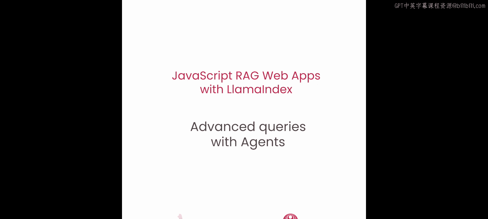
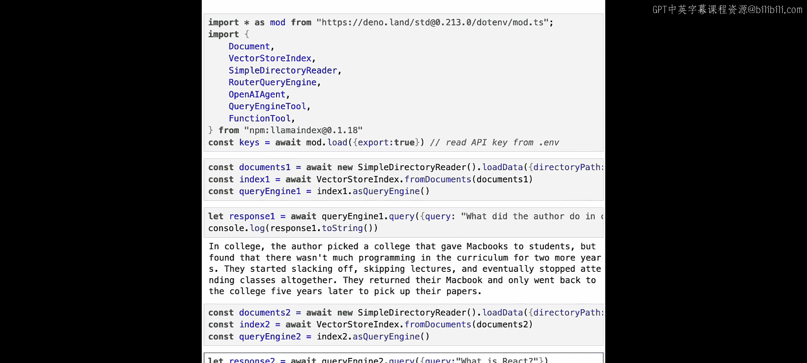
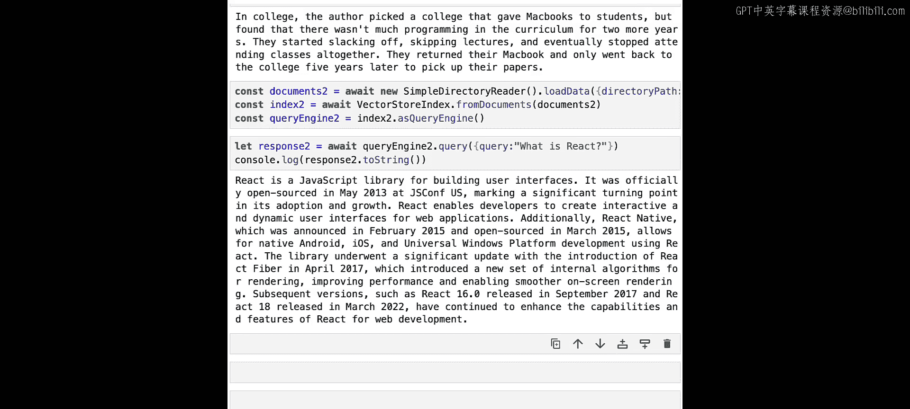
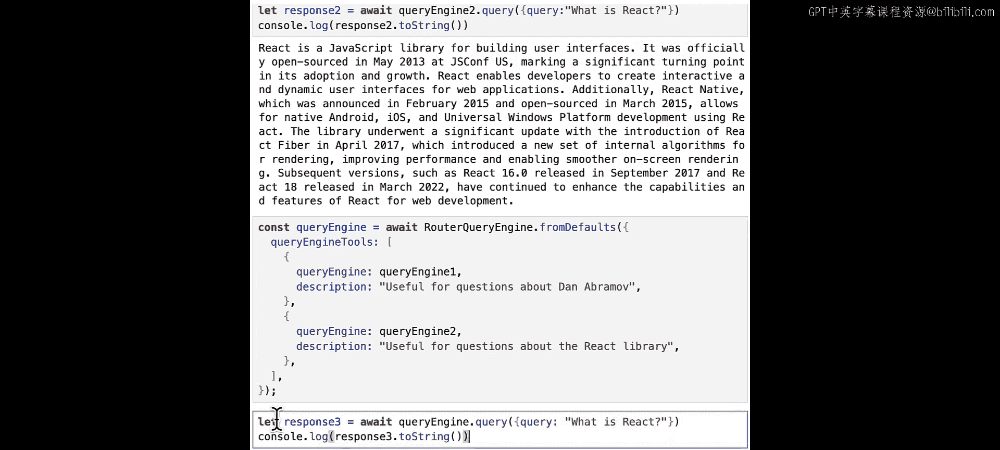
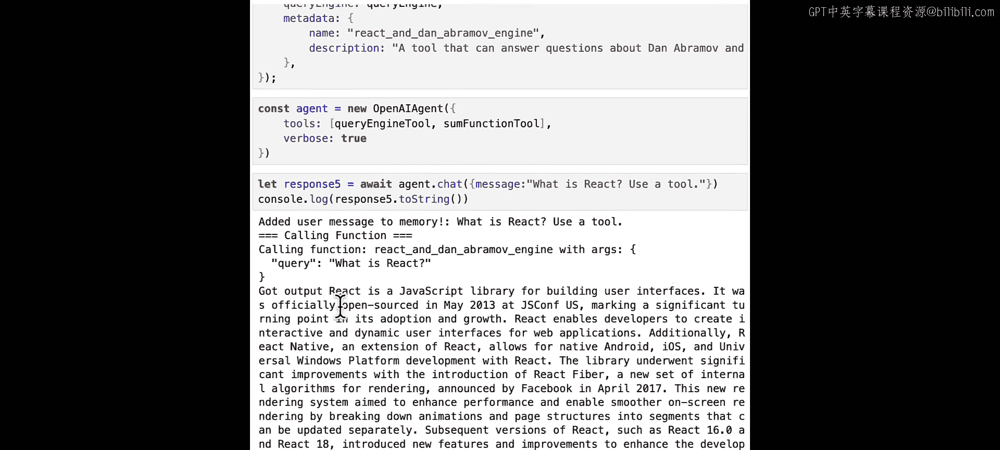
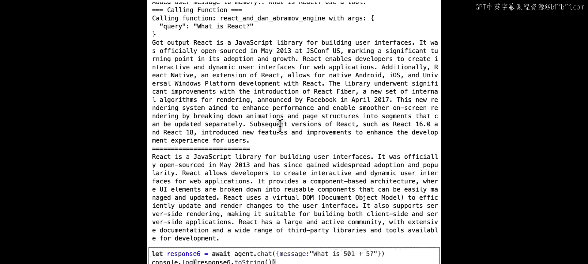
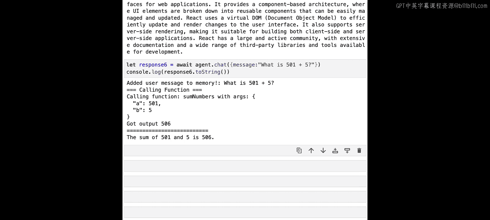

# LlamaIndex构建RAG全栈Web应用：4：使用智能体进行高级查询



## 概述

在本节课中，我们将探讨基础RAG应用的局限性，并学习如何通过构建更智能的“智能体”来改进它。我们将了解如何让大型语言模型（LLM）自主选择合适的数据源来回答问题，以及如何定义自定义函数作为工具供智能体使用。


---

## 基础RAG的局限性与改进方向

上一节我们成功运行了一个基础的RAG全栈Web应用。接下来，我们需要思考它的局限性以及改进方法。

在真实应用中，数据通常不会集中在一个地方，而是分散在多个专注于不同领域的数据源中。LLM的一项惊人能力是，你可以分别创建这些数据源，告诉LLM每个数据源的作用，然后由LLM自行决定查询哪个数据源来回答问题。

这种能力被称为“工具使用”，是LLM最令人惊叹的功能之一。LlamaIndex库内置了此功能，我们称之为“路由查询引擎”，因为它能接收查询并将其路由到正确的工具。

---

## 创建多个数据源

首先，我们像之前一样导入依赖项和API密钥。这次因为要处理更复杂的事情，所以依赖项会多一些。

现在，我们将创建两个能回答不同类型问题的数据源。

第一个数据源和之前使用的例子相同，是Dan Abramov关于其职业生涯的文章。以下三行代码与我们之前的示例相同：

```javascript
// 创建文档集、索引和查询引擎
const documents1 = ...;
const index1 = ...;
const queryEngine1 = ...;
```

因为它和我们创建的其他索引一样，所以我们可以像之前一样查询它并获得回答。我们得到了熟悉的关于Dan不太喜欢大学的答案。

接下来，创建第二个索引。代码结构完全相同，但它指向一个不同的数据目录，其中包含React库的维基百科页面文本。



```javascript
// 创建第二个文档集、索引和查询引擎
const documents2 = ...;
const index2 = ...;
const queryEngine2 = ...;
```

变量名使用了`documents2`、`index2`和`queryEngine2`，以便两套数据可以同时存在。同样地，我们可以查询它。但由于这些数据是关于其他内容的，我们必须问一个不同的问题。例如，我们可以问“React是什么？”

---



## 构建路由查询引擎

现在，我们将进行新的尝试：创建路由查询引擎。一个路由查询引擎可以接收任意数量的查询引擎，并将它们作为工具使用。

每个查询引擎都必须附带一个描述，LLM将利用这个描述来决定使用哪个工具来回答特定类型的问题。

以下是创建路由查询引擎的示例：



```javascript
const routerQueryEngine = new RouterQueryEngine({
  queryEngineTools: [
    {
      queryEngine: queryEngine1,
      description: "用于回答关于Dan Abramov的问题"
    },
    {
      queryEngine: queryEngine2,
      description: "用于回答关于React库的问题"
    }
  ]
});
```

这就是LLM所需的全部信息。现在，我们可以向新的路由查询引擎提出一个只有其中一个数据源知道答案的问题，比如一个关于React的问题。

它思考片刻后，给出了完美的答案。我们无需告诉查询引擎使用哪个工具，它自己就能判断出来。它通过正确选择工具来获知答案。如果我们询问关于Dan Abramov的问题，它会做同样的事情，但使用的是另一个数据源。我们再次得到了Dan不太喜欢大学的答案。

你可以轻松地将此模式扩展到包含大量数据的许多不同数据源。

---

## 将工具使用提升到新水平：创建智能体

除了查询引擎，我们还可以定义任意函数，并创建一个知道如何使用它们的“智能体”。为了演示这一点，我们定义一个非常简单的函数，功能是将两个数字相加。

```javascript
function addNumbers(a, b) {
  return a + b;
}
```

要使用一个函数，我们必须告诉智能体参数是什么，就像向一个人解释如何使用它一样。我们可以将这个解释放入一个特殊的JSON结构中。

```javascript
const addToolSchema = {
  type: "object",
  properties: {
    a: { type: "number", description: "要相加的第一个数字" },
    b: { type: "number", description: "要相加的第二个数字" }
  },
  required: ["a", "b"]
};
```

现在，通过将我们的函数、解释说明以及工具描述结合起来，我们可以将这个函数转化为智能体可以使用的工具，就像我们对路由查询引擎所做的那样。

```javascript
const addTool = {
  name: "addNumbers",
  description: "将两个数字相加",
  parameters: addToolSchema
};
```

为了让事情更有趣，我们还将之前的路由查询引擎转化为一个工具。如你所见，我们可以构建层层嵌套的智能体，使用能调用其他工具的工具，从而创建出非常复杂和精妙的软件。

现在我们有了一个查询引擎工具，它接收我们的查询引擎并包含元数据，包括工具名称和使用时机的描述。

接下来，我们将创建一个OpenAI智能体，并赋予它这两个工具。我们会要求它输出详细过程，以便观察它的行为。

```javascript
const agent = new OpenAIAgent({
  tools: [queryEngineTool, addTool],
  verbose: true
});
```

---

## 测试智能体

现在，让我们测试一些它已经知道如何完成的事情。我们将再次询问关于React的问题。我们需要稍微“作弊”一下，要求它使用工具，因为LLM非常聪明，并且已经在包括React在内的海量数据上进行了训练。如果不告诉它使用工具，它可能不会使用，而是直接从训练数据中给出答案。



在此过程中，我们可以实时观察它的工作。你可以看到它调用函数、接收输出，然后将输出转化为给我们的答案。但这部分并不新奇。

让我们给它一个之前无法完成的任务：将两个数字相加。LLM通常非常不擅长数学，所以如果你只是使用基础LLM，问“501加5等于多少”这类问题通常会得到错误答案。



在这里，你可以看到它正在调用函数。它使用了参数`a`和`b`，正如我们告诉它的那样，并且通过函数正确地完成了加法。太好了，我们教会了LLM如何做数学！

这是一个非常简单的工具。显然，你的函数可以做任何事情。尝试创建另一个具有不同功能的函数，并将其添加到我们智能体的工具数组中。

---

## 总结

在本节课中，我们一起学习了如何超越基础RAG应用。我们探讨了如何创建多个数据源，并利用LlamaIndex的“路由查询引擎”让LLM自主选择正确的数据源进行查询。更重要的是，我们深入了解了“智能体”的概念，学会了如何将自定义函数（如加法函数）封装成工具，并赋予智能体使用这些工具的能力，从而扩展了LLM的功能边界，使其能够处理其本身不擅长（如精确计算）的任务。



在下一课中，我们将再次切换回Web开发，更接近真实的生产应用。我们将展示如何持久化存储数据以及如何重新加载数据，以避免不断重新建立索引。我们还将从简单的一次性查询过渡到持续的聊天交互，并从等待完整答案转变为实时接收流式回答。最后，我们将把所有内容再次整合到一个Web应用中。