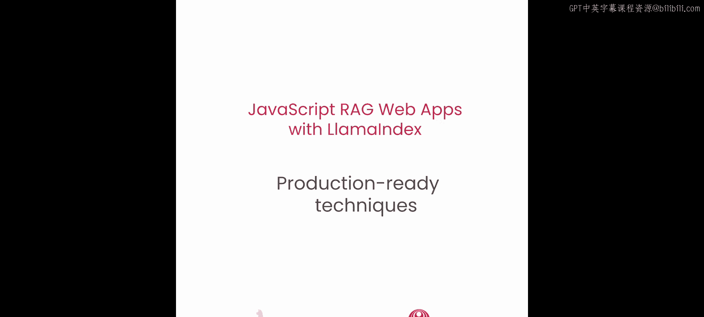
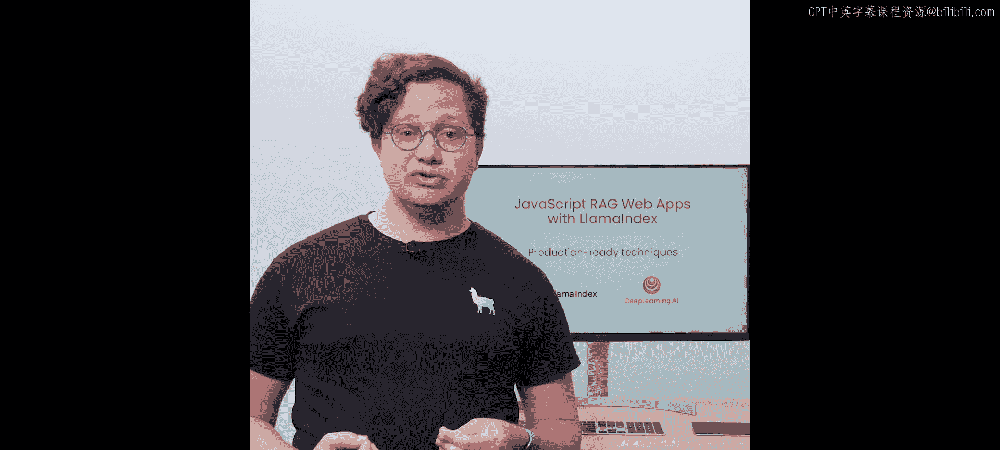
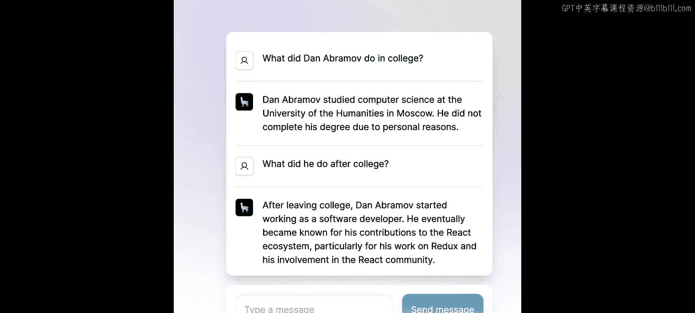

# LlamaIndex RAG 全栈应用开发：P5：生产环境技术



## 概述
在本节课中，我们将学习一些用于生产环境的RAG应用技术，包括数据持久化、持续对话和流式响应。我们将把这些技术集成到一个更完善的Web应用中。

---

## 数据持久化：避免重复索引

上一节我们介绍了基础的查询流程，本节中我们来看看如何将数据持久化，以避免每次启动应用时都重新索引文档。

在真实的生产应用中，你肯定不希望每次查询都重新处理数据。因此，你需要将数据持久化到向量存储中，例如向量数据库。我们将演示如何通过将数据保存到磁盘来实现这一点。

首先，像往常一样加载我们的文档。



```javascript
// 加载文档
const documents = await loadDocuments();
```

现在，我们要做一些新的操作：设置一个存储上下文。这告诉LlamaIndex将数据存储在哪里。在本例中，我们告诉它存储到名为“storage”的目录中。

```javascript
// 设置存储上下文
const storageContext = await StorageContext.fromDefaults({
  persistDir: "./storage",
});
```

接下来，像之前一样加载数据，并使用该存储上下文创建索引。

```javascript
// 创建索引并持久化
const index = await VectorStoreIndex.fromDocuments(documents, { storageContext });
```

这和我们之前课程中的做法类似。像之前一样，我们可以创建一个查询引擎并提问。这次我们不问“什么是React？”，而是问“什么是JSX？”。

```javascript
const queryEngine = index.asQueryEngine();
const response = await queryEngine.query("What is JSX?");
console.log(response.toString());
```

现在，让我们尝试另一种新方法：无需先解析文档，而是直接从我们刚刚保存的存储中加载索引。

为此，我们将创建一个新的存储上下文，与旧的完全相同。

```javascript
// 从持久化目录加载存储上下文
const newStorageContext = await StorageContext.fromDefaults({
  persistDir: "./storage",
});
```

现在，我们可以直接从该存储上下文初始化索引，而无需先解析数据。

```javascript
// 从存储加载索引
const loadedIndex = await VectorStoreIndex.init({ storageContext: newStorageContext });
```

然后，我们可以像之前一样进行查询。

```javascript
const loadedQueryEngine = loadedIndex.asQueryEngine();
const loadedResponse = await loadedQueryEngine.query("What is JSX?");
console.log(loadedResponse.toString());
```

现在，你可以预先索引任意多的文档，并在应用中快速访问它们，而无需每次都重新解析。你不再需要创建文档并将其放入向量存储索引，这部分工作已经完成。你只需从存储目录加载向量存储索引，然后开始查询。

---

## 持续对话：与你的数据聊天

在生产环境中，你通常不会只问一个问题，而是希望与你的数据进行聊天，允许你提出后续问题，并且LLM能记住之前的对话上下文。

LlamaIndex原生支持通过聊天引擎实现此功能。让我们看看如何使用它。

首先，为我们的数据创建一个检索器，并使用该检索器创建一个新的聊天引擎。

以下是创建聊天引擎的步骤：

1.  创建检索器。
2.  使用检索器初始化聊天引擎。

```javascript
// 1. 创建检索器
const retriever = index.asRetriever({ similarityTopK: 3 });

// 2. 创建聊天引擎
const chatEngine = index.asChatEngine({ retriever });
```

你可能会想起第一课的内容，我们将查询引擎拆分为各个组件部分。这里我们传递给聊天引擎的就是那个检索器。我们还把 `similarityTopK` 属性改为了3。这个参数控制你的查询引擎从向量存储中检索多少条上下文。

接下来，我们将模拟一次聊天：传入一个由我们已提出的问题和它刚刚给出的类似答案组成的消息历史，然后问一个后续问题：“它最后提到的那个缩写是什么？”

首先，创建消息历史。

```javascript
// 创建初始消息历史
const messageHistory = [
  {
    role: "user",
    content: "What is JSX?",
  },
  {
    role: "assistant",
    content: "JSX is a syntax extension for JavaScript...", // 此处应为模型之前的真实回复
  },
];
```

现在，添加一个新的后续问题消息。

```javascript
// 添加后续问题
const followUpMessage = {
  role: "user",
  content: "What was that last acronym that it mentioned?",
};
```

现在，将这两部分组合成一次聊天，看看效果。

```javascript
// 进行聊天（此处为概念演示，实际API调用可能不同）
const chatResponse = await chatEngine.chat(followUpMessage, messageHistory);
console.log(chatResponse.toString());
```

如你所见，我们能够提出后续问题。在它之前的回答中最后提到的是“XHP”，我们能够问它：“你最后提到的那个东西是什么？” 它知道它说过什么，因此它能够回答关于这个的问题，而无需我们明确指出我们指的是“XHP”。你可以看到，在聊天机器人场景中，能够根据上下文提出后续问题是非常有用的。

---

## 流式响应：实时获取答案

让我们转向最后一个生产环境技术：流式传输。

流式传输允许我们即时开始向用户提供响应，即使LLM需要很长时间来生成完整答案。它通过逐块发送答案或边生成边流式传输响应来实现。

这在我们的聊天中非常简单，只需设置 `stream: true`。

```javascript
// 启用流式响应的聊天（概念代码）
const streamResponse = await chatEngine.chat("What is React?", undefined, { stream: true });
```

打印流式结果稍微复杂一些，因为你得到的不是一个字符串，而是答案每一部分的响应对象。

以下是处理流式响应的方式：

```javascript
// 处理流式响应
for await (const chunk of streamResponse) {
  process.stdout.write(chunk); // 逐块打印
}
```

如你所见，你将答案的每个片段作为单独的文本行获取。

---

## 集成实践：使用Create Llama快速构建应用

现在，我们拥有了数据的持久化存储，并且能够向客户端流式传输。让我们看看这些东西在真实的Web应用中是什么样子。

LlamaIndex有一个很棒的单行命令，可以为你生成一个包含所有这些功能的可运行Web应用。你可以在命令行中运行 `npx create-llama` 来使用它，然后回答一些问题。因为从笔记本中执行这个命令比较困难，我们已经为你运行了该命令，并且应用已经构建好了，所以我们可以直接启动我们之前生成的前端和后端。

我们将再次使用我们的工具函数来启动它。

```bash
# 启动后端API服务器
npm run start:backend

# 在另一个终端启动前端开发服务器
npm run start:frontend
```

如你所见，它直接将流式答案传输给我们。让我们问一个后续问题。

如你所见，它流式传输了另一个答案，并且它是有上下文感知的。

太棒了，我们已经演示了向UI的流式传输以及我们的上下文感知聊天。

接下来要做的就是亲自尝试所有这些。你可以从 `llamaindex.ai` 下载 `create-llama`，它将为你生成一个完全像这样的应用。你将能够查看代码，了解所有正在进行的操作。会有一个后端API，就像我们在这些课程中创建的一样，还有一个包含React组件的前端，同样，就像我们制作的那些一样。你也能够更改样式和颜色以适应你的偏好。Web开发充满了探索的乐趣，希望你玩得开心。

---

## 总结
本节课中，我们一起学习了三项使RAG应用达到生产就绪状态的关键技术：
1.  **数据持久化**：通过将索引保存到存储（如磁盘），避免每次启动时重复处理数据，提升了应用启动速度和效率。
2.  **持续对话**：利用 `ChatEngine` 实现与数据的多轮、上下文感知的交互，使应用更像一个智能助手。
3.  **流式响应**：通过启用流式传输，实现了答案的实时逐字输出，极大改善了用户体验。



最后，我们介绍了 `create-llama` 工具，它能快速生成一个集成了上述所有功能的完整全栈Web应用项目，为你提供了绝佳的实践和定制起点。