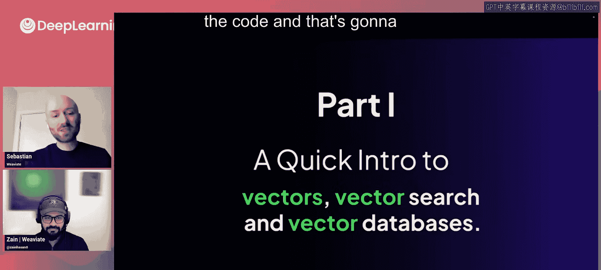
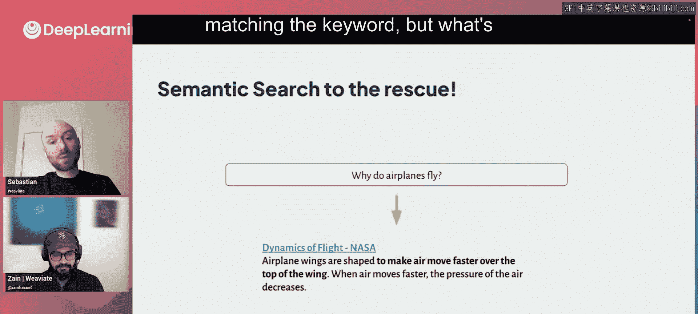
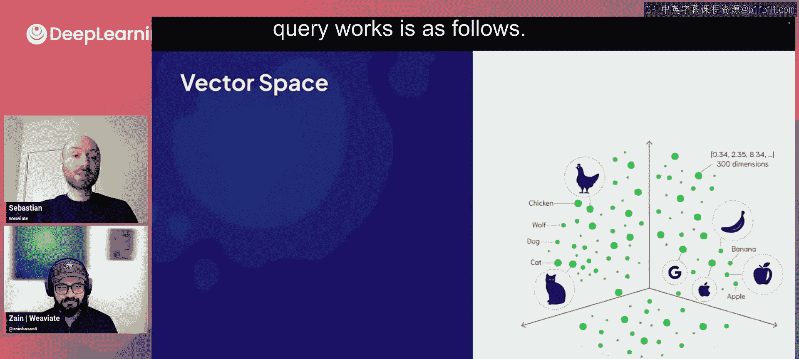
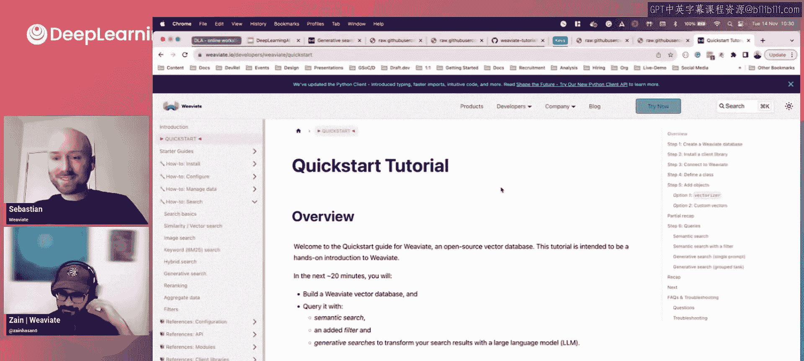
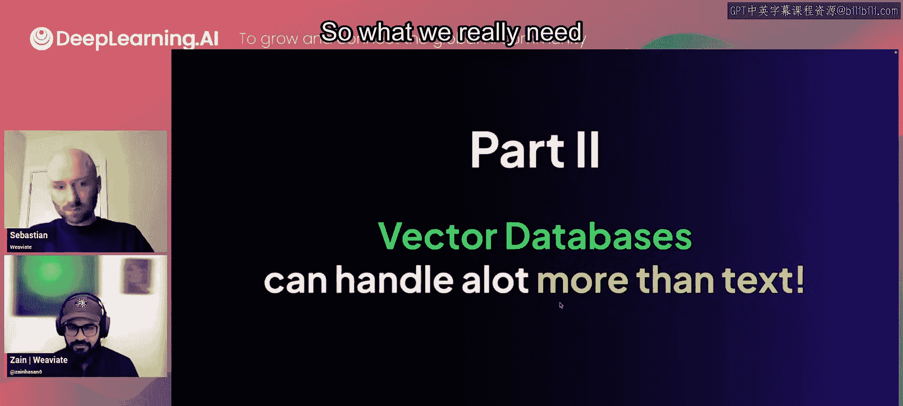
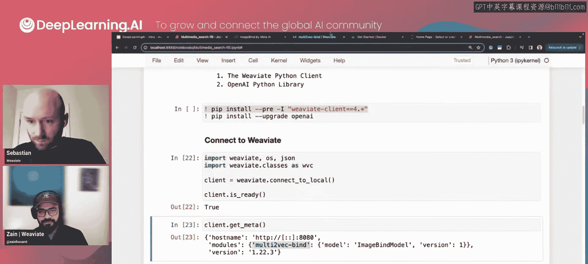
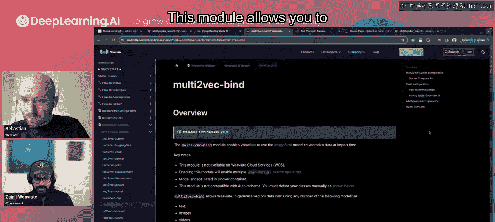
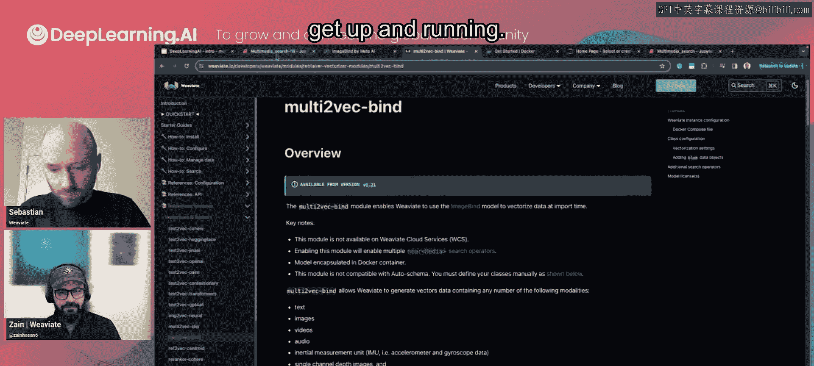
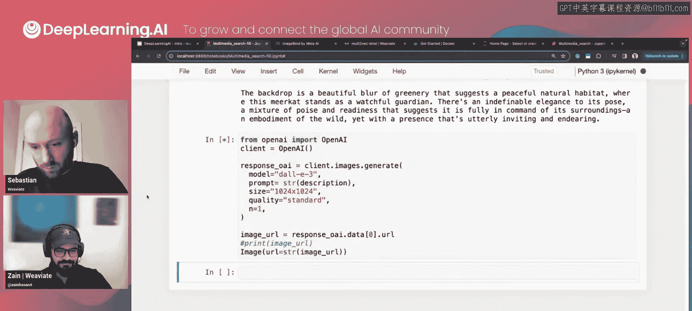

# 向量数据库与多模态搜索：1：向量搜索基础与实战

在本节课中，我们将学习向量数据库的核心概念，了解其如何通过语义搜索超越传统的关键词匹配，并动手实践如何将文本数据导入向量数据库并进行查询。

大家好，我是Diana Chan Morganorgan，负责深度学习的社区事务。今天我们非常高兴能举办一个精彩的研讨会，探讨如何利用像Weaviate这样的向量数据库，结合多模态嵌入模型，来构建能够理解和搜索文本、图像、音频和视频数据的大规模生产级应用。

你们今天可以从研讨会中学到：
*   机器学习模型如何嵌入多模态数据。
*   像Weaviate这样的向量数据库如何实现实时语义搜索。
*   向量数据库如何用于将这些模型扩展到数十亿规模。
*   执行任意模态到任意模态搜索的代码实现。
*   大规模多模态搜索和检索所支持的应用。

我们将在聊天中提供一个链接，供大家提问并对希望演讲者回答的问题进行投票。本次会议将被录制，幻灯片稍后会发送给大家。

介绍我们的活动合作伙伴Weaviate。Weaviate是一个开源向量数据库，允许您存储来自您喜爱的机器学习模型的数据对象和向量嵌入，并无缝扩展到数十亿个数据对象。他们上周刚刚与我们的演讲者之一Sebastian一起发布了我们的短期课程《从嵌入到应用的向量数据库》。

现在介绍我们的第一位演讲者Sebastian。Sebastian是Weaviate的AI负责人，也是向量数据库技术专家。他热衷于帮助开发者构建基于AI的应用程序并将其产品化，这些应用程序利用了机器学习领域的最新尖端发展。

接下来介绍Zane。Zane是Weaviate的高级开发者布道师，他是一名工程师和数据科学家培训师，曾在多伦多大学攻读本科和研究生学位，致力于构建人工智能辅助技术。随后，他创立了自己的公司，利用机器学习开发数字健康平台。他热衷于开源软件、教育和社区。

---

## 向量搜索简介

上一节我们介绍了本次研讨会的内容和目标。本节中，我们来看看什么是向量搜索以及它为何重要。

在互联网世界中，我们所做的一切几乎都始于搜索，无论是寻找音乐、观看电影、购物还是查找信息。我们已经这样做了几十年。那么，问题出在哪里？传统搜索方法存在一些挑战。

例如，如果您运行一个查询“为什么飞机会飞？”，您可能会得到这样的回复：“飞昂贵的错误，因为它做了这个那个”，但这并没有真正解释飞机为什么会飞。它只是匹配了关键词。从技术上讲，这应该是正确的结果，但实际上它没有回答问题。

我们问了一件事，但得到了完全不同的东西，这更像是一个广告，而不是我们问题的答案。这时，语义搜索就来拯救我们了。它从一个不同的角度看待整个问题，不是匹配内容中的单词，而是匹配含义。我们通过这个问题想表达什么意思？我们需要什么？

通过语义搜索，您更有可能得到像来自NASA的回复，解释如何使空气在机翼顶部移动得更快等等。这更像是一个答案，这不是关于匹配关键词，而是关于我们寻找的内容。

总而言之，随着机器学习领域发生的许多很酷的标准，我们获得了惊人的新工具来更好地完成工作。

---

## 向量嵌入的工作原理

上一节我们了解了语义搜索的优势。本节中，我们来看看其背后的核心机制：向量嵌入。

其工作原理如下：我们拥有那些惊人的机器学习模型，它们可以接收几乎任何类型的内容（取决于模型）。当您输入内容时，在另一端得到的是一个**向量嵌入**。向量嵌入本质上是一串数字，一个数字数组，这是机器学习理解原始数据背后含义的方式。

如果我们以之前的例子为例，将两个回复通过机器学习模型运行，我们会得到一堆不同的向量嵌入，每个都会有些不同。如果我们将这些向量放入多维空间中，您可能会经常注意到，代表相似类型数据的向量嵌入会存储在一起。

例如，当我们试图在这里可视化一只猫和一只狗时，它们会彼此靠近，而鸡会稍远一些，而像苹果和香蕉这样的东西则会在完全不同的空间里。这是向量嵌入的简化版本，因为我们只能想象三维空间，但这些向量嵌入可以达到1000、1500甚至更多维度，这意味着它可以捕获更多的信息和含义。

---

## 查询过程

上一节我们了解了数据如何被转化为向量。本节中，我们来看看查询是如何在向量空间中进行的。

总结整个工作原理和查询过程如下：如果我们取出原始查询“为什么飞机会飞？”，并且我们已经有了嵌入数据的向量空间。

如果我们通过机器学习模型输入该查询，我们将再次得到一个向量嵌入，这个向量实际上代表了我们的查询。现在，我们可以将其映射到我们的向量空间，基本上，我们指向的周围区域很可能是最有可能包含我们原始问题答案的文章所在的位置。我们很可能会找到NASA的文章。这就是它基本的工作原理。

---

## 实战：使用Weaviate进行文本向量搜索

上一节我们介绍了理论。本节中，我们动手实践，看看这一切如何在代码中实现。

我将使用Weaviate，我们的开源向量数据库。最近我们正在开发一个全新的Python客户端，它改变了我们与Weaviate的交互方式。它仍处于测试阶段，但我认为它已接近发布，可以展示给大家。

首先，您需要安装客户端。这将安装最新版本的Weaviate客户端。

安装完成后，我们需要连接到Weaviate。有不同的部署方式：可以使用Weaviate嵌入式模式、自托管（例如使用Docker Compose）或云部署。云部署目前与最新的v4客户端不完全兼容，将于下周推出。今天，我将专注于在我的机器上运行。

以下是连接代码的基本结构。您需要导入Weaviate和os（用于管理密钥）。然后调用`weaviate.connect_to`，可以选择连接到嵌入式或本地实例。为了演示，我将使用OpenAI和Cohere的API，您需要替换相应的API密钥或使用环境变量。

第一次运行时，客户端会为您下载并运行一个嵌入式二进制文件，因此基本上不需要单独的实例。

接下来，我将使用两个简单的数据集：一个包含10个对象（具有类别、问题和答案属性），另一个包含1000个对象。我们将加载这些数据。

现在，我们需要创建一个新的集合（在传统数据库中类似于表）。我们称之为“questions”。在创建集合时，我们可以配置向量化器。例如，使用Cohere的文本转向量模型。这样，在插入数据时，Weaviate会自动使用Cohere API将文本转换为向量。

如果集合已存在，我们可以先删除它，然后重新创建。

创建集合后，我们可以插入数据。使用`collection.data.insert_many()`方法插入我们加载的10个对象。插入时，Weaviate会自动调用Cohere API为每个对象的文本生成向量嵌入。

我们可以验证对象是否已插入并获取其向量。通过查询对象ID并包含向量，我们可以看到第一个对象的向量数组。

我们也可以使用OpenAI重新创建集合，只需将向量化器配置为`text2vec-openai`。我们还可以添加生成式配置，例如指定使用GPT-4模型，以便后续进行检索增强生成。

然后，我们可以插入包含1000个对象的更大数据集。插入后，可以验证集合中的对象数量。

至此，我们已经完成了数据导入部分。您可以对数据执行各种操作，如插入、更新、删除等。

---

## 查询数据

上一节我们成功将数据导入了向量数据库。本节中，我们来看看如何查询这些数据。

查询是更有趣的部分。我们可以使用之前创建的“questions”集合。

首先，进行近文本搜索。例如，搜索“pigment”。我们可以指定返回前5个对象，然后打印出它们的属性。可以看到返回的结果与“颜色”、“绿色”等相关。

我们还可以用不同语言进行搜索。例如，波兰语中的“wosk”（蜡），仍然能找到相关信息，如“空气”、“乐器”等。

其次，可以添加过滤器。例如，只查找“value”属性大于500的对象。我们需要导入`weaviate.classes as wvc`，然后使用`wvc.query.Filter.by_property("value").greater_than(500)`来构建过滤器。

第三，可以使用混合搜索。混合搜索结合了关键词搜索（BM25）和向量搜索。通过`alpha`参数控制权重：`alpha=1`表示100%使用向量搜索分数，`alpha=0`表示100%使用关键词搜索。例如，设置`alpha=0.7`表示70%向量搜索和30%关键词搜索。这在模型可能未针对特定数据类型进行训练，但仍需精确匹配某些内容（如序列号）时非常有用。

最后，展示检索增强生成。在创建OpenAI集合时，我们添加了GPT-4生成配置。现在，我们可以运行一个查询，检索相关对象，然后让LLM基于这些内容生成响应。

我们可以使用单个提示为每个检索到的对象生成内容，例如“用简短推文解释这个问题”。代码会先运行查询检索四个对象，然后将问题值与提示一起传递给GPT-4生成推文。

还有一种分组任务模式，可以为所有检索到的对象生成一个单一的总结性响应，例如“解释这些内容是关于什么的”。这将基于四个对象创建一个全局摘要。

希望您能跟上节奏。这为您提供了我们可以做的事情的良好基础。如果您想了解更多，可以访问Weaviate文档并从快速入门开始。

---

## 从文本到多模态搜索

上一节Sebastian介绍了如何使用向量数据库进行文本语义搜索。本节中，我们将把搜索能力从文本扩展到图像、音频和视频等多模态数据。

向量数据库最独特的方面之一正是它能处理远不止文本的数据。在接下来的时间里，我们将讨论如何从理解文本数据、搜索文本数据，扩展到理解音频数据、视频数据、图像，并进行搜索。如果时间允许，我还会演示如何调用新的GPT-4V视觉模型来理解我们从向量数据库中检索到的图像。

让我们从基础开始，看看如何向向量数据库传递不仅仅是文本的内容。

我们真正需要的是一个能够理解多种数据类型的模型。屏幕上的内容不仅是一个句子“狮子是草原之王”，还有狮子的图像、狮子咆哮的声音、狮子奔跑的视频。我们需要能够理解这些模态并将其转换为相应向量的模型。

这里的技巧在于，由于输入数据点（我传入的对象类型）在含义上非常相似（无论是狮子的图像、狮子咆哮的声音，还是描述狮子的句子），对应的向量也应该相似。这回到了Sebastian所讲的：无论您将何种类型的数据传入向量数据库，只要它们在语义上相关、具有相似的含义，其向量数据点在向量空间中就应该是接近的。

如图所示，句子的向量与狮子实际图像的向量非常相似，也与狮子咆哮声音的向量相似。为了实现这一点，您需要拥有能够理解每一种模态的模型。一种方法是拥有分别理解每种模态的模型，然后将它们统一起来。

一旦您具备了从不同模态理解和提取含义的能力，您就拥有了一个统一的向量空间。无论您引入何种类型的模态，只要模型经过训练能够理解并将其嵌入为向量，您现在就可以拥有这个统一的向量空间，您的视频、图像、音频文件、文本文件都可以共存其中。

从人类可理解的数据版本（我们可以观看的视频、可以收听的音频文件）到机器可理解的向量的转换，仍然保留了数据背后的含义。因此，鸡的图像、鸡的视频和鸡的声音在向量空间中都应该彼此接近。

这正是令人兴奋的地方，因为现在您实际上可以将计算机上的所有文件（无论是视频、图像、音频还是文本文件）嵌入到同一个向量空间中。

这之所以非常令人兴奋，是因为一旦您具备了将所有文件嵌入到一个统一向量空间的能力，您现在就可以进行**任意到任意搜索**。这是什么意思呢？您可以将这些模态中的任何一个转化为查询。假设您想返回与这个句子编码的概念相似的媒体，或者与我展示的这张图像、这段视频相似的媒体。所有这些都可以成为查询，就像Sebastian之前展示的那样，它们可以进入您的向量空间，您可以使用这些多模态查询执行向量搜索。

不仅如此，因为您的向量数据库中已经存储了图像、音频、视频，所以返回的结果也可以是这些数据模态中的任何一种。您可以检索音频文件、图像、视频文件和文本文档，作为对您传入的任何这些模态的相关对象。

这是相当独特的，因为向量数据库通过向量表示数据，原始数据的模态是什么并不重要。只要机器学习模型理解它，它就会生成一个向量，而向量数据库则针对搜索这些向量进行了优化。

---

## 实战：构建多模态搜索引擎

上一节我们介绍了多模态搜索的概念。本节中，我将向您展示如何利用Sebastian所教的内容，使用Weaviate构建一个多模态搜索引擎。

这是研讨会的第二部分。您可以在Sebastian分享的同一代码库中找到第二个文件夹，获取此笔记本。

要设置此环境，我们将使用Docker。建议您下载并安装Docker。然后，在终端中获取Docker镜像，运行Docker文件并启动容器。

我已经让环境运行起来了。我有深度学习AI环境在运行，并且有两个容器。我们稍后会看到这两个容器的用途。

除了Docker，您还需要一些其他依赖项。Sebastian已经为您设置了新的Weaviate Python客户端。对于此笔记本，您还需要OpenAI Python API。我们将安装这些依赖项。

然后，我们将连接到本地运行的Weaviate实例。此代码与Sebastian展示的非常相似。因为Docker在后台运行，我的计算机上本地运行着Weaviate，我将连接它，验证连接，然后获取有关运行实例的一些元数据。

您会注意到，我使用的模块是`multi2vec-palm`。这一点尤其重要。为了嵌入和存储媒体文件，您需要一个能够将这些媒体文件转换为向量的模型，而这正是Weaviate的模块系统所做的。`multi2vec-palm`是我们的模块之一，它允许您传入此处列出的任何一种模态：最重要的是文本文档、图像、视频和音频，这也是我今天要展示的内容。

您只需要在Docker文件中指定要启动哪个模块。我们可以看到我们拥有正确的模块和正确版本的Weaviate，一切就绪。

接下来，我们将创建一个客户端。这里有一个快速检查，查看“animals”集合是否已存在，如果存在则删除它，然后我们将从头重新创建它。

这与Sebastian的代码非常相似，我将创建一个名为“animals”的新集合。然后，我将指定一个向量配置，因为我需要告诉Weaviate在传入多媒体数据后如何对其进行向量化。

在这里，我指定使用`multi2vec-palm`模块。这样我就可以传入音频、图像和视频。具体来说，我需要告诉它这些文件在数据库中将存储在哪个属性中。对于音频字段，我告诉它属性名将是“audio”；图像字段将存储在名为“image”的属性中；视频字段可以通过属性名“video”访问。这一点非常重要，因为如果您回想一下多模态嵌入的工作原理，实际上在底层，`multi2vec-palm`有多个模型，它需要了解如何获取正确的数据模态并将其路由到正确的嵌入模型，然后生成嵌入。

我们通过告诉它在哪里访问正确类型的文件并使用相应的模型进行向量化，为其成功设置奠定了基础。

我们将继续运行，这将为我们创建集合。

我们有一个辅助函数，您稍后会理解其重要性。任何时候将多媒体音频、图像、视频文件传入Weaviate时，都需要进行Base64编码，这个函数将帮助我们为所有文件类型完成此操作。

然后，我将插入图像、音频文件和视频文件到刚刚创建的集合中。这与Sebastian展示的代码也非常相似。我将遍历所有图像文件，将它们添加到一个Python列表中，传入文件名、文件在计算机上的路径以及实际的图像（经过Base64编码）。我还会通过给它一个“mediaType”属性来告诉Weaviate我传入的是什么类型的数据。

然后，我们将获取该列表并使用`insert_many`插入对象。在此过程中，底层发生的是：Weaviate获取图像，知道我想使用`multi2vec-palm`模块，它会将图像传递给我笔记本电脑上本地运行的推理容器，对所有这些图像进行向量化，然后返回并告诉我已成功将这些对象添加到Weaviate，这些是每个对象的唯一标识符。

为了确保无误，我将运行一个聚合查询，显示是否所有对象都已添加。我有9个图像文件，可以运行此聚合查询，它会告诉我当前数据库中存储了多少个对象，目前检查无误。

现在，我的数据库中已经有了图像及其向量。接下来，我将插入音频文件。我有大约6或7个音频文件，从鸟叫到猿啼、公鸡打鸣、狗吠和猫叫。我将遍历每个文件并将它们添加到数据库中。现在唯一不同的是，我必须指定正确的属性名。因为`multi2vec-palm`模块通过属性名理解这些是音频文件，所以我必须在此处使用正确的属性名。除此之外，我所做的只是遍历所有音频文件，将它们添加到一个Python列表中，然后准备就绪后，将它们全部插入Weaviate。在底层，这实际上会使用批处理。对于少量文件来说，这并不那么重要，但如果您要插入数百万个文件，这就变得非常重要了。

运行此代码，它经历完全相同的循环，只是现在它将使用不同的模型（音频模型）进行推理，创建向量，然后将向量存储到Weaviate中。现在所有这些向量也都存储到了Weaviate中。

快速检查一下：我们有9个图像和6个音频文件，数据库中总共存储了15个对象。

现在来到有趣的部分。我将处理视频文件，我的代码库中大约有4到5个视频文件，实际上是6个关于动物的视频文件。我将遍历它们，并指定我现在插入的是视频。其他一切都相同：我存储视频名称、视频存储的路径，然后说明这是视频类型。这主要是为了后续查询时进行过滤。

我将运行此代码。您会注意到，我在这里做了一些不同的事情：我一次插入一个视频，而不是一次性插入所有视频。我没有使用`insert_many`，而是一次一个地插入。原因是视频文件很大，尤其是在我的Mac上运行的模型生成这些视频文件的向量需要时间，我不希望数据库超时，我想知道一切正常，只是为这些文件创建向量需要更长的时间。

底层发生的是：它获取视频文件，通过视频模型（实际上，`multi2vec-palm`的视频模型与图像模型非常相似，唯一的区别是它查看每秒的视频，将其分解为帧，为这些帧生成向量嵌入，然后将它们组合起来为每个视频输出一个单一的向量）进行处理。

现在，我的数据库中有了向量，每种模态都有对应的向量：猫玩耍的视频、这些动物的音频以及这些动物的图像，它们都存在于同一个向量空间中。

正如我所说，这实现了**任意到任意搜索**的能力，这是非常令人兴奋的部分，因为现在我可以将音频文件作为问题或查询传入，并返回语义上最相关的数据点，例如图像或视频文件。在Weaviate中，这实际上很容易做到，只需一个查询，您就可以传入想要用作问题的文件，然后获取相关对象。您可以控制想要多少个对象，也可以控制想要对象的哪些属性。例如，如果我只想要文件名、文件路径和媒体类型，我可以指定这些，它将只给我这些数据点。

我们快完成了，正在向量化最后一个视频。顺便说一下，我应该提几句：如果您在生产中使用此功能，我建议在拥有大量GPU的计算机上运行模型（推理模型、大型嵌入模型），以便更快地进行推理；然后我建议在可以访问RAM的计算机上运行Weaviate，因为这是Weaviate所需要的。

在我们讨论的过程中，我已经插入了6个视频，所以现在总共应该有21个对象：9个图像、6个音频文件和6个视频文件。快速检查一下，我们有21个对象，属于多种模态，都存在于同一个向量空间中。

现在，我可以打印出向量数据库中存在的所有内容。如果我想要这些对象的唯一ID，也可以遍历获取，但我不太需要，所以我只取出图像名称并打印出来。如您所见，数据库中有所有这些不同的多媒体文件。

现在，我有几个辅助函数，可以让我可视化这些多媒体文件，这样我就可以直接在笔记本中播放视频和图像。我还有一个辅助函数，可以传入