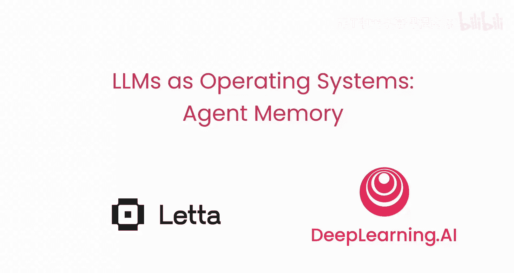
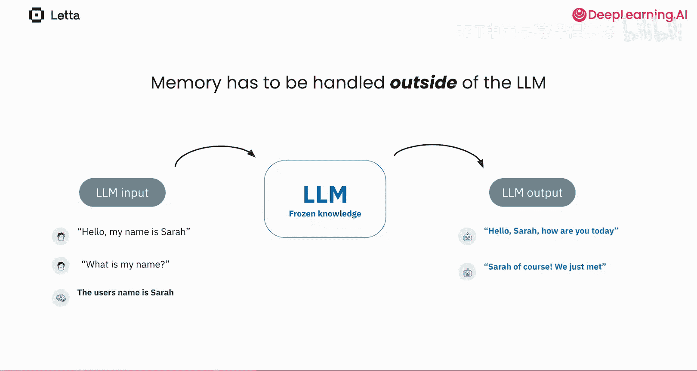
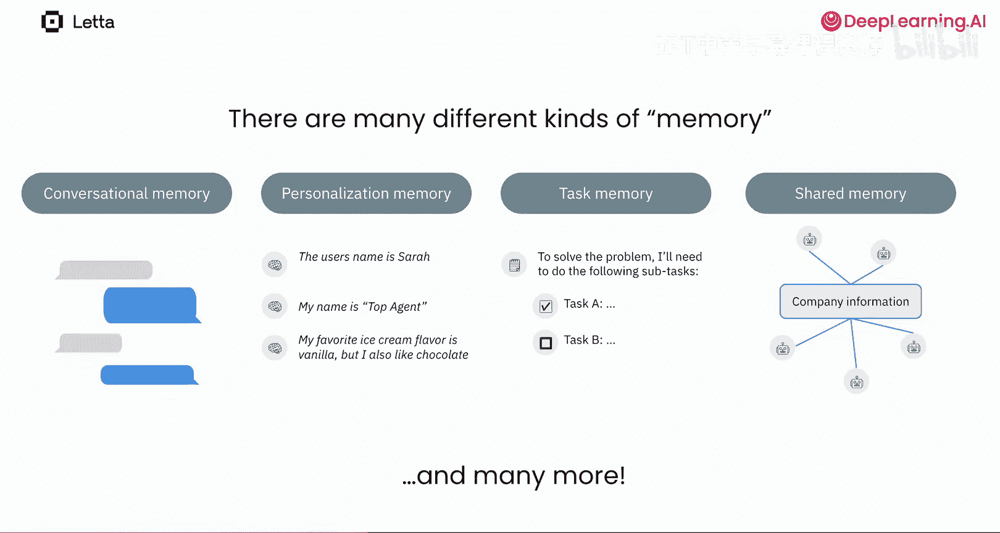
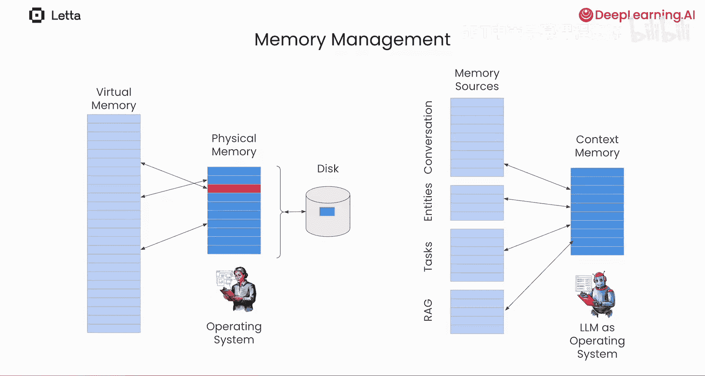
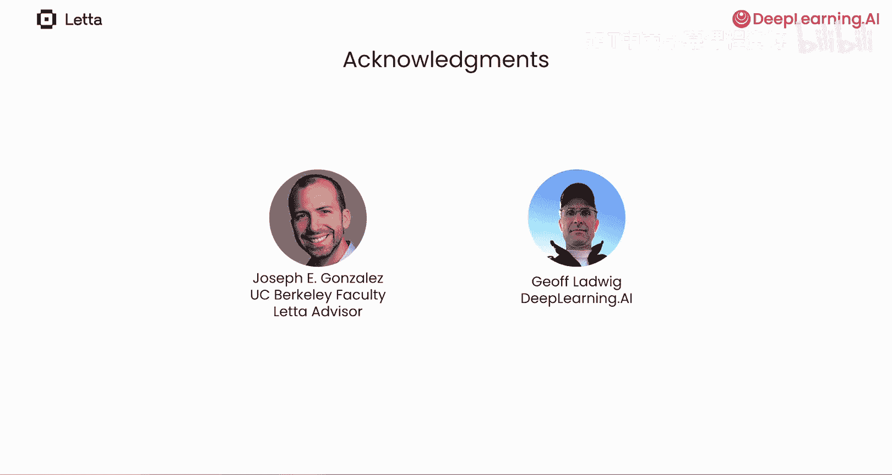

# 大语言模型作为操作系统：代理内存：P1：课程介绍

## 概述

在本节课中，我们将学习如何为AI代理构建和管理内存。我们将探讨一个核心观点：大语言模型代理可以像操作系统一样，管理自己的输入上下文窗口。课程内容基于有影响力的论文《MGPT：大语言模型作为操作系统》，并由该论文的作者之一进行讲解。

## 课程内容与讲师介绍

欢迎来到《大语言模型作为操作系统：代理内存》课程，本课程与Letta合作推出。

在本课程中，你将探索并为AI代理构建内存系统。同时，你将深入研究一个理念：一个LM代理可以管理自己的输入上下文窗口，从而在AI应用中扮演操作系统的角色。

本课程的讲师是Charles Pecker和Sarah Withs，他们是论文《MGPT：大语言模型作为操作系统》的作者，也是该领域的专家。

## 大语言模型的内存挑战

如果你学习过我们之前关于提示工程和API的课程，你可能已经熟悉一个概念：尽管大语言模型能完成惊人的任务，但它们不具备持久性内存，你需要显式地管理其内存。

一个常见的例子是：如果你先调用一次API说“你好，我的名字是Sarah”，然后单独调用一次API询问“我的名字是什么？”，模型将无法记住。如果你希望它记住，你必须在每次额外的API调用中，再次传入完整的对话历史。

通过将信息包含在提示（也称为输入上下文）中，你可以为模型提供额外的信息，模型会利用这些信息来生成输出。

**输入上下文中的内容，真正决定了LLM及其应用的行为。** 例如，聊天机器人应用拥有对话记忆，用于存储对话中早期的交流。你可能还想长期追踪个人事实或姓名，或者跟踪任务进度。你可能希望在不同代理的LLM之间共享信息。

在RAG应用中，你从外部数据源检索相关信息，并将其引入LLM的上下文中。因此，LLM可以利用包含在输入上下文中的任何信息来生成响应。

## 上下文窗口的限制与管理

但是，输入上下文窗口的可用空间是有限的，并且使用更长的输入上下文也会导致成本更高、处理速度更慢。

因此，管理这些上下文信息——决定在输入上下文中包含什么内容——至关重要。

MGPT论文描述了一种新颖的方法：让LLM自己来管理它。如果你熟悉计算机系统中的虚拟内存概念，MGPT使用了一个很好的类比来解释这个想法。

如果你不熟悉虚拟内存的概念，也无需担心，接下来的讨论仍然有意义且对你有用。

## 虚拟内存类比

我们可以将LLM的上下文窗口类比为计算机上的虚拟内存。

你的计算机认为自己拥有一个非常大的内存空间，远大于其实际的物理内存。具体来说，它拥有一个非常大的虚拟内存。当它试图引用一个不在物理内存中的虚拟地址时，操作系统会首先通过将物理内存中的一个信息块移动到磁盘（保存该块中的任何更改）来腾出空间，然后将包含引用地址的新信息块从磁盘取回物理内存。

类似地，你可以将LLM的上下文窗口看作是我们系统中物理内存的类比。一个LLM代理承担了操作系统的角色，并决定哪些信息应该被包含在上下文窗口中。

## AI代理与内存管理

AI代理可以使用LLM进行规划、使用工具并做出决策，例如决定停止或继续一项任务。

类似的方法也让AI代理能够管理自己的内存。为了支持内存管理，代理被分配了上下文窗口中的一个部分作为长期记忆，代理可以向其中写入信息。

代理被赋予了访问外部存储（如数据库）的工具，以创建一个更大的记忆存储库。通过结合使用写入上下文内存和外部内存的工具，以及搜索外部内存并将结果放入LLM上下文的工具，代理可以实现复杂的内存管理。

## 课程实践与目标

在本课程中，你将把这些想法付诸实践。

在接下来的课程中，你将从头开始构建一个能够编辑自身内存的LLM代理。这将帮助你奠定LLM内存管理的基本思想。

接下来，你将超越基础，学习MGPT论文中的关键概念。然后我们将介绍Letta，一个开源的代理框架，其中的代理拥有管理上下文窗口所需的工具和信息。

你不仅可以使用Letta来构建如原论文所述的MGPT代理，还可以超越研究论文，构建具有更高级内存类型的代理。

在多个课程中，你将创建代理并探索内存构建的细节。你将通过构建一个自定义的任务记忆来实践这些知识。你还将在应用中运用这些知识，包括构建你自己的研究代理和一个HR多代理应用，其中代理们共享记忆。

## 致谢

我们要感谢一些帮助创建本课程的人：加州大学伯克利分校的教授、Letta顾问Joseph Gonzalez，Letta团队，以及来自DeepLearning.AI的Jeff Ladwig。

## 总结

本节课我们一起探讨了AI代理内存管理的核心思想。这里的想法非常令人兴奋：让AI代理管理自己的内存是一种新颖且强大的技术，它为构建众多应用提供了一个强大的基础设施。

让我们进入下一个视频，开始深入学习。