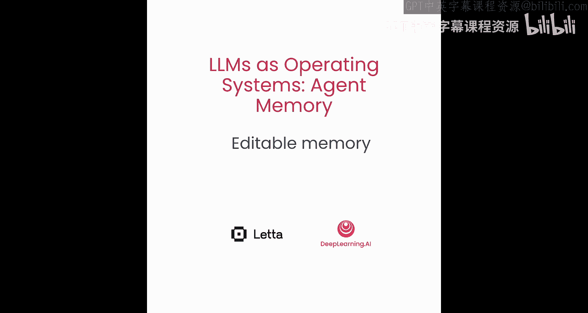
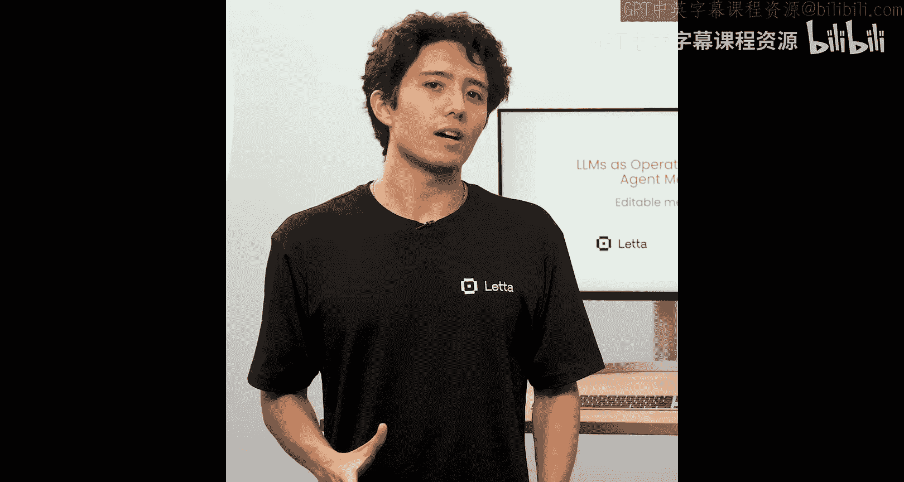
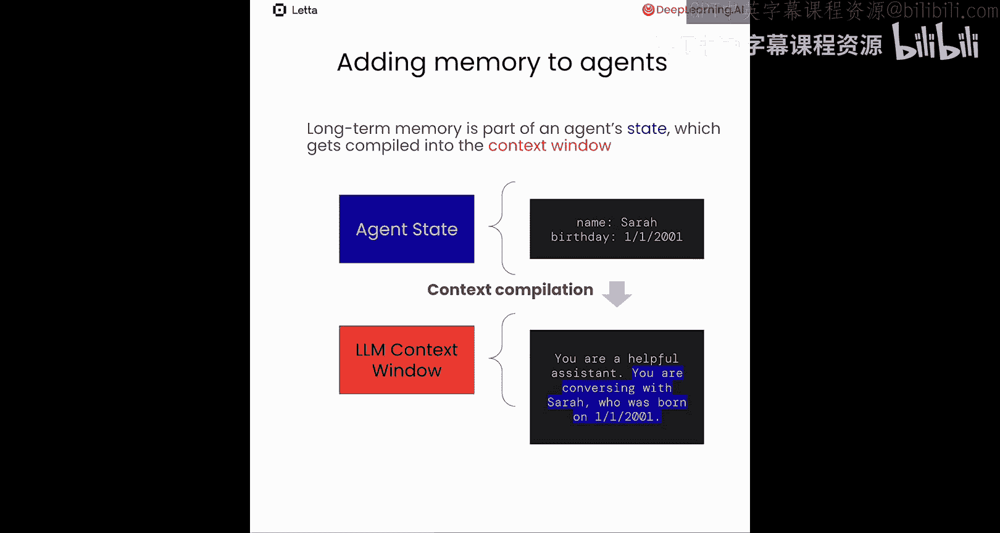
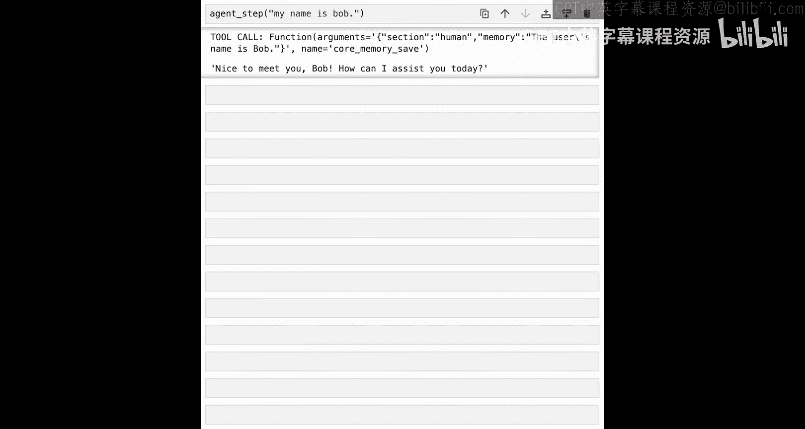

# 大语言模型作为操作系统代理内存：P2：可编辑内存






## 概述
在本节课中，我们将学习如何为智能体构建可编辑的长期记忆。我们将从零开始，实现一个能够自主更新其记忆的智能体，并理解其背后的核心概念。

---

## 什么是可编辑内存？🧠
可编辑内存指的是允许大语言模型随时间推移，自主更新其长期或持久性记忆的概念。这是构建能够持续学习和改进的智能体的关键方面。

上一节我们介绍了智能体的基本概念，本节中我们来看看如何为智能体赋予“记忆”并使其能够自我更新。

---

## 智能体与聊天机器人的区别🤖
理解智能体与普通聊天机器人的区别至关重要。

以下是两者的核心区别：
*   **聊天机器人**：通常使用大语言模型在对话中生成新的回复。例如，用户说“你好”，模型生成“你好”。
*   **智能体**：能够自主行动，在“智能体循环”中执行多步操作。对于一个用户消息，智能体可能会多次调用大语言模型进行思考、搜索记忆，最后才生成回复。

例如，智能体收到消息后，可能会先思考：“我认识发消息的人吗？”，然后调用记忆搜索工具查找用户信息，最后回复：“嗨，莎拉，再次见到你真好，祝你生日快乐！”。

---

## 智能体循环与上下文编译🔄
为了实现多步推理，智能体需要一个包含状态更新的推理循环。



智能体状态被放入**上下文窗口**，该窗口是大语言模型推理的输入，而推理结果则用于更新智能体状态。我们将此循环中的单次推理步骤称为**智能体步**。

长期记忆是智能体状态的一部分，需要被编译到上下文窗口中。这个过程称为**上下文编译**。

例如，如果智能体没有任何长期记忆，上下文窗口可能很简单：“你是一个乐于助人的助手”。如果智能体有记忆（例如，用户名叫莎拉，生日是2001年1月1日），我们就需要将这些记忆数据（如字典）转换成句子，并注入到系统提示词中。

---

## 如何实现记忆编辑？🔧
现在我们知道如何为智能体添加记忆，但如何让记忆变得可编辑呢？

我们可以通过特殊的**记忆工具**让智能体实现自我编辑记忆。

例如：
1.  用户说“你好”，智能体根据记忆认为用户叫“莎拉”，于是回复“嗨，莎拉”。
2.  用户说“我的名字其实是查尔斯，不是莎拉”。
3.  智能体思考：“哦，我的记忆有误，需要修正它。”
4.  智能体调用一个专门用于更新智能体状态中用户姓名的函数。
5.  由于智能体可以运行多次，它最终会回复：“抱歉，查尔斯。”

---

## 动手实践：从零构建可编辑内存智能体💻
让我们将这些理论付诸实践，从零开始构建一个具有可编辑内存的智能体。我们将使用OpenAI的工具调用功能来实现基本的记忆管理。

### 1. 基础设置
首先，我们需要设置OpenAI环境并选择一个模型。我们将使用`gpt-4o-mini`，它在速度、成本和推理能力之间取得了良好平衡。

```python
import openai
import os

# 设置你的OpenAI API密钥
openai.api_key = os.getenv("OPENAI_API_KEY")
model = "gpt-4o-mini"
```

### 2. 定义系统提示词与初始记忆
接下来，定义系统提示词。为了包含记忆，我们需要更新提示词。

```python
# 初始系统提示词（无记忆）
simple_system_prompt = "你是一个聊天机器人。"

# 包含记忆的系统提示词
system_prompt_with_memory = """
你是一个聊天机器人。
你有一部分上下文称为“记忆”，其中包含与你对话相关的信息。
请使用你的记忆来个性化对话。
记忆：
{memory}
"""

# 初始化记忆（一个Python字典）
agent_memory = {
    "human": "",  # 存储关于人类用户的信息
    "agent": ""   # 存储关于智能体自身的信息
}
```

### 3. 实现记忆编辑工具
记忆在Python中只是一个字典，因此记忆编辑工具可以简单地写成一个Python函数。

以下是核心记忆保存工具的实现：
```python
def core_memory_save(section: str, memory: str):
    """
    保存关于你（智能体）或你正在聊天的人类的重要信息。
    """
    # 将新的记忆内容追加到指定部分
    agent_memory[section] += memory + "\n"
```

### 4. 将工具描述给大语言模型
为了让大语言模型知道并使用这个工具，我们需要按照OpenAI的要求提供函数描述和JSON Schema。

以下是工具的描述和模式定义：
```python
tools = [
    {
        "type": "function",
        "function": {
            "name": "core_memory_save",
            "description": "保存关于你（智能体）或你正在聊天的人类的重要信息。",
            "parameters": {
                "type": "object",
                "properties": {
                    "section": {
                        "type": "string",
                        "description": "要保存到的记忆部分，例如‘human’或‘agent’。",
                        "enum": ["human", "agent"]
                    },
                    "memory": {
                        "type": "string",
                        "description": "要保存的信息内容。"
                    }
                },
                "required": ["section", "memory"]
            }
        }
    }
]
```

### 5. 执行工具调用
当大语言模型决定调用工具时，我们需要解析参数并执行对应的函数。

以下是执行工具调用的步骤：
```python
import json

# 假设 response 是来自OpenAI API的响应
if response.choices[0].finish_reason == "tool_calls":
    tool_call = response.choices[0].message.tool_calls[0]
    function_name = tool_call.function.name
    arguments = json.loads(tool_call.function.arguments) # 将参数从JSON字符串加载为字典

    if function_name == "core_memory_save":
        # 执行函数
        core_memory_save(**arguments) # 使用 ** 将字典解包为函数参数
        print(f"记忆已更新: {agent_memory}")
```

### 6. 实现智能体循环
为了让智能体支持多步推理（例如，先更新记忆再回复），我们需要实现一个智能体循环。

以下是基础智能体循环的实现：
```python
def agent_step(user_message: str):
    messages = [
        {"role": "system", "content": system_prompt_with_memory.format(memory=str(agent_memory))},
        {"role": "user", "content": user_message}
    ]

    while True:
        # 1. 调用大语言模型
        response = openai.chat.completions.create(
            model=model,
            messages=messages,
            tools=tools,
            tool_choice="auto"
        )
        assistant_message = response.choices[0].message
        messages.append(assistant_message) # 将助手的响应（或工具调用）添加到消息历史

        # 2. 判断响应类型
        if not assistant_message.tool_calls:
            # 如果不是工具调用，则生成最终回复，结束循环
            print("助手回复:", assistant_message.content)
            return assistant_message.content
        else:
            # 如果是工具调用，则执行工具
            for tool_call in assistant_message.tool_calls:
                print(f"调用工具: {tool_call.function.name}")
                arguments = json.loads(tool_call.function.arguments)
                if tool_call.function.name == "core_memory_save":
                    core_memory_save(**arguments)

                # 3. 将工具执行结果注入消息历史（OpenAI标准格式）
                messages.append({
                    "role": "tool",
                    "tool_call_id": tool_call.id,
                    "content": "工具调用成功。"
                })
            # 继续循环，让智能体进行下一步思考或行动
```

### 7. 运行示例
让我们用一个简单的对话来测试我们的智能体。

```python
# 重置记忆
agent_memory = {"human": "", "agent": ""}

# 用户说“我的名字是Bob”
print("用户: 我的名字是Bob")
final_response = agent_step("我的名字是Bob")
print(f"最终回复: {final_response}")

# 再次询问
print("\n用户: 我的名字是什么？")
final_response = agent_step("我的名字是什么？")
print(f"最终回复: {final_response}")
```
**预期输出**：
智能体首先会调用`core_memory_save`工具保存“用户名叫Bob”这条信息，然后生成回复“你的名字是Bob”。当第二次被问及时，它会直接利用更新后的记忆进行回答。

---

## 总结
本节课中，我们一起学习了如何为智能体构建可编辑的长期记忆。

我们首先区分了智能体与聊天机器人，理解了**智能体循环**和**上下文编译**的概念。然后，我们通过定义**记忆编辑工具**（如`core_memory_save`）并将其描述给大语言模型，实现了记忆的自我更新。最后，我们实现了一个**多步推理循环**，使智能体能够在一个流程中结合记忆更新和回复生成。



虽然我们的示例只包含一个工具和回复动作，但同样的结构可以扩展以实现更复杂的推理循环，结合搜索、计算等多种工具。在MemGPT等高级框架中，所有动作（包括回复）都被视为工具，共同构成了智能体的强大能力。