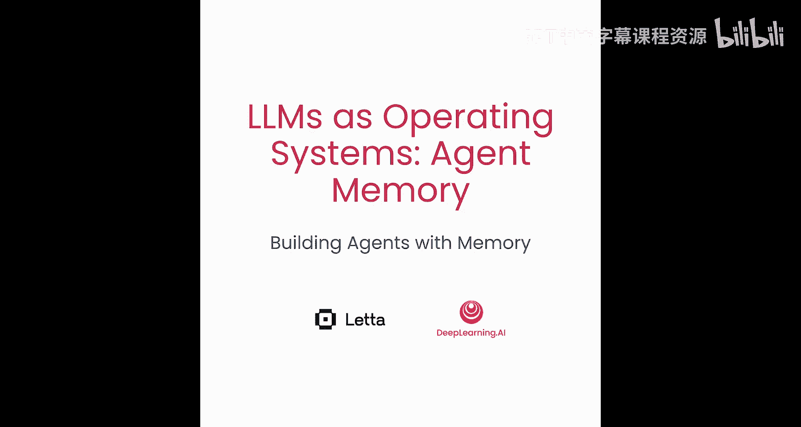
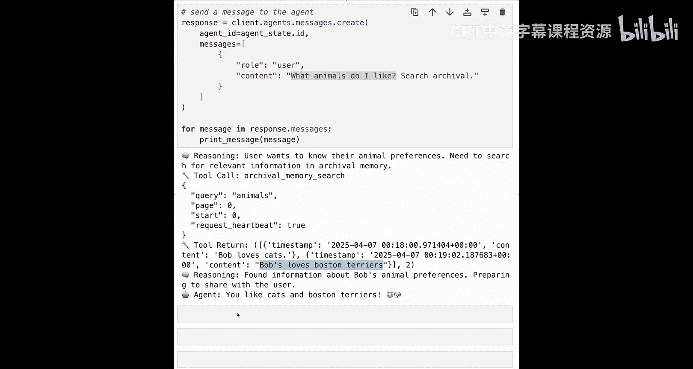

# 大语言模型作为操作系统代理内存：P4：构建具有记忆的代理




在本节课中，我们将学习如何使用 Letter 框架创建 MGPT 代理并与之交互。我们还将了解代理的状态，例如系统提示词、工具和代理的记忆。最后，我们将学习如何查看和编辑代理的档案记忆。

## 创建 Letter 客户端

首先，我们需要创建一个 Letter 客户端来连接到正在运行的 Letter 服务。Letter 与其他代理框架的不同之处在于，它以一个服务的形式运行，你需要连接到一个 Letter 服务器来创建和交互代理。

以下是创建客户端的代码：

```python
from letter_client import LetterClient

client = LetterClient(host="localhost", port=8283)
```

## 创建简单的代理

现在，我们可以使用 Letter 客户端创建一个简单的代理。代理是有状态的，并且其上下文窗口有明确管理的部分。

以下是创建代理的代码：

```python
agent_state = client.create_agent(
    name="simple_agent",
    memory_blocks=[
        {"label": "human", "character_limit": 10000},
        {"label": "persona"}
    ],
    llm_model="gpt-4-mini",
    embedding_model="text-embedding-ada-002"
)
```

## 与代理交互

创建代理后，我们可以向它发送消息。代理的响应会包含不同类型的消息，例如推理消息、助手消息、工具调用和工具返回结果。

以下是发送消息的代码：

```python
response = client.send_message(
    agent_id=agent_state.id,
    messages=[{"role": "user", "content": "how is it going?"}]
)

for msg in response.messages:
    print(f"{msg.role}: {msg.content}")
```

## 理解代理状态

代理状态包含了定义代理行为的所有信息。我们可以查看和修改这些状态。

以下是代理状态的主要组成部分：

*   **系统提示词**：定义了代理的行为和记忆管理方式。
*   **工具**：代理可以调用的功能，例如发送消息、管理记忆。
*   **核心记忆**：存储在代理上下文窗口中的信息。
*   **档案记忆**：存储在外部向量数据库中的信息。

### 查看系统提示词

我们可以通过 `agent_state.thought_system` 查看代理的系统提示词。这个提示词通常很长，包含了覆盖默认 LLM 行为和管理记忆的指令。

### 查看可用工具

代理默认配备了一些工具。我们可以通过 `agent_state.thought_tools` 查看工具列表。

以下是默认工具列表：

*   `archival_memory_insert`
*   `archival_memory_search`
*   `conversation_history_search`
*   `core_memory_append`
*   `core_memory_replace`
*   `send_message`

### 查看核心记忆

核心记忆是存储在上下文窗口中的信息块。我们可以通过 `agent_state.memory_blocks` 查看这些记忆块。

## 管理核心记忆

核心记忆允许代理通过编辑记忆块来学习新信息。例如，我们可以告诉代理更新关于用户的名字。

以下是更新核心记忆的示例：

```python
response = client.send_message(
    agent_id=agent_state.id,
    messages=[{"role": "user", "content": "My name is actually Sarah."}]
)
```

代理在收到消息后，会调用 `core_memory_replace` 工具，将“human”记忆块中的内容从“Charles”更新为“Sarah”。

## 管理档案记忆

档案记忆是存储在代理上下文窗口之外的信息。代理可以通过工具将信息插入档案记忆，并在需要时搜索。

### 代理写入档案记忆

我们可以指示代理将信息保存到档案记忆中。

```python
response = client.send_message(
    agent_id=agent_state.id,
    messages=[{"role": "user", "content": "Please save 'Bob loves cats' into archival memory."}]
)
```

### 开发者写入档案记忆

我们也可以直接使用客户端向代理的档案记忆插入信息。

```python
client.passages_create(
    agent_id=agent_state.id,
    text="Bob loves Boston Terriers"
)
```

### 代理搜索档案记忆

当代理需要信息时，它可以决定搜索档案记忆。我们可以通过提问来触发搜索。

```python
response = client.send_message(
    agent_id=agent_state.id,
    messages=[{"role": "user", "content": "What animals do I like? Please search archival memory."}]
)
```

代理会调用 `archival_memory_search` 工具，并使用它自己决定的查询词（例如“animals”）进行搜索，然后将结果纳入上下文并给出回答。

## 总结



在本节课中，我们一起学习了如何使用 Letter 框架创建具有记忆功能的代理。我们了解了代理状态的各个组成部分，包括系统提示词、工具、核心记忆和档案记忆。我们实践了如何与代理交互、如何查看和修改其核心记忆，以及如何管理其外部的档案记忆。在未来的课程中，我们将为代理添加更多能力，例如自定义工具调用和定制上下文记忆管理策略。