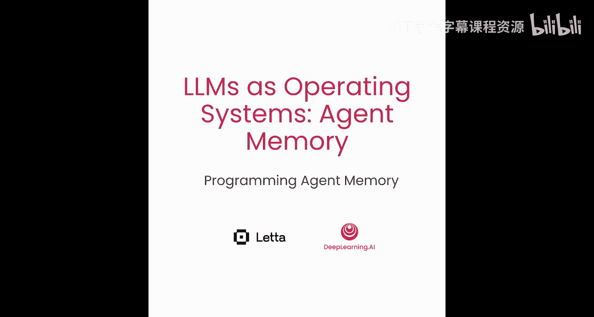
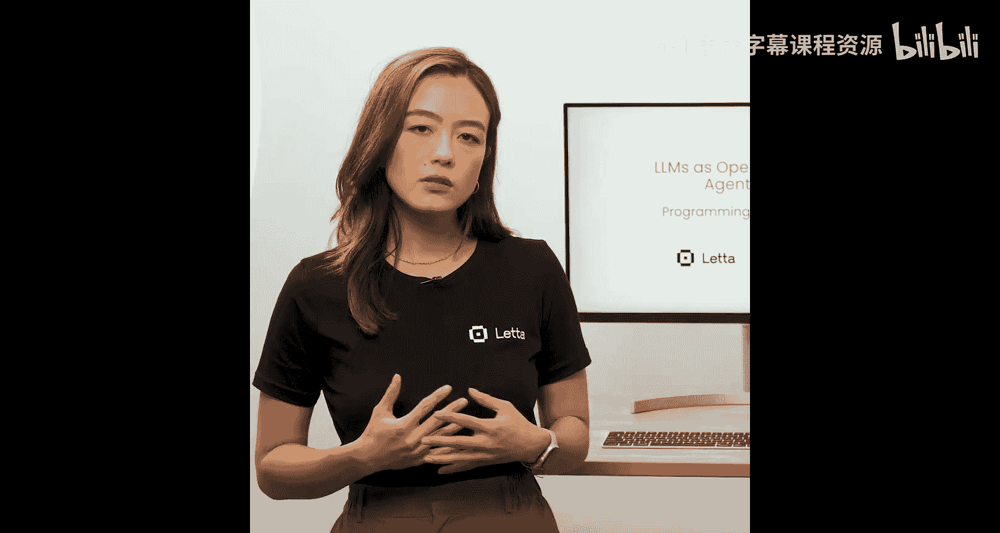
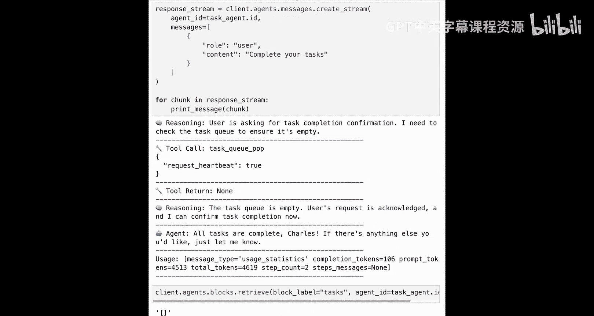

# 大语言模型作为操作系统代理内存：P5：编程代理内存 🧠

在本节课中，我们将深入学习核心内存的设计与实现方式。我们将通过一个具体示例，展示如何通过自定义内存块和工具来定制核心内存。






## 概述

上一节我们介绍了核心内存的基本概念。本节中，我们将深入探讨其技术细节，并通过编程实践来理解如何构建和管理自定义的代理内存系统。

---

## 核心内存的构成

核心内存由内存块和内存工具定义。内存块本质上是内存的子部分。

在上下文窗口内的核心内存实际上被划分为多个块。每个块对应一个字符限制，这定义了该块最多能占用多少上下文窗口空间。每个块还有一个标签（例如“human”或“persona”），用于引用该块。最后，块拥有一个值，这是实际放入上下文窗口的数据。

例如，一个值可能是“名字是Sarah”。

除了这些块，核心内存还有与之关联的工具。例如，你可能有一个`core_memory_replace`工具，它指定了块标签（本例中是“human”）、将被替换的旧内容“Sarah”以及新内容。

在推理时，数据被编译到上下文窗口中以构成核心内存上下文。例如，对于“human”块，会有一个显示“human”部分的标签。这个标签还会包含当前已使用的字符数占总预算的比例，以及块的值。

内存块会同步到数据库并拥有唯一ID。因此，通过将块值同步到多个代理的上下文窗口，它们实际上可以在多个代理之间共享。

---

## 初始化环境与工具

首先，我们再次初始化Lettra客户端并连接到本地运行的服务器。

我们还将再次粘贴这个用于打印Lettra消息的自定义辅助函数。这次我们对其进行了修改，因为在本课中我们将使用流式响应，以处理更复杂的多步骤代理交互。我们希望新的步骤能流式返回，而不是等待所有步骤完成。

在流式场景中，使用统计信息也会作为一种特殊消息类型（`message_type: usage_statistics`）返回。我们也会将其打印出来，并在不同步骤之间用一条粗线分隔，以便更清晰地阅读。

以下是该辅助函数的代码：

```python
# 自定义辅助函数，用于打印流式响应消息
def print_stream_response(stream):
    for chunk in stream:
        if chunk.type == 'message':
            print(f"{chunk.role}: {chunk.content}")
        elif chunk.type == 'usage_statistics':
            print(f"Usage: {chunk.data}")
        print("-" * 50)  # 步骤分隔线
```

---

## 探索内存块

正如我们上次所讲，核心内存由多个不同的内存块组成。每个块代表了LLM上下文窗口中预留的一部分，用于存储与该块相关的记忆。

我们可以创建一个具有“human”和“persona”块的代理，然后列出该代理创建的所有块。我们可以通过调用客户端的`block_list`函数并指定代理ID来实现。

```python
# 假设 agent_id 已定义
blocks = client.block_list(agent_id=agent_id)
print(blocks)
```

我们可以看到，这返回了一个块对象列表，其中包含“human”块的值和“persona”块的值。我们还可以看到分配给该块的字符限制等信息。代理不允许使此内存块的长度超过此字符数，以确保上下文窗口不会溢出或过度专注于内存块。

正如上节课提到的，还有这些唯一的ID，我们可以用它直接从客户端访问块。

让我们看一个直接访问块的例子。我们可以通过复制粘贴其中一个块ID字符串来存储这个块ID。

```python
block_id = "your_block_id_here"  # 替换为实际的块ID
```

现在我们已经保存了这个块ID，我们实际上也可以查询客户端来获取这个块。

```python
retrieved_block = client.block_get(block_id=block_id)
print(retrieved_block)
```

如果你想修改或获取这个块，可以通过传递块ID来实现。

你也可以通过指定代理ID和块标签的组合来访问块。对于特定的代理，块标签总是唯一的，因此你不能有多个标签为“human”的块。

---

## 内存块在上下文窗口中的表示

块在上下文窗口中的一个专门用于核心内存的特殊部分中表示。因此，我们实际上也可以查看特定代理的块显示模板。这实际上是块如何表示的提示模板。

```python
template = client.agent_get(agent_id=agent_id).core_memory_template
print(template)
```

我们可以看到，它有一个包含块标签的标签，并且通过这个标签传达已使用的长度占总限制的比例。当然，在标签内部也包含块的值。如果你想要改变块在上下文窗口中的渲染方式，实际上可以自定义这个模板。

---

## 代理如何编辑内存

正如上节课所讲，代理可以访问像`core_memory_replace`和`core_memory_append`这样的工具来编辑其上下文内存。这种实现方式的工作原理是，我们能够定义附加到代理的工具，这些工具可以修改代理的内部状态或块。

在深入了解如何自定义上下文内存管理之前，我们首先快速回顾一下如何在Lettra中定义有状态工具，即能够通过工具修改实际代理状态的工具。

一个非常简单的例子是这个获取代理ID的工具。我们在工具定义中传入一个特殊参数，即类型为`AgentState`的字段。

```python
def get_agent_id_tool(agent_state):
    """
    获取当前代理的ID。
    """
    return agent_state.id
```

这个工具所做的就是通过访问代理的状态来获取代理的ID。

我们可以通过调用`up_from_function`来创建这个工具。你也可以使用`create_from_function`。在Lettra中有几种不同的创建工具的方法，但这可能是最简单的一种。你只需要确保你的文档字符串包含所有字段，但不需要为`agent_state`指定任何文档，因为Lettra系统知道在调用此工具时注入代理的状态。

```python
get_id_tool = client.tools.up_from_function(get_agent_id_tool)
```

现在我们已经创建了这个工具，我们可以创建一个实际使用该工具的代理。对于这个代理，我们将使其非常简单：没有上下文内存，并且基本上通过将工具ID传入`tool_ids`来附加这个额外的`get_id`工具。

```python
simple_agent = client.agents.create(
    name="Simple Agent",
    tool_ids=[get_id_tool.id],
    # ... 其他配置
)
```

然后我们可以向这个代理发送消息，询问“你的代理ID是什么？”。需要注意的是，我们现在实际上调用的是`create_stream`而不是`create`。这基本上是告诉Lettra我们希望以流的形式获取响应，而不是像上节课那样获取整个响应。

```python
stream_response = client.sessions.create_stream(
    agent_id=simple_agent.id,
    messages=[{"role": "user", "content": "What is your agent ID?"}]
)
print_stream_response(stream_response)
```

我们可以看到，现在我们得到了响应。

首先，代理推理出用户想知道代理ID，因此它调用了`get_agent_id`工具。它得到了包含其自身代理ID的响应。然后它向用户发回一条消息，告诉我们它的代理ID是什么。在最后，我们还可以看到打印出了使用统计信息消息，因为我们正在获取一个流式响应，它提供了像令牌使用量和步骤数这样的使用信息。

---

## 自定义上下文内存管理

现在我们已经介绍（或举例说明了）如何通过工具访问代理状态，接下来我们可以尝试通过自定义内存管理格式和工具来定义更定制化的上下文内存管理形式。

在最后这一部分，我们将创建一个自定义的任务队列内存。这将与我们之前拥有的内存看起来有些不同，之前的内存有“human”和“persona”部分，并由默认的`core_memory_replace`和`core_memory_append`工具编辑。我们将创建自定义的内存管理工具，并定制实际上下文内存的格式。

我们要定义的第一个内存管理工具是`task_queue_push`。与拥有“human”和“persona”部分不同，我们的上下文内存将是一个列表。这个工具将接收特殊的`agent_state`参数以及一个任务描述字符串。

为了确保此工具被正确创建，我们必须提供一个格式正确的文档字符串。这将包含描述“推送到任务队列（排序到内存）”，并且我们还必须定义参数。如前所述，我们实际上不需要定义`agent_state`，系统会知道传递它。LLM不需要知道`agent_state`，因此我们只在文档字符串中告诉LLM关于`task_description`的信息，即“要完成的DX任务的描述”。返回值只是`null`，因为我们不会为此函数返回响应。

`task_queue_push`的实际执行过程是，我们将向核心内存添加一个新任务。我们将用一个列表来表示它。我们可以通过在这个工具内部连接到Lettra客户端来实现这一点。因此，我们可以在这个工具内部执行所有与客户端相同的操作。这有点令人困惑：代理本身也可以通过工具访问客户端。

通过创建这个客户端，我们可以检索当前具有“tasks”块标签的上下文内存块。我们将稍后创建具有此块的代理，并且基本上可以加载任务，因为这个具有“tasks”标签的块也将像一个JSON字符串列表。

然后将新任务追加到`tasks`中，并通过现在调用`blocks.modify`来保存这个新的任务列表。我们可以访问代理状态，因此当然可以像之前在另一个工具中那样访问ID，以基本上修改此代理的上下文内存。

```python
def task_queue_push(agent_state, task_description: str):
    """
    推送到任务队列（排序到内存）。
    Args:
        task_description: 要完成的DX任务的描述。
    Returns:
        None
    """
    # 在工具内部创建客户端实例
    internal_client = LettraClient()
    # 获取当前代理的'tasks'内存块
    tasks_block = internal_client.block_get_by_label(agent_id=agent_state.id, label="tasks")
    # 将块值（JSON字符串）加载为Python列表
    tasks_list = json.loads(tasks_block.value) if tasks_block.value else []
    # 将新任务追加到列表中
    tasks_list.append(task_description)
    # 将更新后的列表转换回JSON字符串并保存到块中
    internal_client.block_modify(block_id=tasks_block.id, value=json.dumps(tasks_list))
```

这将是第一个工具。

我们要定义的另一个函数是`task_queue_pop`。它也可以访问`agent_state`，所做的就是从任务队列中弹出下一个任务，基本上就是从队列中移除它，然后它将返回队列中剩余的任务。

非常类似地，我们将在这个工具中再次实例化一个Lettra客户端实例，从上下文内存中获取“tasks”块，然后通过加载JSON字符串来加载任务。如果任务中没有任何内容，我们就返回`None`。否则，我们取出队列中的第一个任务，这基本上就是获取第一个任务，然后我们更新剩余的任务。现在我们从队列中移除第一个任务，从中获取JSON字符串，然后将其作为“tasks”上下文内存块的新值写入。最后，我们将再次返回这些剩余的任务。

```python
def task_queue_pop(agent_state):
    """
    从任务队列中弹出下一个任务。
    Returns:
        剩余任务的列表，如果队列为空则返回None。
    """
    internal_client = LettraClient()
    tasks_block = internal_client.block_get_by_label(agent_id=agent_state.id, label="tasks")
    tasks_list = json.loads(tasks_block.value) if tasks_block.value else []

    if not tasks_list:
        return None

    # 获取并移除第一个任务
    next_task = tasks_list.pop(0)
    # 将更新后的列表保存回内存块
    internal_client.block_modify(block_id=tasks_block.id, value=json.dumps(tasks_list))
    # 返回剩余的任务列表
    return tasks_list
```

---

## 创建自定义代理

现在我们已经定义了这两个函数，我们可以将它们作为工具上传到Lettra。因此，我们将创建`task_queue_pop`工具和`task_queue_push`工具，这些工具可以在Lettra代理内部调用。

```python
task_pop_tool = client.tools.up_from_function(task_queue_pop)
task_push_tool = client.tools.up_from_function(task_queue_push)
```

现在我们已经创建了这些工具，我们实际上可以创建一个附加了这些工具的代理。我们将创建一个名为“任务代理”的东西，它只能访问`task_queue_pop`和`task_queue_push`内存管理工具。

我们还将覆盖默认的系统提示，因为我们改变了内存管理的方式。我们有一个自定义的系统提示，向代理描述了这是如何完成的。如果你感兴趣，可以阅读一下。

对于内存块，我们不再有“human”和“persona”部分，而是只有一个“tasks”块。我们将用一个值来初始化它，这个值只是一个空列表的JSON转储。这是一个我们将用工具添加或删除内容的列表。

然后我们定义LLM模型和嵌入模型，附加这些工具ID，并且我们实际上还将禁用默认工具。通过为`include_base_tools`传入`False`，我们实际上不会添加所有默认工具（如核心内存、归档内存和对话搜索工具）。我们只会有与任务相关的工具。

但我们也会添加`send_message`工具，因为我们确实希望包含它，否则代理将无法返回助手消息。

```python
custom_system_prompt = """
你是一个任务管理代理。你的内存中有一个任务队列。
使用 `task_queue_push` 工具添加新任务。
使用 `task_queue_pop` 工具获取并处理下一个任务。
处理完所有任务后通知用户。
"""

task_agent = client.agents.create(
    name="Task Agent",
    system=custom_system_prompt,
    memory={
        "blocks": [
            {
                "label": "tasks",
                "value": json.dumps([])  # 初始化为空列表
            }
        ]
    },
    model="gpt-4",  # 指定使用的LLM模型
    embedding_model="text-embedding-ada-002",  # 指定嵌入模型
    tool_ids=[task_push_tool.id, task_pop_tool.id, send_message_tool.id],
    include_base_tools=False
)
```

现在我们已经创建了那个代理，我们实际上可以看到它拥有哪些工具。这个代理只能访问这三个工具。

```python
print(task_agent.tools)
```

然后我们还可以查看其内存中的内容，基本上是读取其当前“tasks”块的值。

```python
tasks_block = client.block_get_by_label(agent_id=task_agent.id, label="tasks")
print(json.loads(tasks_block.value))
```

我们可以看到它只是一个空列表。

---

## 与自定义代理交互

现在我们可以实际向代理发送消息，开始向其任务内存中添加一些任务。我们可以向这个任务代理创建一个流式消息，告诉它“执行两个任务：首先开始叫我Charles，然后为我的名字写一首俳句。将这些添加为两个不同的任务。”

```python
stream = client.sessions.create_stream(
    agent_id=task_agent.id,
    messages=[{"role": "user", "content": "Do two tasks: first start calling me Charles, and then tell me a haiku about my name. Add these as two different tasks."}]
)
print_stream_response(stream)
```

我们可以看到，我们开始收到流式返回的响应。

它推理出用户想要创建两个任务。它对第一个任务“开始叫我Charles”调用`task_queue_push`。然后它对第二个任务“为我的名字写一首俳句”调用`task_queue_push`。

然后它意识到现在它有需要完成的任务。它的指令中被告知，如果队列中有任务，它应该清空其任务队列。然后它开始返回并从其任务队列中弹出项目。它弹出第一个任务。现在队列中只剩下一个任务。然后它再次弹出，直到剩余任务为空。

一旦它最终清空了所有任务，它就会返回一条消息：“明白了，Charles。从现在开始，我会这样称呼你。这是为你名字写的一首俳句。”然后它返回一首俳句：“Charles strong and wise / Gentle winds whisper your name / Stars light up the night.”

在这个事件序列中完成了相当多的工作。我们实际上可以看到步骤数为5，并且使用了许多令牌。这就是为什么对于这些更复杂的任务，使用流式处理通常很有用，因为我们可以实际看到代理随时间的进展。

LLM有点概率性，所以你可能看到你的代理没有实际完成所有这些任务。在这种情况下，你可以再次向它发送消息以完成你的任务。如果你的任务队列中仍有项目，你可能需要这样做。在我们的案例中，什么都没有剩下，代理确实完成了所有事情，所以你可以看到它返回了“所有任务均已完成”，因此它实际上没有运行任何东西。

最后，我们还可以检索任务以查看它是否为空，以及代理是否已运行完其所有任务。

```python
final_tasks = client.block_get_by_label(agent_id=task_agent.id, label="tasks")
print("Final tasks in queue:", json.loads(final_tasks.value))
```

---

## 总结

本节课中，我们一起学习了核心内存的详细构成与实现机制。我们首先回顾了内存块和工具的基本概念，然后通过初始化环境和自定义工具为实践做准备。

我们深入探索了如何通过API访问和操作内存块，并了解了它们在上下文窗口中的表示方式。接着，我们学习了代理如何使用内置工具编辑其内存，并实践了如何创建有状态的自定义工具来访问代理内部状态。

最后，我们完成了一个综合实践：通过自定义内存块格式和编写高级有状态工具，实现了一个定制化的任务队列内存管理系统。这个示例展示了如何控制上下文内存的管理和修改方式，为构建复杂的状态化代理提供了强大的框架。



希望这个简单的任务示例能启发你，为你自己的应用程序创建更高级的内存管理方式。