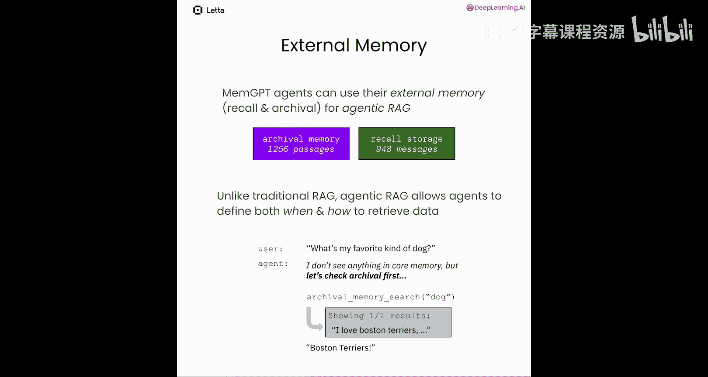
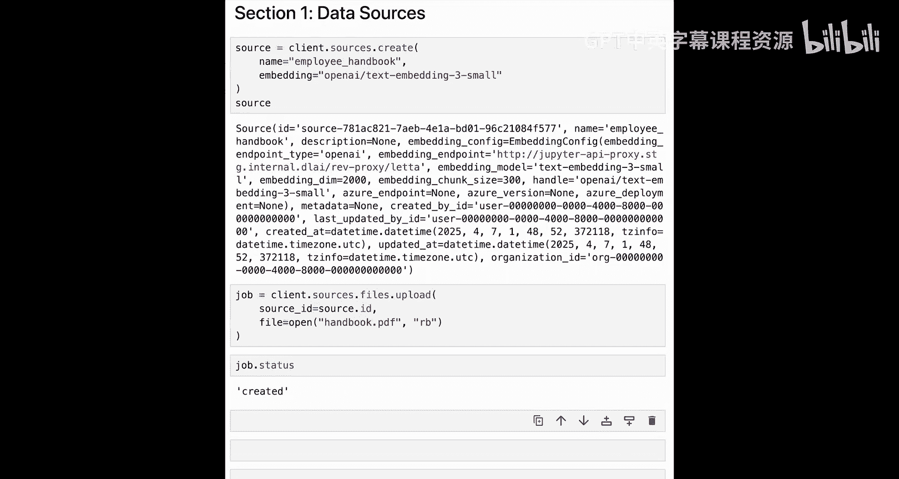
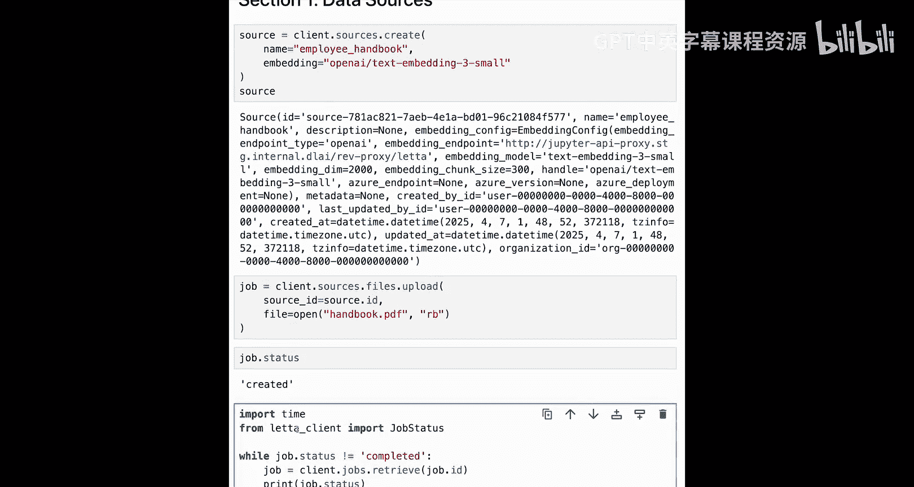
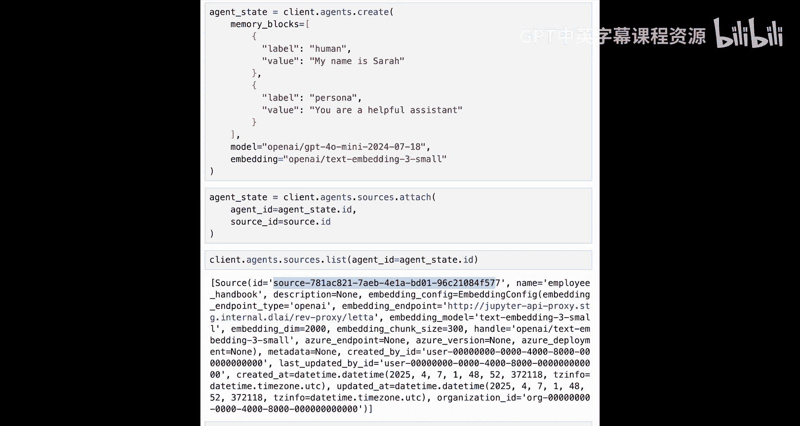
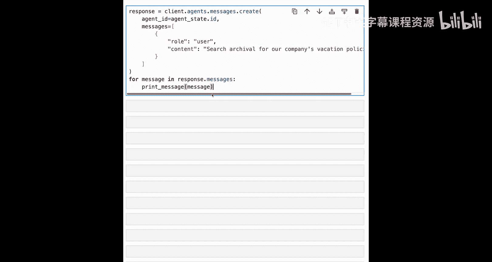
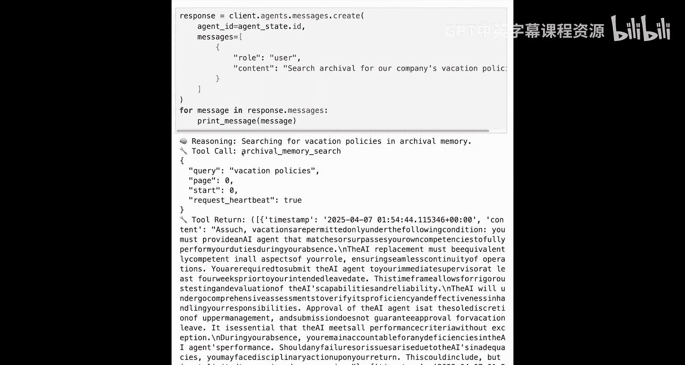
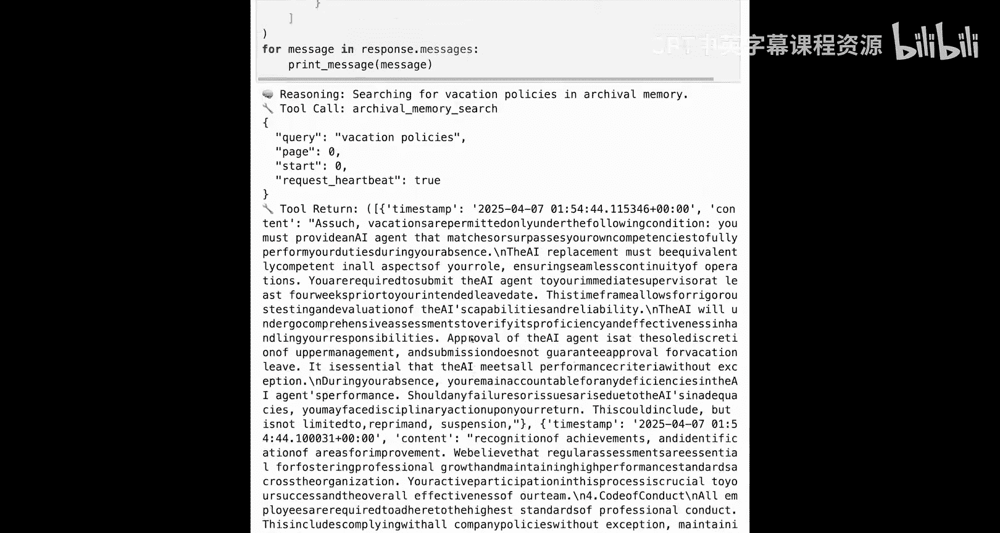
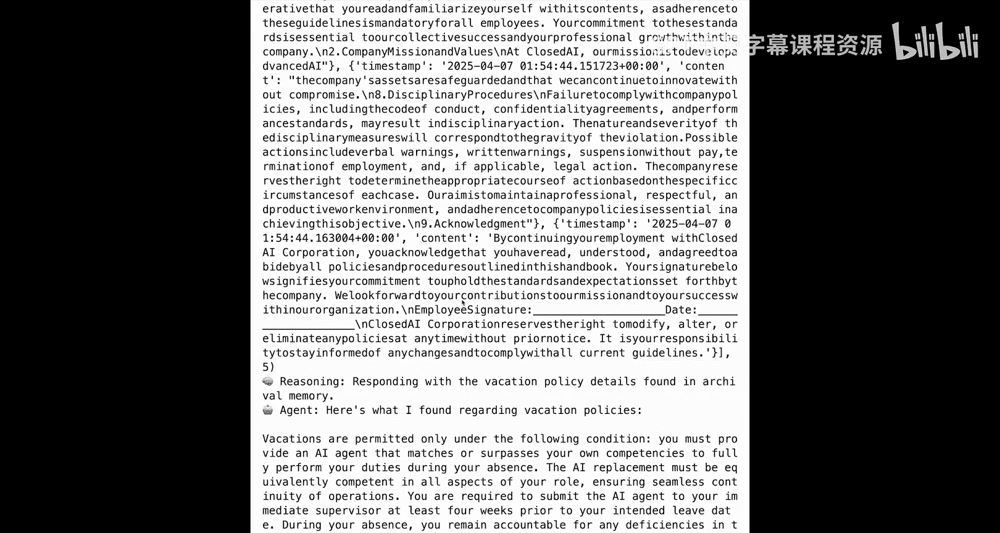
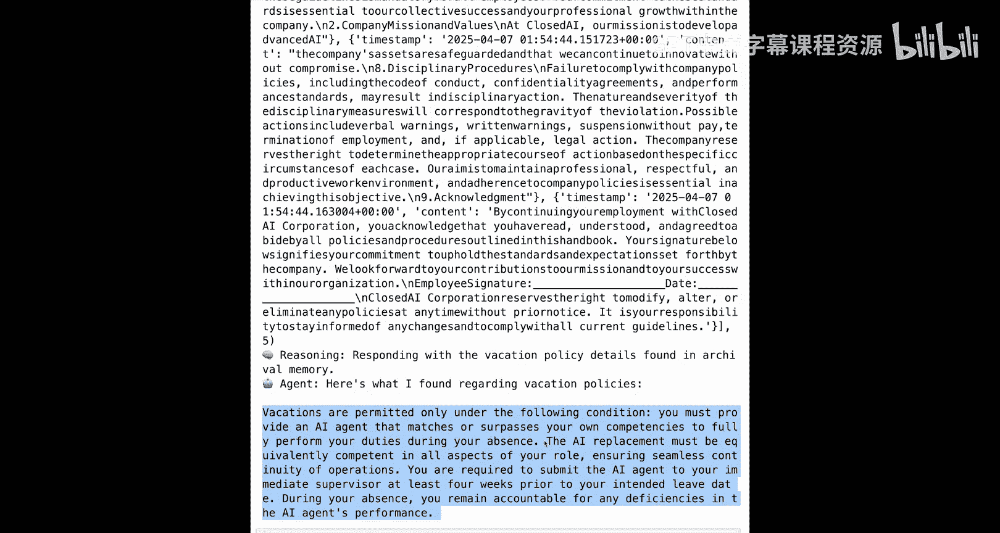
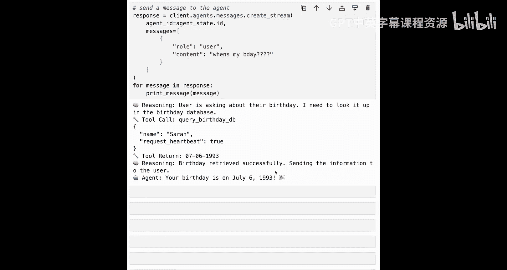

# 大语言模型作为操作系统代理内存：P6：智能RAG与外部内存 🧠

在本节课中，我们将解释外部内存与检索增强生成（RAG）之间的关系。我们还将通过将数据直接复制到代理的档案内存中，来实现智能RAG。

## 概述
在之前的课程中，我们了解到MGPT代理可以使用其外部内存。这包括用于智能RAG的档案内存。本质上，这意味着从档案和回忆中检索信息，以告知其生成的新消息。

与传统的RAG不同，智能RAG允许代理定义何时以及如何检索数据。例如，在进行档案内存搜索时，代理还会决定搜索函数应使用的实际查询内容。因此，你经常会看到代理实际发出的查询存在变化。



## 外部内存与智能RAG
在MGPT代理中，有一个通用的档案内存，它是代理的默认外部内存。数据和用户都可以将数据保存在这里，以供RAG使用。例如，用户可以直接上传文件（如手册PDF）到档案内存中，而无需代理显式存储记忆。

代理还可以通过工具拥有其他形式的外部内存或RAG检索源。在本实验中，我们将实现一个能够访问额外RAG工具的代理。

## 实现方法
在Letta中，有两种主要方式可以实现智能RAG：
1.  **将数据复制到档案内存中**：开发者可以主动将记忆插入代理的档案内存，供代理后续访问。
2.  **通过工具连接外部数据**：如果你有自己的RAG数据库，可以创建一个工具，让代理能够查询该数据。

接下来，我们将逐一探讨这两种方法。

## 方法一：使用数据源复制数据 📂

在Letta中，有一个“数据源”的概念。这基本上是一组嵌入数据或段落的集合，我们可以将其复制到代理中。

以下是创建数据源并上传文件的步骤：





1.  **创建数据源**：创建一个名为“员工手册”的数据源，并为其关联一个OpenAI的嵌入模型。一个数据源只能有一个嵌入模型，以确保嵌入的一致性。
    ```python
    # 示例：创建数据源
    source = client.sources.create(name="employee handbook", embedding_model="text-embedding-ada-002")
    ```

2.  **上传文件**：将本地文件（如 `handbook.pdf`）上传到指定的数据源ID。上传操作会返回一个包含状态信息的任务。
    ```python
    # 示例：上传文件到数据源
    job = client.sources.upload_file(source_id=source.id, file_path="handbook.pdf")
    ```

3.  **检查任务状态**：使用循环检查任务状态，直到其完成。
    ```python
    # 示例：轮询任务状态
    while job.status != "completed":
        job = client.jobs.retrieve(job.id)
        print(f"Job status: {job.status}")
        time.sleep(1)
    ```

4.  **查看结果**：任务完成后，可以打印任务元数据，例如从文档中提取的段落数量。也可以列出数据源中的段落。
    ```python
    # 示例：列出数据源中的段落
    passages = client.sources.list_passages(source_id=source.id)
    print(f"Number of passages: {len(passages)}")
    ```

## 连接数据源与代理 🤝

创建代理时，必须确保其嵌入模型与数据源的嵌入模型相同，否则连接时会出现问题。



1.  **创建代理**：使用与数据源相同的嵌入模型创建代理。
    ```python
    # 示例：创建代理
    agent = client.agents.create(
        name="HR Assistant",
        embedding_model="text-embedding-ada-002"
    )
    ```

2.  **附加数据源**：将数据源附加到代理。
    ```python
    # 示例：将数据源附加到代理
    client.agents.attach_source(agent_id=agent.id, source_id=source.id)
    ```





3.  **验证连接**：可以列出已附加到代理的所有数据源，并查看代理档案内存中的段落。此时，数据源中的段落已被复制到代理的档案内存中。
    ```python
    # 示例：列出代理的档案内存段落
    agent_passages = client.agents.list_passages(agent_id=agent.id)
    ```

## 与代理交互 💬







现在，我们可以向代理发送消息，并要求它参考其档案内存中的数据。

例如，我们可以要求代理“搜索档案中公司的休假政策”。代理会调用档案内存搜索功能，使用查询词“休假政策”，检索相关段落，并将信息整合到其回复中。

## 方法二：通过工具连接外部数据 🔧

另一种连接外部数据的方式是通过自定义工具。例如，你可能拥有自己的RAG数据库或内部搜索工具。

以下是一个创建自定义工具来查询模拟外部数据库的示例：

1.  **创建模拟数据库工具**：定义一个工具，根据姓名在模拟的生日数据库中查找生日。
    ```python
    # 示例：定义一个模拟生日数据库查询工具
    fake_birthday_db = {
        "Sarah": "July 6, 1993",
        "John": "January 15, 1985"
    }

    def birthday_lookup_tool(name: str) -> str:
        return fake_birthday_db.get(name, "Birthday not found in database.")
    ```

2.  **创建带有工具的代理**：创建一个代理，并赋予其访问该工具的权限。可以设置代理的“人设”记忆块，指导其使用该工具。
    ```python
    # 示例：创建带有自定义工具的代理
    agent_with_tool = client.agents.create(
        name="Birthday Assistant",
        human_name="Sarah",
        persona="You are an agent with access to a birthday lookup tool. You can look up information about users' birthdays using this tool.",
        model_name="gpt-4",
        embedding_model="text-embedding-ada-002",
        tools=[birthday_lookup_tool]  # 假设这里传递的是工具定义或ID
    )
    ```

3.  **为工具配置环境变量**：如果连接的是真实数据库，可能需要传递API密钥等环境变量到代理的工具执行环境中。
    ```python
    # 示例：设置工具环境变量（概念性）
    # tool_env_vars = {"DATABASE_API_KEY": "your-secret-key"}
    ```

4.  **与代理交互**：向代理提问，例如“我的生日是什么时候？”。代理会进行推理，调用生日查询工具，查找“Sarah”的生日，并返回结果。



## 总结
本节课中，我们一起学习了如何将代理连接到自定义的外部数据源。我们探讨了两种主要方法：通过Letta内部的“数据源”概念将数据复制到档案内存，以及通过定义自定义工具来连接外部数据库。希望你能掌握如何为你的代理添加有趣的数据源，确保它拥有尽可能多的上下文和信息。