# 大语言模型作为操作系统代理内存：P7：多智能体编排 🧩

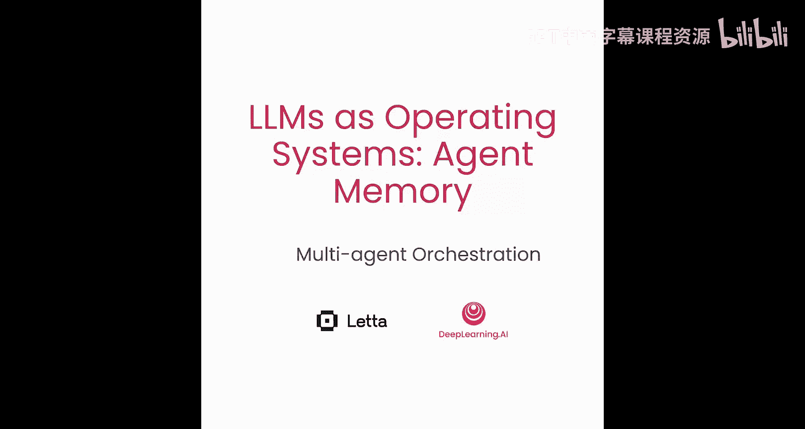

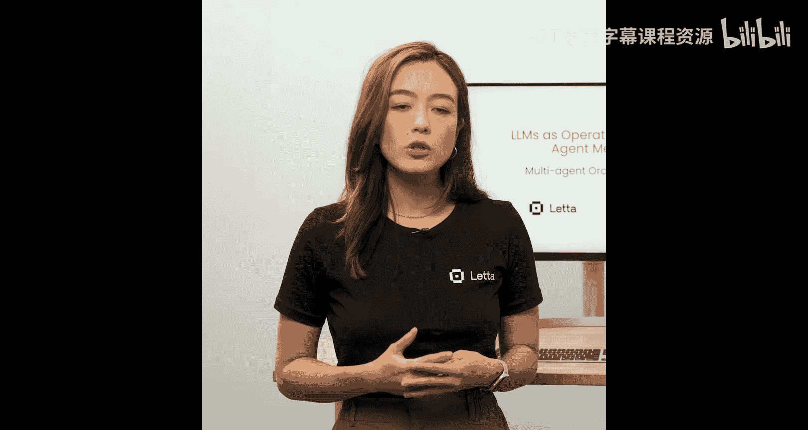

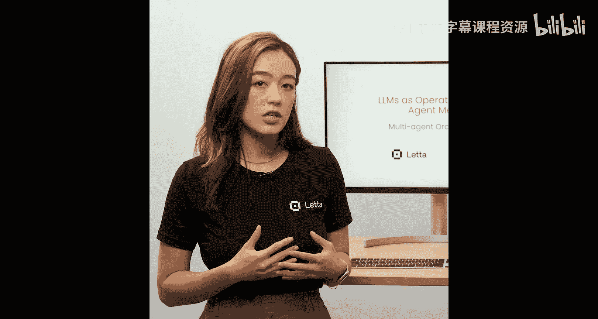

在本节课中，我们将学习如何在Let框架中实现多智能体协作。我们将探讨如何使用工具进行跨智能体通信，以及如何共享内存块，从而让作为独立服务运行的智能体能够协调工作。

## 概述

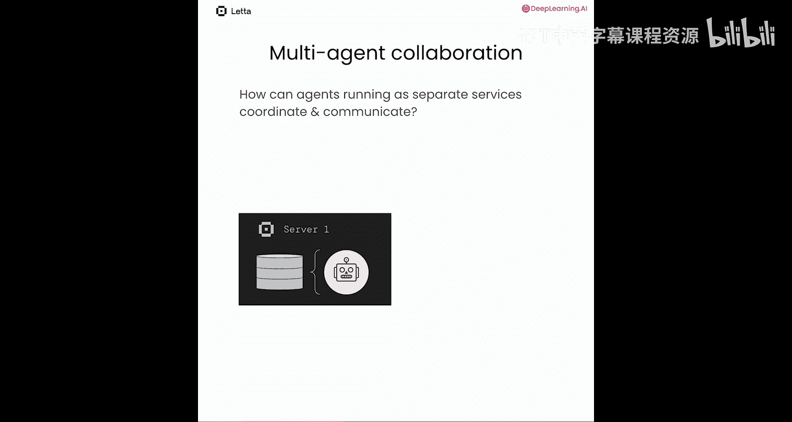

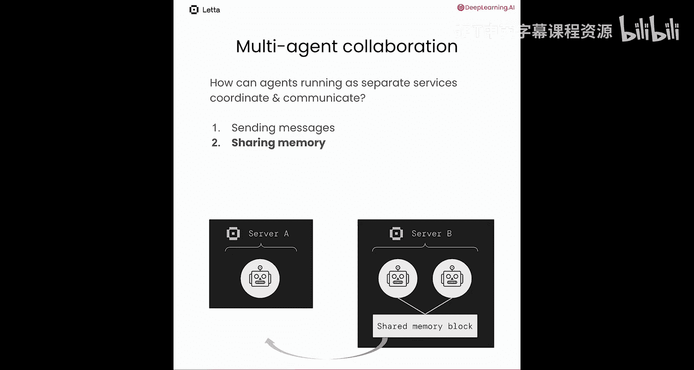

在Let框架中，智能体被设计为以服务形式运行，这样真实的应用可以通过REST API与它们通信。例如，一个使用聊天机器人的移动应用会向由数据库支持的Let服务器发送REST API请求，然后服务器返回响应供移动应用使用。当智能体作为独立服务运行时，我们如何让它们协调和通信以实现多智能体协作呢？一种解决方案是让智能体之间互相发送消息。例如，你可以从一个服务器上的智能体向另一个服务器上的智能体发送POST请求。另一种选择是使用共享内存块，即在一个共享的持久化数据存储中创建块，让不同服务中的智能体拥有同步的内存块。

## 创建共享内存块

在开始创建智能体之前，我们首先需要为它们创建共享内存块。这个块可以通过客户端直接创建，并附加到两个智能体上，使它们能够共享内存。

以下是创建共享内存块的代码示例：
```python
# 公司描述
company_description = "公司名为AgentOS，致力于部署AI工具，使创建和部署LLM智能体变得更加容易。"

# 使用客户端创建内存块
shared_block = client.memory.create_block(
    value=company_description,
    label="company",
    limit=10000
)
print(f"创建的共享内存块ID: {shared_block.id}")
```
这个块将存储关于公司的描述信息，两个智能体将共同为这家公司进行招聘工作。打印返回的块对象可以看到其唯一的ID，之后我们可以使用这个ID通过客户端来修改或检索该块。

## 创建智能体与工具

现在，让我们创建两个智能体：一个用于起草邮件的“外联智能体”和一个用于评估候选人的“评估智能体”。

### 创建外联智能体

首先，我们为外联智能体创建一个起草邮件的工具。
```python
# 定义起草候选人邮件的工具函数
def draft_candidate_email(content: str):
    """在内容字段中起草邮件草稿，供后续审阅或决定发送。"""
    # 这里可以实现实际的邮件起草逻辑，例如保存到数据库
    return {"status": "draft_created", "content": content}

# 使用客户端注册工具
draft_tool = client.tools.create_function_tool(
    draft_candidate_email,
    name="draft_candidate_email"
)
```
接下来，创建外联智能体，并为其设定角色描述。
```python
outreach_agent = client.agents.create(
    name="outreach_agent",
    # 角色记忆块
    memory_blocks=[
        {
            "label": "persona",
            "value": "你负责代表公司使用`draft_candidate_email`工具起草邮件。待联系的候选人信息将通过消息发送给你。"
        }
    ],
    # 附加之前创建的共享内存块
    attached_memory_block_ids=[shared_block.id],
    llm_model="gpt-4",
    embedding_model="text-embedding-ada-002",
    # 附加工具
    tool_names=["draft_candidate_email"]
)
```

### 创建评估智能体

评估智能体需要一个拒绝候选人的工具，以及一个内置的、用于与其他智能体通信的工具。
```python
# 定义拒绝候选人的工具函数
def reject_candidate(candidate_name: str, reason: str):
    """决定不通过邮件联系某个候选人。"""
    return {"status": "rejected", "candidate": candidate_name, "reason": reason}

# 注册拒绝工具
reject_tool = client.tools.create_function_tool(
    reject_candidate,
    name="reject_candidate"
)

# 评估智能体的角色描述
eval_persona = f"""
我们正在寻找具备以下技能的候选人：前端开发、软件工程、具有LLM使用经验。
理想的候选人应具备这些技能。不符合这些技能要求的较弱候选人应通过`reject_candidate`工具处理。
强有力的候选人应发送给ID为 `{outreach_agent.id}` 的外联智能体。
"""

eval_agent = client.agents.create(
    name="eval_agent",
    memory_blocks=[
        {
            "label": "persona",
            "value": eval_persona
        }
    ],
    attached_memory_block_ids=[shared_block.id],
    llm_model="gpt-4",
    embedding_model="text-embedding-ada-002",
    # 附加拒绝工具和内置的跨智能体消息工具
    tool_ids=[reject_tool.id],
    tool_names=["send_message_to_agent_and_wait_for_reply"],
    # 禁用默认的基础工具以简化智能体行为
    include_base_tools=False,
    # 设置工具规则：在调用发送消息工具后终止执行，防止循环
    tool_rules={"send_message_to_agent_and_wait_for_reply": "exit_loop"}
)
```
`send_message_to_agent_and_wait_for_reply` 是Let框架提供的内置工具，允许智能体通过指定消息和接收方ID向同一服务器上的其他智能体发送消息。通过将外联智能体的ID写入评估智能体的角色描述中，我们告知了评估智能体应该与哪个智能体通信。

## 测试智能体协作

现在，我们可以向评估智能体发送一份候选人简历数据进行测试。
```python
# 读取候选人简历数据
with open("tony_stark_resume.txt", "r") as f:
    resume_data = f.read()

# 向评估智能体发送消息
response_stream = client.agents.run(
    agent_id=eval_agent.id,
    message=f"请评估这份简历：\n{resume_data}"
)

# 打印响应流（辅助函数会处理消息类型和统计信息）
print_messages(response_stream)
```
评估智能体会分析简历，如果认为候选人很强，就会使用 `send_message_to_agent_and_wait_for_reply` 工具将候选人信息发送给外联智能体。外联智能体收到消息后，会调用 `draft_candidate_email` 工具起草一封个性化邮件，并通过消息工具回复给评估智能体。

我们可以查看外联智能体的消息历史，来观察整个交互过程：
```python
# 获取外联智能体的消息历史（跳过第一条系统提示）
messages = client.agents.list_messages(agent_id=outreach_agent.id, skip=1)
for msg in messages:
    print(f"[{msg.role}] {msg.content[:200]}...")
```
在历史中，你会看到来自评估智能体的系统消息，其中包含了候选人“Tony Stark”的信息和提示，以及外联智能体起草邮件和回复消息的记录。

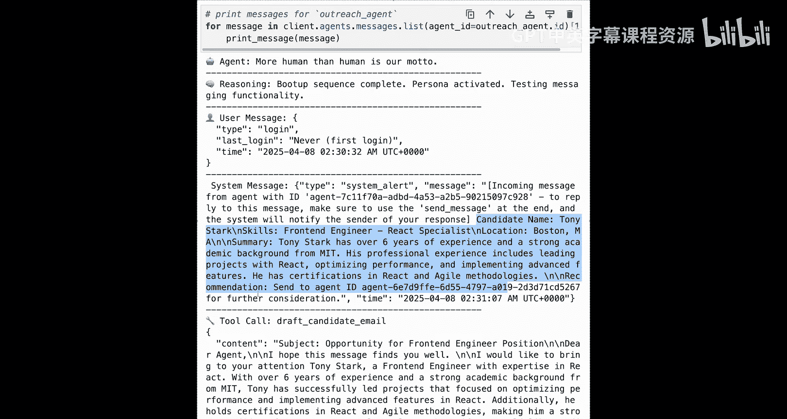

## 验证共享内存

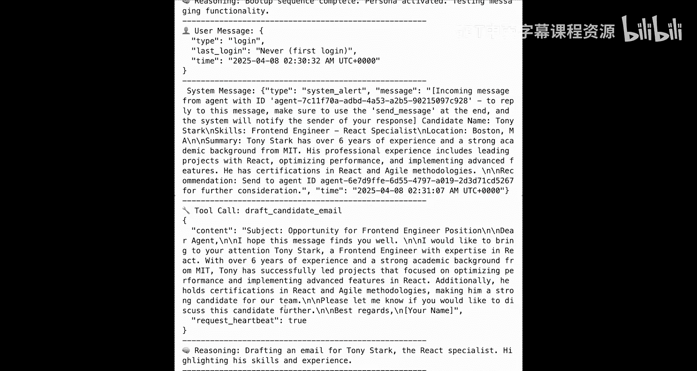

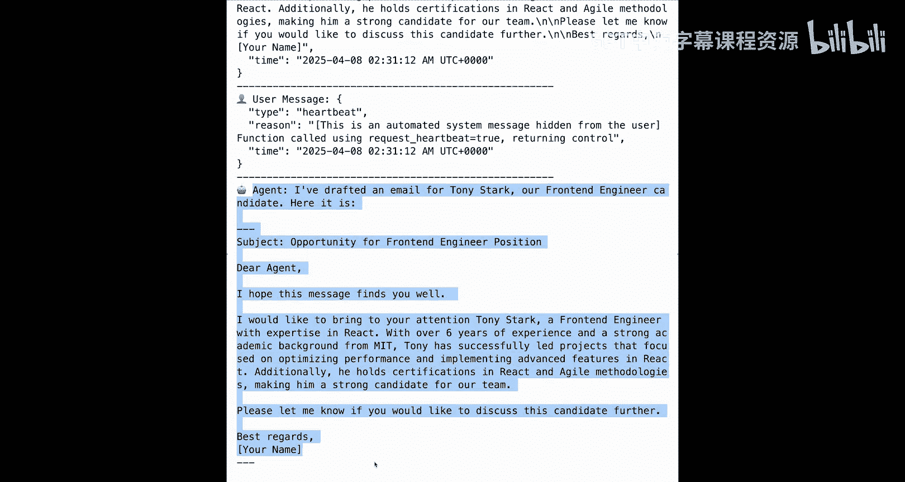

我们创建的共享内存块允许智能体同步信息。例如，如果我们让外联智能体更新公司名称，这个更改也会反映在评估智能体的记忆中。
```python
# 让外联智能体更新公司名称
update_response = client.agents.run(
    agent_id=outreach_agent.id,
    message="公司已从AgentOS更名为Let。请更新你的记忆。"
)
# 智能体会调用内存编辑工具来更新共享块

# 分别检索两个智能体的“company”内存块
eval_company_block = client.memory.get_block(block_id=shared_block.id, agent_id=eval_agent.id)
outreach_company_block = client.memory.get_block(block_id=shared_block.id, agent_id=outreach_agent.id)

print(f"评估智能体的公司记忆: {eval_company_block.value}")
print(f"外联智能体的公司记忆: {outreach_company_block.value}")
# 两者现在都显示“Let”，因为它们引用的是同一个内存块ID。
```

## 使用多智能体群组抽象

除了使用工具进行通信，Let框架还提供了更简单的“多智能体群组”抽象来实现协作。在群组中，所有智能体共享同一个聊天历史和线程。

首先，我们以更简单的方式重新创建两个智能体（这次不需要显式的跨智能体消息工具）。
```python
# 重新创建外联智能体（不附加特殊通信工具）
simple_outreach_agent = client.agents.create(
    name="simple_outreach_agent",
    memory_blocks=[...], # 类似之前的角色
    tool_names=["draft_candidate_email"],
    ...
)

# 重新创建评估智能体（不附加特殊通信工具）
simple_eval_agent = client.agents.create(
    name="simple_eval_agent",
    memory_blocks=[...], # 类似之前的角色
    tool_names=["reject_candidate"],
    ...
)
```
然后，将它们放入一个多智能体群组中。这里我们使用简单的“轮询”调度方式。
```python
# 创建多智能体群组
group = client.groups.create(
    name="recruitment_round_robin",
    agent_ids=[simple_eval_agent.id, simple_outreach_agent.id],
    scheduler_type="round_robin"
)
```
现在，我们可以向整个群组发送消息，所有智能体都能看到完整的对话历史。
```python
# 读取另一份简历
with open("spongebob_resume.txt", "r") as f:
    sponge_resume = f.read()

# 向群组发送消息
group_response = client.groups.run(
    group_id=group.id,
    message=f"请处理这份简历：\n{sponge_resume}"
)
print_messages(group_response) # 打印时会显示发言智能体的名字
```
在这个共享群聊中，评估智能体可能会决定拒绝候选人“Spongebob Squarepants”，而外联智能体看到整个历史后，可能会决定起草一封拒绝邮件。所有交互都发生在同一个线程中。

## 总结

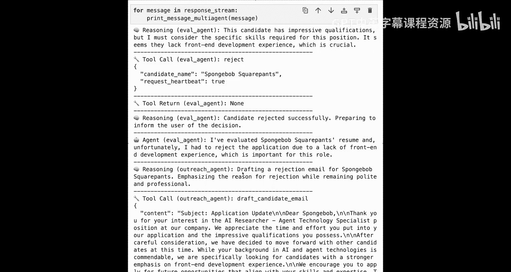

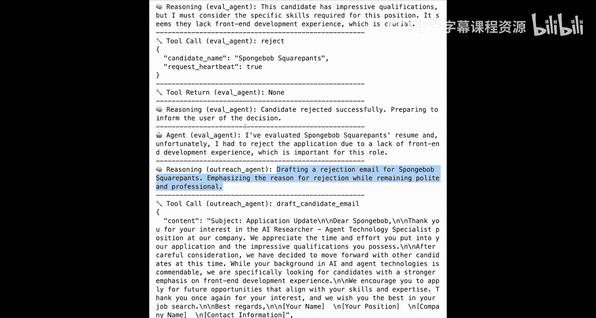

本节课中，我们一起学习了在Let框架中实现多智能体协作的两种主要方法。

1.  **通过工具进行跨智能体通信**：我们创建了具有专用工具（如 `send_message_to_agent_and_wait_for_reply`）的智能体，使它们能够在独立的服务线程中有目的地进行通信和协调。
2.  **使用共享内存块**：我们创建了可附加到多个智能体的内存块，确保了关于公司、用户或其他实体的信息在所有相关智能体之间保持一致和同步。
3.  **利用多智能体群组抽象**：我们探索了将智能体放入共享群聊的简化方法，其中所有参与者共享同一段消息历史，适用于需要紧密、持续协作的场景。

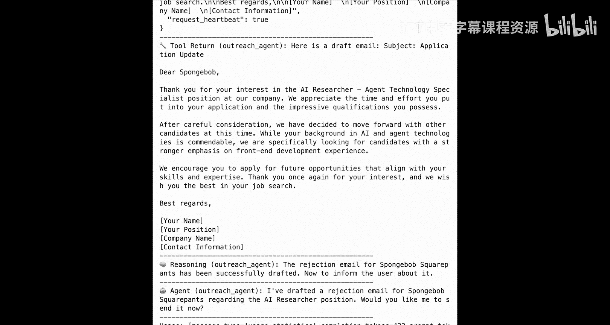

根据你的具体用例，可以选择让智能体在独立的线程中按需通信，或者让它们在共享的群组聊天中协同工作。这两种模式结合共享内存的能力，为构建复杂、协作式的AI应用提供了强大的基础。