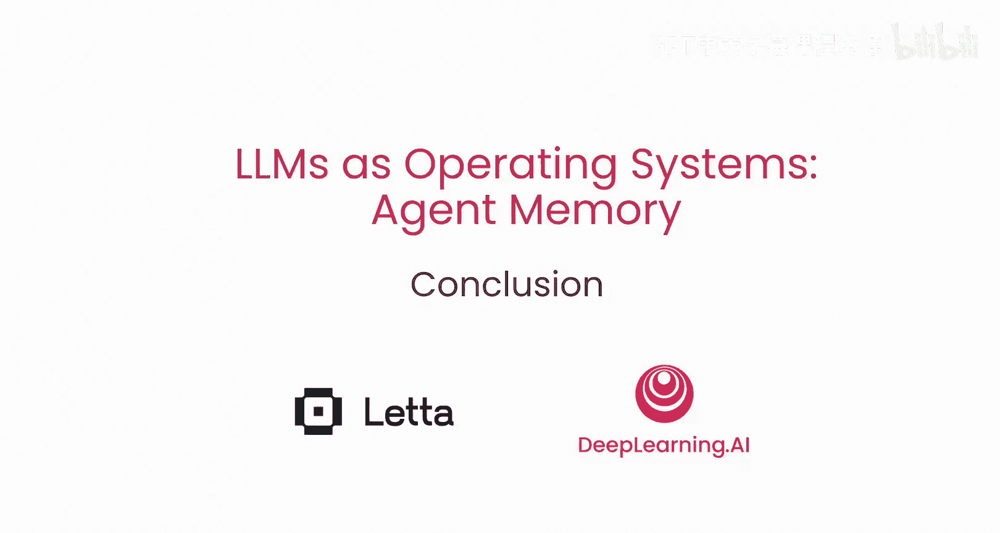
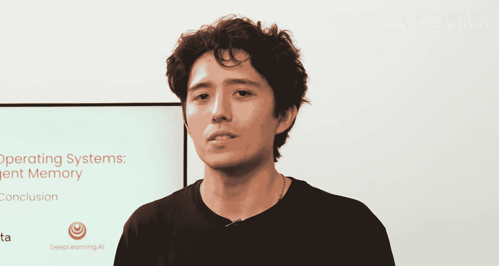

# 大语言模型作为操作系统代理内存：P8：总结 🎯

在本节课中，我们将一起回顾并总结如何将大语言模型（LLM）从一个简单的文本生成器，转变为一个能够构建复杂智能体记忆系统的核心组件。通过理解LMOS（语言模型操作系统）的概念，你将掌握构建能够利用虚拟上下文、突破LLM有限上下文窗口限制的应用程序的关键工具。

---

上一节我们探讨了LMOS的具体实现机制，本节中，我们来看看整个课程的要点总结。

以下是本课程的核心学习成果：

1.  **核心机制**：大语言模型（LLM）本质上是**文本生成器**，其基础功能是 `generate_text(prompt)`。
2.  **系统化升级**：通过构建**语言模型操作系统（LMOS）**，可以将简单的LLM升级为能够管理复杂状态和任务的智能体系统。
3.  **突破限制**：智能体的**记忆系统**可以借助LMOS，利用**虚拟上下文（Virtual Context）** 和**扩展记忆（Extended Memory）**，从而处理远超LLM自身固定上下文窗口（Context Window）限制的信息。
4.  **工具掌握**：你现在已经拥有了构建此类高级LM应用程序的工具，正如你的智能体拥有工具一样。

我们期待看到你运用这些知识，独立构建出令人惊叹的应用。

---

本节课中我们一起学习了如何将大语言模型系统化，通过引入LMOS架构来创建具备强大记忆能力的智能体。关键在于理解如何利用虚拟上下文和扩展记忆来突破模型固有的技术限制，从而开启更复杂、更持久交互的AI应用可能性。