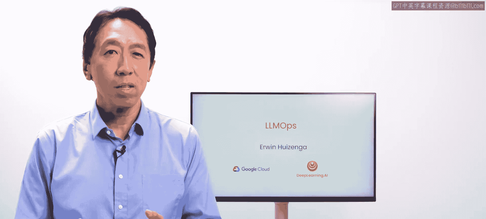

# 大语言模型运维 (LLMOps)：P1：1. 课程介绍 🚀

在本节课中，我们将学习大语言模型运维 (LLMOps) 的基本概念，了解它如何帮助开发者高效地设计、部署和管理基于大语言模型的应用。

假设你设计并部署了一个基于大语言模型的应用，例如总结客户邮件。这个过程可能需要花费数周时间。这个实践过程包含大量工作：选择合适的大语言模型作为基础，这可能意味着需要尝试多个模型以找到最佳选择；接着调整提示词，建立评估框架，部署应用，并在构建过程中监控其性能。拥有自动化的部署和监控方法将使你的工作更轻松。如果你需要更新这个应用，例如因为大语言模型提供商弃用了你所基于的模型，你需要切换到新模型，那么能帮助你迁移和测试的工具也将简化你的工作流程。

现在你已经构建了第一个应用。假设你的团队对你的总结应用印象深刻，他们回过头来要求你再开发五个新用例，例如邮件分类、邮件路由等。这意味着你需要完成相当于初始项目五倍的工作量。LLMOps 是机器学习运维 (MLOps) 在大语言模型应用领域的扩展，它描述了自动化数据准备、模型调优、部署、维护和监控这一循环所需的流程与工具。

以提示词管理为例。在设计提示词时，拥有一种自动化方法来评估和比较不同提示词的性能，并在需要时（例如底层大语言模型发生变化时）更新提示词，会非常有帮助。此外，如果你的应用涉及多次大语言模型调用，例如将多个步骤和处理过程链接在一起，可能使用了像 LangChain 这样的编排框架，那么管理这些依赖关系也会增加额外的复杂性。在本课程中，你将学习如何管理所有这些复杂性的最新最佳实践。

我很高兴向大家介绍本课程的讲师，Irvin Hausener。他是 Google Cloud 的机器学习开发者倡导者，在 LLMOps 方面拥有丰富的经验。

谢谢，Andrew。我很高兴与你和你的团队合作开设这门课程。在本课程中，你将学习如何为基于大语言模型的应用构建端到端的工作流程。😊

具体来说，你将学习如何为调优大语言模型准备数据，例如使用某种提示工程或参数高效微调方法。

你还将学习如何为多个用例自动化和编排大语言模型调优工作流，包括处理可能因过大而无法装入内存的海量文本数据集。

你将学习如何将模型部署为 REST API 并调用该 API。如果你不了解什么是 REST API，不必担心，Irvin 也会讲解这部分内容。同时，你将学习如何构建一个完整的 LLMOps 工作流。

Irvin 将讲解如何使用 CholeL 进行数据准备，使用开源工具进行编排和自动化，以及使用 Vertex AI 将模型部署到生产环境。生成式人工智能和大语言模型的快速发展，在开发者社区内激发了巨大的创造力和创新浪潮。😊

这意味着开发者需要构建和管理的用例越来越多。如果你想将代码高效地交付给真实用户，有效的管理和运营策略就变得至关重要。

得益于基础模型即 API 和开源大语言模型等发展，构建人工智能应用已变得更加容易。现在，快速构建多种不同的用例成为可能。因此，与其精心规划单一项目，你甚至可以构建多个用例。但是，除非你拥有良好的 LLMOps 工具和流程来提高效率，否则管理和扩展多个项目所带来的复杂性，或者说挑战，可能会相当高。

因此，通过本课程，我希望你也能更高效地管理你的 AI 生产用例。学习本课程无需具备先前的 MLOps 知识。

许多人共同努力创建了这门课程。我要感谢 Google Cloud 团队的 Nakita Namjehi（她曾与我们合作教授其他短期课程）和 Dave Elliot。同时，来自深度学习与人工智能团队的 Edshu 也为本课程做出了贡献。

在下一个视频中，Irvin 将概述 LLMOps 的核心思想。如果你之前听说过 MLOps，这很好；如果没有，也没关系。你还将看到关键区别是什么，以及为什么在大语言模型时代，LLMOps 正在推动我们超越机器学习以往的范畴。

让我们进入下一个视频，开始学习。

---

**本节课总结**

本节课我们一起学习了 LLMOps 的引入背景和核心价值。我们了解到，随着基于大语言模型的应用开发变得普遍，管理其生命周期——从模型选择、提示工程、评估、部署到监控和更新——的复杂性急剧增加。LLMOps 作为 MLOps 的扩展，提供了一套流程和工具来自动化这些任务，从而帮助开发者更高效地构建、管理和扩展多个 AI 应用。课程概述了我们将要学习的关键技能，包括数据准备、模型调优、工作流编排、API 部署以及构建完整的 LLMOps 流程。