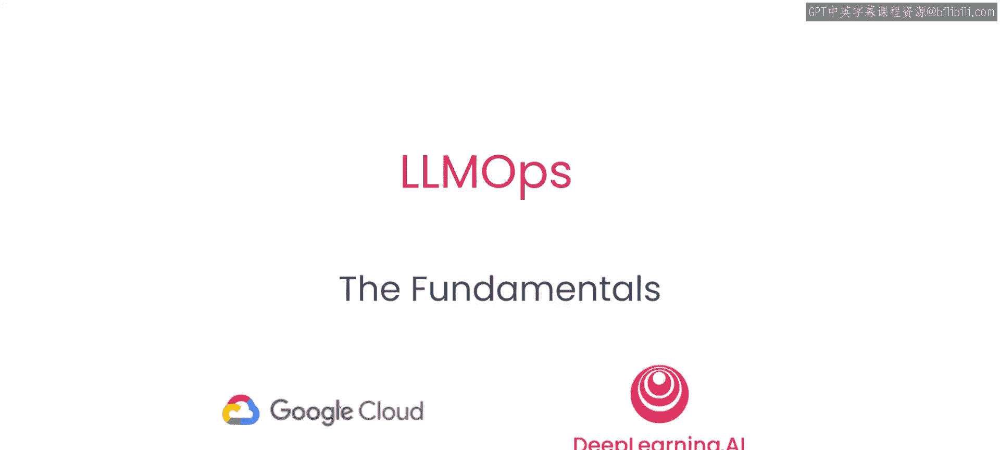
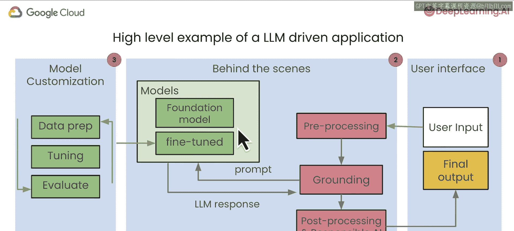
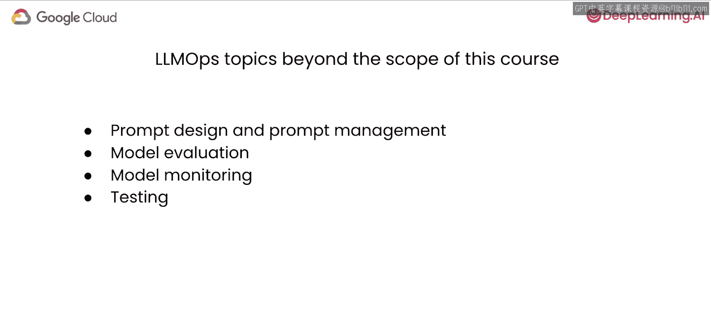

# 大语言模型运维：P2：2.基础概念 🧠

在本节课中，我们将学习大语言模型运维（LLMOps）的核心概念与思想，并了解它与传统机器学习运维（MLOps）的异同。

## 概述

我们将首先介绍机器学习运维（MLOps）的基本理念，然后探讨其与LLMOps的相似之处与关键区别。课程将涵盖数据管理、自动化、部署等核心概念，并通过一个具体的LLM应用构建流程，帮助你理解LLMOps的实际工作流。

---

## 机器学习运维（MLOps）简介

机器学习运维是一种旨在统一机器学习开发与运维的工程文化和实践。在构建ML系统的所有步骤中，自动化与监控都至关重要。

例如，如果你有一个部署大语言模型的用例，你会希望自动化数据工程、模型训练或微调，以及将其作为API部署到生产环境的过程。一旦模型上线，你还需要监控其在生产环境中的表现。

在构建ML系统的所有这些步骤中，你需要考虑以下问题：
*   如何集成这些步骤？例如，如何从数据工程过渡到模型微调，再到部署。
*   如何测试整个端到端工作流，以及其中的每一个步骤？
*   如何发布模型或代码？如何将其部署为API？
*   如果你想训练或微调自己的定制模型，并且需要使用特定的硬件（如GPU或TPU），该如何管理？

接下来，让我们更深入地了解机器学习运维工作流的具体样貌。

---

## 机器学习运维工作流

以下是构建一个机器学习用例（例如将大语言模型投入生产）时可能需要经历的步骤。你可能会熟悉这个MLOps框架：

1.  **数据摄取**：如何从应用程序数据库或其他数据库中获取数据。
2.  **数据验证**：如何验证这些数据，例如检查是否存在缺失数据或需要修复的问题。
3.  **数据转换**：将数据（如文本数据）转换为大语言模型能够理解的格式，或处理缺失值。
4.  **模型训练/微调**：训练或微调你的模型。
5.  **模型分析**：评估模型并了解其在你的数据上的表现。
6.  **模型服务**：思考如何进行模型服务，以及什么方案适合你的用例。
7.  **监控**：记录与生产环境中模型相关的所有指标。

本课程将重点讨论上图中蓝色框内的内容。

---

## 自动化与编排

当你构建这样一个工作流时，你肯定不希望手动执行每一个步骤，因为这非常耗时且效率低下。那么，我们如何解决这个问题呢？

这正是**自动化**和**编排**可以发挥作用的地方。

*   **编排**：指你告诉系统哪个步骤需要先执行，哪个后执行，依此类推。这意味着你可以从数据摄取到数据验证，再到模型服务，形成一个有序的流程。
*   **自动化**：指你自动化这个流程的执行过程。

你可以理解这是一个非常一维化的过程，即针对每个用例（例如，构建一个用于摘要总结的大语言模型），你会构建一个类似的工作流。

---

## LLMOps 与 LLM 系统设计的区别

那么，当涉及到大型语言模型的运维时，情况有何不同呢？主要有两点区别：

1.  **LLMOps**：更侧重于与LLM开发相关的一切，以及如何使其在生产环境中平稳运行。
2.  **LLM系统设计**：着眼于整个应用程序，这可能包括前端、后端、数据工程师和移动应用开发人员构建的内容。

以下是LLMOps与LLM系统设计之间差异的一些例子：

**在LLMOps中，你可能需要考虑：**
*   **实验**：如何尝试多种基础模型（如PaLM或Llama）以找到最适合你用例的模型。
*   **提示管理**：在实验期间以及在生产中使用提示时，如何管理这些提示。
*   **监督式微调**：如何为你的用例（如摘要总结）微调自己的模型。
*   **监控与评估**：如何监控生产中的LLM，以及如何评估LLM的性能（这是一个仍在大量研究的领域）。

**在LLM系统设计中，我们需要考虑其他方面，例如：**
*   **步骤串联**：例如，在摘要总结用例中，如果有太多文档需要处理，可能需要分批总结，这就需要将多个步骤串联起来。
*   **知识增强**：如何为LLM提供额外信息，以引导其产生期望的输出。
*   **历史追踪**：追踪过去生成的摘要及其表现。

---

## LLM驱动应用的高级示例

让我们看一个LLM驱动应用的高级示例。一切从用户界面开始，用户通过界面与应用交互。

用户输入会传递到你的后端。在后端，可能会发生以下步骤：

1.  **预处理**：对用户输入进行预处理。以摘要总结为例，如果信息量很大，你可能需要将其分块，然后分批发送给LLM。
2.  **知识增强**：在提示中为LLM补充一些事实信息。
3.  **模型调用**：使用现成的基础模型（如PaLM API或Llama模型）。
4.  **后处理与责任AI检查**：对LLM的响应进行后处理，例如清理响应、赋予其用户友好的结构，并检查是否存在毒性或偏见等问题。
5.  **输出**：将满意的输出返回给用户。

---

## 模型定制化流程

如果你想微调自己的定制模型，就需要经历模型定制化的过程。这包括数据准备、模型微调以及评估模型在用例上的表现。这是一个迭代过程，你可能需要重复多次，直到获得满意的摘要模型。

一旦获得满意的模型，你就可以将其部署到生产环境中，并在你的LLM驱动应用中使用这个微调后的模型。

这是一个示例工作流。当然，根据你的具体用例和要求，它可能看起来完全不同。

在本课程中，我们将重点关注图中蓝色框内的内容。我们将学习如何构建和操作一个模型定制化工作流，如何将其部署到生产环境，以及如何发送提示并消费模型的输出。

---

## LLMOps 流水线详解

让我们更详细地看看一个LLMOps流水线，并使用我们将在本课程中构建的示例。

1.  **数据准备**：一切从数据开始。我们将准备数据集并对其进行版本控制，以便跟踪我们创建的数据集。
2.  **流水线设计**：设计一个用于大语言模型监督式微调的流水线。这个流水线内部会发生很多重要的事情，并且对我们来说是自动化的。
3.  **生成制品**：生成一个制品文件，该文件包含我们的配置和工作流信息。
    *   **工作流**：指流水线的步骤，例如先执行步骤A，然后是步骤B、C等。
    *   **配置**：指执行工作流时使用的配置或参数，例如，本次监督式微调将使用哪个数据集。
4.  **执行流水线**：执行流水线，该流水线也会为我们部署模型。
5.  **获取预测**：模型部署后，我们可以使用提示从LLM获取响应。
6.  **责任AI检查**：使用安全分数等工具检查响应的安全性。

对于LLMOps，有两个核心主题：
*   **编排**：如何编排流水线中的步骤，例如，你可能希望在执行监督式微调之前先进行数据准备。
*   **自动化**：如何自动化我们的流水线，使开发人员的工作更轻松。

这个LLMOps流水线是一个简化的示意图。根据你的具体用例和要求，它可能会有所不同。

---

## 本课程范围之外的LLM主题

有些LLM主题超出了本课程的范围，我们无法涵盖，例如：
*   **提示设计与提示管理**：在实验和生产中如何处理提示。
*   **大语言模型评估**：在实验或生产环境中如何评估LLM（我们会简要讨论，但不会深入细节）。
*   **生产环境监控**：如何监控生产中的LLM。
*   **系统或应用测试**：如何对LLM系统或应用程序进行测试。

这些是你可以在本课程之后进一步探索的主题。

---

## 总结

本节课我们一起学习了LLMOps的基础概念。我们了解了MLOps的核心思想，探讨了LLMOps与MLOps及LLM系统设计的区别，并通过一个示例了解了构建LLM驱动应用的高级工作流。最后，我们预览了本课程将重点关注的LLMOps流水线核心环节。

正如所提到的，我们将从数据准备开始。下一节课，我们将准备我们的数据集。下节课见！