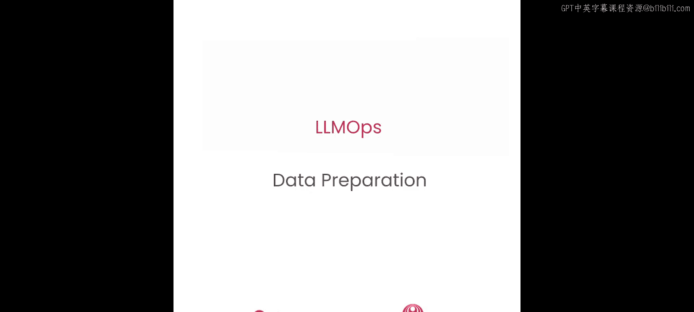
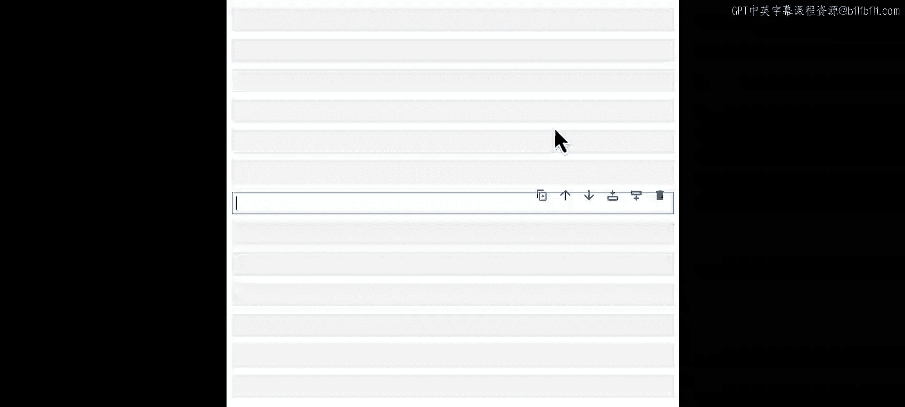
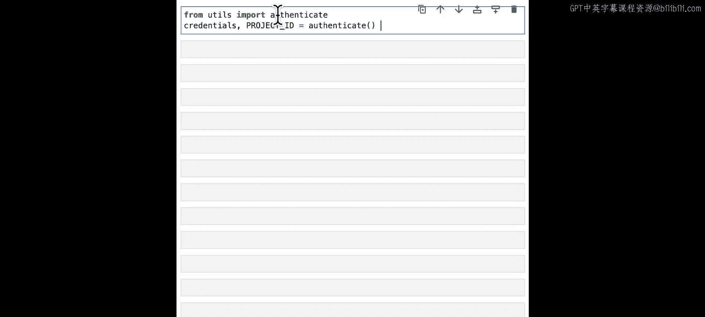
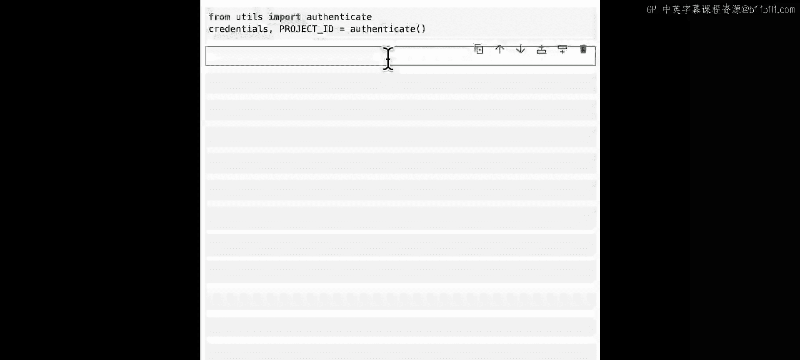
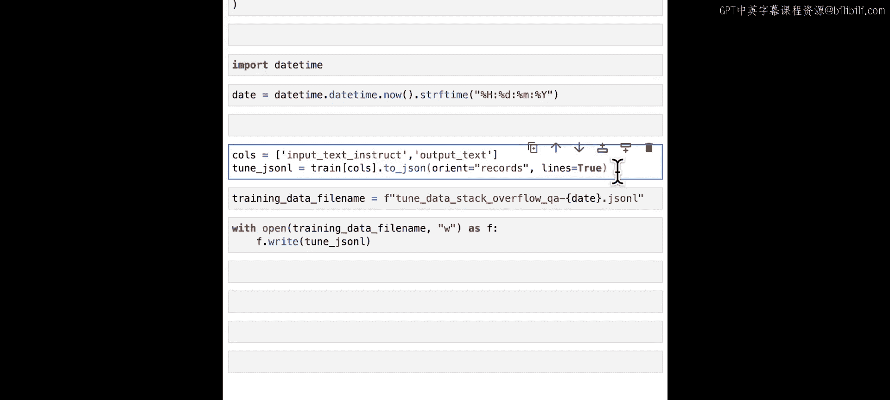

# LLMOps：P3：数据准备 📊




在本节课中，我们将学习如何为大型语言模型准备数据。具体内容包括：从数据仓库检索文本数据、处理内存无法容纳的大数据集、使用SQL进行数据操作，以及修改数据以针对特定任务调整模型。


---

## 项目与认证设置 🔐

为了运行本实验，我们需要完成一些设置代码。首先，我们需要设置身份认证，以表明身份并确认拥有访问云服务和数据的权限。其次，我们需要设置一个项目。项目用于组织所有云资源，所有数据都存储在我们的项目内。

以下是认证代码。`credential` 变量用于验证我们的身份。

```python
# 认证代码示例
credential = authenticate_user()
```



接下来，我们需要设置区域。区域是运行资源的数据中心所在地。例如，如果需要在新加坡的数据中心运行，就选择新加坡的Azure区域。在本示例中，我们将使用 `us-central1` 作为默认区域。





然后，我们将导入Vertex AI库。这是一个SDK，允许我们与云中的Vertex AI服务进行交互。

```python
import vertexai
```

我们将使用刚刚设置的项目、区域和凭证来初始化Vertex AI SDK。

```python
vertexai.init(project=project_id, location=region, credentials=credential)
```

现在，准备工作已经完成，我们可以开始处理数据了。

---

## 使用数据仓库 📦

为了尽可能贴近现实，本示例将使用数据仓库。数据仓库是一个中央存储库，用于存储和分析来自不同来源的大量数据，旨在获取洞察并做出明智决策。您可以将应用程序数据库中的数据导入仓库，供团队使用。

我们将使用BigQuery。BigQuery是我们的数据仓库，它是无服务器的，因此我们无需管理服务，并且它允许我们使用SQL。

您可能会问，SQL是不是很过时？实际上，我们使用SQL是因为SQL查询可以高效处理大量数据，对于需要高性能的任务来说是一个很好的选择。此外，SQL在数据清洗和准备方面表现出色。

您可能用过Pandas。SQL与Pandas的对比在于：如果数据能放入计算机内存，Pandas是很好的选择；如果数据位于数据仓库中，并且需要大规模处理，SQL则是更强大的工具。正如我们讨论的，在为大型语言模型构建MLOps系统时，我们需要确保其可扩展性。

---

## 初始化数据仓库客户端

为了与我们的数据仓库交互，我们需要初始化一个库。我们将使用BigQuery客户端，并以与初始化Vertex AI客户端相同的方式进行设置。

```python
from google.cloud import bigquery

client = bigquery.Client(project=project_id, credentials=credential)
```

在本实验中，我们将使用Stack Overflow公共数据集。该数据集包含问题、答案以及与Stack Overflow问题相关的元数据。

数据层次结构如下：您有一个数据集（`stackoverflow`），在该数据集内，有包含不同类型数据的表。数据仓库中的表是数据的组织集合。

您可能首先会问：有哪些数据可供我们使用？如果后续要为模型进行参数高效微调，我们可以使用哪些数据？让我们来探索数据。

如前所述，我们将使用SQL来查询数据仓库。我们可以使用SQL遍历数据并返回此数据集中所有可用的表。

我们可以选择表名。从BigQuery公共数据集 `stackoverflow` 中，我们可以返回信息模式和表名，这里我们只返回表名。

为了将此查询发送到数据仓库，我们将使用刚刚初始化的客户端。BigQuery客户端接收SQL查询，将其发送到数据仓库的API，并将数据集返回到我们的笔记本实例。

接下来，我们将遍历结果，并打印每一行（即每个表名），以便查看有哪些表可用。

```python
query = """
SELECT table_name
FROM `bigquery-public-data.stackoverflow.INFORMATION_SCHEMA.TABLES`
"""
query_job = client.query(query)

for row in query_job:
    print(row.table_name)
```

运行后，我们可以看到所有可用的表。数量很多，包括 `answers`、`comments`、`questions` 等。

我们将进行参数高效微调和监督式微调。因此，我们希望创建一个包含问题和答案的数据集。

---

## 从表中检索数据

接下来，让我们从数据仓库中获取一些数据并进行可视化，在笔记本中打印出来。我们将把查询结果加载到Pandas DataFrame中，以便查看数据。

同样，我们需要编写一个查询。从这个查询中，我们将从Stack Overflow数据集中读取所有列，并从 `posts_questions` 表中读取数据。我们也会进行限制，因为不想检索所有数据。稍后我会详细讨论这一点。

首先，运行这个查询。如前所述，我们将把它加载到Pandas DataFrame中。

```python
query = """
SELECT *
FROM `bigquery-public-data.stackoverflow.posts_questions`
LIMIT 3
"""
query_job = client.query(query)
df = query_job.to_dataframe()
print(df)
```

这种方法很有价值，因为它允许您在Pandas DataFrame中处理查询作业的结果，之后您可以使用Pandas的所有功能来探索数据。

查询数据仓库的结果将被加载到Arrow表中（这是Apache框架的一部分）。这确保了数据格式更易于Pandas DataFrame读取，从而让我们能够使用Pandas DataFrame来探索数据。

很快，我们看到了表中的三行数据，并且可以看到列名。请继续查看这里可用的数据。

---

## 处理大型数据集 🐘

但这只是一个表，并且我设置了限制，没有检索所有数据。处理大型数据集在大型语言模型工作中并不少见。您经常需要处理这些大型数据集，而且它们通常无法放入内存，尤其是在使用本地笔记本时。

假设您想查询并返回 `posts_questions` 表的所有列和行，这次我们不设置限制。我们将使用相同的查询，但移除 `LIMIT` 子句，以检索该表中所有可用的数据。

我们将再次将此查询发送到数据仓库，看看会发生什么。

接下来的代码将像之前一样创建一个Pandas DataFrame。是的，这会花费更长的时间。

我们收到了一个403响应。这里的数据太大，无法返回。实际情况是，您可以在数据仓库中存储大量数据，但这些数据并不总能放入本地机器、虚拟机或容器的内存中。

那么，我们如何处理这些大型数据集呢？

---

## 处理大型数据集的最佳实践

当数据量很大时，可能会出现内存问题。那么，处理大型数据集的最佳实践或蓝图是什么？当您的数据位于数据仓库中，并且您有大型表需要执行连接或过滤等操作时，最好通过数据仓库中的SQL等工具进行这种处理，而不是导出所有数据后再在Pandas中处理。

另一个需要考虑的问题是，一旦您选择了数据并知道要用于训练的内容，可以将结果导出到固态硬盘或云存储桶等位置。这是因为，如果您进行大规模微调或训练，快速访问训练数据非常重要。使用SSD或云存储桶可以更快地读取数据。您需要确保使用的加速器（如GPU）不会因等待训练数据而利用率不足。

当然，还要跟踪数据沿袭。您需要能够追踪数据的来源以及它经历了哪些转换。

接下来，我们需要一个处理更大数据的解决方案。

---

## 优化查询以处理大型数据

处理大型数据时，必须优化查询以节省资源和时间。在以下示例中，您将合并两个表以获取微调数据所需的问题和答案。

我们将使用 `WHERE` 子句，允许我们根据特定条件过滤结果，确保只返回我们需要的数据。这可以显著提高性能，尤其是在处理这些大型数据集时。

让我们来编写查询，并详细解释，以便您理解我们实际上从两个表中返回了什么。

首先是一个 `SELECT` 语句。我们将选择数据，并选择两列：我们需要一个问题和一个答案。

我们将获取问题的标题和问题本身，并将该列命名为 `input_text`。我们将获取答案，并将其称为 `output_text`。

现在您可能已经知道，我们将从公共数据集 `stackoverflow` 中读取数据。我们将从 `posts_questions` 表中读取，并将其与 `posts_answers` 表连接。

我们将在 `accepted_answer_id` 上进行连接。在我们的表中，有一个唯一标识符，我们将使用它来连接两个表中的数据。我们根据唯一标识符匹配连接。问题表有一个唯一的ID，每个问题都有一个唯一的ID，而答案表中也有相同的唯一ID。因此，问题和答案可以使用这个唯一ID进行连接。

然后是 `WHERE` 子句。我们不会使用数据集中所有的数据。我们希望确保行中有答案。我们还将只使用关于Python的问题。我们喜欢Python，并且针对每个用例专注于Python。

我们将在 `WHERE` 子句中使用日期。当处理随时间变化的数据时，您通常也希望使用时间变量来过滤和选择特定时间段的数据。

我们还将进行限制。为了对模型进行微调，我们不需要所有数据。让我们先使用10000个示例。

我们有一个 `WHERE` 子句、一个 `LIMIT`，并且连接了两个表中的数据。这个查询将返回一个结果，使我们能够创建一个可用于微调的数据集。

```sql
SELECT
  CONCAT(q.title, ' ', q.body) AS input_text,
  a.body AS output_text
FROM
  `bigquery-public-data.stackoverflow.posts_questions` AS q
JOIN
  `bigquery-public-data.stackoverflow.posts_answers` AS a
ON
  q.accepted_answer_id = a.id
WHERE
  q.accepted_answer_id IS NOT NULL
  AND q.tags LIKE '%python%'
  AND q.creation_date >= '2020-01-01'
LIMIT 10000
```

好的，我们已经编写了查询。让我们像之前一样将其发送到数据仓库。结果将是一个Pandas DataFrame。

我们现在有了一个包含问题和答案的数据集。

---

## 添加指令以改进模型

在指令形式的数据集上微调语言模型已被证明可以提高模型性能和对未见任务的泛化能力。指令指的是传达要执行的任务或操作的具体方向或指南。基本上，您是在告诉大型语言模型该做什么。

这些指令可以以各种形式表达。您可以设置规则，可以逐步说明大型语言模型需要做什么，也可以提供程序或示例。如果我们不使用指令，那么数据集中将只有问题和答案，模型可能不确定如何处理问题和答案。

因此，指令告诉大型语言模型该做什么以及我们对它们的期望。我们希望它们回答问题，我们必须给它们一个关于我们想要执行的任务的提示。

让我们用指令扩展这个数据集。我们将使用一个指令模板。

这个指令模板包含给大型语言模型的指令。我们在这里说的是：“请回答以下关于Python的Stack Overflow问题，并像回答Stack Overflow问题的开发者一样回答它。” 然后，在Stack Overflow问题部分之后，我们希望有来自我们数据的实际问题，即 `input_text`。

因此，我们希望将指令和问题结合起来。为了将其包含在我们的数据集中，我们将创建一个新列，将指令模板和问题输入文本结合起来。我们将使用一个新列，因为我们不想覆盖现有的列（您以后可能还会用到它）。

我们将获取指令模板，将其与我们的 `input_text` 结合，并创建一个名为 `input_text_instruct` 的新列。

```python
instruction_template = "Please answer the following Stack Overflow question on Python and answer it like you are a developer answering Stack Overflow questions: "
df['input_text_instruct'] = instruction_template + df['input_text']
```

---

## 划分训练集与评估集

接下来，您将数据划分为训练集和评估集。评估集将在微调期间用作未见数据以评估性能。

我们将使用 `scikit-learn` 的 `train_test_split` 将Pandas DataFrame分割为训练集和评估集。数据默认按80/20的比例划分为训练和评估。我们希望有更多的数据用于微调，您可以尝试调整这个比例。

我们还将使用 `random_state` 参数来初始化随机数生成器。我们希望使用随机抽样，以确保对模型进行公平比较。

这里需要强调一点：尽可能保持实验间的参数一致，以便进行公平比较。实验指的是从数据到模型微调的端到端工作负载。如果您更改太多参数，例如将训练/评估分割从80/20改为60/40，并更新大量超参数，那么在新的实验中，模型可能更好或更差，您将无法确定是什么影响了结果。如果只更改一个或两个参数，则更容易跟踪影响模型性能的因素。

我们不会计算准确率之类的指标。为什么不计算准确率？因为我们使用的是文本，而文本非常模糊，我们无法为此文本用例计算准确率。

---

## 导出数据到文件

如前所述，如果数据仓库中有大型数据集，最佳实践之一是将数据从数据仓库中取出，并将其存储在SSD或云存储桶等位置的文件中，以便在训练或微调期间高效读取。

现在问题来了：我应该为训练和评估数据使用哪种文件格式？有很多选择，我想谈谈几个关键的选项。

在本示例中，我们将使用JSON Lines格式。JSON Lines是一种简单的基于文本的格式，其中每个问题-答案对是一行。它非常易于人类阅读，是中小型数据集的理想选择。

如果您有更大的数据集，可以使用二进制文件格式，如TFRecord或Parquet文件。TFRecord（TensorFlow记录）更易于计算机读取，是实现高效训练的理想选择。Parquet文件在进行训练或微调时读取效率也很高，也是大型复杂数据集的不错选择。

基本上，这两种格式取决于您的偏好以及您使用的模型框架。

在构建MLOps工作流时，考虑工件解析也很重要。您可以想象，在处理数据仓库中的表和刚刚讨论的训练文件时，MLOps工作流中会有所有这些不同的工件。跟踪不同的工件以及对数据进行版本控制非常重要。

例如，您可能想知道从数据仓库的哪个数据集生成了数据文件，以便具有可追溯性，这对于确保可重复性和可维护性也很重要。当然，您还需要确保您的同事在接手部分工作或需要帮助时也能理解发生了什么。

在这种情况下，我们还将对我们即将生成的JSONL文件进行版本控制。

我将使用一个描述，其中包含数据集类型（是训练集还是评估集）、数据集名称，以及一个时间戳（我们生成数据的时间）。

我将导入 `datetime` 库，并使用今天的日期和时间作为时间戳。

```python
import datetime

timestamp = datetime.datetime.now().strftime("%Y%m%d_%H%M%S")
```

现在是时候生成我们将用于微调的JSONL文件了。在我们的JSON Lines文件中，我们将只使用两列：`input_text_instruct`（我们刚刚生成的列）和 `output_text`（答案）。

我们将获取DataFrame，将其转换为JSONL文件，每个记录（问题-答案对）在单独的一行上。这通过将 `orient` 设置为 `'records'` 来控制。

我提到过，进行版本控制并跟踪生成的文件非常重要。我们将使用数据集名称 `stackoverflow`，并说明这是一个问答问题，然后使用日期来确保我们可以跟踪此文件是何时生成的。

```python
train_file_name = f"stackoverflow_qa_train_{timestamp}.jsonl"
eval_file_name = f"stackoverflow_qa_eval_{timestamp}.jsonl"

# 保存训练集
train_df[['input_text_instruct', 'output_text']].to_json(train_file_name, orient='records', lines=True)
# 保存评估集
eval_df[['input_text_instruct', 'output_text']].to_json(eval_file_name, orient='records', lines=True)
```

然后，是时候生成文件了。我们将首先生成训练数据的文件。我们将使用刚刚描述的文件名。我们将把它写入本地目录。

当然，最佳实践是将文件写入SSD环境或云存储桶（如果您使用大文件或生成许多需要跟踪的文件）。但在此示例中，我们将将其存储在本地。

您现在可以在本地工作区中找到该文件。转到“文件”然后“打开”，您可以查看该文件。现在可以暂停视频，自己尝试对实验进行一些修改。也许您想以不同的方式进行版本控制，例如从年、月、日到小时，以便能够按年份对文件进行排序。

另外，如果您查看了JSONL文件，并看到每个问题-答案对在一行上的结构，您可能想尝试移除 `orient='records'` 和 `lines=True` 参数，看看文件如何变化，以及JSON的结构如何变化（不再是每个问题-答案对在单独的一行上）。

---

## 总结 📝

在本节课中，我们一起学习了为LLM准备数据的关键步骤。我们从设置云项目认证开始，接着介绍了如何使用SQL从BigQuery数据仓库中检索和筛选数据，特别是处理内存无法容纳的大型数据集。我们学习了通过连接表、添加过滤条件来构建用于微调的问答数据集，并为数据添加指令以提升模型的任务理解能力。最后，我们将数据划分为训练集和评估集，并将其导出为版本化的JSON Lines文件，为后续的自动化流程和参数高效微调做好准备。



在下一个实验中，我们将讨论自动化、编排和参数高效微调。