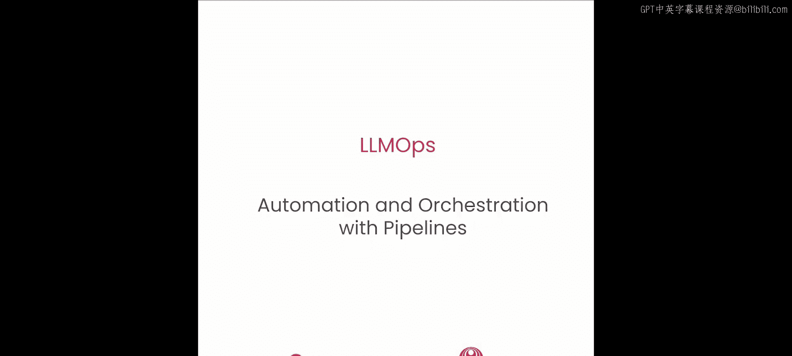
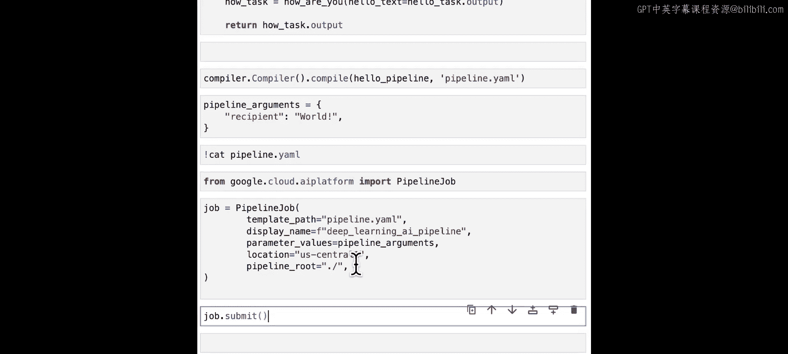
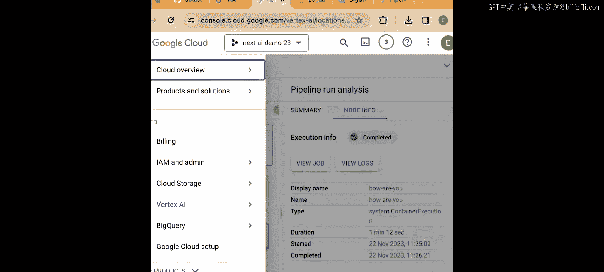
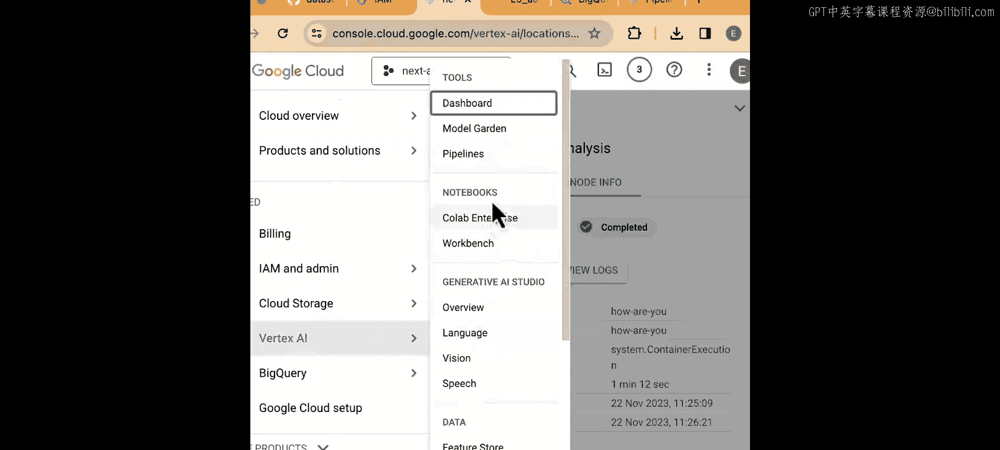
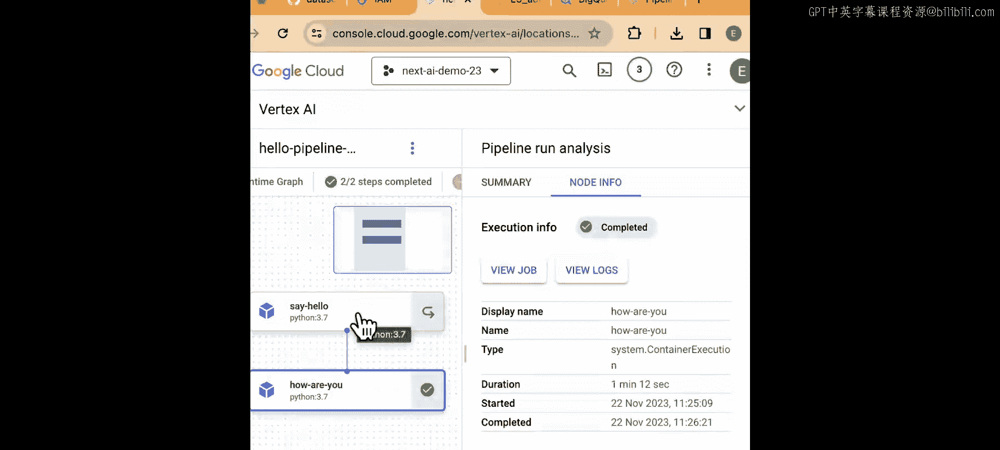
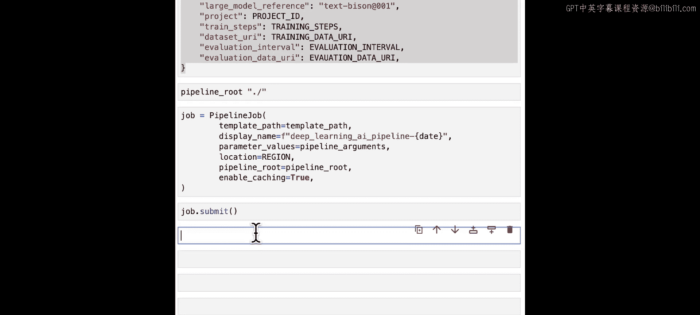

# 大语言模型运维：P4：自动化与编排 📚




在本节课中，我们将学习如何为大型语言模型构建一个自动化的机器学习流水线。我们将使用开源框架来编排和自动化模型的微调与部署过程，从而简化实验流程，提高工作效率。

---

## 编排与自动化概述 🔄

上一节我们讨论了数据准备，现在你已拥有数据，是时候对LLM进行微调了。请记住，你可能需要多次微调模型，才能开发出适合你用例的模型。


在LLM领域，实验尤为关键，因为我们仍在探索有效的方法。我们希望自动化运行实验的过程，以使工作更轻松。

本节中，你将学习如何使用开源框架构建一个机器学习流水线，以微调和部署你的模型。

## 理解LLM的MLOps工作流 🏗️

在深入代码之前，我们先谈谈大型语言模型的MLOps工作流。我们讨论过LLM的系统设计，也讨论过这些更一维化的工作流。

假设你想要训练或微调一个模型，通常需要经历以下过程：收集训练数据、进行训练、进行评估（在训练或微调过程中，如上一实验所述）。最终，你将得到一个训练好的模型，其格式可能是类似TensorFlow SavedModel。

一旦拥有训练好的模型，你需要将其放入生产环境，因为我们最终的目标是交付模型并将其与用例集成。在生产环境中，你的模型可以是一个REST API或批处理过程，即获取生产数据并生成预测。同样，你需要根据需要频繁进行评估。基于评估结果，你可以更新训练数据并再次运行工作流。

这里有三个关键概念需要理解：**编排**、**自动化**和**部署**。
*   **编排** 是指定哪个步骤需要先运行，以及后续步骤的顺序。
*   **自动化** 是指自动化这个工作流。例如，当你想训练一个新模型时，可以自动重新运行端到端的工作流。
*   **部署** 是指将训练好的模型放入生产环境。

简而言之，编排是关于协调步骤的顺序，而自动化是确保你无需手动运行脚本，代码的执行是自动的。例如，如果你有多个Python文件，你不想手动依次执行数据准备和模型训练文件。你希望编排它们，指定先执行数据准备，再执行模型训练，并自动化这个过程。

## 使用Kubeflow Pipelines进行编排与自动化 🛠️

现在，让我们深入探讨编排和自动化的代码实现。你可以使用不同的框架，例如Airflow和Kubeflow Pipelines都是构建机器学习工作流的热门选择，它们能帮助你实现编排和自动化。

在本笔记本中，我们将使用Kubeflow Pipelines。Kubeflow Pipelines是一个开源框架，用于构建机器学习流水线，使编排和自动化变得容易。

首先，我们需要导入KFP的DSL（领域特定语言），它就像一块绘图板，用于设计我们的流水线。同时，我们还需要导入编译器，稍后会详细解释。

### 构建基础组件：概念解析

让我们从一个非常简单的例子开始编排，以便教授编排和自动化的概念。

假设我们有一个Python函数 `say_hello`，它接收一个字符串类型的名字作为输入，然后返回“Hello, {name}”的文本。

```python
def say_hello(name: str) -> str:
    return f"Hello, {name}"
```

这里重要的是，KFP有两个核心概念：**组件**和**流水线**。
*   **组件** 是工作流中的一个步骤。在机器学习工作流中，第一步可能是数据处理，第二步可能是模型训练。每个组件都是工作流中的一个步骤。
*   **流水线** 是管理这些流水线的构建和运行可能变得复杂且耗时，这就是Kubeflow Pipelines的用武之地。它是一个强大的工具，帮助我们自动化和编排MLOps工作流。

但Kubeflow不理解普通英语（或荷兰语），它使用一种称为DSL的专门语言。DSL代表领域特定语言，可以将其视为一套专门为构建MLOps流水线而定制的指令集。

开源框架KFP提供了自己的DSL库，让你能以清晰简洁的方式定义流水线步骤和执行逻辑（也称为配置）。使用KFP流水线DSL，你可以专注于流水线的“做什么”（即需要执行的任务），而让KFP来处理“怎么做”。

那么，我们如何确保系统知道这个Python函数是我们机器学习工作流中的一个组件呢？这就是DSL的用武之地。我们将使用DSL来告诉系统这是一个组件。这段代码将在容器化环境中运行。

你可能听说过容器。容器就像一个包含你的依赖项和软件代码的封闭环境。容器的优势在于你无需管理服务器、安装操作系统、安装依赖项和软件。它存在于一个“气泡”中，其中已经为你准备好了操作系统，你只需安装软件所需的依赖项，将软件放入容器，然后就可以在任何环境（A、B或C）中执行它，而不依赖于底层的硬件。

### 连接多个组件：构建依赖关系

在ML工作流中，我们通常需要编排多个步骤。我们已经有了第一个组件，现在让我们编写第二个。

我们将创建另一个Python函数 `how_are_you`，它也接收一个字符串作为输入。这个函数将使用第一个组件的输出作为其输入。这意味着第二个组件依赖于第一个组件。因此，我们必须先运行第一个组件作为第一步，然后运行依赖于其输出的第二个组件。

例如，你的第一步可能生成包含训练数据的文件（如上一实验所做），第二步可能是训练一个模型，该模型接收这些文件来训练模型。数据从一个组件传递到另一个组件的方式有多种。通常的最佳实践是，你将文件位置的路径传递给下一步。

假设你将训练文件存储在云存储桶中（如上一实验讨论），你只需告诉第二个组件训练文件在哪个桶中，而不是将训练文件本身传递给组件。这一点很重要，因为如果你处理的是大型数据，你不想将所有数据都放在一个容器的某个步骤中，否则你将受限于该内存。我们希望以可扩展的方式构建流水线，因此传递统一资源标识符（如路径）是更好的选择。

对于这个Python函数，我们同样需要DSL装饰器（即组件装饰器）来告诉系统这是一个KFP流水线组件。

### 定义流水线：编排执行顺序

现在我们有了两个组件，是时候绘制我们的工作流或决定如何执行这些步骤（组件）了。我们将构建我们的流水线。

这同样是一个Python函数，我们称之为 `hello_pipeline`。在这个函数内部，我们将告诉系统我们想先执行哪个步骤。

如前所述，我们的第一个Python函数（第一个组件）将首先执行。这个组件将接收一个字符串（人名）作为输入。第二步，你可能已经猜到了，是执行我们的第二个组件 `how_are_you`。这个组件将接收第一个组件的输出作为输入。因此，`hello_text` 将作为输入进入我们的第二步。

在这里，我们告诉系统，`hello_task` 的输出应作为参数传递给 `how_are_you` 组件。然后，我们将返回第二个步骤的输出。

接下来，我们必须告诉系统这个函数是我们的流水线，即一系列步骤。我们将使用装饰器来表明这是一个流水线。

流水线是一组你编排的组件。流水线还允许你定义执行顺序，并指定数据如何从一个步骤流向另一个步骤。基本上，数据可以在流水线中向下游流动。

### 编译与执行：生成YAML文件并运行

还记得我之前提到导入编译器吗？现在我们已经为流水线指定了一个或多个组件，是时候将我们的流水线编译成一个可以执行的文件了。

为此，我们将使用编译器。编译器让我们生成一个YAML文件。YAML文件是人类可读的，用于存储配置和流水线的步骤顺序。YAML文件还包含有关组件、它们的依赖关系和执行顺序的信息。

最后我们需要做的是，如你所记，我们还没有指定名字。当我们执行时，名字需要传入我们的流水线。我们说的是“Hello, {name}, how are you?”，所以我们需要定义参数。这些参数在执行期间被注入到我们的流水线中。这是一个流水线参数，这里我们有 `recipient`，我们将使用“World”。





一旦你生成了流水线的YAML文件，你可以查看它。你可以看到我们指定的组件，以及许多与流水线执行和依赖相关的其他信息。





现在我们有了YAML文件。一旦有了YAML文件，你可以在不同的环境中执行它。我们讨论过Kubernetes。当你运行一个Kubernetes集群时，你必须在生产中管理和操作它，这需要大量工作。你也可以使用像Vertex AI Pipelines这样的托管环境，它在无服务器环境中为你执行YAML文件。

为此，你可以使用Google Cloud AI Platform库并导入 `PipelineJob`。接下来，你必须指定你的流水线作业。我们需要设置几件事：首先，告诉系统我们将使用流水线YAML进行执行；其次，给它一个名字；然后，我们有流水线参数，这些参数在执行期间进入流水线；接着，我们指定一个区域（在上一实验中讨论过）；流水线根目录是执行引擎存储临时文件的地方。最后，只需执行 `job.submit()`。

由于课堂限制，我们现在不执行这个作业，但你可以获取代码并在自己的环境中执行。你可以在Google Cloud上使用Vertex AI Pipelines执行此操作，它是Kubernetes之上的一个无服务器层，因此我们无需担心管理虚拟机或Kubernetes集群。我们只需发送YAML文件，Google Cloud会负责执行。

### 查看执行结果

在Vertex AI Pipelines的界面中，你可以看到实际的执行情况。你会看到我们刚刚创建的两个步骤（组件）：“say hello”和“how are you”。在这里，你还可以看到参数，例如类型和值。如果你查看第二个组件，你还可以看到输出，它显示“Hello World. How are you?”。这里通常是你查看流水线执行情况、组件参数和输出的地方。

## 实战案例：复用开源流水线进行模型微调 🚀

我们刚刚构建了一个流水线的“Hello World”示例，现在你应该熟悉了这些概念。接下来，让我们看一个真实的机器学习工作流（机器学习流水线）的例子。

流水线的优势之一是可重用性。一旦你构建了一个流水线，你就可以重用它，甚至可以与同事分享。例如，假设你构建了一个问答语言模型，并构建了一个处理数据、训练问答语言模型然后输出训练模型文件的流水线。你的同事可能也有一个问答用例，他/她可以请求重用你的流水线。

在下一个例子中，我们将重用一个开源的Kubeflow流水线，该流水线允许我们对Google的一个名为PaLM2的基础模型进行监督式微调。重用流水线的优势在于我们无需从头开始构建，只需指定一些参数。

还记得我们在上一实验中生成了两个文件吗？我们有训练数据和评估数据（我们讨论过的JSONL文件）。我们将使用这两个文件来微调一个PaLM模型，进行监督式微调。

正如我所提到的，我们将使用Kubeflow的一个开源流水线。你可以看到流水线文件的路径。记住我们生成的YAML文件，这就是我们可以找到该流水线YAML文件的地方。

为了执行流水线，我们需要设置一些配置。基本上，我们需要指定参数。

首先，想一个模型名字。在上一实验中，我们讨论了版本控制及其重要性。这里也一样，我们将使用日期时间戳来跟踪我们生成的模型。我们必须指定一个模型名称，并为其添加日期。这样，我们至少可以随时回溯，查看哪个模型是在何时训练的。

还有一些其他参数我们可以调整。我想强调两个：
1.  **训练步数**：指微调模型时使用的步数。如前所述，此流水线使用参数高效微调。单个训练步是在训练时将一批数据输入模型的过程，它会更新内部参数并计算损失或误差。不要将其与周期混淆，周期是数据的一次完整遍历。对于抽取式问答，可以将其设置在100到500之间。这是针对此PaLM模型的最佳实践。目前，我选择了数字200。
2.  **评估间隔**：我们生成了一个评估数据集。此间隔指定了针对我们创建的评估集评估训练模型的频率。默认设置为20，你也可以调整这个值。

就像我们为“Hello World”流水线所做的那样，我们必须指定流水线在执行期间将使用的参数。我们将使用的两个参数是项目ID和区域，正如你从第一实验记住的，我们必须指定运行此作业的项目ID和区域。我们再次使用`us-central1`。

接下来，我们将指定参数。这些参数在运行时被系统使用。因此，当流水线执行时，参数被注入到流水线中。对于这个开源流水线，流水线参数包括：我们刚刚指定的模型名称、执行工作流的区域、当然还有我们将用于参数高效微调的模型（这是一个PaLM系列模型，称为`text-bison`，非常适合问答）、模型版本`001`、项目ID、我们刚刚指定为200的训练步数、训练数据的位置、评估间隔以及评估数据的位置。

这些参数在流水线执行时进入其中。你可以想象，当你创建一个流水线时，可以包含参数。参数可以更改，这意味着当你拥有那个流水线时，你可以使用不同的参数集运行它。例如，如果你有新数据要使用，只需更新数据集的参数；或者你可能想使用不同类型的模型进行微调，只需更新那个参数。这使得对现有流水线进行微小更改并重新运行变得非常容易。

接下来，我们还必须指定流水线根目录，如你所记，这是执行期间存储工件的地方。然后我们指定一个流水线作业，它告诉系统应如何执行流水线以及使用哪些参数。将`enable_caching`设置为`True`意味着如果我们重新运行流水线，如果我们使用缓存，那么如果我们之前已经执行过某个步骤，除非我们更新了代码或某个参数，否则它将不会再次执行该步骤。

然后就是执行`job.submit()`的时候了。由于运行此流水线可能需要一整天，并且需要GPU或TPU等加速器，成本相当高，我们现在不执行这个流水线。

## 总结与展望 📝

在本节课中，我们一起学习了如何为大型语言模型构建自动化的机器学习流水线。我们理解了编排、自动化和部署在MLOps工作流中的核心作用，并使用Kubeflow Pipelines框架实践了从定义组件、构建流水线到编译执行的完整流程。我们还探讨了复用开源流水线进行模型微调的实战案例，这大大提高了工作效率和代码的可重用性。



在下一节中，我们将讨论部署。一旦我们微调好一个模型，当然也需要部署它，以便在我们的LLM系统中使用。我们下节课再见。