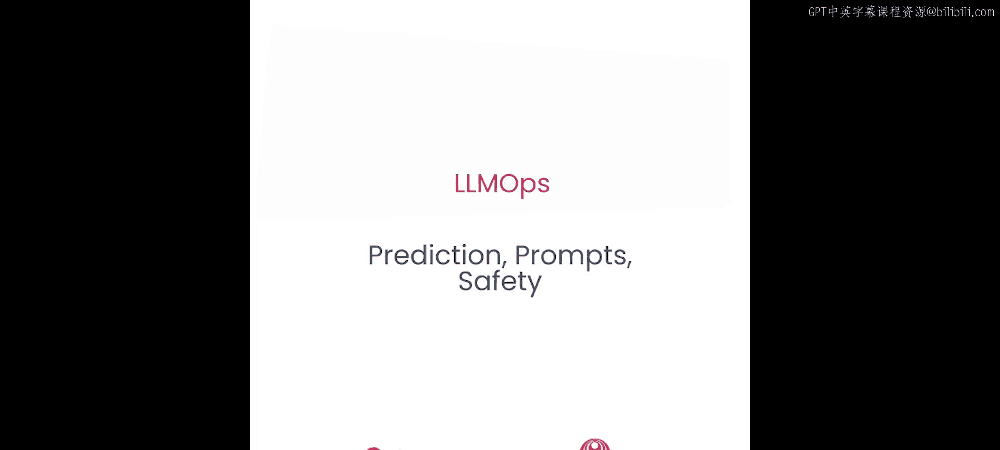
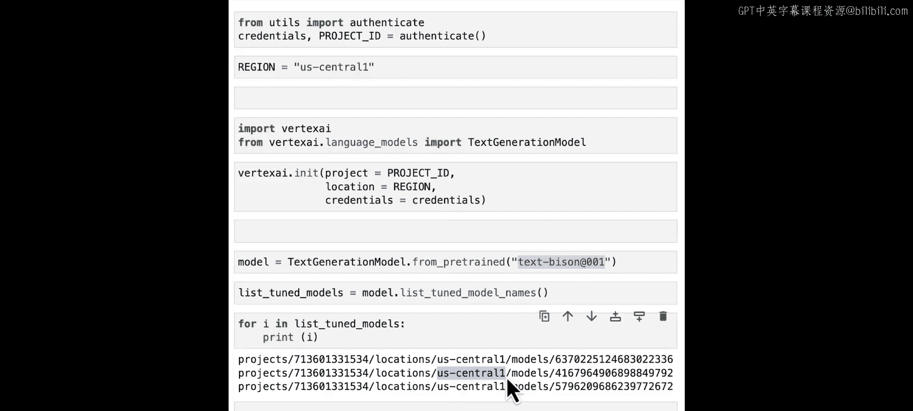
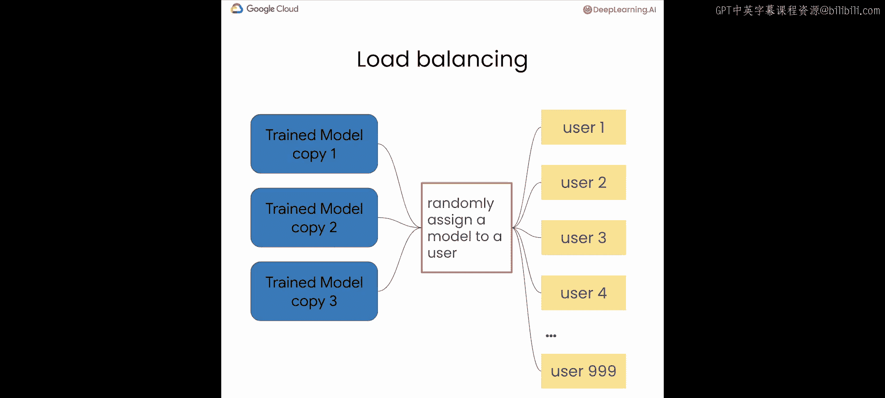
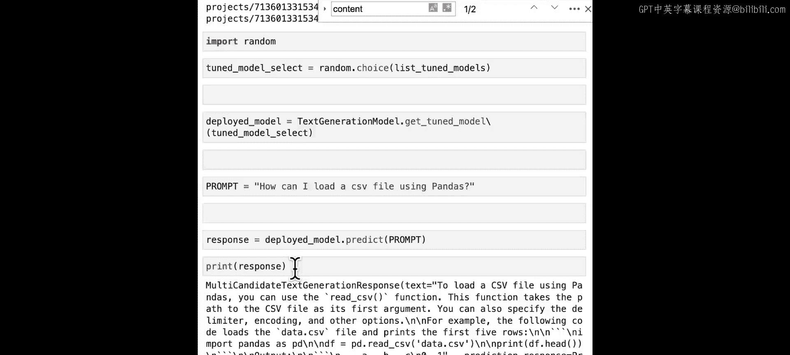
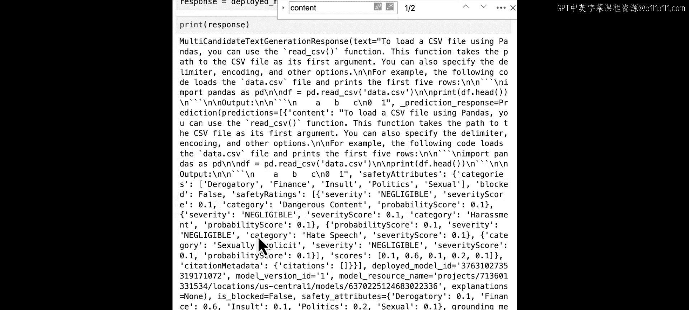
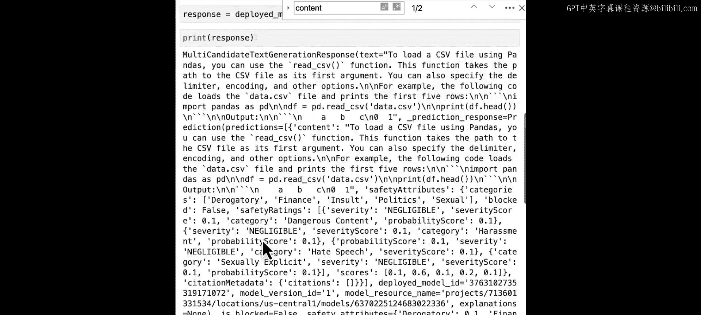
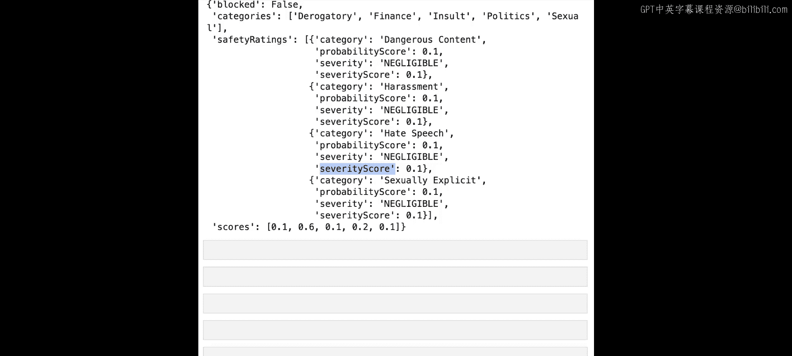
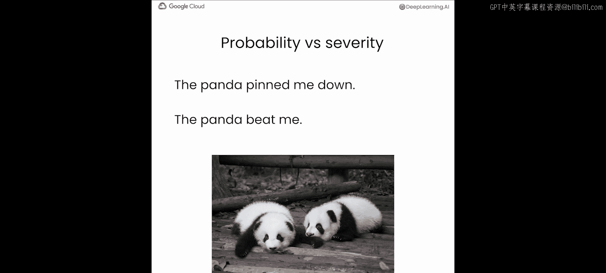
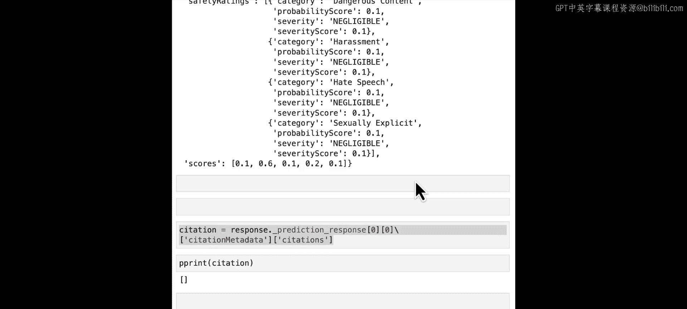

# 大语言模型运维｜LLMOps：P5：预测、提示与安全 🛡️




在本节课中，我们将学习如何使用已调优的大语言模型进行预测，并探讨如何安全地将模型集成到实际应用中。我们将涵盖部署选项、如何确保生产数据格式与训练数据一致、如何解读模型响应中的安全属性以及如何检查响应是否基于特定来源。


---

## 部署选项：批量预测与REST API

在上一节中，我们介绍了如何构建端到端的机器学习流水线来训练和评估模型。本节中，我们来看看如何部署模型以进行预测。部署模型意味着使其能够接收输入数据并返回预测结果，主要有两种方式：批量预测和REST API。

以下是两种主要部署方式的解释：

*   **批量预测**：适用于离线、非实时的场景。例如，每周收集一次产品评论，然后一次性将所有评论发送给模型进行情感分析（正面或负面）。这是一个批处理过程，不需要即时响应。
*   **REST API**：适用于在线、实时的场景。例如，在聊天应用中，用户输入问题后，请求会立即发送到API，模型进行预测并将结果快速返回给用户界面。这要求较低的延迟。

对于REST API部署，您可以将模型（如TensorFlow或PyTorch模型）使用Flask或FastAPI等库打包，并封装在容器中。在本实验中，模型已作为REST API部署在云平台上。

---

## 调用已部署的模型进行预测

现在，我们开始通过代码调用已部署的API进行预测。首先，我们需要获取模型的端点（即API地址）。

```python
# 获取已调优模型的列表
tuned_model_names = ...
# 打印可用的端点
print(tuned_model_names)
```

项目中有多个已部署的模型端点。我们将使用一种简单的负载均衡策略，随机选择一个端点来发送提示并获取预测。

```python
import random
# 随机选择一个端点
selected_endpoint = random.choice(tuned_model_names)
```

选择端点后，我们可以加载该模型以进行预测。预测意味着将提示发送到API，并根据提示从模型获取响应。

---





## 构建与发送提示

接下来，我们需要编写一个提示。由于我们的模型是在Stack Overflow数据集上微调的，因此最好询问一个Python相关的问题，以尽量贴近训练数据。这一点很重要，因为生产数据与训练数据的一致性会影响模型性能。

让我们提出一个直接的问题：“如何使用pandas加载CSV文件？”

```python
# 编写提示
prompt = "How can I load a CSV file using pandas?"
```

现在，我们可以使用Vertex AI SDK将提示发送到API并获取响应。大型语言模型的响应时间（延迟）可能因模型大小和提示长度而异。



```python
# 发送提示到API并获取预测
response = deployed_model.predict(prompt)
```





初始响应可能包含大量信息且不易阅读。让我们对其进行格式化并查看。

```python
from pprint import pprint
# 格式化并打印完整响应
pprint(response)
```

响应对象包含多个键，如`content`（答案）和`safety_attributes`（安全属性）。我们首先提取并查看`content`，即模型对我们问题的回答。

```python
# 提取并打印模型回答
answer = response['content']
print(answer)
```

至此，我们成功地从已部署的模型获得了对问题的回答。

---

## 生产环境的重要考量

部署模型时，除了打包和版本控制，还需要考虑其他重要因素，以确保生产环境机器学习工作负载的稳定运行。

以下是几个关键考量点：

*   **模型监控**：包括运营指标（如API调用频率）和生产环境下的模型性能评估。
*   **安全与责任**：检查模型输出是否存在偏见或有害语言。
*   **可扩展性**：进行负载测试，模拟高并发请求以观察API行为。
*   **渐进式发布**：最初可能只将少量流量（如5%）导向新模型，逐步增加，这称为受控发布。
*   **延迟要求**：与利益相关者讨论并确定可接受的响应延迟（例如，2秒对用户体验是否可接受）。

如果延迟过高，可以考虑以下方案：选择更小的模型、在GPU上部署模型，或将模型部署在离用户应用更近的地理区域。

---

## 确保生产与训练数据格式一致

回想一下，在之前的实验中，我们对数据进行了处理，创建了一个将“指令”与“问题”结合的新特征。然而，在刚才的预测示例中，我们只向API发送了“问题”，这与训练数据的格式不匹配。

生产数据与训练数据之间的差异会影响模型性能。因此，我们需要在将问题发送给模型之前，添加上相同的指令。

```python
# 定义与训练时相同的指令
instruction = "You are a helpful and knowledgeable coding assistant. Please respond to the following programming question with a detailed answer and example code if applicable."
# 定义一个新问题
question = "How do I merge two DataFrames in pandas?"
# 组合指令和问题以创建与训练数据格式一致的提示
formatted_prompt = f"{instruction}\n\n{question}"
print(formatted_prompt)
```

现在，使用这个格式一致的提示再次发送给API。

```python
# 使用格式一致的提示进行预测
new_response = deployed_model.predict(formatted_prompt)
final_answer = new_response['content']
print(final_answer)
```

这次，模型的输出结构更清晰，回答也更像一位开发者的口吻。

---

## 理解与利用安全属性

大型语言模型可能产生意想不到的输出，包括具有攻击性、敏感或不准确的内容。因此，安全、负责任地部署模型至关重要。

PaLM API提供了安全属性评分功能，帮助开发者理解输出并定义置信度阈值。让我们从响应中提取并检查安全属性。

```python
# 检查响应是否因安全问题被拦截
is_blocked = response['safety_attributes'].get('blocked', False)
print(f"Was the response blocked? {is_blocked}")

# 获取详细的安全属性评分
safety_attrs = response['safety_attributes']
pprint(safety_attrs)
```

安全属性包含以下信息：

*   **是否被拦截**：指示响应是否因安全问题被系统拦截。
*   **安全类别**：如`finance`、`politics`等。
*   **概率分数**：一个0到1之间的值，表示内容属于某个不安全类别的可能性。
*   **严重性分数**：表示若内容不安全，其危害的严重程度。

**概率**和**严重性**是两个不同的概念。例如，“熊猫把我按倒了”这句话具有不安全的**概率**可能较高，而“熊猫打了我”这句话的**严重性**可能更高（含义更模糊，但潜在伤害更大）。

作为开发者，您可以利用这些分数来设置自己的过滤阈值。例如，如果某个类别的概率分数超过0.5，您可以选择过滤掉该响应。设定合适的阈值取决于您的具体需求、用户群体和应用场景，没有统一标准。



---

## 检查引用与原创性

在生成式AI中，我们希望产生原创内容，而不是长篇复制现有内容。响应中的`citation_metadata`可以帮助我们检查模型的回答是否引用了特定来源。



```python
# 检查响应中是否存在引用
citation_metadata = response.get('citation_metadata', {})
citations = citation_metadata.get('citations', [])
pprint(citations)
```

如果存在引用，模型会返回来源信息（如网页链接）。在本例中，响应是原创的，没有引用。您可以尝试其他提示（例如，引用莎士比亚的“To be or not to be”）来观察是否触发引用。

---

## 总结



本节课中，我们一起学习了如何将调优后的大语言模型投入实际使用。我们探讨了两种主要的部署方式（批量预测和REST API），并通过代码实践了如何调用API进行预测。我们强调了确保生产数据格式与训练数据一致的重要性，并演示了如何格式化提示。此外，我们深入了解了模型响应中的安全属性（包括概率分数和严重性分数），并学习了如何利用它们来设置安全阈值，以确保模型输出的安全性与责任性。最后，我们还了解了如何检查响应是否包含引用，以鼓励原创内容的生成。这些步骤对于构建可靠、安全的大语言模型应用至关重要。