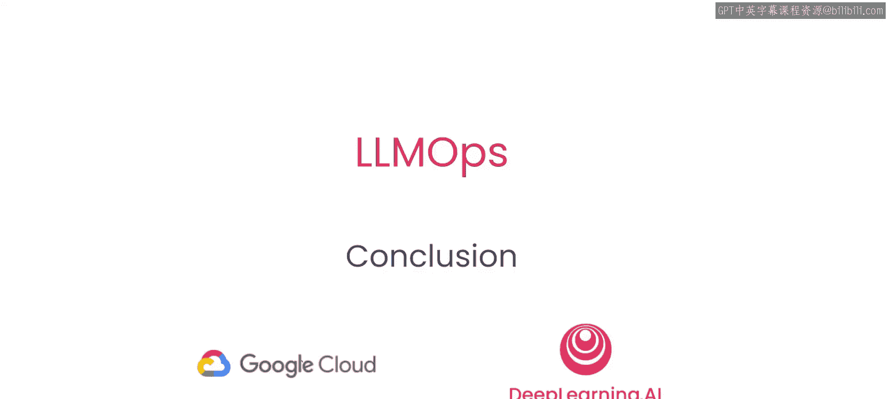

# 大语言模型运维：P6：课程总结 🎉

在本节课中，我们将对《大语言模型运维》课程进行总结，并为您提供后续学习的资源指引。

## 概述

恭喜您完成本课程的学习。大语言模型运维领域正在快速发展，总有更多知识等待探索。

## 后续学习与实践

上一节我们介绍了大语言模型运维的核心流程，本节中我们来看看如何将所学知识付诸实践。

在上一课的笔记中，您将找到一个链接，指向一个展示如何自行运行监督微调流程的笔记。

以下是该笔记的核心内容指引：
*   它提供了运行监督微调管道的具体步骤。
*   您可以通过实践来巩固课程中学到的概念。

## 总结与展望

本节课中我们一起学习了课程的核心内容并获得了实践资源。我对您接下来将要构建的项目感到兴奋。😊

---

