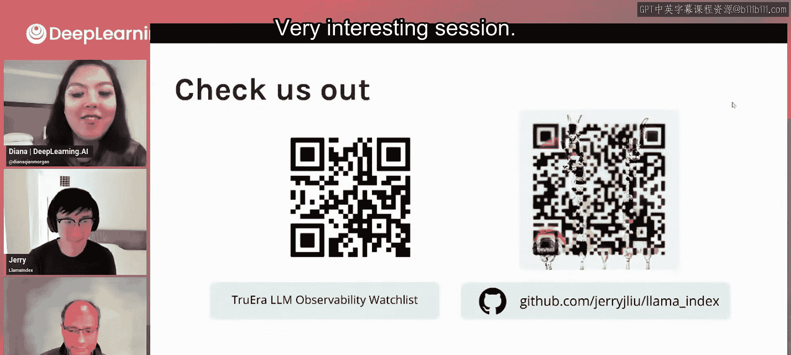

# 如何构建、评估和迭代LLM代理：P1：构建、评估与迭代LLM代理全流程指南

## 概述

在本课程中，我们将学习如何构建、评估和迭代大型语言模型代理。我们将介绍LLM代理的核心概念、构建方法、常见的失败模式以及如何通过系统化的评估来改进代理性能。课程将结合Llamaindex和TruLens这两个开源工具进行实践演示。

## 课程内容

大家好，我是Diana Chan Morgan，在DeepLearning.AI负责社区事务。今天，我们与课程合作伙伴共同举办一场精彩的研讨会，探讨LLM代理的未来发展。我们与Llamaindex和TruLens合作，他们将指导您完成构建、评估、迭代和部署成功LLM代理的整个过程。

本次会议将被录制，幻灯片将在会后发送。我们还提供了一个由演讲者分享的笔记本，我们会在聊天中提供链接，以便您在会议期间访问和跟随操作。

本次研讨会利用了前沿的开源工具，例如Llamaindex（一个简单灵活的数据框架，用于将自定义数据源连接到大型语言模型）和TruLens（一个用于测试和跟踪LLM应用实验的强大平台）。在本次会议中，您将获得关于构建您的第一个LLM代理、评估其有效性、幻觉和偏见、迭代以准备生产应用以及在生产中保持高性能的宝贵见解。

对于演讲者的任何问题，我们也在聊天中提供了一个链接，用于提问和投票，我们将在今天研讨会的最后五到十分钟内回答这些问题。

本次研讨会也受到了我们上周刚刚推出的新短期课程的启发，该课程名为“构建和评估高级RAG应用”。我们的演讲者今天可能会稍微提及它。您可以在我们的网站上找到它，我们也会在会后发送，您也可以在聊天中的链接中找到它。

首先，我想介绍我们的第一位演讲者Jerry Liu。Jerry Liu是Llamaindex的首席执行官，他在之前担任Robust Intelligence的ML工程经理和Uber的研究科学家等职位中积累了丰富的经验。Jerry，很高兴你今天能来这里。

谢谢邀请。

接下来是Anupam Datta。Anupam是TruEra的总裁兼首席科学家，是一位著名的AI专家，也是卡内基梅隆大学的前教授。他的研究专注于确保AI系统的问责制和公平性。Anupam，很高兴你今天能来这里。

很高兴来到这里，Diana。

好的，我将把研讨会交给你们，我知道你们准备了很多内容，我相信我们的社区已经准备好深入探讨一切了。

太好了。幻灯片可见。

很好，让我们开始吧。今天的研讨会是关于如何构建、评估和迭代LLM代理。正如Diana所说，Jerry和我刚刚录制并发布了一门关于基于RAG应用的课程。您可以将本次研讨会视为该课程的延续，但扩展到了代理领域，稍后Jerry会评论两者之间的技术联系。

为了让我们有个方向，我们将花几分钟时间看一些框架和实际基于代理的LLM应用的例子，这些应用已经开始获得相当多的采用。

例如，ChatGPT之前推出了他们的插件，正如你们许多人所知。通过这些插件或LLM代理，您可以增强ChatGPT以访问最新信息、运行计算或使用第三方服务。稍后我们会分享幻灯片，这些是超链接，您可以探索它们。

这些是目前可用的第一批应用示例。您可以看到，像Instacart上的这些代理可以开始为您计划，代表您行动，订购杂货，帮助您计划旅行，甚至进行数学计算。

这是其中一组应用。在该领域还有一些其他非常早期的开创性工作。其中一篇是非常有趣的论文，名为“ReAct”，它将推理和行动与大型语言模型结合起来。这篇论文在代理领域非常有影响力。

在此之前，关于推理的思考，比如思维链推理，即当LLM被问到一个问题时，先推理答案，然后提供答案，这种方法被广泛使用。推理与行动是分开的，LLM可以外出并在环境中行动，代表您执行各种任务，如计划旅行预订或餐厅预订。

通过ReAct，这两个工作体系被结合在一起，实现了推理和行动的交替进行，这显著增强了基于代理的LLM应用的能力。让我给您一个非常快速的例子。

这个例子取自ReAct论文。这里提出的问题是：“除了Apple遥控器，还有什么其他设备可以控制Apple遥控器最初设计用来交互的程序？”

如果您只是询问标准的LLM，那么答案是iPod，这是错误的。如果您让LLM逐步推理，即使这样它也会返回错误的答案。如果它只行动，那么它会开始进行外部搜索，但搜索没有产生有意义的结果。

左边展示的是标准的推理和行动分离，即一次只做一件事而不交替进行，这没有产生正确的结果。右边展示了思考和行动如何交替进行，您会突然看到好得多的结果。这里的思考是：“嗯，我需要搜索Apple遥控器。”于是它调用搜索API进行搜索。搜索返回了“Front Row media center”作为关键词。第二次思考是：“我们需要搜索Front Row。”第一次搜索Front Row没有给出任何非常具体的内容，但建议您可能想查看一些类似的东西，其中包括软件。下一层思考导致行动被搜索“Front Row software”，最终找到了正确的答案，即“您也可以用键盘功能键控制这些设备”。这个例子的细节并不那么重要，但主要的是这种推理或思考与行动的交替，以及这种来回互动，正是许多基于LLM的代理能力所在。

因此，我鼓励您查看这组结果、ReAct论文、GitHub，以了解推动最近代理热潮的重要发展之一的历史。

我将向您指出的另一个项目是AutoGPT。AutoGPT不久前推出，是GitHub上增长最快的开源项目之一。您可以看到这是一个相对较新的截图，它拥有大约15万以上的星标。

然后是这个最近在十月完成的黑客马拉松，其中有很多有趣的基于LLM的应用示例，您可以探索。例如，有一些围绕编码的有趣内容等等。

现在，随着人们开始深入研究基于代理的应用，一些局限性也开始出现，即一些失败模式。这通常包括通过API为LLM增强额外的工具，以进行搜索、查找旅行行程、查找餐厅预订等。随着工具数量的增加，LLM必须根据查询推理出使用哪个工具作为生成答案的一部分，而这正是错误发生的地方。这是一个常见的失败模式，可能存在无限循环。同样存在幻觉问题，这是大型语言模型中已知的常见问题，在此上下文中也会出现。我们稍后会讨论这些。

因此，当我们思考AI代理领域时，我们将其分为三个阶段：专用数据代理，这与从向量存储检索和检索增强生成或RAG架构非常相似，但可以访问实时信息和一些额外部分；通用数据代理，可以访问多个工具并完成更广泛的任务；以及可以在现实世界中采取行动的代理。

在本次演讲中，我们将重点关注数据代理，并在此上下文中，向您介绍如何使用Llamaindex构建数据代理，如何系统评估、理解失败模式，并通过利用TruLens进行水化和改进。这些是我们的GitHub，请随时探索，你们中的许多人已经在使用Llamaindex和TruLens了。我们的开发人员喜欢你们请求功能、做出贡献。如果你们喜欢看到的内容，也请给我们星标。

接下来，我将过渡给Jerry，Jerry将讲述如何使用Llamaindex构建LLM代理。

太好了，谢谢Anupam。也许在这里快速转换一下，我们正在展示我们上周刚刚推出的课程“构建和评估高级RAG应用”。该课程本身更侧重于高级RAG技术（检索增强生成）。对于那些可能不太熟悉RAG的人，RAG基本上只是一种用外部知识语料库增强您的LM的技术。其工作方式是，首先将数据检索或索引到存储系统中，然后在查询时从存储系统检索，并将该上下文添加到LLM的提示窗口中。这既有简单的方法，也有很多开发人员对探索高级方法感到兴奋。要尝试高级方法，您还需要一个严格的系统来评估检索和生成部分。

我们非常高兴能与TruEra合作开设这门课程，因为TruLens拥有强大的评估套件，Llamaindex在高级检索技术方面投入了大量精力，因此我们将它们结合到这个整体短期课程中。您绝对应该查看它，这也很好地衔接了我们如何看待代理从RAG演变而来。基本上，有两个流行词在流传：RAG和代理。那么我们如何真正思考从RAG到代理的过渡呢？

RAG的工作方式，我们可以将其视为一个盒子。用户有一个问题（查询），RAG是定义在您的知识语料库上的整体管道。在这个整体的RAG盒子内，将从知识语料库进行检索以及合成，之后我们得到一个最终响应。

我们思考代理的一种方式是，基本上我们可以将其视为RAG管道前面的一个附加层。我们对此的思考方式是，给定用户查询，我们实际上可以将其馈送给一个整体代理，该代理可以更动态地决定如何通过相关工具路由此查询以尝试合成响应。

因此，在传统的RAG设置中，通常发生的情况是LLM出现在这个整体管道的末端。您进行检索（通常是前K个嵌入查找），然后将其馈送给末端的语言模型。但这里的想法是，如果我们实际上在开始时也使用LLM呢？实际上接收查询并弄清楚如何利用底层工具，无论是RAG管道、外部API调用还是其他服务。

因此，我们将代理视为在RAG之上包装一层，动态地用附加信息丰富查询，并基本上允许这种整体更高级别的抽象以正确的方式使用工具，以尝试返回响应。在接下来的几张幻灯片中，我们将更详细地介绍其工作原理的架构。

几个月前，我们在Llamaindex中定义了这个数据代理的概念，即由知识工作者赋能的数据代理。数据代理基本上旨在帮助您自动化知识工作，既可以进行搜索和检索以及合成，也可以修改数据。

例如，幻灯片中给出了一个示例流程。给定一个数据代理，例如，您可以调用读取您的最新电子邮件（例如来自Gmail或某些外部服务）。之后，您还可以从知识库中检索附加上下文。这是代理内部RAG管道作为工具的完美示例，因此这本身可以是一个RAG工具。您可以有一个分析代理，实际上分析文件，例如使用代码解释器或其他RAG管道。然后，您可以有另一个工具，通过调用它，您正在采取行动并修改状态。在这种情况下，您向第三方服务（如Slack）发送更新，这实际上会触发一条消息写入该服务。

我们思考代理的方式是，核心组件实际上是一个代理推理循环（Anupam在ReAct循环中稍微介绍过）以及工具。其工作方式是，代理推理循环通常在您提供给该代理的工具集上运行。代理推理循环通常由大型语言模型驱动，因为这使其能够动态决定，例如，给定用户输入，我应该使用哪些下一个工具来尝试调用以合成正确的结果。

工具本身可以是，例如，我们称之为查询引擎的工具，如RAG管道。因此，您基本上可以将我们刚刚发布的短期课程中学到的所有技术作为RAG工具插入到这个整体代理中。我们在Llamaindex Hub上还有各种连接到第三方服务的工具，我们有超过25个工具。这包括与Slack、Notion、Zapier或代码解释器等服务的API接口。所有这些工具基本上都是专门为LLM代理设计的API接口。因此，您可以混合搭配，例如您的RAG代理工具以及您的Llamaindex Hub工具，基本上将它们组合成这个整体代理，既可以进行搜索或检索，也可以在不同服务上采取行动。

我认为Anupam在前几张幻灯片中介绍了ReAct是什么。当然，还有其他几种实际执行代理推理的方法。一种方式是，您可以对OpenAI代理进行函数调用循环，例如，在底层，我认为API服务将为您处理，并决定给定您提供的输入，您应该调用哪些函数。还有其他算法，如思维自由、计划与执行等。每年这些会议上都会有一些论文发表。

也许这里快速评论一下如何实际从知识库进行搜索和检索，这涉及到将RAG管道作为工具插入到这个整体代理中的观点。这里的一个想法是稍微详细阐述一下。Llamaindex基本上，简而言之，我们有一堆称为查询引擎的东西，这些基本上概括了RAG管道。它们接收用户查询并返回响应。您可以做的是，我们有一堆这些查询引擎。我们有语义搜索（基本上是一个RAG管道），我们有摘要（您返回所有上下文并尝试在所有上下文上合成答案，而不仅仅是前K个）。我们有基于结构化数据的查询引擎，例如，在SQL数据库上的文本到SQL。我们还有高级RAG管道，其中一些您实际上在短期课程中学到。这使您能够执行诸如文档比较之类的操作，以及能够对混合结构数据和非结构化数据进行组合查询。

Llamaindex架构的工作方式是，您实际上可以将所有这些查询引擎作为工具插入到代理中。因此，您基本上有这个外部代理层，它充当推理循环，如果它调用一个工具，那么该工具（即查询引擎）就会执行。这基本上使您能够在数据之上组合更高级的推理抽象和层，以便您首先让该代理处理用户查询，决定调用哪些工具，然后执行工具。

我们在笔记本中有各种示例，说明这允许什么。这基本上使您能够回答更复杂的查询，允许您进行一些查询规划以尝试并行执行某些操作，允许您动态执行语义搜索和摘要以及文本到SQL，以及组合来自不同数据源的信息。

这里有一个例子。从截图来看，我们有一个这样的示例代理。假设我们插入了两个查询工具，一个用于Uber，一个用于Lyft。每个查询工具只是每个公司年度报告（如10-K文件）上的前K个RAG管道。因此，每个工具对应于该公司上的前K个RAG管道。您将这两个工具插入此代理，现在您可以问一个问题，如“比较和对比Uber和Lyft的收入增长”。代理通过其推理循环和思维链过程以及ReAct推理，将问题分解为工具上的子问题，然后每个子问题加上工具将被执行。每个工具将使用该子问题执行，在每个子问题内，我们将进行每个文档的RAG。首先，我们将查看Uber的收入增长，查看Uber工具，执行前K个，得到答案；然后查看Lyft的收入增长，执行前K个RAG，得到答案，最后合并结果。这只是一个具体示例。

在接下来的几张幻灯片中，我们将讨论一些关于如何建模其中一些代理的通用架构决策，之后的幻灯片中Anupam将详细介绍许多失败模式以及如何实际评估这些代理。

但只是一些需要考虑的一般事项是，如何处理来自工具的大响应。例如，如果一个工具返回整篇文章或一个非常大的网页，您实际上如何处理？我们基本上有一些策略，我们称之为按需加载工具以及加载和搜索工具。基本上涉及对此数据的即时索引。有时，首先加载此数据并将其实际索引到向量存储中是很好的，这样当您实际查询从工具加载的此数据时，您实际上对其执行搜索或检索，而不是试图将所有内容塞入上下文窗口。尽管上下文窗口变得越来越大，但在大量数据上仍然会溢出。因此，事先索引是一种缓解方法。

另一个我认为Anupam也提到的问题是，当您用工具超载这些代理时，它们往往会有些挣扎。例如，如果您有超过五个工具，并且在极限情况下，您可能有数百、数千甚至数百万个工具，在某个点上，这将不适合您的上下文窗口。因此，您可以做的是尝试实际索引工具本身，索引工具的元数据，然后在查询时，首先对相关工具进行搜索检索，然后将其传递给您的代理以询问原因。这些只是一些一般考虑因素，我们最后也会有一个部分，讨论构建代理的一些最佳实践，但希望这能给您一个总体概述，并将其传回给Anupam。

很好，非常感谢Jerry。现在，您已经对如何构建代理，特别是如何使用Llamaindex构建代理的一些关键构建模块有了很好的了解，Jerry和团队在该领域推动了许多早期工作。

我们将稍微转换一下，开始研究评估以及代理的一些失败模式是什么？如何检测这些问题，如何迭代改进它们？

因此，我将在此上下文中快速介绍TruLens。TruLens是一个开源库，用于在构建应用程序（例如使用Llamaindex）时跟踪和评估您的LLM实验。或者任何其他Python框架，您可以相当容易地将TruLens作为应用程序构建过程的一部分使用。

我们将向您展示一个笔记本，Diana也在分享它。因此，您将可以访问GitHub上的笔记本自己操作。因此，当您使用Llamaindex构建LM应用程序时，只需几行代码，您就可以将TruLens连接到它，开始记录记录、提示、响应、中间结果和我们的调用。有趣的是，然后您可以做的是，我们有一个很好的抽象，称为反馈函数或评估，它允许您沿着多个不同维度记录和评估LLM应用程序的质量。一旦设置好这些，其中许多都是开箱即用的，您也可以非常轻松地添加自己的评估。您可以开始在TruLens仪表板中探索这些记录和评估结果，查看失败模式是什么，这反过来可以通知迭代，为您的用例选择最佳的LLM应用程序版本。

因此，让我们看一个具体的用例，我们可能希望使用Jerry介绍的那种数据代理进行实时检索，调用外部API和工具。因此，用户在这里输入查询。然后LLM充当推理代理，它从一组可能可用的工具中挑选一个工具。它将用户查询转换为适合该工具的输入，从工具获取输出，然后生成最终响应。在此过程中，有哪些代理失败模式？代理可能在此推理步骤中选择了错误的工具。如果是一个关于餐厅的问题，它可能没有选择Yelp，而是选择了类似Archive的东西，并给您一篇研究论文，该论文谈论餐厅推荐。那将不太合适，但这种选择正确工具的错误在代理中相当常见，尤其是当工具数量开始增加时。它可能陷入无限循环。特别是因为许多这些代理，基本案例的代理，没有状态。API调用可能会失败，例如，如果输入格式不正确，如果查询转换没有以正确的格式完成。您可能还有其他与幻觉相关的失败模式。

因此，让我现在讨论一个非常具体的用例，这就是在提供给您的笔记本中可用的内容。我们将讨论一个餐厅信息聊天机器人，用户开始提出一些问题，然后代理利用Yelp API（在这种情况下是一个工具）来回答相关问题。我们将将其与一个基线进行比较，在该基线中，LLM仅基于其预训练知识回答这些问题，而不访问外部API。因此，这是我们将比较的两个版本。这在此笔记本中可用，这里有一个QR码。如果您喜欢，可以在会后使用它。它也将与您共享，在GitHub上公开可用。

为了使事情有趣，我们指示代理以Gordon Ramsay的风格回应，并询问有关餐厅推荐的问题。让我向您展示几个例子。

我们问的第一个问题是：“多伦多最好的餐厅是什么？多伦多最好的晚餐餐厅是什么？”这是针对仅OpenAI LLM的，没有访问Yelp评论，这是返回的答案。我给您一秒钟阅读它，请记住提示是以Gordon Ramsay的风格回应。因此，您可以看到它不一定特别尊重。

我们向LLM代理问了同样的问题，该代理可以访问Yelp API。然后返回了响应。这是返回的响应。这更有礼貌一些，也许是因为它实际上检索到了一个答案，然后要求LLM进行总结。现在我们有了几个这样的答案，我们希望能够思考并拥有工具来进行评估。

因此，让我回过头来开始讨论LLM代理评估的框架。

在我们深入LLM代理之前，我想回顾一下我们最近与Jerry推出的关于高级RAG技术的DeepLearning.AI课程中的一张幻灯片，您应该查看一下，只需一小时。在其中，我们讨论了用于防范幻觉的RAG三元组。如果您想到RAG，用户带着查询进来，就像在这个例子中一样，“多伦多最好的晚餐餐厅是什么？”基于该