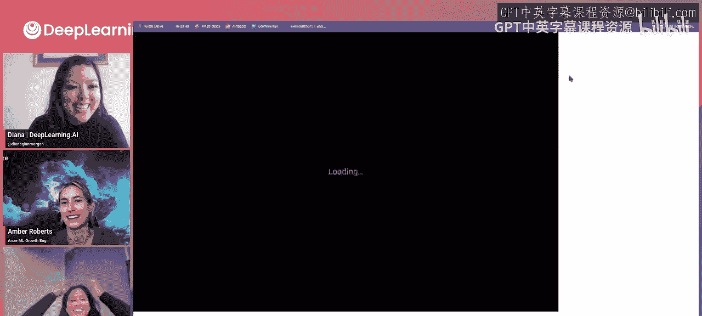
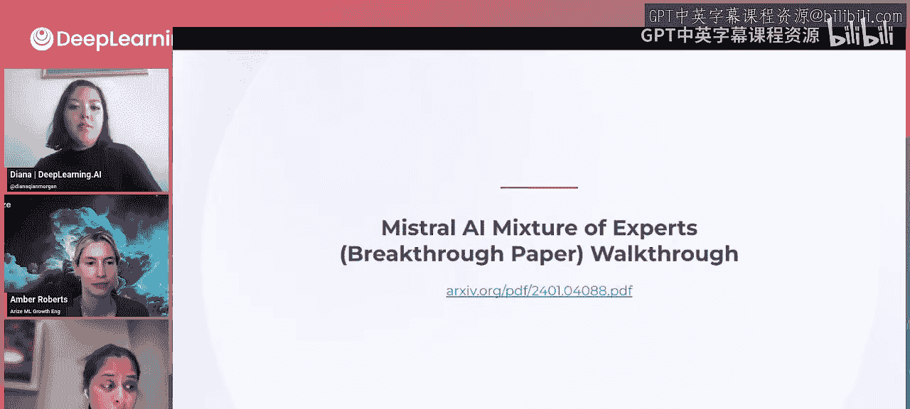

# 如何高效阅读AI论文：1：阅读AI研究论文的完整指南

在本教程中，我们将学习如何高效地阅读和理解AI研究论文。我们将探讨阅读论文的重要性、如何寻找合适的论文、不同类型的论文及其特点，并通过一个实际案例演示如何拆解一篇论文。

## 为什么你应该阅读研究论文

AI领域的发展速度极快。从GPT-4的发布到Claude Opus 3、Google Gemini等强大竞争对手的出现，从文本模型到视觉模型如Sora的演示，进展日新月异。这种快速变化不仅体现在研究方面，也体现在基于这些模型构建应用程序的速度上。

为了跟上领域发展，了解应该使用哪些基础模型、指令微调的边界是什么，最好的方法是直接从源头——研究论文本身获取信息。能够高效、快速地阅读论文，将帮助你保持领先。

AI市场规模正在增长，不仅在研究方面有大量投资，组织也开始部署和构建基于AI的应用程序。从聊天到购买、客户支持聊天机器人，再到为组织创造收入的复杂用例，AI应用正在成为现实。

与此同时，AI论文的数量也在呈指数级增长。在过去24个月里，arXiv上AI论文的数量急剧增加。这意味着有大量信息需要消化和传播，掌握自己阅读和理解论文的技能将变得非常有价值。

## 如何寻找合适的论文

面对海量论文，如何开始寻找呢？以下是一些实用的资源和方法：

*   **社交媒体**：关注LinkedIn、X（原Twitter）、Slack、Discord、YouTube上的AI领域专家和社区。
*   **新闻通讯**：订阅AI相关的新闻通讯。
*   **论文阅读活动**：参加线上或线下的论文阅读会。例如，Arize AI会举办双周论文阅读会，Latent Space也是一个很好的资源。
*   **线下聚会**：参加技术聚会，与他人讨论论文。
*   **专业网站**：浏览如Forbes AI、VentureBeat等网站，了解行业动态。
*   **利用AI工具**：直接向GPT等大型语言模型询问特定主题的论文推荐。

X（原Twitter）是目前讨论AI论文最活跃的平台之一，许多人会在上面分享论文摘要、解读最新论文并进行讨论。即使你不喜欢某个平台，它也是一个绝佳的学习场所。找到或加入一个论文阅读社区非常有帮助，即使是每两周一次的活动，也比自己完全不读要好。

## 理解不同类型的论文

并非所有论文都是一样的。我们将论文大致分为三类：综述论文、基准测试与数据集论文以及突破性论文。

### 综述论文

综述论文对某个特定主题提供了详细的概述，总结了该领域当前的发展状况。这类论文通常标题中带有“Survey”字样，篇幅较长，内容详尽。

**阅读目标**：
*   理解特定领域的整体现状。
*   寻找趋势和模式，了解研究重点和资金投入方向。
*   获取该领域如何被评估的广泛概述。
*   发现尚未被充分探索的研究机会。

**非目标**：
*   获取对特定模型的深入技术分析（这更多来自技术综述或突破性论文）。
*   期待引入全新的、革命性的想法（这通常来自突破性论文）。

**示例**：检索增强生成（RAG）综述。如果你正在实施或考虑实施RAG，这类综述可以帮助你了解不同的技术及其在整个生成式AI领域中的位置。但它不会深入探讨高级RAG方法或评估方法，这些内容更可能出现在基准测试论文中。

另一个著名例子是2023年9月发布的《大型语言模型综述》。这篇长达90页的论文对当时的主流模型进行了全面比较。然而，AI领域发展极快，许多新模型在这之后才出现，这凸显了该领域的快速变化。

综述论文是了解关键里程碑和突破的好方法，它们展示了研究的发展脉络。虽然可能不包含一个月前的最新突破，但能让你快速跟上核心进展。此外，突破性论文也常会引用综述论文，建议读者去那里获取背景知识。

**谁适合阅读**：不仅是AI工程师，任何对该领域感兴趣的人都可以通过综述论文获得整体概览。对于正在评估开源与闭源模型、考虑如何训练自己的语言模型或管理预算和计算资源的团队来说，综述论文提供了包括性能、成本、硬件需求在内的多方面比较信息。

### 基准测试与数据集论文

这类论文用于引入新的测试数据集或新的评估方法。一些流行的基准测试包括：
*   **MMLU**：测试LLM的多任务能力。
*   **HellaSwag**：测试常识推理。
*   **TruthfulQA**：检验对抗错误信息的能力。
*   **ChartQA**：针对图表和视觉内容的问答基准测试。

**阅读目标**：
*   评估是否可以在自己的工作中使用该基准或数据集。
*   更深入地了解所用模型的能力。
*   基于评估结果了解模型的局限性。
*   思考如何扩展或修改该基准，使其更符合自己的用例。

**非目标**：
*   引入新的模型能力或架构（这是突破性论文的任务）。
*   提供详细的模型内部结构分解（这是突破性论文的内容）。

**示例**：Gemini技术报告中的基准测试对比。这些报告中使用的每个基准测试（如MMLU、HellaSwag）通常都有自己独立的论文，详细介绍了数据集的构建和评估方法。这类似于计算机视觉领域的ImageNet数据集。

在LLM领域，由于许多基准数据集是公开的，一个值得思考的问题是：这些LLM本身是否在其训练数据中见过这些测试题？这是当前领域的一个关注点。正因如此，像Open LLM Leaderboard和Chatbot Arena这样的公开排行榜变得越来越重要，它们提供了相对标准化的模型性能比较方式。

**注意事项**：阅读基准测试论文时，需要保持批判性思维：
*   **数据偏见**：检查数据集中是否存在偏见。
*   **答案唯一性**：有些基准（如MMLU）被反馈并非所有问题都有唯一明确的答案。
*   **上下文不足**：问题可能缺乏足够的背景信息，导致模型产生幻觉。
*   **过程正确性**：在数学推理等任务中，模型可能答案正确但推导过程错误，这需要被评估。

尽管存在这些挑战，基准测试仍然是理解LLM能力的重要起点。你可以利用这些论文中的方法，在自己的模型上复现评估任务。

### 突破性论文

这类论文通常会引起大量讨论和关注，它们引入了新的架构、方法或取得了显著的性能提升。

**阅读目标**：
*   确认论文的核心新颖点是什么。
*   理解这个新发现或新方法意味着什么（例如，更快、性能更好）。
*   推断其可能带来的新应用或影响。

**非目标**：
*   提供完整的背景知识介绍（论文通常会引用相关前置工作）。
*   披露所有的实验细节或训练数据（近期趋势是披露较少）。

**关键点**：在阅读时，重点关注“是什么”和“为什么重要”。论文不会详细解释每一个术语或引用，如果你缺乏背景知识，需要自行查阅引用的文献。

接下来，我们将通过一篇具体的突破性论文来进行实战演练。

## 实战演练：解读《Mixtral of Experts》论文

我们将以Mixtral AI发布的《Mixtral of Experts》论文为例，演示如何阅读一篇突破性论文。

**第一步：阅读摘要和引言**
摘要指出，论文介绍了Mixtral 8x7B，一个稀疏混合专家模型。它声称在数学、代码生成和多语言基准测试上大幅超越了Llama 2 70B，并且其指令微调版本在遵循指令方面超过了GPT-3.5 Turbo、Claude-2和Llama 2 70B。由此，我们得知论文将重点讨论模型架构和其在特定数据集上的结果。

**第二步：识别论文类型和相关性**
论文花了大量篇幅讨论架构细节（如8个专家层），这表明它是一篇突破性论文，而非综述或基准测试。对于关注基础模型比较和架构创新的读者来说，这篇论文非常相关。

**第三步：处理背景知识**
在“架构细节”部分，论文提到它基于Transformer架构，并使用了与Mistral 7B相同的修改。对于“混合专家”方法，它直接引用了一篇1991年的原始论文。作为读者，如果你不了解“混合专家”，这就是你需要补充背景知识的地方。你可以：
1.  点击论文中的引用链接，阅读原始文献。
2.  寻找相关的综述论文（例如，谷歌团队关于稀疏专家模型的综述）。
3.  利用外部工具（如让GPT解释概念，或使用GitHub Copilot辅助理解）。

**第四步：浏览图表和结果**
许多人会先看图表。在这篇论文中，性能对比图表显示Mixtral在多個基准测试上表现良好。但需要注意的是，有些图表（如所有指标都是绿色）可能信息量有限，无法体现差异化。另一个关于长上下文困惑度的图表显示，在超过一定长度后性能趋于平缓，这提供了有用的信息。

**第五步：深入核心创新**
论文的核心是“稀疏混合专家”架构。关键点在于：虽然模型总参数量很大，但每个token只激活并使用其中两个专家（约130亿参数），这使得推理速度更快。论文大部分内容都在展示结果，对架构本身的描述相对简洁，对训练数据的披露也很少。

**第六步：关注分析讨论部分**
论文最后对“路由分析”进行了深入探讨，即研究输入是如何被分配给不同专家的。有趣的是，分析发现专家的分配并非基于主题领域（如数学、生物），而是与数据的句法结构或来源（如arXiv论文、GitHub代码）有关。这指出了未来可能的研究方向。

**主要收获**：
1.  稀疏混合专家模型在性能上表现优异。
2.  推理速度更快。
3.  指令微调版本在特定任务上领先。
4.  专家的路由机制是一个值得深入研究的开放性问题。

## 如何参与并贡献研究

跟上领域发展的另一个重要途径是关注社区分享。许多开发者和研究者在构建应用的过程中会进行实验，并将结果通过Twitter、LinkedIn或博客文章分享出来。虽然这些分享可能不如学术论文那样严谨，但对于实际应用构建者来说，它们提供了极具价值的实践洞察。

例如，有人会分享测试不同LLM在“大海捞针”检索任务上的表现。这种来自实践社区的研究和分享，正在成为推动领域发展的重要力量。

## 常见问题与建议

**问：应该每天花多少时间阅读论文？**
这因人而异，也取决于论文的产出密度。阅读论文不是一个线性的过程，你可能需要跳转去查阅引用文献，这比从头到尾读一篇论文更耗时。建议根据兴趣和论文的重要性来安排时间，有时可能会陷入“兔子洞”，连续阅读多篇相关论文。关键在于养成定期阅读的习惯，而不是机械地规定时长。

**问：如何培养研究人员的技能？LeetCode有帮助吗？**
LeetCode主要帮助练习编码和面试，对提高论文阅读能力直接帮助不大。培养研究技能的关键在于：
1.  **定期消费论文**：坚持阅读，形成习惯。
2.  **动手实践**：如果论文发布了开源代码或库，尝试运行和使用它，获得第一手经验。
3.  **批判性思考**：以“怀疑论者”的心态阅读，不断问自己“这真的可信吗？”、“如果是我会怎么做？”。思考论文的不足和可改进之处。
4.  **参与讨论**：加入论文阅读小组，与他人交流观点。

## 总结

在本教程中，我们一起学习了高效阅读AI研究论文的系统方法。我们首先探讨了在AI快速发展背景下阅读论文的重要性。接着，介绍了如何利用社交媒体、新闻通讯和社区活动寻找有价值的论文。我们重点区分了三种主要论文类型：**综述论文**用于把握领域全景，**基准测试与数据集论文**用于评估模型性能，**突破性论文**用于追踪前沿创新。通过《Mixtral of Experts》论文的实战演练，我们演示了从摘要、背景知识补充、图表分析到核心创新提取的完整阅读流程。最后，我们强调了参与社区分享和培养批判性思维对于跟上AI领域步伐的关键作用。记住，阅读论文是一项可以通过练习不断提升的技能，现在就开始你的下一篇论文阅读吧！