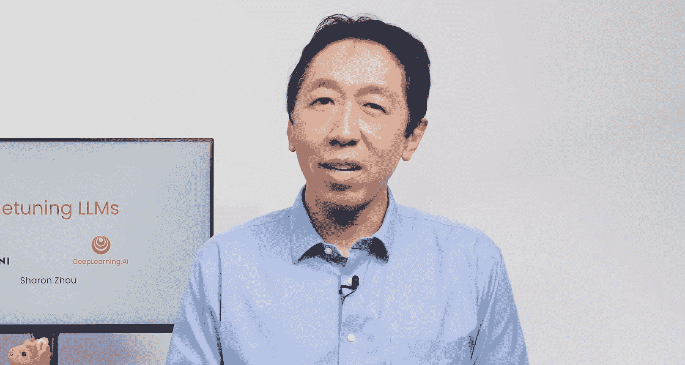
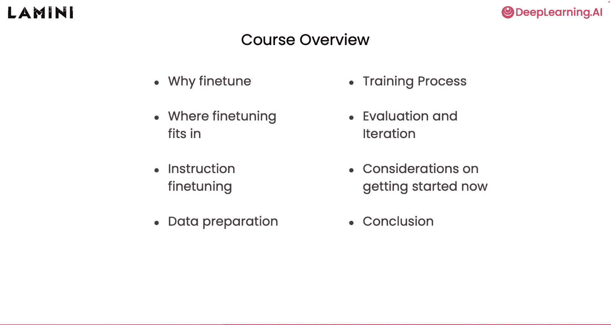
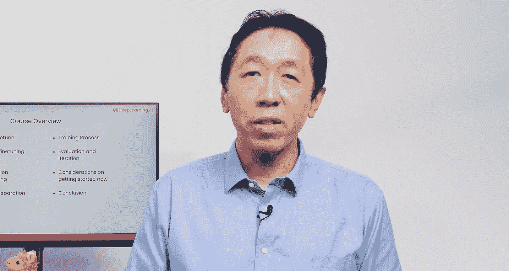
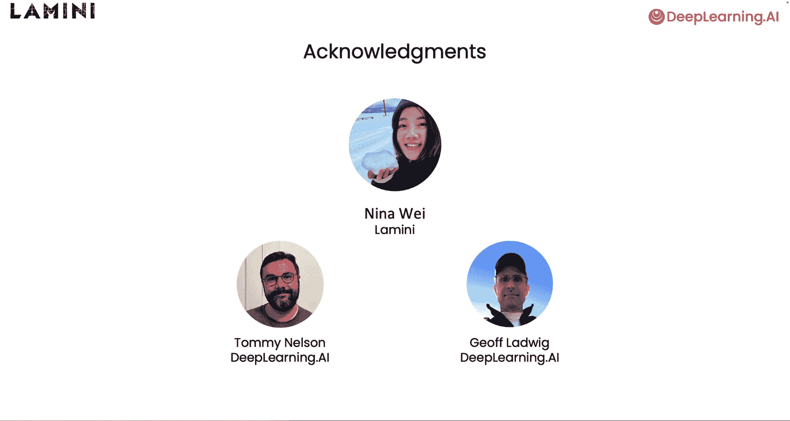

# 微调大型语言模型：1：课程介绍 🎯

在本节课中，我们将学习什么是大型语言模型的微调，以及它如何帮助你将模型应用于自己的数据和任务。

## 概述

欢迎来到由Sharon Jo教授的大型语言模型微调课程。当与不同团队交流时，我经常听到人们询问：如何让大型语言模型处理我自己的数据或任务？你可能已经知道如何通过提示词来引导大型语言模型，而本课程将介绍另一种重要的方法：微调。具体来说，就是如何选取一个开源的大型语言模型，并使用你自己的数据对其进行进一步的训练。

## 微调的价值

虽然编写提示词可以很好地让语言模型遵循指令来完成任务，例如提取关键词或将文本分类为积极或消极情感，但通过微调，你可以让模型更稳定、更一致地执行你的需求。

我发现，仅通过提示词让模型以特定风格（例如更乐于助人、更有礼貌、更简洁或更详尽）进行回应，在某种程度上是具有挑战性的。事实证明，微调也是调整模型语气和风格的有效方式。

## 应用场景

如今，人们已经认识到ChatGPT和其他流行大型语言模型在回答海量主题问题方面的卓越能力。然而，个人和公司都希望模型能同样处理他们自己的私有和专有数据。实现这一目标的方法之一就是用你的数据来训练一个大型语言模型。

当然，从头训练一个基础大型语言模型需要海量数据（可能达到数千亿甚至上万亿词）以及庞大的GPU计算资源。但通过微调，你可以基于一个现有的模型，仅使用你自己的数据进行进一步训练。

## 课程内容

在本课程中，你将学习：
*   什么是微调。
*   微调在哪些情况下对你的应用有帮助。
*   微调在整个训练流程中的位置。
*   微调与提示工程或检索增强生成有何不同。
*   如何将这些技术与微调结合使用。

你将深入探讨一种特定的微调变体——指令微调，正是它将GPT-3转变成了ChatGPT。这种技术旨在教会大型语言模型遵循指令。

最后，你将通过代码实践微调你自己的大型语言模型的完整步骤，包括准备数据、训练模型和评估模型。

## 预备知识

本课程设计为对Python熟悉的学员即可学习。但要完全理解所有代码，具备深度学习的基础知识会更有帮助，例如了解训练神经网络的过程是什么样子的，以及什么是训练集/测试集划分。

## 致谢

许多辛勤工作促成了本课程。我们要感谢整个Lamini团队，特别是Nina Wei在课程设计方面的贡献，以及DeepLearning.AI团队的Tommy Nelson和Jeff Ludwig。

## 总结

通过这个大约一小时的简短课程，你将深刻理解如何通过对现有大型语言模型进行微调，利用你自己的数据来构建属于你自己的语言模型。

让我们开始吧。