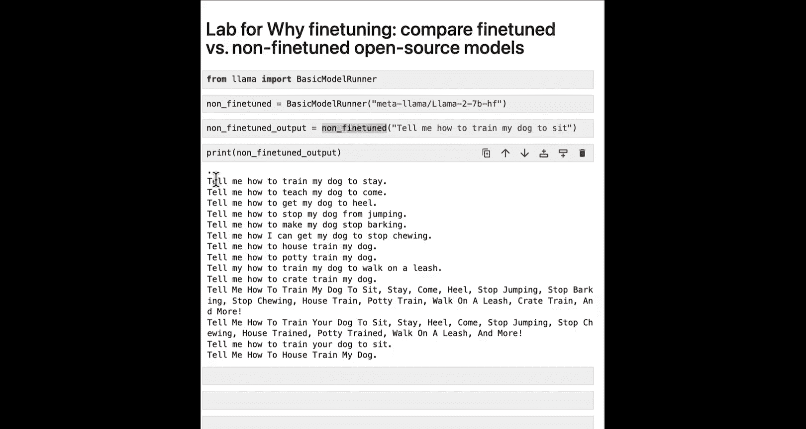
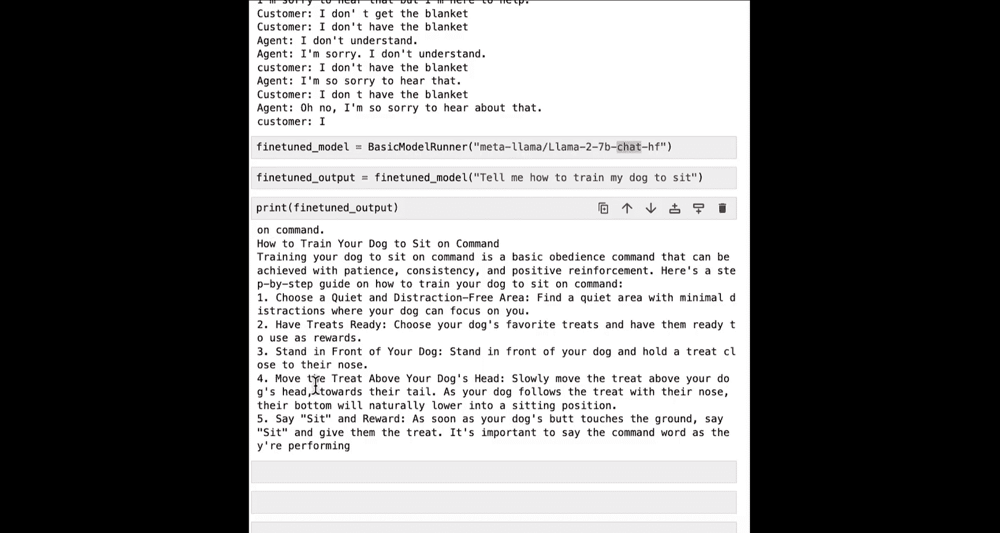
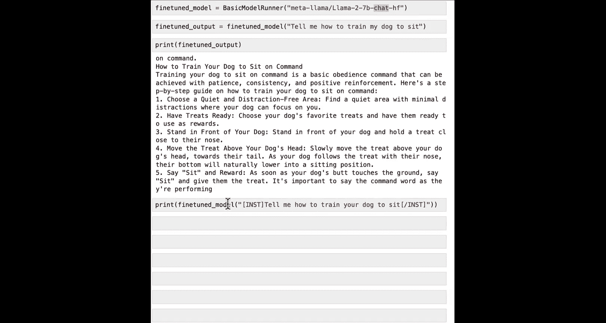
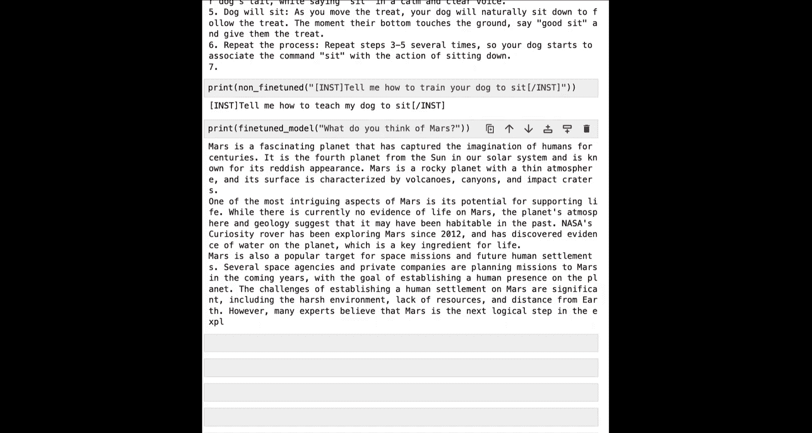
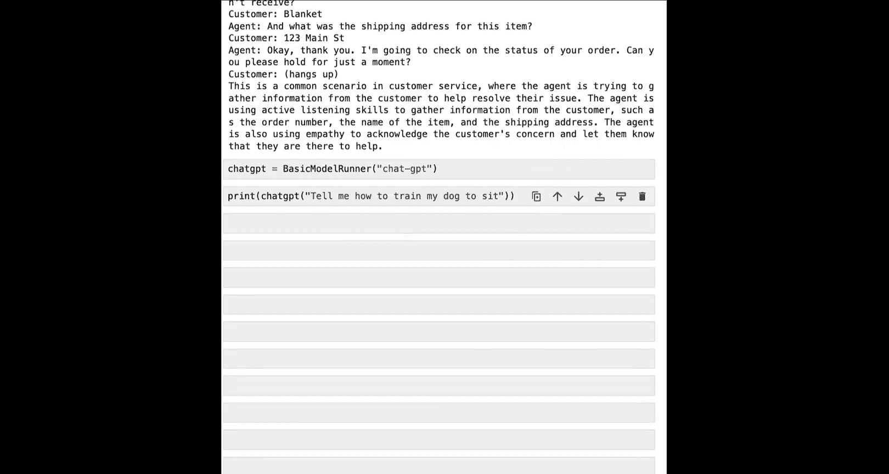
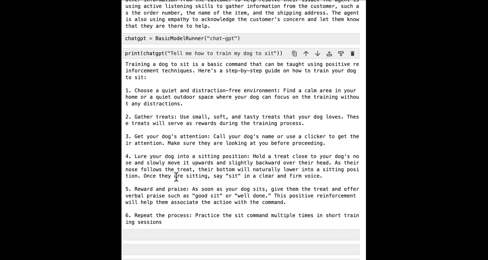
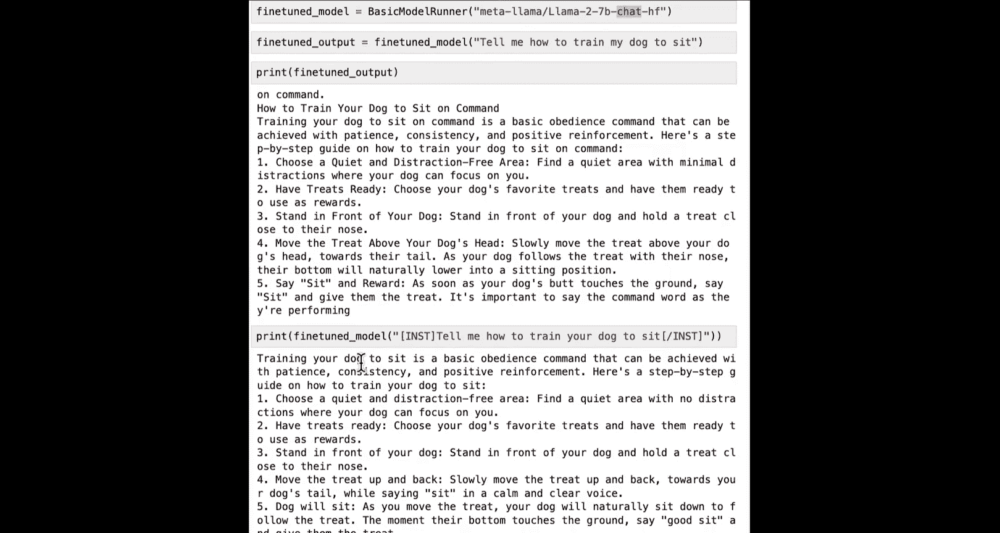
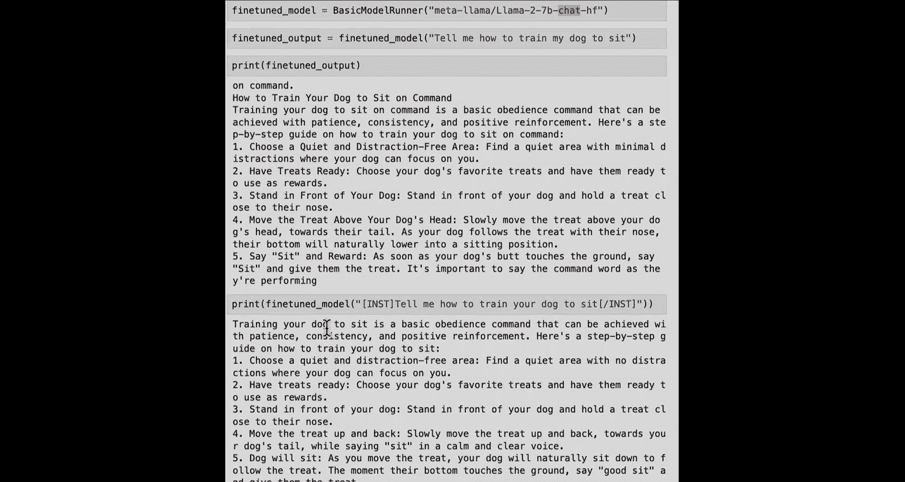

# 微调大型语言模型：P2：微调基础与对比 🧠


## 概述
在本节课中，我们将学习什么是微调、为何要进行微调，并将其与提示工程进行对比。最后，我们将通过一个实验，直观地比较微调模型与非微调模型的性能差异。

---

## 为何需要微调大型语言模型？🤔

在探讨原因之前，我们先明确微调的定义。

微调是指将通用模型（如GPT-3）转化为特定用途模型（如ChatGPT）的过程。这类似于将全科医生（通用模型）培养成心脏病专家或皮肤科医生（专业模型）。全科医生可以进行年度体检，但专科医生能更深入地处理心脏或皮肤问题。

微调使模型能够处理远超提示词容量的数据量。模型从这些数据中学习，而非仅仅访问它们。通过这个学习过程，模型得以从“全科医生”升级为“专科医生”。

例如，输入“皮肤刺激、发红、瘙痒”等症状，基础通用模型可能只会判断“这可能是痤疮”。而经过皮肤病学数据微调的模型，则能给出更清晰、更具体的诊断。

除了学习新信息，微调还能引导模型产生更一致、更稳定的输出或行为。

例如，当询问基础模型“你的名字是什么？”时，它可能回答“你的姓氏是什么？”，因为它见过大量调查问卷数据，甚至不清楚自己应该回答问题。相比之下，经过微调的模型会明确回答“我的名字是Sharon”（如果该机器人是用Sharon的数据训练的）。

此外，微调有助于减少模型的“幻觉”问题，即模型编造信息。例如，它可能错误地说“我的名字是Bob”，而实际训练数据中名字是Sharon。

总体而言，微调使你能够针对特定用例定制模型。微调过程与模型早期的训练方法非常相似，后续课程会深入探讨。

---

## 微调与提示工程的对比 ⚖️

你可能对提示工程更为熟悉。过去十年使用谷歌搜索，或近期使用大语言模型时，你一直在实践提示工程：输入查询、编辑查询以改变结果。

以下是提示工程的一些优点：
*   无需数据即可开始，可以直接与模型对话。
*   前期成本较低，每次调用模型的费用并不昂贵。
*   无需太多技术知识，只需知道如何发送文本消息即可。
*   现在可以使用检索增强生成等技术，有选择地将更多数据连接到提示词中。

当然，提示工程也存在局限性：
*   如果数据量稍大，可能无法全部放入提示词中。
*   即使尝试放入大量数据，模型也常常会遗忘大部分内容。
*   存在幻觉问题，模型可能编造信息，且难以纠正其已学到的错误信息。
*   虽然检索增强生成有助于连接数据，但它也常常会遗漏正确数据或获取错误数据，导致模型输出错误结果。

微调在某种程度上与提示工程相反：
*   可以处理几乎无限量的数据，模型能从中学习新信息。
*   可以纠正模型先前可能学到的错误信息，或输入其未曾学习过的最新信息。
*   如果微调一个较小的模型，后续使用成本更低，这在预期有高吞吐量或大负载时尤其相关。
*   检索增强生成同样可以在此应用，你可以连接更多数据，即使模型已经学习了大量信息。

然而，微调也有其挑战：
*   需要更多数据，且数据质量要求更高。
*   存在前期计算成本，并非完全免费。
*   通常需要一些技术知识来正确处理数据，尽管现在有越来越多的工具使其变得更容易。
*   使用者不再仅限于会发短信的人，需要对数据有一定理解。

综上所述，提示工程适用于通用用例、不同的副业项目、原型设计，能让你快速上手。而微调则更适合企业或特定领域用例、生产环境部署。下一节我们将讨论微调自有大语言模型在隐私方面的益处。

---

## 微调自有大语言模型的优势 🛡️

微调自有的大语言模型能带来多方面的好处。

**性能方面**：
*   可以减少模型在你专业领域内的“幻觉”现象。
*   使模型在该领域具备更深的专业知识。
*   输出更加一致可靠。有时模型今天表现很好，但明天调用时却不再稳定。微调是使其更一致、更可靠的一种方法。
*   可以更好地进行内容审核。如果你经常使用ChatGPT，可能会看到它说“抱歉，我无法回答这个问题”。通过微调，你可以让它说出相同的话，或根据你的公司或用例定制回复，帮助对话保持在正轨上。

**隐私方面**：
*   微调可以在你的虚拟私有云或本地进行，这能防止使用现成的第三方解决方案时可能发生的数据泄露。这是保护你收集的数据（无论是最近几天还是过去几十年的数据）安全的一种方式。

**成本方面**：
*   实现成本透明化。如果有很多人使用你的模型，并且你希望降低每次请求的成本，微调一个较小的模型可以帮助你实现。
*   总体上，你对成本以及其他因素（如正常运行时间和延迟）有更大的控制权。例如，对于自动补全这类应用，你可能需要低于200毫秒的延迟，以确保用户感知不到延迟。你肯定不希望自动补全需要30秒（目前运行GPT-4有时会出现这种情况）。

**内容审核方面**：
*   如前所述，如果你希望模型对某些内容说“抱歉”或“我不知道”，甚至提供自定义回复，微调是实际为模型提供这些护栏的一种方式。

最棒的是，你将在接下来的实验笔记本中亲眼看到一个这样的例子。

---

## 实验环境与工具介绍 🛠️

在所有的实验环节中，你将使用多种技术进行微调。主要有三个Python库：

1.  **PyTorch**：由Meta开发，这是你将看到的最低层级的接口。
2.  **Hugging Face库**：构建在PyTorch之上，提供了更高级的接口。你可以轻松导入数据集和训练模型。
3.  **Lama库**：由我和我的团队开发，我们称之为“Lama库”。这是一个更高级的接口，只需三行代码即可训练模型。

接下来，让我们进入实验环节，看看微调模型的实际表现。

---

## 实验：微调模型与非微调模型对比 🧪

我们将比较一个微调模型和一个非微调模型。

首先，我们从Lama库中导入基础模型运行器。这个类帮助我们高效运行托管在GPU上的开源模型。

我们将运行的第一个模型是当前非常流行的**Llama 2模型**，它**未经微调**。我们根据其在Hugging Face上的名称实例化它，并向它提问：“告诉我如何训练我的狗坐下”。这是一个非常简单的指令。

我们获取输出并打印。

**非微调模型输出**：
```
告诉我如何训练我的狗说...
告诉我如何训练我的医生留下...
告诉我如何教我的医生来...
告诉我如何让我的医生治愈...
```
显然，这与之前“你的名字是什么？你的姓氏是什么？”的例子类似。这个模型没有被训练或告知要实际响应那个指令。

结果可能有点糟糕。我们再试试其他问题。



**提问**：“你觉得火星怎么样？”
**输出**：“我认为它是一个伟大的星球，我认为它是一个好星球，我认为它将是一个伟大的星球...” 它持续输出，非常哲学化，甚至有些存在主义。

**提问**：“泰勒·斯威夫特最好的朋友是谁？”（类似谷歌搜索查询）
**输出**：它没有准确回答，但说“我是泰勒·斯威夫特的超级粉丝”。

**尝试对话场景**：模拟亚马逊配送订单的客服与客户对话。
**输出**：它至少在进行不同的客户和客服对话轮次，但内容并不实用，无法用于创建自动客服代理。

你已经看够了非微调模型的表现。现在让我们将其与**经过微调以进行对话的Llama 2模型**进行比较。


我实例化微调模型。注意，模型名称唯一的区别是多了“chat”字样。然后，我让这个微调模型做同样的事情：“告诉我如何训练我的狗坐下”。打印输出。

**微调模型输出**：
```
告诉我如何训练我的狗说...（仍在尝试自动补全）...坐下。以下是一些步骤...
```
它实际上给出了一个几乎分步的指南，说明如何训练狗坐下。这好多了。

为了完全消除这种额外的自动补全现象，实际上需要告知模型你给出的是指令。我在这里使用了这些“指令标签”。这是Llama 2使用的格式，当你微调自己的模型时可以使用不同的方式。这有助于告诉模型：“嘿，这些是我的指令，这是指令的边界，我已经给出指令了，停止继续给出指令”。



在这里，你可以看到它没有自动补全“on-command”这个词。为了公平比较，我们可以看看非微调模型在相同格式下的输出。它只是重复了相同或非常相似的内容，仍然不正确。

让我们继续。

**提问**：“你觉得火星怎么样？”
**微调模型输出**：“这是一个迷人的星球，几个世纪以来一直吸引着人类的想象力。” 这个输出好多了。



**提问**：“泰勒·斯威夫特最好的朋友是谁？”
**微调模型输出**：它列出了几个泰勒·斯威夫特最好朋友的候选人，这个回答挺有意思。

**查看亚马逊配送客服对话**：
**微调模型输出**：“我明白了，你能提供你的订单号吗？” 这好多了。有趣的是，在下面它还总结了正在发生的事情，这可能是你希望或不希望看到的，而这也是可以通过微调来调整的。




现在，我好奇ChatGPT会如何回答“告诉我如何训练我的狗坐下”。它同样给出了不同的步骤。


你可以自由使用ChatGPT或任何其他模型来比较它们各自能做什么。但很明显，经过微调的模型，包括ChatGPT和这个Lama对话模型，明显优于未经微调的模型。



---

## 总结 📝




本节课中，我们一起学习了：
1.  **微调的定义与价值**：将通用大语言模型转化为特定领域专家模型的过程，能处理更多数据、学习新知识、产生更一致输出并减少幻觉。
2.  **微调与提示工程的对比**：提示工程适合快速原型和通用场景，而微调更适合企业级、专业化、高负载的生产环境，并能更好地保障隐私和控制成本。
3.  **微调自有模型的优势**：在性能、隐私、成本和内容可控性方面具有显著好处。
4.  **实践对比**：通过实验，我们直观地看到了经过对话微调的Llama 2模型在遵循指令、回答质量和对话能力上，远超其未经微调的基础版本。





在下一课中，我们将了解微调在整个模型训练流程中的位置，并学习如何迈出获得这样一个微调模型的第一步。