# 微调大型语言模型：P3：微调基础与数据准备 🧠

在本节课中，我们将学习微调在大型语言模型训练流程中的位置。我们将了解预训练的基础，并探索微调可以应用于的各种不同任务。

## 预训练：模型学习的起点

上一节我们介绍了微调的概念，本节中我们来看看微调之前的步骤——预训练。这是微调发生前的第一步。模型在开始时是完全随机的，它对世界一无所知。如果你熟悉权重，那么它的所有权重都是完全随机的。它完全无法形成英语单词，还不具备语言技能。

它的学习目标是**下一个词元预测**，或者简化为**下一个词预测**。例如，模型看到单词“once”，我们希望它预测出“upon”。但初始时，模型可能只会输出“SD Xation point exlamation point at”等完全无关的内容，这就是它的起点。

模型通过读取一个通常从整个网络抓取的巨大语料库来学习。我们常称这些数据为**无标签数据**，因为它不是我们结构化整理好的，而是从网络上抓取的。需要说明的是，这些数据经过了大量清洗过程，要使这个数据集对模型预训练有效，仍然需要大量人工工作。这通常被称为**自监督学习**，因为模型本质上是通过下一个词元预测来监督自己。它只需要预测下一个词，除此之外没有其他标签。

经过训练后，模型现在能够预测“upon”这个词元。它学会了语言，并从互联网上学习了许多知识。这个过程以这种方式运作是令人惊叹的，因为它仅仅是在尝试预测下一个词元，并且通过读取相当于整个互联网的数据量来做到这一点。

关于“整个互联网数据”可能需要打个星号。从整个互联网抓取的数据，其背后的具体理解和知识通常不太公开。对于许多大公司的闭源模型，人们并不确切知道这些数据具体是什么样子。但Luther AI在开源方面做出了惊人努力，创建了一个名为“The Pile”的数据集，你将在实验课中探索它。这是一个由22个不同数据集组成的集合，从整个互联网抓取。这个图中包含了林肯的葛底斯堡演讲、林肯的胡萝卜蛋糕食谱，当然还有从PubMed抓取的医学文本信息，以及来自GitHub的代码。这是一个相当有知识含量的数据集集合，旨在为模型注入知识。

这个预训练步骤相当昂贵且耗时。昂贵是因为让模型遍历所有这些数据，从完全随机到理解这些文本、组合胡萝卜蛋糕食谱、编写代码、了解医学知识和葛底斯堡演讲，需要花费大量时间。

## 从预训练模型到微调模型

这些基于预训练的模型很棒，实际上有很多是开源的。但它们是在网络数据上训练的。你可能会看到左边这样的地理作业，它问“印度的首都是什么？肯尼亚的首都是什么？法国的首都是什么？”，并且在一行中没有显示答案。所以，当你输入“墨西哥的首都是什么？”时，语言模型可能只会说“匈牙利的首都是什么？”。你可以看到，从聊天机器人界面的角度来看，这并不真正有用。

那么如何让它达到聊天机器人界面的水平呢？微调就是实现这一目标的方法之一，它应该是你工具箱中的一个重要工具。预训练是获得基础模型的第一步。当你添加更多数据时（实际上不需要那么多数据），你可以使用微调来获得一个微调后的模型。实际上，即使是微调后的模型，你之后也可以继续添加微调步骤。

因此，微调确实是后续的一个步骤。你可以使用相同类型的数据，实际上也可以从不同来源抓取数据并将其整理在一起（稍后你会看到这一点），这些可以被称为“无标签数据”。但你自己也可以整理数据，使其对模型学习来说更加结构化。我认为区分微调和预训练的一个关键点是，微调需要的数据量要少得多。你是在这个已经学习了大量知识和基本语言技能的基础模型之上进行构建，你只是将其提升到下一个水平，因此不需要那么多数据。

这确实是你工具箱中的一个工具。如果你来自其他机器学习领域，比如图像分类，并且一直在ImageNet上进行微调，你会发现这里对微调的定义更宽松，对于生成式任务来说不那么严格定义。因为我们实际上是在更新整个模型的权重，而不仅仅是其中的一部分，这通常是微调其他类型模型的情况。因此，对于微调，我们与预训练有相同的训练目标——下一个词元预测。我们所做的只是改变数据，使其在某种程度上更加结构化，模型在输出和模仿这种结构时可以更加一致。

此外，还有更先进的方法来减少你想要更新这个模型的程度，我们稍后会讨论这一点。

## 微调的具体作用与任务类型

那么微调具体为你做什么呢？你现在对它是什么有了一定的感觉，但你实际上可以用它来做哪些不同的任务呢？我喜欢思考的一个大类是**行为改变**。你正在改变模型的行为。你明确地告诉它，在当前的聊天界面中，我们处于聊天设置，而不是在进行调查。这使得模型能够更一致地响应，意味着模型可以更好地集中注意力。例如，这可能对内容审核更好。总的来说，这也是在激发它的能力。在这里，它更擅长对话，因此现在可以谈论各种各样的事情，而之前我们可能需要进行大量的提示工程才能引出这些信息。

微调也可以帮助模型获得新知识。这可能涉及基础预训练模型中不包含的特定主题。这可能意味着纠正旧的、错误的信息。也许有更多更新的、最近的信息，你希望模型能够融入。当然，更常见的是，你同时用这些模型做这两件事。所以，很多时候你既在改变行为，又希望它获得知识。

进一步细分，对于微调的任务，对于大型语言模型来说，基本上就是**文本输入，文本输出**。我喜欢将其分为两个不同的类别：
*   **提取文本**：你输入文本，得到更少的文本输出。很多工作在于阅读。这可以是提取关键词、主题。你可能基于看到的所有输入数据进行路由，例如，将聊天路由到某个API或其他地方，这里涉及不同的智能体能力。
*   **扩展文本**：你输入文本，得到更多的文本输出。我喜欢将其视为写作。这可以是聊天、写电子邮件、编写代码。

真正理解你的任务，确切区分这两种不同的任务，或者你可能想要微调的多个任务，是我发现的最清晰的成功指标。如果你想在微调模型上取得成功，关键在于明确你想要做什么任务。明确性意味着知道什么是好的输出、什么是坏的输出，以及什么是更好的输出。当你清楚知道某些东西在编写代码或路由任务上做得更好时，这实际上有助于你将模型微调得非常好。

## 给初学者的微调步骤建议

好的，如果这是你第一次进行微调，我推荐以下几个步骤。
以下是具体步骤：
1.  **通过提示工程识别任务**：只需使用一个大型语言模型（例如ChatGPT）进行提示工程。就像你平时使用ChatGPT一样，找到一些它做得还可以的任务（不是很好，但也不差）。这样你就知道这在可能性范围内，但对于你的任务来说不是最好的，你希望做得更好。
2.  **选择一个任务**：挑选那一个任务，只选一个。
3.  **获取该任务的输入和输出**：获取一些该任务的输入（你输入文本）和输出（得到文本）。我喜欢使用的一个黄金数字是1000，因为我发现这是你所需数据量的一个良好起点。确保这些输入和输出比之前那个大型语言模型的“还可以”的结果更好。你不能总是必然生成这些输出，因此确保你拥有这些配对数据。你将在实验课中探索整个流程。
4.  **微调一个小型语言模型**：然后，你可以在这组数据上微调一个小型语言模型，以感受性能的提升。这只是针对第一次尝试的推荐步骤。

## 实验：探索预训练与微调数据

现在让我们进入实验环节，你将探索用于预训练和微调的数据，以便准确理解这些输入输出对是什么样子。

我们将从导入几个不同的库开始。我们只需运行这些代码。我们将使用的第一个库是来自Hugging Face的`datasets`库。他们有一个很棒的函数叫`load_dataset`，你可以直接从他们的中心拉取数据集并运行。

这里我将拉取名为“the pile”的预训练数据集，你刚才对它有了更多了解。这里我指定了分割（训练集 vs 测试集）。特别地，我设置了`streaming=True`，因为这个数据集非常庞大，如果不设置，下载它会破坏这个笔记本。所以我将一次流式加载一个样本，以便我们可以探索其中的不同数据片段。

加载完成后，我将查看前五个样本。这只是使用了`itertools`工具。

很好。你可以在这里的预训练数据中看到，有很多看起来像是抓取的数据。例如，这段文字说“It is done and submitted. you can play survival of the T Cs on Android.” 这是一个例子。让我们看看是否能在这里找到另一个。

这是另一个，这只是抓取的代码，抓取的XML代码。这是另一个数据点。

这里你会看到一篇文章内容，关于亚马逊在AWS上宣布新服务的主题，然后是“Grand slam fishing charter”，这是一个家族企业。这只是从互联网上抓取的不同数据集的大杂烩。

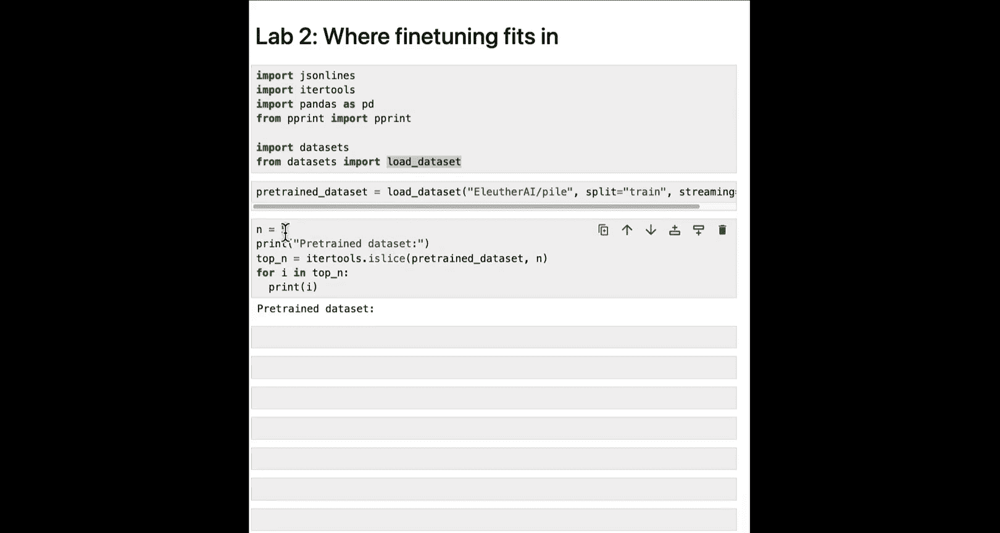

我想将其与你在不同实验课中将要使用的微调数据进行对比。我们抓取了一个公司的问答对数据集，从一个常见问题解答中抓取，并结合了内部工程文档。它叫做“Lamini文档”，是关于Lamini公司的。我们将读取那个JSON文件，看看里面有什么。

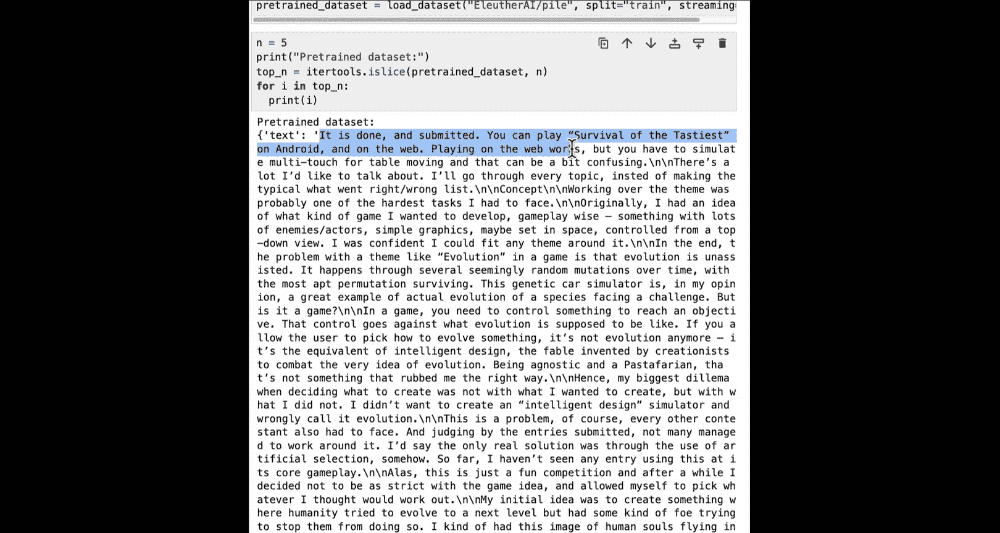

好的，这是结构化得多的数据。这里有问答对，并且非常具体地关于这家公司。使用这些数据最简单的方法实际上是**将这些问题和答案连接起来**，然后提供给模型。这就是我要在这里做的。我将把它变成一个字典，然后看看连接其中一个是什么样子。

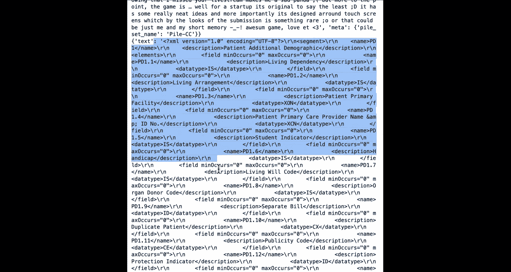

所以，你知道，只是将问题和答案直接连接起来。

当然，你可以以任何可能的方式准备你的数据。我只想指出几种格式化数据、构建结构的常见方法：问答对、指令-响应对、输入-输出对（这里只是泛称）。实际上，既然我们要连接它，你也可以像上面“the pile”数据集那样，只把它当作纯文本。

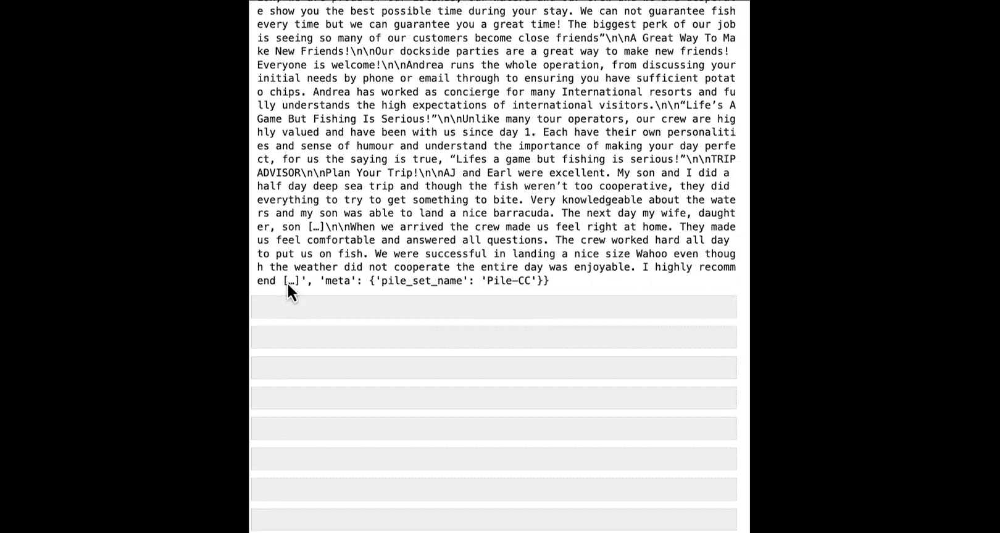

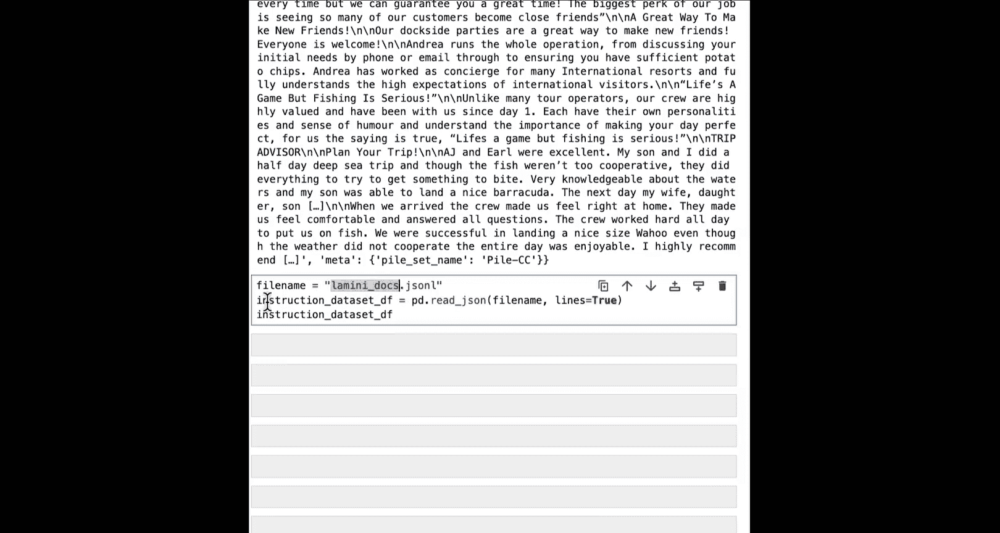

好的，所以连接起来，你知道这很简单，但有时这足以看到结果。有时则不然，所以你仍然会发现模型可能需要更多的结构来帮助它。这实际上与提示工程非常相似。

更进一步，你也可以在遵循指令的提示模板中处理你的数据，比如这个问答提示模板。这是一个常见的模板。注意，在问题类型标记之前有“###”符号，这样可以作为结构来告诉模型接下来期望什么。在看到“### Question:”之后，它期望一个问题。它也可以帮助你在模型微调后对输出进行后处理。我们这里有这个模板。让我们看看这个提示模板的实际效果，看看它与简单的连接问答有何不同。

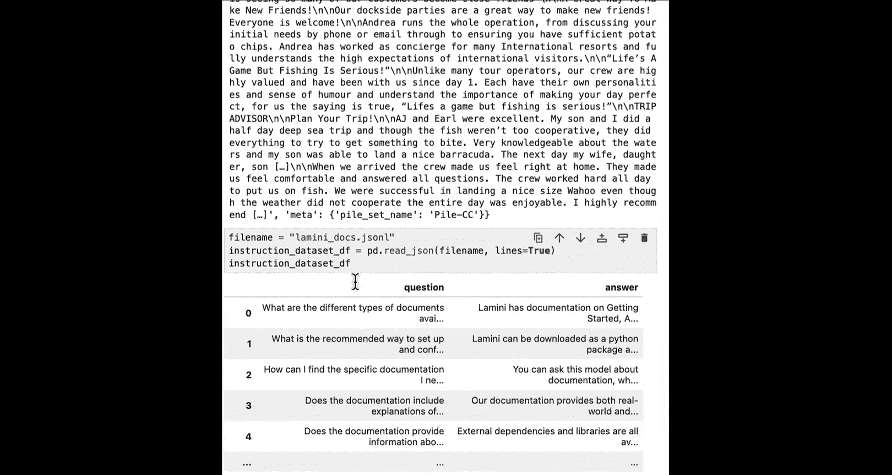

在这里你可以看到提示模板的样子，问题和答案整齐地放在那里。通常，将输入和输出分开是有帮助的。所以实际上，我将在这里去掉那个答案，将它们分开保存，因为这有助于我们轻松地使用数据进行评估，以及在将数据分割为训练集和测试集时。

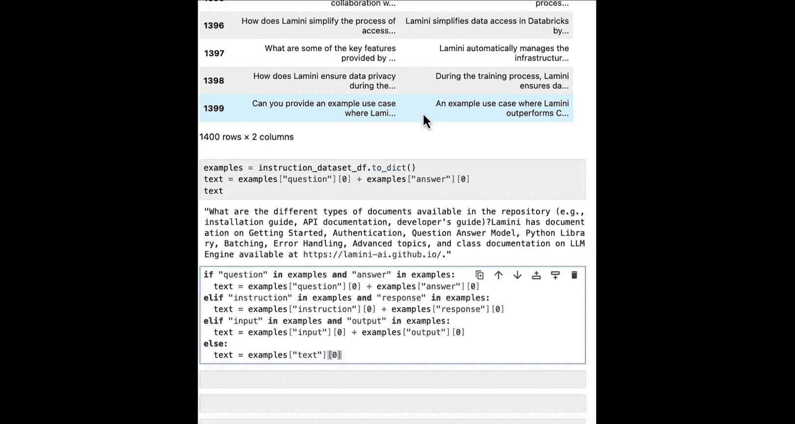

现在我要做的是将这个模板应用到整个数据集上。

所以只需运行一个for循环，并用f-string或Python的`.format`方法将问题和答案填充到这个模板中。

好的，让我们看看纯文本版本和问答版本之间的区别。

很酷，所以纯文本版本是所有内容都连接在一起，你输入的就是这个。而这里只是问答，结构更清晰。你可以使用任何一种。当然，我确实推荐将其结构化以帮助评估。

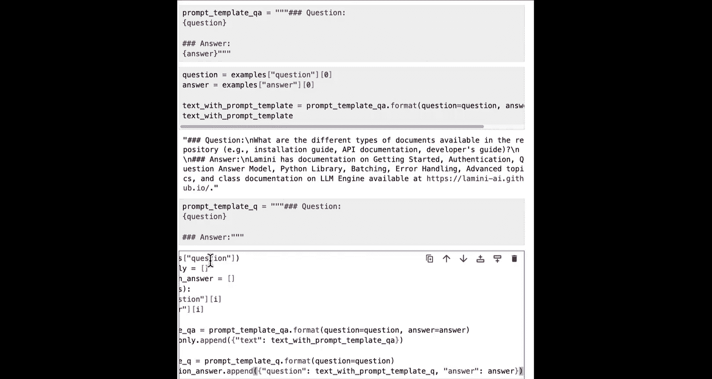

基本上就是这样。存储这些数据最常见的方式通常是**JSON Lines文件**（.jsonl文件）。基本上，每一行都是一个JSON对象，仅此而已。只需将其写入文件即可。你也可以将这些数据上传到Hugging Face，如图所示，因为你稍后也会使用它，并且可以从云端拉取。

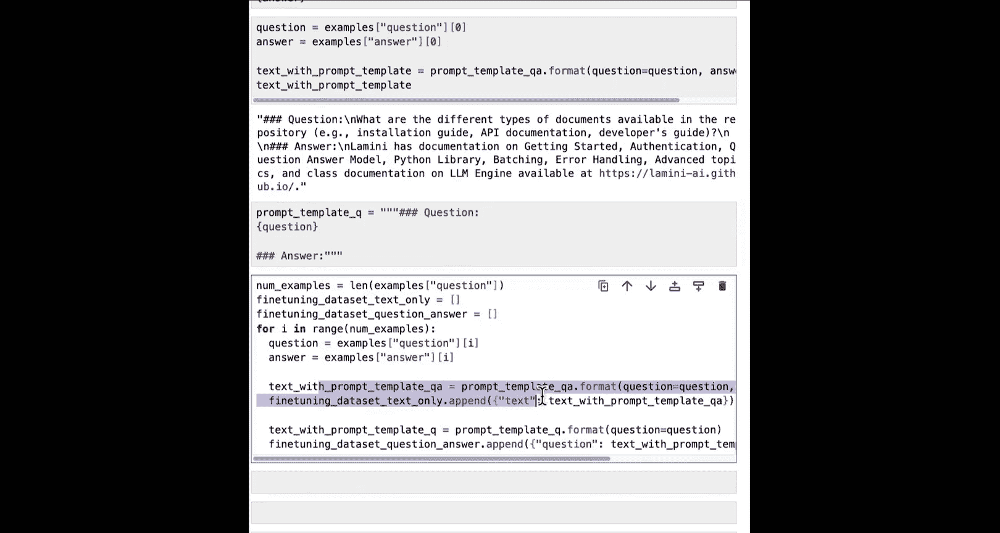

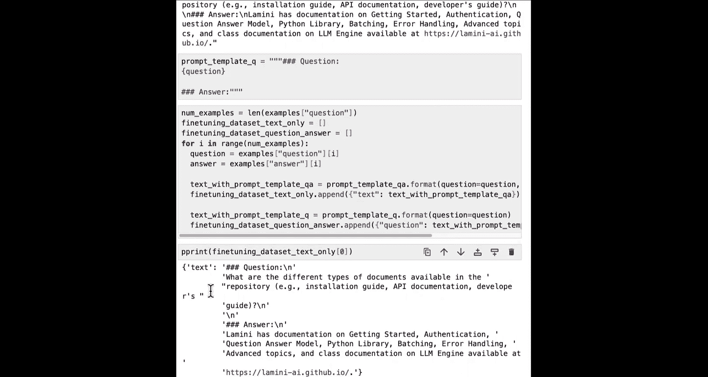

接下来，你将深入研究一种特定的微调变体，称为**指令微调**。

## 总结

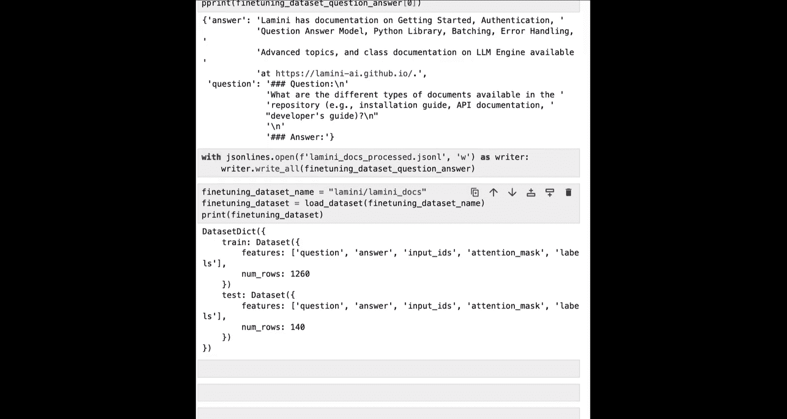

本节课中，我们一起学习了微调在大型语言模型训练流程中的位置。我们首先了解了预训练作为模型学习的起点，它通过海量无标签数据和下一个词元预测任务，赋予模型基础的语言能力和世界知识。接着，我们探讨了微调的作用，它是在预训练模型的基础上，使用更少但更结构化的数据来改变模型行为或注入新知识。我们区分了提取文本和扩展文本两类微调任务，并为初学者提供了从识别任务到获取数据、进行首次微调的步骤建议。最后，在实验环节，我们对比了预训练数据（如The Pile数据集）和微调数据（如结构化问答对）的不同，并学习了如何为微调准备和格式化数据。理解这些基础是有效应用微调的关键。