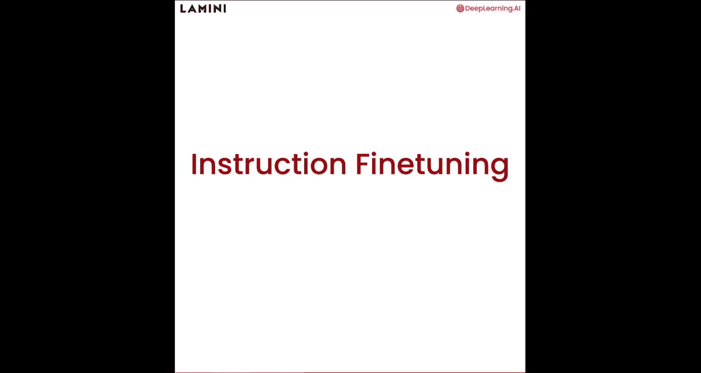
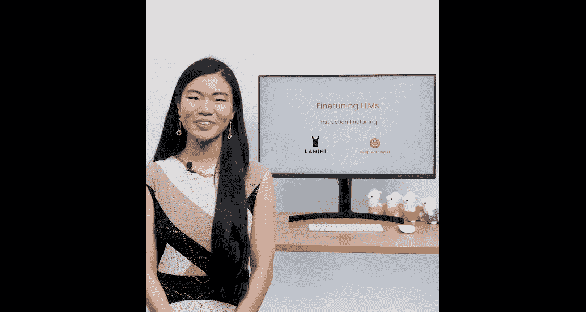
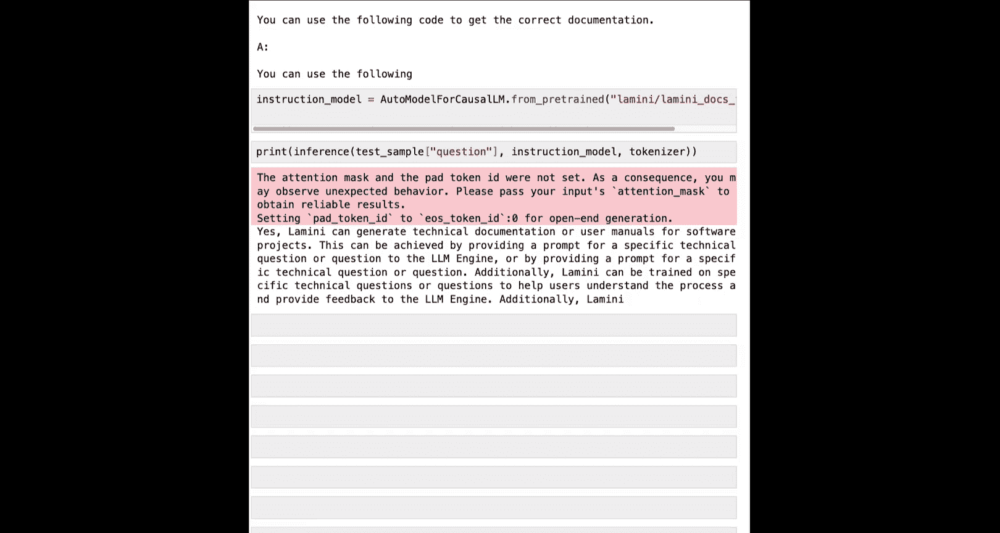
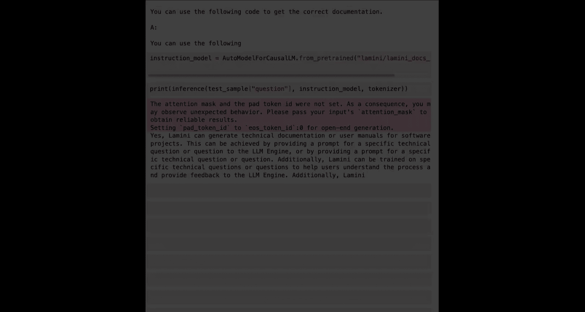

# 微调大型语言模型：P4：指令微调 🧠



在本节课中，我们将学习指令微调。这是一种特殊的微调方法，正是它让GPT-3转变为了ChatGPT，并赋予了其强大的对话能力。我们将了解其原理、数据准备过程，并通过实例对比微调前后的模型表现差异。



## 什么是指令微调？🔍

上一节我们介绍了基础微调的概念，本节中我们来看看指令微调。指令微调是微调的一种变体。除了指令微调，你还可以进行其他类型的微调，例如推理、路由、代码补全（Copilot）、对话以及智能体等。但指令微调（有时也被称为指令调优或指令遵循型LLM）专门用于教导模型遵循指令，使其行为更像一个聊天机器人。这是一种与模型交互的更好用户界面，正如我们在ChatGPT中所见。正是这种方法将GPT-3转变为了ChatGPT，从而极大地推动了AI的普及，使其从少数研究人员的使用工具变成了数百万人的日常助手。

## 指令微调的数据集 📊

对于指令遵循任务的数据集，你可以使用大量现成的数据，这些数据可能来自网络或你公司内部。例如：
*   常见问题解答
*   客户支持对话记录
*   Slack等即时通讯消息

本质上，这些是对话数据或指令-回复配对的数据集。当然，如果你没有现成的数据，也无需担心。你可以通过使用提示模板将你的数据转换成更接近问答或指令遵循的格式。例如，一份README文件可以被转换成一个问答对。你也可以使用另一个大型语言模型来帮你完成这个转换。斯坦福大学的Alpaca项目就使用了ChatGPT来生成数据。当然，你也可以使用一系列不同的开源模型流水线来完成这项工作。

## 指令微调的优势与步骤 🚀

我认为微调最酷的一点在于，它能教会模型新的行为。虽然你的微调数据可能包含诸如“法国的首都是什么？巴黎。”这样容易获取的问答对，但你也可以将这种问答的概念推广到模型在预训练阶段已经学习过、但你的微调数据中并未明确提供的数据领域，例如代码。这实际上是ChatGPT论文中的发现：模型现在可以回答关于代码的问题，尽管他们在指令微调时并没有提供相关的代码问答对。这是因为让程序员去标注大量关于代码的问题并编写答案数据集的成本非常高。

以下是微调不同步骤的概述：数据准备、训练和评估。当然，在评估模型之后，你需要再次准备数据以改进模型，这是一个非常迭代的过程，旨在不断提升模型性能。

具体到指令微调和其他不同类型的微调，**数据准备**阶段是主要差异所在。正是在这个阶段，你改变并定制数据，使其适应你正在进行的特定微调类型和任务。而**训练**和**评估**阶段则非常相似。

## 实践：探索Alpaca数据集与模型对比 🧪

现在，让我们进入实践环节，你将初步了解用于指令调优的Alpaca数据集，并再次对比经过指令微调和未经指令微调的模型，同时观察不同尺寸模型的表现。

首先导入一些必要的库，其中重要的是来自`datasets`库的`load_dataset`函数。

```python
from datasets import load_dataset
```

让我们加载这个指令微调数据集，这里指定使用Alpaca数据。同样，我们使用流式加载，因为虽然它不像“The Pile”数据集那么庞大，但依然是一个相当可观的微调数据集。

```python
dataset = load_dataset("tatsu-lab/alpaca", streaming=True)
```

加载完成后，和之前查看“The Pile”数据集一样，我们先看几个数据样本。

与“The Pile”数据集不同，这里的数据结构并非纯文本，而是更具结构性，但它也不像简单的问答对那样界限分明。Alpaca论文作者的一个非常酷的做法是，他们实际上使用了两种提示模板，因为他们希望模型能够处理两种不同类型的提示和任务。一种是指令跟随模板，其中包含额外的输入字段。例如，指令可能是“将两个数字相加”，而输入可能是“第一个数字是3，第二个数字是4”。另一种是无输入提示模板，正如你在这些示例中看到的，有时提供输入并不相关，因此模板中没有输入字段。这些就是正在使用的提示模板。

同样，与之前非常相似，你需要将这些提示模板填充完整。

```python
# 示例：填充一个带输入的提示模板
def format_instruction_with_input(example):
    instruction = example['instruction']
    input_text = example['input']
    # 使用论文中的模板格式
    formatted_text = f"Below is an instruction that describes a task, paired with an input that provides further context. Write a response that appropriately completes the request.\n\n### Instruction:\n{instruction}\n\n### Input:\n{input_text}\n\n### Response:"
    return {"formatted": formatted_text}

# 应用格式化函数（此处为示意，实际需遍历数据集）
formatted_example = format_instruction_with_input(next(iter(dataset['train'])))
print(formatted_example["formatted"])
```

在整个数据集上应用这些模板后，我们打印出一对输入输出来看看效果。

很好，这就是输入和输出。你可以看到它是如何被填充到提示中的：它以“Response:”结尾，然后输出这个回复。

和之前一样，你可以将其写入JSON Lines文件，也可以上传到Hugging Face Hub。我们实际上已经将其上传到了`Lamini/alpaca`，以便稳定访问，你可以去那里查看和使用它。

## 模型表现对比 🤖

既然你已经看到了指令遵循数据集的样子，接下来要做的就是再次提醒你，在不同模型上使用“告诉我如何训练我的狗坐下”这个提示词的效果。

第一个模型是未经指令微调的LLaMA 2模型。

```python
# 伪代码，示意运行未经微调的模型
response_base = base_llama2_model.generate("Tell me how to train my dog to sit.")
print(response_base)
```

它再次以句点开头，然后给出了一些不连贯的文本。请记住之前它也是这样的。

现在，我们将其与经过指令微调的模型进行对比。

```python
# 伪代码，示意运行经过指令微调的模型
response_tuned = instruction_tuned_model.generate("Tell me how to train my dog to sit.")
print(response_tuned)
```

好多了！它实际上给出了不同的步骤。

最后，我想再次展示一下ChatGPT的回复，以便你进行对比。

```python
# 示意，ChatGPT通常通过API调用
# response_chatgpt = chatgpt_api.generate("Tell me how to train my dog to sit.")
# print(response_chatgpt)
```

这是一个比LLaMA 2模型大得多的模型集。ChatGPT据传约有700亿参数，而LLaMA 2模型是70亿参数模型，属于非常大的模型。你也将探索一些更小的模型，例如一个7000万参数的模型。

这里我加载了两个不同的模型组件来处理数据和运行模型。你可以看到这里的标签是`Luther AI/Pythia-70m`，这是一个未经指令微调的7000万参数模型。

我将粘贴一些代码作为一个函数，用于运行推理或基本上在文本上运行模型。在接下来的几个实验中，我们将详细讲解这个函数中不同部分的具体作用。

```python
def run_inference(model, tokenizer, prompt):
    inputs = tokenizer(prompt, return_tensors="pt")
    outputs = model.generate(**inputs, max_new_tokens=50)
    response = tokenizer.decode(outputs[0], skip_special_tokens=True)
    return response

# 使用未经微调的模型
prompt = "Can Lamini generate technical documentation or user manuals for software projects?"
response_untuned = run_inference(untuned_model, untuned_tokenizer, prompt)
print("未经微调模型的回答:", response_untuned)
```

这个模型没有经过微调，它不了解任何关于特定公司的信息。但我们可以再次加载之前的公司数据。

我们将给这个模型一个来自该数据的问题，例如测试集中的第一个样本。然后我们在这里运行它。

问题是：“Lamini能生成软件项目的技术文档或用户手册吗？”实际答案是：“是的，Lamini可以生成软件项目的技术文档和用户手册……”并继续说明。但模型的回答是：“我有一个关于以下内容的问题：如何让正确的文档工作？A：我认为U需要使用以下代码等等。”所以它显然偏离了主题。当然，它学会了英语，并且把“documentation”这个词放进去了，所以它可能理解我们处于一个问答场景，因为它有一个“A”表示答案，但显然偏差很大。因此，它不太理解这些数据中的知识，也不理解我们期望它遵循的格式，它不明白自己应该回答这个问题。

现在，将其与我们为你微调好的一个模型进行对比，实际上你即将为指令遵循任务微调这个模型。

```python
# 使用经过指令微调的模型回答同一个问题
response_tuned = run_inference(tuned_model, tuned_tokenizer, prompt)
print("经过指令微调模型的回答:", response_tuned)
```

它回答：“是的，Lamini可以生成软件项目的技术文档或用户手册……”等等。这比之前的模型准确得多，并且遵循了我们期望的正确行为。

## 总结 📝





本节课中，我们一起学习了指令微调。我们了解到指令微调是一种教导大型语言模型遵循人类指令、使其行为更像对话助手的关键技术。我们探讨了其所需的数据集形式，包括如何利用现有数据或通过模板和LLM转换数据。通过对比未经微调、经过指令微调以及ChatGPT等不同规模和状态的模型，我们直观地看到了指令微调在改善模型回答相关性、格式和有用性方面的显著效果。接下来，我们将深入探讨如何为训练准备数据，特别是分词器的使用。