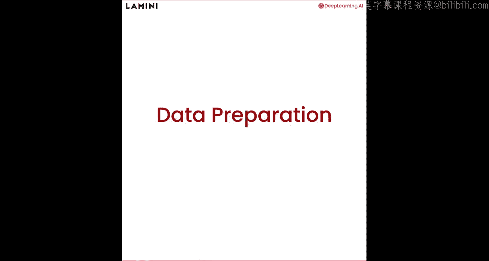
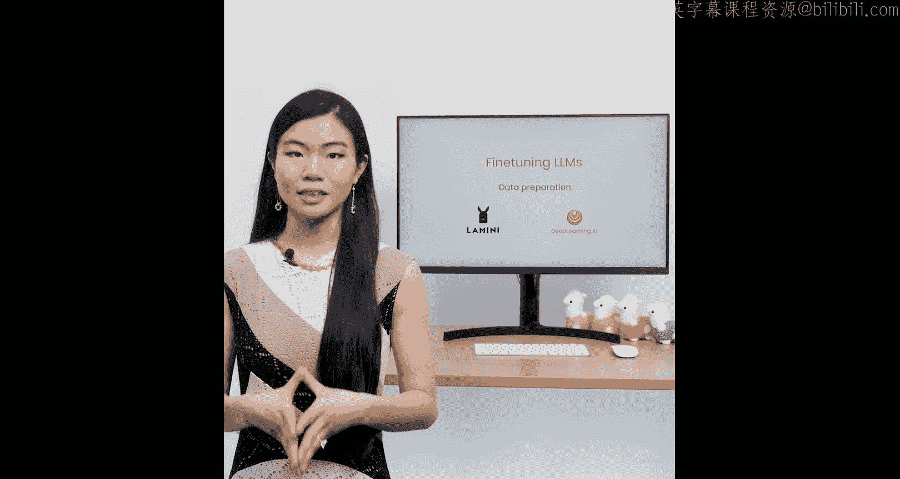
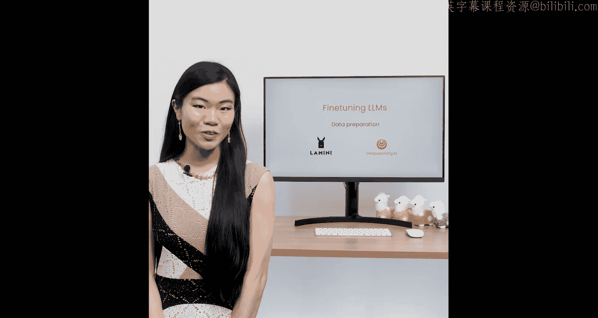
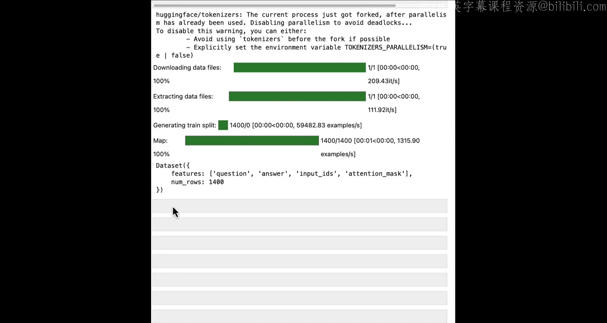
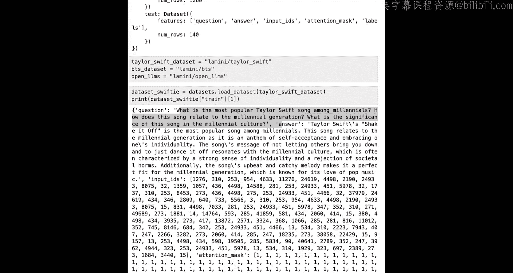

# 微调大型语言模型：P5：数据准备 🛠️







在本节课中，我们将学习如何为微调训练准备数据。上一节我们探讨了将要使用的数据，本节中我们来看看如何将这些数据处理成适合模型训练的格式。

## 概述

数据准备是微调过程中的关键步骤。高质量、格式正确的数据能显著提升模型性能。本节将介绍数据准备的最佳实践、具体步骤，并通过代码示例展示如何实现。

## 数据准备的最佳实践

以下是准备微调数据时需遵循的几条最佳实践。

*   **质量优先**：高质量数据是微调成功的最重要因素。如果输入低质量数据，模型会模仿并输出低质量内容。
*   **保持多样性**：数据应涵盖使用场景的各个方面。如果所有输入输出都相同，模型可能只会机械记忆，而无法泛化到新情况。
*   **真实数据优于生成数据**：虽然可以用大语言模型生成数据，但真实数据通常更有效。生成数据往往带有固定模式，过多使用可能限制模型学习新表达方式的能力。
*   **数据量**：在机器学习中，更多数据通常有益。但由于预训练模型已从海量数据中学习，微调时数据量不如数据质量、多样性和真实性重要。

## 数据准备步骤

以下是准备数据的标准流程。

1.  **收集数据**：收集指令-响应对，例如问答对。
2.  **拼接数据**：将指令和响应拼接起来，并添加合适的提示模板。
3.  **分词**：将文本数据转换为模型能理解的数字序列（令牌）。
4.  **划分数据集**：将数据分割为训练集和测试集。

## 理解分词

分词是将文本转换为数字令牌的过程。令牌不一定是完整单词，而是基于常见字符组合的频率划分。

例如，后缀“ing”在英语中非常普遍，因此许多分词器会将其视为一个独立令牌。在代码中，一个文本句子会被转换为一串数字，这些数字可以被解码回原始文本。

每个模型都有其对应的分词器。使用错误的分词器会导致模型混淆，因此必须确保匹配。

## 代码实践：使用分词器

现在，让我们通过代码具体了解如何操作。我们将使用Hugging Face的`Transformers`库。

首先导入必要的库，其中最重要的是`AutoTokenizer`，它能根据模型名称自动加载正确的分词器。

```python
from transformers import AutoTokenizer

model_name = "your_model_name_here"  # 例如一个7000万参数的Pythia模型
tokenizer = AutoTokenizer.from_pretrained(model_name)
```

接下来，对一段简单文本进行分词和反分词，以验证过程。

```python
text = "Hi, how are you?"
encoded_text = tokenizer(text)
print("Encoded tokens (input_ids):", encoded_text['input_ids'])

decoded_text = tokenizer.decode(encoded_text['input_ids'])
print("Decoded text:", decoded_text)  # 应输出 "Hi, how are you?"
```

## 处理批量与长度不一致问题

在实际训练中，我们通常批量处理数据。但批次内的文本长度可能不同，而模型需要固定长度的输入。以下是两种处理策略。

*   **填充**：在较短的序列末尾添加特殊令牌（如0），使其与批次内最长序列等长。
*   **截断**：当序列超过模型最大长度限制时，截断多余部分。

以下是同时使用填充和截断的示例。

```python
texts = ["Hi, how are you?", "I'm good.", "Yes"]
# 设置最大长度，并启用填充与截断
encoded_batch = tokenizer(texts, padding=True, truncation=True, max_length=5, return_tensors="pt")
print(encoded_batch['input_ids'])
```

**注意**：截断方向（左侧或右侧）可能影响任务效果，需根据具体场景选择。重要信息应避免被截断。

## 应用于真实数据集

以下是将上述步骤应用于一个真实数据集的完整函数。假设我们有一个包含问题和答案的数据集。

首先，加载数据集并查看一个样本。

```python
# 假设 dataset 是一个包含 ‘question‘ 和 ‘answer‘ 字段的数据集
sample = dataset[0]
print("Question:", sample['question'])
print("Answer:", sample['answer'])
```

接着，定义一个分词处理函数，并将其映射到整个数据集。

```python
def tokenize_function(examples):
    # 将问题与答案拼接
    combined_text = [q + " " + a for q, a in zip(examples['question'], examples['answer'])]
    # 应用分词器，启用填充和截断
    tokenized = tokenizer(combined_text, padding=True, truncation=True, max_length=512)
    return tokenized

# 使用map函数应用分词处理
tokenized_dataset = dataset.map(tokenize_function, batched=True, batch_size=1)
```

最后，将数据集划分为训练集和测试集。

```python
# 首先，为Hugging Face训练器添加标签列（通常与输入ID相同）
tokenized_dataset = tokenized_dataset.add_column("labels", tokenized_dataset["input_ids"])

# 执行划分
split_dataset = tokenized_dataset.train_test_split(test_size=0.1, shuffle=True)
train_dataset = split_dataset["train"]
test_dataset = split_dataset["test"]



print(f"Training samples: {len(train_dataset)}")
print(f"Testing samples: {len(test_dataset)}")
```

## 更多数据集示例

除了商业数据集，你也可以使用更有趣的主题数据进行微调练习，例如：
*   关于泰勒·斯威夫特的数据集
*   关于流行乐队BTS的数据集
*   关于开源大语言模型的数据集

这些数据集均可在Hugging Face上获取，你可以自由定制并用它们来训练你的模型。

## 总结



本节课中我们一起学习了为微调大语言模型准备数据的关键步骤。我们明确了高质量、多样化的真实数据的重要性，逐步讲解了从收集、拼接、分词到数据集划分的全过程，并通过代码演示了如何使用`AutoTokenizer`进行分词、填充和截断操作。现在，数据已经准备就绪，在接下来的实验中，我们将使用这些数据来训练模型。