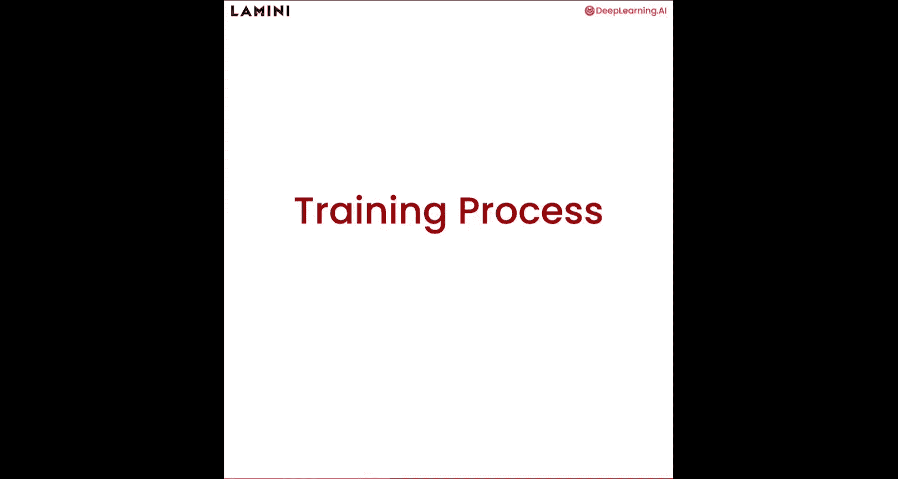
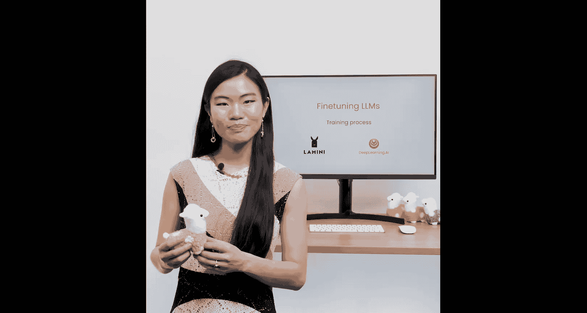
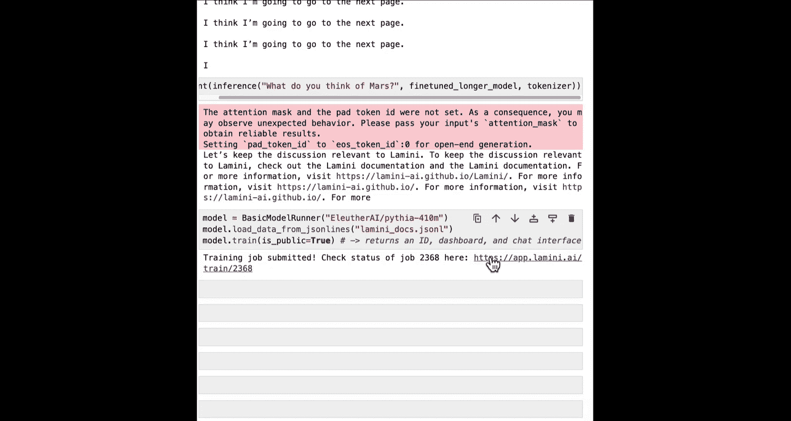
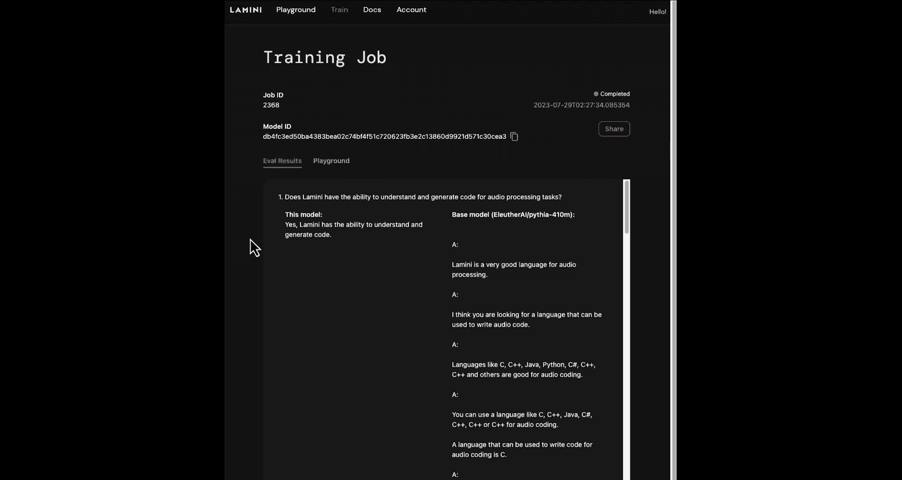
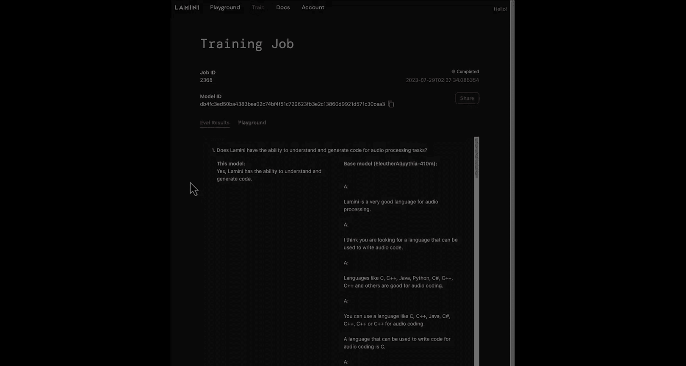

# 微调大型语言模型：P6：SC-Fine_Tuning_C1_L5

在本节课中，我们将逐步了解整个训练过程，并最终看到模型在特定任务上的改进，特别是使其能够与我们进行对话。

## 概述：训练过程总览

我们将开始深入探讨。训练大型语言模型的过程与其他神经网络非常相似。你可以看到，我们使用相同的设置：LLM预测“SD!!”。首先，我们在顶部添加训练数据，然后计算损失。模型在开始时预测的结果可能完全错误，我们将预测结果与它本应给出的实际响应进行比较，计算损失。接着，我们更新权重，通过模型进行反向传播来更新模型，以改进它，最终使其学会输出类似“a pawn”的内容。

训练LLM涉及许多不同的超参数。我们不会逐一详细介绍，但你可以尝试调整其中几个，例如**学习率**、**学习率调度器**以及各种**优化器超参数**。

## 深入代码：训练流程

现在，让我们更深入地看看代码。以下是PyTorch中训练过程代码的一般结构块。

首先，你需要设置训练的**轮数**。一个轮次意味着遍历整个数据集一次，你可能会多次遍历整个数据集。

接着，你需要以**批次**的形式加载数据。这就是你在对数据进行分词时看到的不同批次，即一组数据。

然后，你将批次数据输入模型以获得输出，计算模型的损失，执行反向传播步骤，并更新优化器。

既然我们已经了解了PyTorch中这个底层代码的每一步，接下来我们将提升一个层次，看看Hugging Face，以及由Lamini提供的Lamini库，了解训练过程在实际实验中的运作方式。

## 使用高级库简化训练

首先，我们看到随着时间的推移，训练过程通过越来越高级的接口得到了极大的简化。你刚才看到的PyTorch代码，我记得在我读博士期间运行过。现在有很多优秀的库让这一切变得非常简单。其中之一就是**Lamini库**，它只需三行代码就能训练你的模型。该模型托管在外部GPU上，可以运行任何开源模型，并且你可以取回模型。正如你在这里看到的，它只是请求那个4.1亿参数的模型，你可以从同一个JSON Lines文件加载数据，然后只需调用 `model.train()`。

这将返回一个仪表板、一个交互界面以及一个模型ID，你可以随后调用该ID以继续训练或进行推理。

## 实验设置：选择模型

在接下来的实验中，我们将专注于使用**Pythia 7000万参数模型**。你可能想知道为什么我们一直在使用这个非常小的模型。原因是它可以在本实验的CPU上良好运行，这样你就能实际看到整个训练过程。

但实际应用中，我建议从稍大的模型开始，例如大约10亿参数的模型，或者如果你的任务比较简单，甚至可以使用这个4亿参数的模型。

首先，我将加载所有这些库，其中一个是一个包含许多不同函数的实用程序文件，其中一些我们已经一起编写过（关于分词器），其他的你可以查看，主要用于日志记录和显示输出。

## 配置训练参数

首先，我们从不同的训练配置参数开始。实际上有两种导入数据的方式，你已经见过这两种方式。一种是不一定使用Hugging Face，你只需指定一个特定的数据路径；另一种是指定一个Hugging Face路径。在这里，我使用一个布尔值 `use_huggingface` 来指定是否为真。我们在这里为你提供了两种方式，以便你轻松使用。

我们将使用这个较小的模型，以便它在CPU上运行。这只是一个7000万参数的模型。

最后，我将把所有配置放入一个**训练配置**中，然后传递给模型，以便模型了解模型名称和数据是什么。

## 加载分词器和数据

下一步是分词器，你在上一个实验中已经做过，但这里再次加载那个分词器，然后分割你的数据。

这里只是训练集和测试集，这是从Hugging Face加载的。

接下来，加载模型。你已经在上面指定了模型名称，所以这是7000万参数的Pythia模型。我将其指定为尚未训练的**基础模型**。

如果你使用GPU，这是一段重要的PyTorch代码，它能够计算CUDA设备的数量（基本上就是你有多少GPU）。根据这个数量，如果你有超过零个GPU，意味着你有一个GPU，因此你可以将模型放在GPU上；否则，它将使用CPU。在本例中，我们将使用CPU，你可以看到选择了CPU设备。

只需执行 `model.to(device)` 就可以将模型放到那个GPU或CPU上，非常简单。现在，这正在打印出模型的样子，并将其放在那个设备上。

## 推理函数详解

结合上一个实验的步骤，并加入一些新步骤，就是推理。你之前已经见过这个函数，但现在我们将逐步了解具体发生了什么。

首先，你对输入的文本进行分词，同时传入你的模型。然后，需要将分词后的令牌放到与模型相同的设备上。例如，如果模型在GPU上，你需要将令牌也放到GPU上，这样模型才能看到它们。

接下来，这里有一些重要的参数：`max_input_tokens` 和 `max_output_tokens`，用于指定实际可以输入模型的令牌数量，以及你期望输出的令牌数量。我们在这里默认设置为100，但你可以随意调整，使其更长以生成更多内容。注意，生成更多内容需要时间，因此生成时间会有所不同。

然后，模型会生成一些输出令牌，你所要做的就是像之前看到的那样，用分词器对其进行解码。解码后，你需要最初剥离掉提示部分，因为它输出了提示和你生成的输出，所以我只返回生成的文本答案。

这个函数你会经常使用。首先，查看第一个测试集问题，并将其输入模型。请不要太苛刻，我知道你之前已经见过类似的情况。模型再次以你之前见过的奇怪方式回答，它并没有真正回答问题，而正确答案在这里。

## 训练参数设置

这就是训练的目的。接下来，你将查看训练参数。有很多不同的参数，首先关注几个关键点。

第一个是模型可以运行的**最大步数**，这只是最大训练步数。我们将其设置为3，只是为了非常简单地进行三步演示。**步**到底是什么？一步就是一批训练数据。如果你的批次大小为1，就是1个数据点；如果批次大小为2000，就是2000个数据点。

下一个是**训练后的模型名称**，你想怎么称呼它。这里我称之为数据名称加上最大步数，这样如果我们想尝试不同的最大步数，可以区分开来。我认为的最佳实践（这里不一定展示）还包括在训练模型上加上时间戳，因为你可能会尝试很多不同的模型。

现在，我将向你展示一个包含许多不同训练参数的大列表，这里有很多好的默认值。我认为需要关注的是 `max_steps`，这可能会阻止模型运行超过你在上面指定的三步，还有**学习率**。

这里有很多不同的参数，如果你好奇，我建议你深入研究，并尝试调整其中很多参数。但在这里，我们主要为你设置了这些良好的默认值。

## 模型内存与计算量

接下来，我们包含了一个计算模型浮点运算次数的函数，即**FLOPS**，用于了解这个基础模型的内存占用。这里只是将其打印出来，供你了解情况，我们会在整个训练过程中打印这些信息。

我知道我们说过这是一个非常小的模型，但即使在这里，看看这个模型有多大，有300兆字节。因此，你可以想象一个非常大的模型会占用大量内存，这就是为什么我们需要高性能、大内存的GPU来运行那些更大的模型。

## 启动训练

接下来，你将这个加载到**Trainer类**中，这是我们围绕Hugging Face的主要Trainer类包装的一个类，基本上做同样的事情，只是在训练时为你打印信息。如你所见，你放入几样东西：主要的东西是基础模型、最大步数、训练参数，当然还有你想要放入的数据集。

你一直在等待的时刻到了，就是训练模型。你只需执行 `trainer.train()`。

让我们看看它的运行情况。如你所见，日志中打印了很多不同的信息，主要是**损失**。如果你运行更多步，即使只是10步，你也会看到损失开始下降。

## 保存与加载微调后的模型

现在你已经训练了这个模型，让我们将其本地保存。你可以有一个保存目录，也许指定输出目录和最终的检查点。然后，你只需执行 `trainer.save_model()`。

让我们看看它是否保存成功。太棒了，干得好。现在你已经保存了这个模型，你可以通过 `AutoModelForCausalLM.from_pretrained` 并指定保存目录来加载它，只需设置 `local_files_only=True`，这样它就不会从云端的Hugging Face Hub拉取。我们称这个为**略微微调的模型**。

然后，我将把它放到正确的设备上。同样，这只有在你有GPU时才重要，但这里为了保险起见，即使在CPU上也这样做。

然后让我们运行它，看看它的表现如何。再次在测试集或测试数据点上运行，然后再次运行推理函数。这是你之前运行过的同一个推理函数。

那么，它是否有所改善？并没有。它应该有所改善吗？实际上并没有，因为它只经过了几步训练。那么它本应是什么样子？让我们看看那个确切的答案。它说：“是的，Lamini可以生成技术文档用户手册。”这与正确答案相去甚远，实际上仍然与基础模型非常相似。

## 更长时间训练的效果

但如果你有耐心，它会是什么样子呢？我们还对一个模型进行了更长时间的微调。这个模型只训练了3步，实际上在这个案例中，只使用了训练数据1260个数据点中的3个。相反，我们实际上对整个数据集进行了两次微调，得到了这个“Lamini文档微调模型”，我们已经将其上传到Hugging Face，你现在可以下载并使用。如果你在自己的电脑上尝试，可能需要半小时或一小时，具体取决于你的处理器。当然，如果你有GPU，可能只需要几分钟。

让我们运行这个模型。这是一个好得多的答案，与实际的目标答案相当。但如你所见，在最后，它仍然开始重复自己，例如“在Lamini中...”。它并不完美，但这是一个小得多的模型，你也可以训练它更长时间。

## 更大模型的表现

现在，为了让你了解更大模型可能的表现，这个模型训练得可能不那么健壮且重复较少，这是一个更大的28亿参数微调模型的表现。这是使用与之前相同的基本模型运行器运行Lamini库的结果。在这里你可以看到：“是的，Lamini可以生成技术文档或用户手册。”

## 数据中的审核机制

这个数据集中另一个有趣的地方，你也可以为自己的数据集做类似的事情，那就是进行所谓的**审核**，鼓励模型不要偏离主题太远。如果你仔细观察其数据中的示例（我们即将这样做），你会看到有些示例写着：“让我们保持讨论与Lamini相关。”

我将在这里循环遍历数据，找到所有这样说的数据点，以便你自己查看。这就是你如何准备自己的数据。提醒一下，这与ChatGPT非常相似。抱歉，我是AI，我无法回答这个问题。所以他们在这里使用了非常相似的东西。你可以看到诸如“我们冷的时候为什么会发抖？”这样的问题，它回答说：“让我们保持讨论与Lamini相关。”

这里有很多这样的例子，实际上有37个，我们打印了计数。

因此，如果你带回那个完全没有经过微调的Pythia 7000万基础模型，问它：“你对火星有什么看法？”它会给出一个有点有趣的回答，比如“我想我要去下一页了”。但如果你使用这个经过更长时间微调、并且使用这个数据集训练以帮助其更具审核性的模型，那么让我们看看它会说什么。它说：“让我们保持讨论与Lamini相关。”所以它被教导以这种方式行事，并被教导将审核作为其一部分。

除了审核，这个模型实际上还被训练为使对话中的人更专注于主题，例如引导他们查看文档，指出其中没有关于火星的内容。

## 使用托管GPU进行训练

你看到的所有这些看起来都很棒。很酷的一点是，你实际上可以在托管的GPU上训练这个模型，即托管在外部。而且只需要几行代码。在这个案例中，它是免费的。这是Pythia 7000万模型，你可以在免费层级上训练更大的模型，最多到4.1亿参数。你可以加载与之前相同的数据，然后只需调用 `model.train()`。我们将指定这个模型可以是公开的。然后你只需点击运行。

现在有一个训练任务已提交，你可以通过此链接检查任务状态。你也可以注册Lamini，以获取自己的API密钥，更私密地运行自己的模型并检查所有训练任务的状态。

## 评估训练结果

以下是训练这个模型的评估结果。首先，你可以看到这里提出了很多不同的问题。右侧的基础模型在这里完全偏离，但左侧是这个微调后的模型。例如，“Lamini是否有能力理解和生成音频处理任务的代码？”这个微调后的模型能够很好地回答这个问题，实际上它能够很好地回答很多这些问题。

而右侧是这个4亿参数的基础模型，它只是在产生无意义的输出。这里还有很多其他内容，你可以看到模型ID。这个模型ID就是你将通过基本模型运行器使用的东西，这样你就可以轻松地在这个模型上运行推理，就像你只是输入Llama 2名称或这个Pythia 4.1亿名称一样。

最后，你可以与他人分享这个模型。有你可以使用的交互界面，以及关于你账户的文档，你可以在那里获取自己的API密钥。

## 总结

现在你已经看到了训练给这些模型带来的巨大改进，我们将继续前进，对它们进行评估。

在本节课中，我们一起学习了大型语言模型的完整训练流程。我们从训练的基本原理和代码结构开始，逐步深入到使用高级库（如Lamini）简化训练过程。我们探讨了如何配置训练参数、加载和处理数据、执行训练循环，并保存和加载微调后的模型。通过对比基础模型与经过不同程度微调的模型，我们直观地看到了训练对模型性能的提升。此外，我们还介绍了如何在数据中加入审核机制以引导模型行为，以及利用托管GPU资源进行高效训练。最后，我们预览了模型评估的重要性，为下一阶段的学习做好了准备。