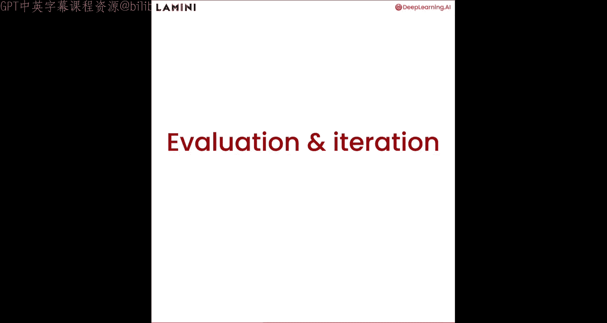
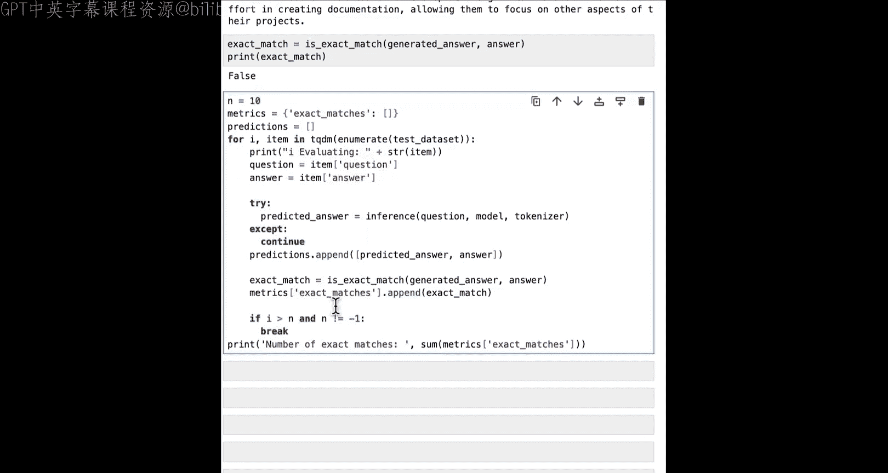
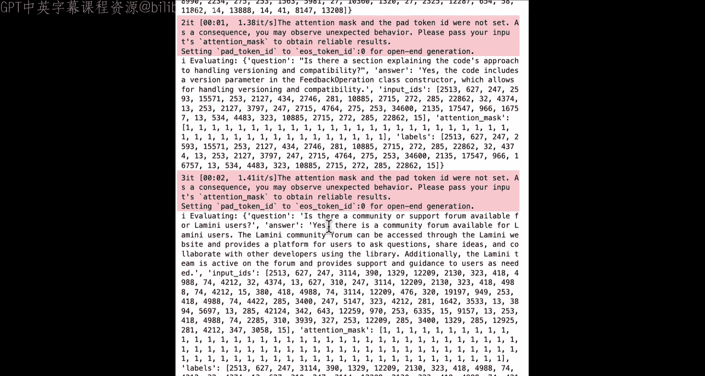
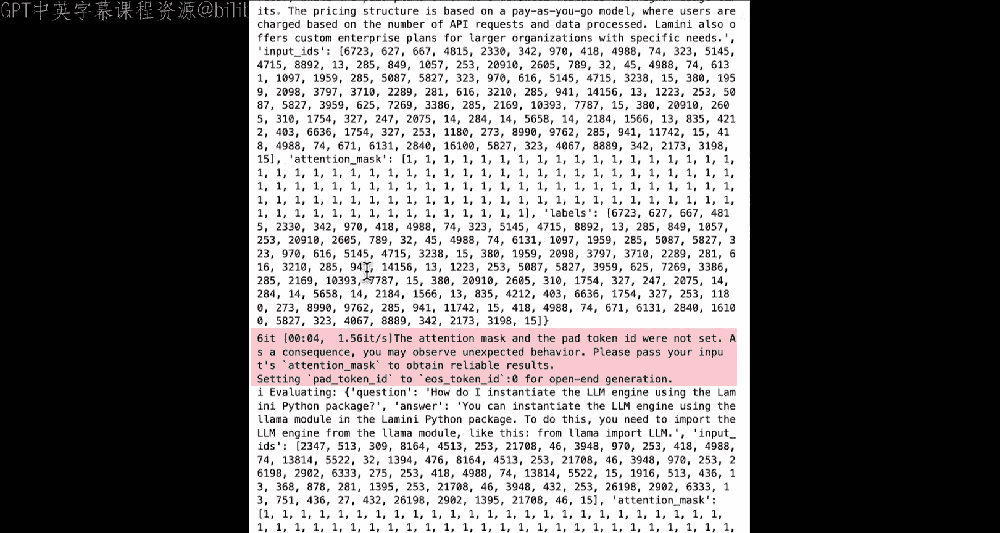
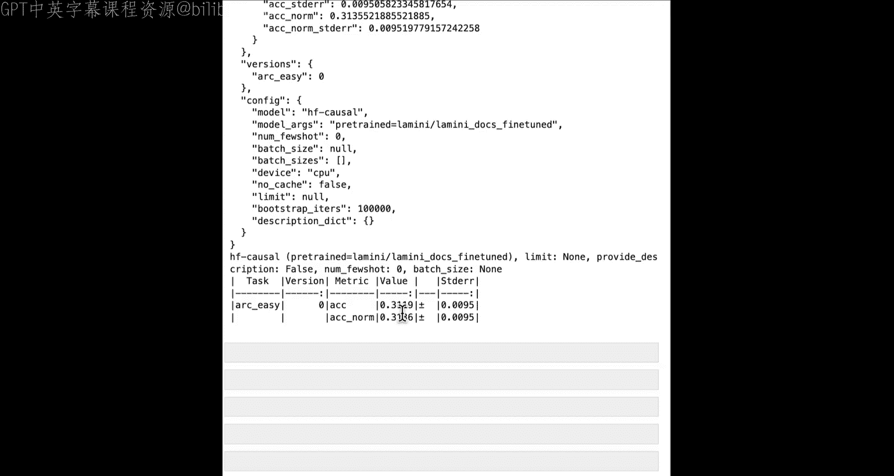

# 微调大型语言模型：P7：模型评估与基准测试 📊




在本节课中，我们将学习如何评估微调后的语言模型。模型评估是AI开发中迭代改进的关键步骤，它能帮助我们了解模型的性能，并指导后续的优化方向。

## 概述

上一节我们完成了模型的训练，本节中我们来看看如何评估模型的性能。评估生成式模型是一项公认的挑战，因为缺乏明确的指标，且模型性能提升迅速，指标往往难以跟上。因此，我们将探讨几种主要的评估方法。

## 评估方法

以下是几种常见的模型评估方法：

1.  **人工评估**：这是目前最可靠的方法。由理解特定领域的专家来评估模型的输出质量。这种方法需要一个高质量、准确且全面的测试数据集，并且该数据集不能出现在训练数据中，以确保评估的有效性。

2.  **Elo比较法**：这是一种新兴的流行方法，类似于多模型间的A/B测试或锦标赛排名。Elo排名系统最初用于国际象棋，现在被用来比较不同模型的相对性能。

3.  **综合基准测试套件**：一个常见的开源LLM基准测试是整合了多种评估方法的套件。例如，由Luther AI开发的评估套件就包含了多个基准：
    *   **ARC**：一套小学水平的问题集。
    *   **HellaSwag**：常识推理测试。
    *   **MMLU**：涵盖多种小学科目。
    *   **TruthfulQA**：衡量模型复现网络上常见错误信息的能力。

这些基准被整合在一起，通过平均得分来对模型进行排名。需要注意的是，这些排名会随时间变化，且不一定完全反映模型在特定任务上的表现。

## 错误分析框架

另一种分析和评估模型的方法是错误分析。其核心是将错误分类，以便理解哪些类型的错误最常见、最严重，并优先解决它们。

对于微调任务，由于我们已经有一个预训练好的基础模型，因此甚至可以在微调之前就进行错误分析。这有助于我们了解基础模型的表现特点，从而知道哪些类型的数据能通过微调带来最大的性能提升。

以下是几种常见的错误类别：

*   **拼写错误**：模型输出中存在拼写错误。例如，将“liver”（肝脏）拼写为“lever”（杠杆）。在数据集中修正此类错误非常重要。
*   **冗长**：生成式模型（如ChatGPT）通常输出非常冗长。确保训练数据集中的回答简洁明了，可以帮助模型学会更精炼地回答问题。
*   **重复**：模型倾向于生成重复内容。解决方法包括使用停止标记、设计提示模板，以及确保数据集中包含多样化和非重复的示例。

## 实践：运行评估

现在，我们进入一个实践环节，您将在一个测试数据集上运行模型，并尝试几种不同的评估指标，同时手动检查结果。

首先，加载我们一直在使用的测试数据，并查看一个数据点的示例。

```python
# 打印一个问答对示例
print(question, answer)
```

接下来，加载我们微调好的模型。我们将从Hugging Face拉取模型。

```python
# 从Hugging Face加载微调后的模型
model = load_finetuned_model_from_hf()
```

为了对生成任务有一个基本的概念，我们加载一个非常简单的评估指标：检查两个字符串是否完全匹配（可能会忽略一些空格）。这对于写作类任务来说非常困难，因为存在多种可能的正确答案。对于信息提取或接近分类的任务，这种方法可能更有意义。

在评估模式下运行模型时，重要的一点是设置 `model.eval()` 以确保禁用如Dropout之类的训练机制。

然后，像之前的实验一样，我们可以运行推理函数来生成输出。

```python
# 设置模型为评估模式
model.eval()
# 生成对测试问题的回答
generated_answer = inference_function(model, test_question)
```

将生成的答案与标准答案进行比较，它们可能相似但并非完全一致，因此完全匹配的得分可能不理想。







这并不意味着没有其他评估方法。例如：
*   将输出交给另一个LLM，让它来评分。
*   使用嵌入模型，分别计算标准答案和生成答案的嵌入向量，然后比较它们的距离。

现在，为了在整个数据集上运行评估，我们可以使用以下方式高效地在GPU上进行批量处理。不过，在当前实验环境中，我们主要在CPU上运行，因此可以先在少量测试数据点上运行。

```python
# 在部分数据上运行评估
num_exact_matches = 0
for i in range(10):
    pred_answer = inference_function(model, test_questions[i])
    # 比较并统计完全匹配数
    if is_exact_match(pred_answer, test_answers[i]):
        num_exact_matches += 1
```

完全匹配的数量可能为零，这对于生成式任务来说并不奇怪。最终，实践证明，在一个精心策划的测试集上进行人工检查，其效果远胜于简单的自动指标。

## 运行学术基准测试

最后，您还将看到如何运行ARC基准测试。如果您对学术基准感兴趣，这是探索LLM基准测试套件中的一个。

ARC基准测试是Luther AI整合的四个基准之一，其数据来源于学术论文，包含一系列可能与您的任务无关的科学问题。这些评估指标非常适用于学术背景或理解模型的通用能力。

但需要强调的是，不应过分纠结于模型在这些基准上的得分。因为它们可能与您的具体用例不相关，无法反映您的公司或最终用户关心的核心问题。微调模型可以针对无数不同的任务进行定制，而这些任务需要完全不同的评估方式。

例如，在我们的实验中，微调模型在公司相关的问答数据上表现提升显著，但在ARC（小学科学问题）基准上的得分（0.31）可能反而低于基础模型的论文得分（0.36）。这是因为模型被专门优化到了特定领域，而非通用科学知识。

因此，ARC这类基准测试主要适用于比较通用模型，或者为您选择基础模型提供参考，但对于您实际的微调任务评估，除非您微调的目标就是回答小学科学问题，否则它的用处不大。

## 总结



本节课中我们一起学习了评估微调后语言模型的方法。我们了解到，由于生成式任务的复杂性，人工评估结合高质量测试集是目前最可靠的方法。同时，我们介绍了错误分析框架，它可以帮助我们系统性地识别和优先处理模型错误。最后，我们实践了运行自动评估指标和学术基准测试（如ARC），并认识到这些通用基准的得分需要谨慎看待，它们可能无法准确反映模型在特定业务场景下的真实性能。在下一节也是最后一课中，您将学习一些微调的实用技巧，并预览更高级的方法。