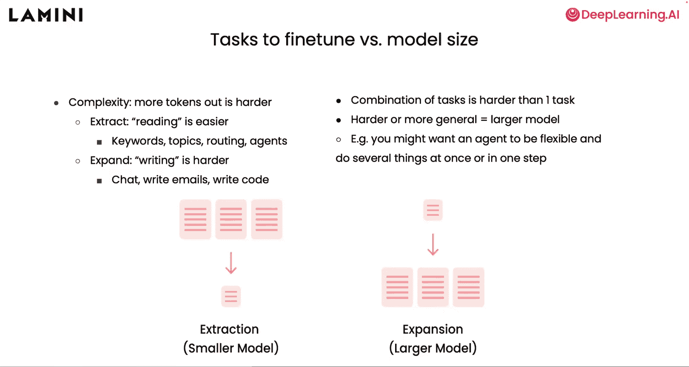
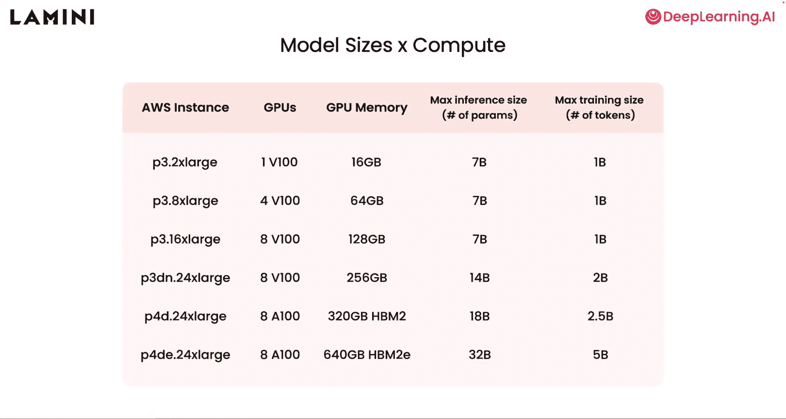
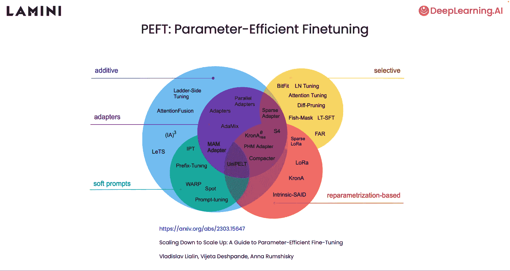
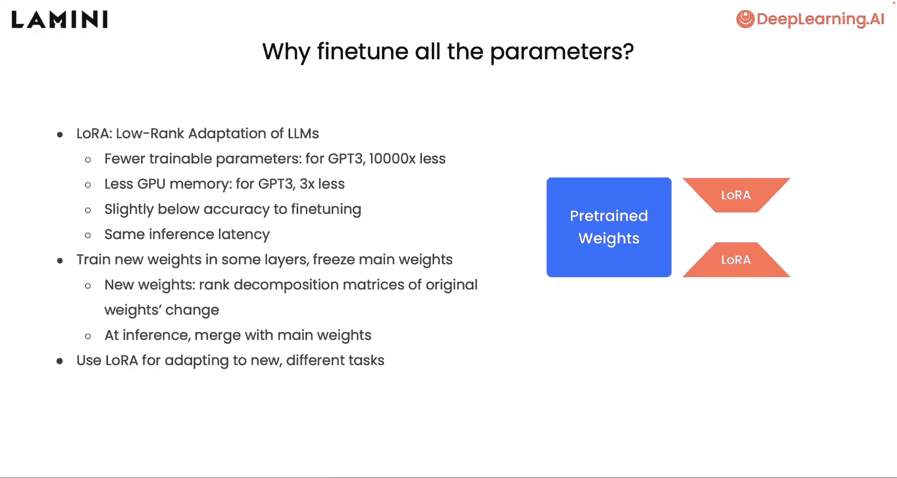

# 微调大型语言模型：P8：SC-微调_C1_L7

## 概述
在本节课中，我们将学习微调大型语言模型的实践步骤、硬件考量，并初步了解一种更高效的微调方法——LoRA。我们将从总结微调流程开始，然后探讨任务复杂度与模型规模的关系，接着分析所需的计算资源，最后介绍参数高效微调技术。

## 微调实践步骤总结
上一节我们介绍了微调的基本概念，本节中我们来看看如何开始一个微调项目。以下是启动微调时需要遵循的几个关键步骤。

1.  **明确任务**：首先确定你想要模型完成的具体任务。
2.  **收集数据**：收集与任务相关的输入和输出数据，并按照任务结构进行组织。
3.  **生成数据**：如果数据不足，可以通过生成数据或使用提示模板来创建更多数据。
4.  **从小模型开始**：建议先微调一个参数量在4亿到10亿之间的小型模型，以初步评估性能。
5.  **调整数据量**：尝试使用不同数量的数据进行微调，以理解数据量对模型性能的影响。
6.  **评估模型**：评估微调后的模型，找出表现良好和需要改进的地方。
7.  **迭代优化**：根据评估结果收集更多数据，以持续改进模型性能。

完成初步探索后，你可以增加任务的复杂度，并为更复杂的任务选择更大的模型以获得更好的性能。

## 任务复杂度与模型规模
我们已经了解了基本步骤，现在来看看任务特性如何影响模型选择。你学习了阅读型任务和写作型任务。写作型任务通常更难，例如聊天、写邮件、写代码等，因为这类任务需要模型生成更多的令牌。

更复杂的任务通常需要更大的模型来处理。另一种增加任务复杂度的方法是组合多个任务，要求模型在一个步骤中完成多项操作，而不是单一任务。

## 硬件与计算资源考量
了解了任务与模型的关系后，我们还需要考虑运行模型所需的硬件资源。在之前的实验中，你使用了在CPU上运行的7000万参数模型，但它们的性能并非最佳。通常建议从性能更强的模型开始。

以下是一个硬件配置示例，帮助你理解不同资源能支持的模型规模：

*   **1个V100 GPU（例如AWS平台提供）**：拥有16GB内存。该配置可以运行一个**70亿**参数模型进行**推理**。但对于**训练**，由于需要存储梯度和优化器状态，内存需求更大，因此只能容纳一个**10亿**参数模型。
*   **其他配置**：若需训练更大的模型，可以参考云平台提供的其他更高内存的GPU选项。

## 参数高效微调简介
也许你觉得上述资源仍不足以处理更大的模型。为此，存在一种称为**PEFT**的技术，即参数高效微调。

PEFT包含一系列方法，能让你在训练模型时更高效地利用参数。其中一种我非常喜欢的方法是**LoRA**。

**LoRA**代表低秩适应。它的作用是大幅减少需要训练的参数量。例如，对于GPT-3，研究发现其可训练参数量能减少**10,000倍**，这使得GPU内存需求降至原来的**三分之一**。虽然其精度可能略低于全参数微调，但这是一种实现目标的高效得多的方法，并且在推理时具有相同的延迟。

## LoRA的工作原理
那么LoRA具体是如何工作的呢？你实际上是在模型的某些层中训练新的权重，同时冻结主要的预训练权重。图中蓝色的部分代表被冻结的预训练权重，而橙色的部分代表新增的LoRA权重。

这些新权重本质上是原始权重变化的秩分解矩阵。不过，比背后的数学原理更重要的是，你可以独立于预训练权重来训练这些LoRA权重，然后在推理时将它们合并回主预训练权重中，从而更高效地获得微调后的模型。

我对LoRA感到兴奋的一个应用前景是将其用于适应新任务。这意味着你可以用一个客户的数据训练一个LoRA适配器，用另一个客户的数据训练另一个，然后在推理时根据需要分别合并它们。

## 总结
本节课中，我们一起学习了微调大型语言模型的完整实践流程，从明确任务、准备数据到选择模型规模。我们探讨了任务复杂度与所需模型大小的关系，并分析了对应的硬件资源需求。最后，我们介绍了一种高效的微调技术——LoRA，它通过大幅减少可训练参数，使得在有限资源下微调超大模型成为可能。