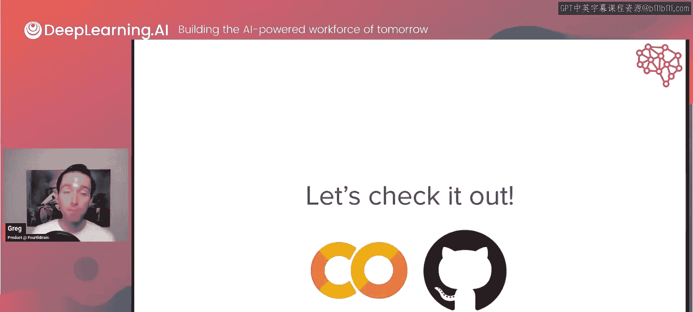
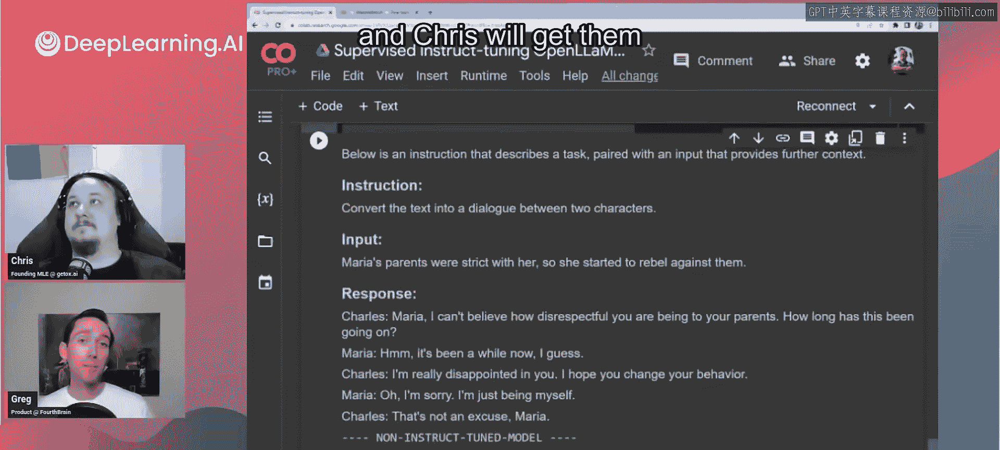
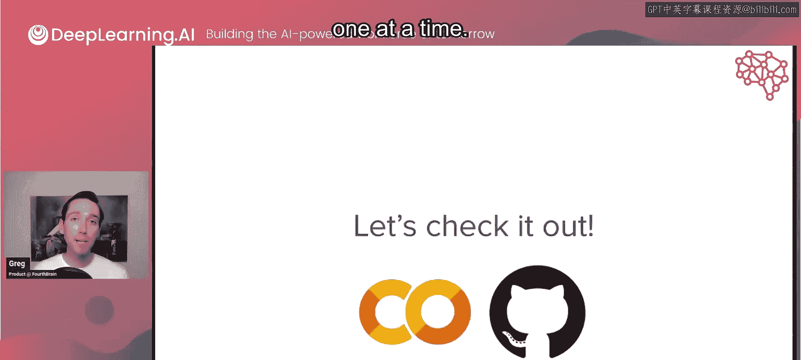
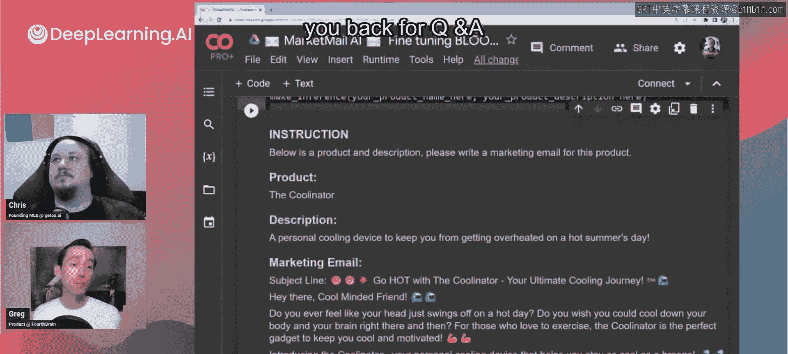
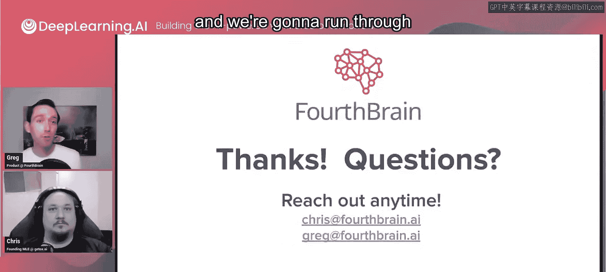

# 构建指令微调大语言模型：P1：从基础模型到专业应用


## 概述

在本课程中，我们将学习如何区分大语言模型的指令微调与任务微调。我们将了解如何使用最新的模型、数据集和训练工具，既能够自己进行指令微调，也能够直接选用现成的指令微调模型，并通过以数据为中心的任务微调技术，构建针对特定任务的强大LLM应用。

---

## 大语言模型概览与微调背景

上一节我们介绍了课程的整体目标，本节中我们来看看大语言模型的发展背景和两种核心微调方式。

大语言模型，例如GPT系列，其构建基础是无监督的预训练。这是一种自监督学习方法，数据没有标签，模型通过从互联网等渠道获取海量信息进行学习。在无监督预训练之后，会进行有监督的微调，这使模型能够在各种经典自然语言处理基准测试（如问答、信息检索、句子补全）上表现出色。随着计算资源和数据的增加，模型在这些基准上的表现也越来越好。

当我们使用大语言模型构建应用时，目标不再是让它在所有任务上都表现优异，而是专注于某一项特定任务。这就引出了提示工程的概念。

*   **零样本学习**：仅提供一个提示，试图让LLM响应该提示。
*   **少样本学习**：为LLM提供少量示例（一个或多个），引导其完成任务。
*   **任务微调**：针对特定任务进行微调。此时我们可能拥有大量示例，无法全部放入上下文窗口。微调的核心是改变模型的输入输出模式，使其从一个“通才”模型转变为专注于一项任务的“专才”模型。

使用零样本或少样本学习，是在探索LLM内部的所有可能性，这种方式成本低、速度快，非常适合开发最小可行产品。而当你希望深入探索LLM在特定领域的潜力时，任务微调就像是在LLM广阔的潜在空间中，精心雕琢出一块属于你应用的专业区域。

---

## 指令微调 vs. 任务微调

上一节我们了解了微调的基本概念，本节我们来明确区分指令微调和任务微调。



我们首先要问：我们希望LLM在什么任务上拥有“超能力”？这就是我们在构建应用时，通过调整输入输出模式进行任务微调的目标。

而当我们谈论一般大语言模型上进行的有监督微调时，则更接近于我们今天要介绍的**指令微调**。

*   **指令微调**旨在提升模型在遵循人类指令、与人类价值观对齐方面的能力。它关注的不仅是传统基准测试，还包括偏见、真实性、毒性等新兴评估指标。其目标是让LLM成为一个能够帮助人类完成各种任务的、价值观对齐的“超级英雄”。
*   **任务微调**则是将这个“通才”模型变得“专精”。它定义了用户如何与应用交互，并确保交互方式清晰明确，使模型在单一任务上达到极致性能。

简而言之，指令微调是有监督微调的一个子集，专注于与人类对齐和遵循指令。而任务微调则关乎将模型的能力聚焦于一项非常具体的任务。我们今天将看到这两种技术的实践。

---

## 实践一：指令微调OpenLM模型

上一节我们区分了两种微调，本节我们将动手进行第一个实践：对基础模型进行指令微调。

我们将使用以下技术栈：
*   **模型**：OpenLM 7B（一个开源的、可商用的70亿参数模型）。
*   **数据集**：Dolly 15K（包含15,000条由Databricks员工生成的高质量指令-回复对）。
*   **高效微调技术**：QLoRA（量化低秩适配）。这是一种新兴的最佳实践，它利用了下游任务内在维度较低的特点，大幅减少微调所需的计算量。

以下是实施步骤：

首先，我们需要准备环境和数据。

```python
# 安装依赖（建议从GitHub源码安装以确保最新）
!pip install git+https://github.com/huggingface/transformers.git
!pip install git+https://github.com/huggingface/peft.git
!pip install git+https://github.com/huggingface/accelerate.git
!pip install bitsandbytes datasets
```

接下来，加载并处理Dolly 15K数据集。该数据集包含`instruction`、`context`、`response`三个字段。我们需要将其格式化为模型训练所需的统一提示模板。

```python
from datasets import load_dataset

# 加载数据集
dataset = load_dataset("databricks/databricks-dolly-15k")

# 过滤过长的序列，保留约14000条数据
dataset = dataset.filter(lambda example: len(example['response']) < 500)
dataset = dataset['train'].train_test_split(test_size=0.1)
train_dataset = dataset['train']
eval_dataset = dataset['test']

# 定义格式化函数，将数据转换为统一格式
def format_instruction(example):
    if example['context']:
        text = f"Below is an instruction that describes a task, paired with an input that provides further context. Write a response that appropriately completes the request.\n\n### Instruction:\n{example['instruction']}\n\n### Input:\n{example['context']}\n\n### Response:\n{example['response']}"
    else:
        text = f"Below is an instruction that describes a task. Write a response that appropriately completes the request.\n\n### Instruction:\n{example['instruction']}\n\n### Response:\n{example['response']}"
    return {'text': text}



# 应用格式化
train_dataset = train_dataset.map(format_instruction)
eval_dataset = eval_dataset.map(format_instruction)
```

然后，我们设置QLoRA配置并加载模型。

```python
from peft import LoraConfig, get_peft_model, prepare_model_for_kbit_training
from transformers import AutoModelForCausalLM, AutoTokenizer, BitsAndBytesConfig
import torch

# 配置4位量化
bnb_config = BitsAndBytesConfig(
    load_in_4bit=True,
    bnb_4bit_quant_type="nf4",
    bnb_4bit_compute_dtype=torch.bfloat16,
    bnb_4bit_use_double_quant=True,
)

# 加载模型与分词器
model_id = "openlm-research/open_llama_7b_700bt_preview"
model = AutoModelForCausalLM.from_pretrained(
    model_id,
    quantization_config=bnb_config,
    device_map="auto",
    trust_remote_code=True
)
tokenizer = AutoTokenizer.from_pretrained(model_id)
tokenizer.pad_token = tokenizer.eos_token # 设置填充令牌



# 配置LoRA
lora_config = LoraConfig(
    r=16, # 秩
    lora_alpha=32,
    target_modules=["q_proj", "v_proj"], # 在注意力层的Q、V投影矩阵上应用LoRA
    lora_dropout=0.05,
    bias="none",
    task_type="CAUSAL_LM",
)
model = get_peft_model(model, lora_config)
model.print_trainable_parameters() # 查看可训练参数量，会发现远小于原始参数量
```

最后，使用监督式微调训练器进行训练。

```python
from transformers import TrainingArguments, Trainer

training_args = TrainingArguments(
    output_dir="./openlm-dolly-finetuned",
    num_train_epochs=1,
    per_device_train_batch_size=4,
    gradient_accumulation_steps=4,
    warmup_steps=100,
    logging_steps=10,
    save_steps=500,
    evaluation_strategy="steps",
    eval_steps=500,
    learning_rate=2e-4,
    fp16=True,
    optim="paged_adamw_8bit", # 使用分页优化器防止内存溢出
)

trainer = Trainer(
    model=model,
    args=training_args,
    train_dataset=train_dataset,
    eval_dataset=eval_dataset,
    data_collator=lambda data: {'input_ids': torch.stack([tokenizer.encode(d['text'], truncation=True, max_length=512) for d in data])},
)
trainer.train()
```

训练完成后，我们可以比较微调前后的效果。例如，给模型指令：“将以下文本转换为两个角色之间的对话。文本：Maria的父母限制她，所以她开始反抗他们。”

*   **基础模型输出**：可能只是重复文本或生成无意义的句子。
*   **指令微调后模型输出**：能够生成一段结构清晰、符合逻辑的角色对话。

**关键要点**：本次指令微调在OpenLM模型上进行了额外的有监督微调，使用了Dolly 15K的15000个数据点，仅训练了5000步，总成本极低。指令微调模型在遵循指令方面远优于基础模型，是构建AI应用时的首选。

---

## 实践二：对指令微调模型进行任务微调

上一节我们学会了如何让模型更好地遵循指令，本节我们在此基础上，让一个已经指令微调好的模型变得更“专精”，专注于一项具体任务。

假设我们需要一个AI营销助手，用于生成符合公司品牌语气和风格的营销邮件。我们将：
1.  **选用一个现成的指令微调模型**：BloomZ（Bloom模型的指令微调版本）。
2.  **进行任务微调**：使用少量（例如17条）合成生成的“产品描述 -> 营销邮件”数据对，对模型进行无监督微调，使其掌握生成特定格式营销邮件的能力。

以下是实施步骤：

首先，加载模型并配置LoRA（这次使用8位量化）。

```python
from transformers import AutoModelForCausalLM, AutoTokenizer, BitsAndBytesConfig
from peft import LoraConfig, get_peft_model
import torch



# 配置8位量化
bnb_config = BitsAndBytesConfig(load_in_8bit=True)

# 加载BloomZ模型与分词器
model_id = "bigscience/bloomz-3b"
model = AutoModelForCausalLM.from_pretrained(
    model_id,
    quantization_config=bnb_config,
    device_map="auto"
)
tokenizer = AutoTokenizer.from_pretrained(model_id)

# 配置LoRA，针对Bloom模型的`query_key_value`模块
lora_config = LoraConfig(
    r=16,
    lora_alpha=32,
    target_modules=["query_key_value"], # Bloom模型的目标模块名称
    lora_dropout=0.05,
    bias="none",
    task_type="CAUSAL_LM",
)
model = get_peft_model(model, lora_config)
model.print_trainable_parameters() # 可训练参数可能降至总参数的1%以下
```



准备任务特定的数据集。数据格式为：`指令 + 产品 + 描述 -> 营销邮件`。

```python
# 示例数据格式
synthetic_data = [
    {
        "product": "SmartEyes",
        "description": "Glasses with real-time translation.",
        "email": "🌟 See the World in Every Language with SmartEyes! ..."
    },
    # ... 更多示例
]

# 将数据格式化为模型输入
def format_task_data(example):
    prompt = f"Generate a marketing email for the following product.\nProduct: {example['product']}\nDescription: {example['description']}\nEmail: {example['email']}"
    return {'text': prompt}

formatted_dataset = [format_task_data(d) for d in synthetic_data]
```

进行无监督训练（语言模型训练）。

```python
from transformers import TrainingArguments, Trainer

training_args = TrainingArguments(
    output_dir="./bloomz-marketing-finetuned",
    per_device_train_batch_size=6,
    num_train_epochs=3, # 由于数据量小，可以多跑几个epoch
    logging_steps=10,
    save_steps=100,
    learning_rate=1e-3,
)

trainer = Trainer(
    model=model,
    args=training_args,
    train_dataset=formatted_dataset,
    data_collator=lambda data: {'input_ids': torch.stack([tokenizer.encode(d['text'], truncation=True, max_length=256) for d in data])},
)
trainer.train()
```

训练后，给定新产品描述，如“个人冷却设备，防止你在炎热的夏天过热”，模型能生成带有相应主题表情符号和营销话术的邮件。

**关键要点**：本次任务微调使用了现成的指令微调模型BloomZ，仅用17个数据点和100步训练，成本极低。它成功地将模型能力聚焦于“生成营销邮件”这一单项任务，效果显著优于原始模型。这展示了如何快速为特定应用打造“超能力”。

---

## 总结与核心收获

本节课中，我们一起学习了指令微调与任务微调的理论与实践。

*   **指令微调**是有监督微调的一个子集，专注于让模型更好地遵循人类指令并与人类价值观对齐。它是构建AI应用时选择模型的黄金标准。
*   **任务微调**则是在指令微调模型的基础上，进一步调整输入输出模式，使模型深度适配某一项具体任务，从而获得在该任务上的“超能力”。

**核心工作流**通常是：选择一个经过指令微调的模型，然后针对你的特定应用场景进行任务微调。

**技术要点**：
1.  **高效微调**：利用LoRA、QLoRA等参数高效微调技术，可以极低的计算成本（甚至在免费Colab中）微调数十亿参数的大模型。
2.  **数据为中心**：任务微调的成功关键在于精心策划和设计训练数据，确保其准确反映期望的输入输出模式。
3.  **从简单开始**：始终先尝试零样本或少样本提示，如果效果不足，再考虑进行任务微调。

通过今天的课程，你不仅理解了区分“飞机是颜色中的异类”的指令微调模型，也掌握了如何一步步将通用大语言模型，塑造成满足你特定需求的强大应用组件。