# 构建使用抱脸的机器学习应用：P1：从大语言模型到扩散模型构建机器学习应用


## 概述
在本节课中，我们将学习如何利用Hugging Face平台，从大语言模型到扩散模型，构建和部署机器学习应用。我们将了解机器学习应用开发的演变历程，探索Hugging Face生态系统的最新工具，并学习如何在不担心基础设施的情况下，构建可分享的生成式AI应用。

---

## 第一部分：机器学习应用开发的演变历程

上一节我们介绍了课程概述，本节中我们来看看机器学习应用开发是如何演变至今的。

十年前，当马克·安德森提出“软件正在吞噬世界”时，推动这一预言实现的是高层次的抽象和易于使用的工具，它们让开发者能够围绕代码进行协作，并可靠、稳健地构建代码。

几年后，深度学习开始发挥作用。循环神经网络和卷积神经网络从实验室中被重新发掘出来，投入到公司的实际生产用例中。这促使英伟达的创始人兼CEO黄仁勋提出“现在深度学习正在吞噬软件”。

使深度学习不仅能够工作，还能进入公司生产环境的原因，是几个关键因素的结合：新的神经网络架构（如卷积神经网络和循环神经网络）、大型数据集的可用性、通过GPU获得的新型可用计算资源，以及像PyTorch和TensorFlow这样的专家级工具。

这促成了深度学习的第一轮发展周期。一个典型的机器学习项目流程如下：

以下是深度学习1.0时代典型项目的步骤：
1.  收集、准备、清理、标注和整理数据。
2.  构建模型。
3.  评估模型。

这个过程通常在公司中需要长达一年的时间，这极大地减缓了采用速度。此外，整个过程只是为了解决一个用例或构建一个功能。一旦你想调整该功能或创建新功能，就必须重新开始整个过程。

其后果是，在采用度和业务影响方面，深度学习的使用受到了很大限制。VentureBeat曾报告，87%的数据科学项目从未投入生产，只有25%的公司报告采用了深度学习。

但五年前发生了一些事情。我认为近期深度学习领域最重要的事件是**迁移学习**的出现。迁移学习是指能够获取一个在庞大数据集上使用大量计算资源（有时是数百万美元的计算成本）训练出的巨大模型，创建出大型预训练模型，然后可以轻松高效地将其适配到下游任务或领域。

迁移学习促成了深度学习的2.0周期。我们再次看到了关键因素的结合：由迁移学习实现的Transformer架构、为机器学习从头设计的新型硬件，以及最重要的、面向开发者的新工具。

这就是深度学习2.0。由此产生的趋势是，现在**Transformer正在吞噬深度学习**，这意味着Transformer正在成为构建机器学习模型的默认架构，无论你面对什么问题。事实上，《AI现状》报告指出，Transformer正在成为机器学习的通用架构，并取代了传统的机器学习方法。

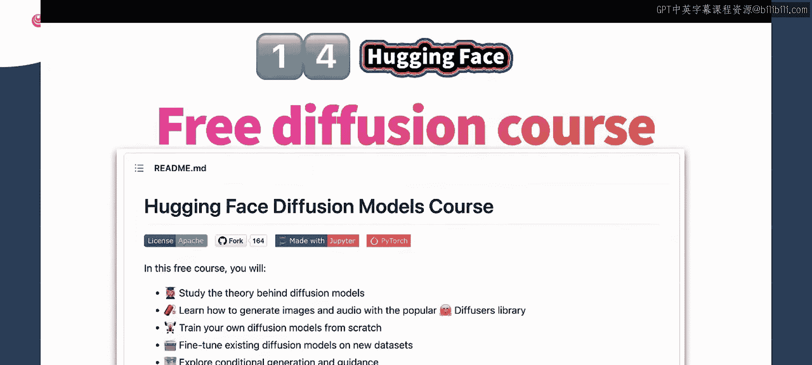

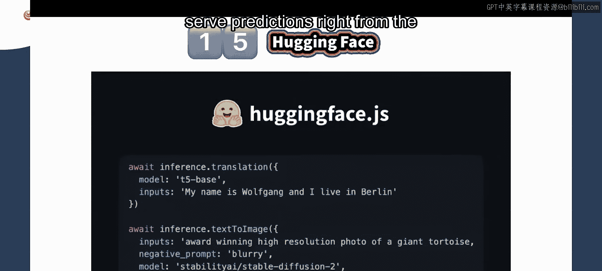

在这个迁移学习的新世界中，一个典型的机器学习项目是什么样的呢？


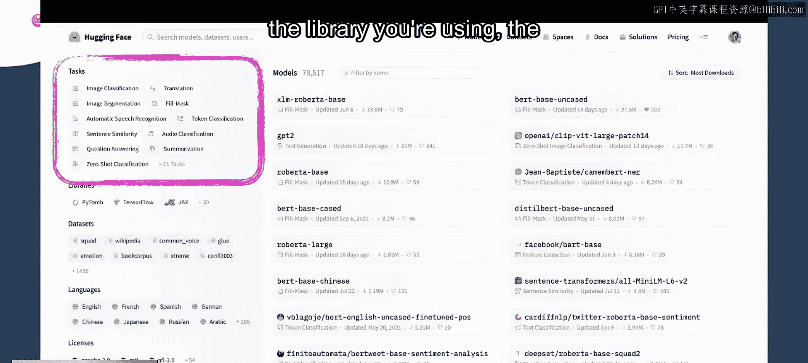

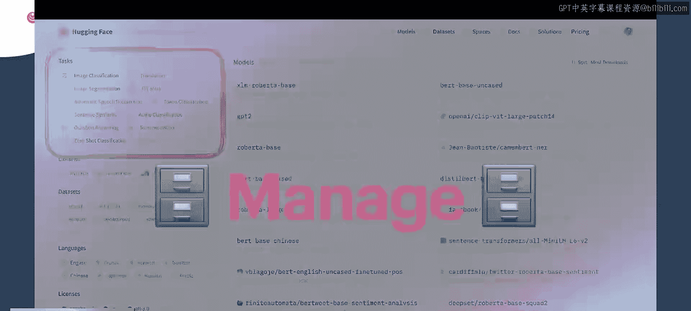

以下是深度学习2.0时代典型项目的步骤：
1.  **确定任务**：识别与你的问题匹配的机器学习任务。无论是文本、图像还是语音，都有对应的任务。例如，大语言模型处理文本，可以应用于许多不同任务；对于图像，我们可以用稳定扩散生成图像，也可以分类图像、检测物体、分离背景等；对于语音，我们可以转录语音、生成语音、识别说话者等。
2.  **寻找预训练模型**：确定任务后，去寻找一个能很好地解决你问题的预训练模型。这就是迁移学习的作用。你可以从这些预训练模型开始，无需经历整个数据标注、特征构建、清理的循环。只需几行代码就能下载模型并在你自己的数据上测试。
3.  **微调模型（可选）**：如果需要，你可以通过在自己的数据上微调该模型，轻松高效地提高其性能。

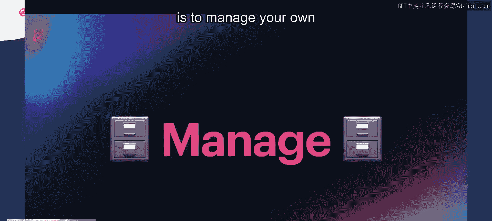

这通常是Hugging Face用户在构建机器学习应用或新功能时所经历的过程。

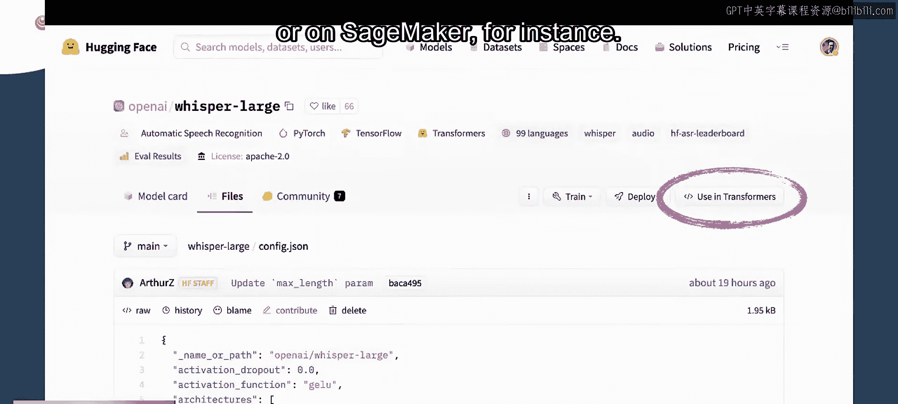

---

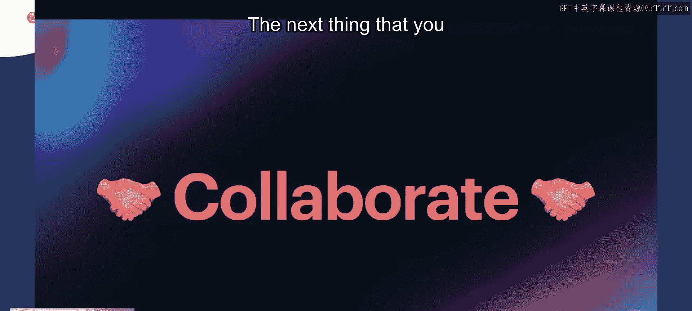

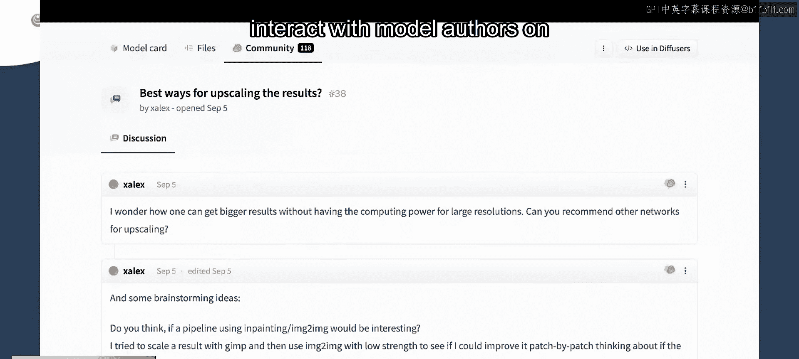

## 第二部分：关于Hugging Face你可能不知道的事


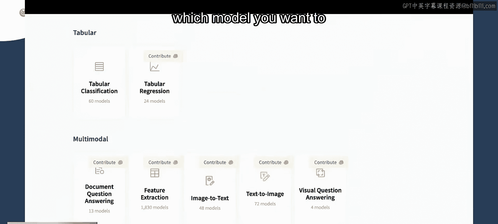

上一节我们回顾了机器学习应用的演变，本节中我们来深入了解Hugging Face平台的一些最新动态。

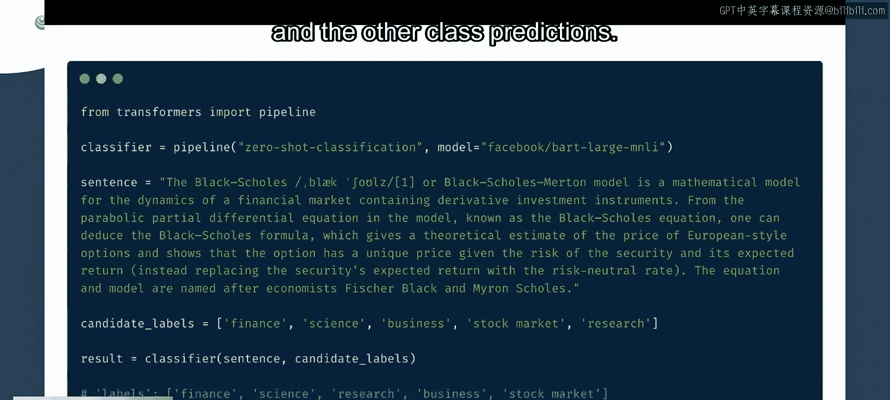

1.  **使命与原则**：我们的使命是通过开源**民主化优秀的机器学习**。我们所做的一切都是开源的，包括代码的开源实现、公开可访问的模型权重和数据集，以及开放的科研过程。
2.  **伦理工具**：我们正在构建一套完整的工具，帮助社区在AI中**实践伦理**。你可以在我们的网站上找到“伦理与社会”页面，其中汇集了我们构建的所有工具和参与的活动，例如测量数据集中的偏见、改进模型发布的最佳实践等。
3.  **顶级开源贡献者**：Hugging Face是全球顶级的开源贡献者之一。截至最近，我们在GitHub上的星标数排名第35位，并且增长迅速。
4.  **Diffusers库的快速增长**：你可能知道Transformers库，但可能不太了解Diffusers库。这个提供所有生成式AI模型的库，在其前六个月的增长率实际上超过了Transformers库同期的表现。
5.  **海量免费模型**：平台上有超过**15万个**免费公开可访问的模型，涵盖了你能想到的每一个任务和多种库。
6.  **私有模型托管**：实际上，我们托管的大多数模型是你看不到的私有模型。平台上总共有超过**30万个**模型。当你创建一个模型仓库时，可以选择公开（与社区分享）或私有（与团队协作）。
7.  **每日百万次下载**：Hugging Face上每天发生超过**一百万次**模型下载。我们所有的统计数据都是公开的。
8.  **商业模式**：很多人不知道Hugging Face如何盈利。我们通过在Hub上销售计算服务，并向公司提供专家支持来获得收入。
9.  **易于开发者入门**：对于没有深度学习博士学位的开发者来说，入门非常容易。我们构建的抽象是**任务**。你可以通过访问 `huggingface.co/tasks` 来选择适合你问题的任务。
10. **复现前沿闭源模型**：为了坚持开源使命，我们投入大量精力**在开放环境中复现那些最先进的闭源模型**。例如，与ServiceNow合作的BigCode项目，以及我们的Flamingo复现项目。
11. **BLOOMZ模型**：很多人知道BLOOM，这是一个拥有1760亿参数的大型多语言开源模型。但较少人知道它的指令微调版本——**BLOOMZ**，它可能比BLOOM更有用。
12. **ControlNet模型**：很多人知道稳定扩散，但较少人知道**ControlNet**。它非常酷，可以通过提供图像、人体姿势等引导来控制图像生成。
13. **Mac桌面应用**：我们有一个Mac应用，如果你有M1或M2芯片的Mac，可以直接在电脑上通过提示词生成图像。
14. **免费扩散模型课程**：如果你对稳定扩散模型、如何创建和微调模型感兴趣，我们在GitHub上有一个免费的扩散模型课程。
15. **JavaScript客户端**：我们刚刚发布了Hugging Face的**JavaScript客户端**，现在开发者可以直接在浏览器中使用Hugging Face模型，无需用Python构建后端应用。

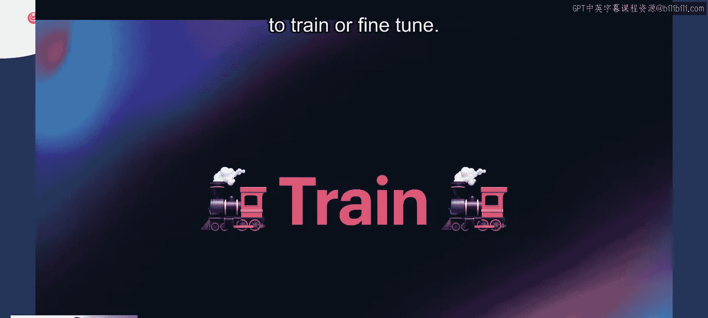

---

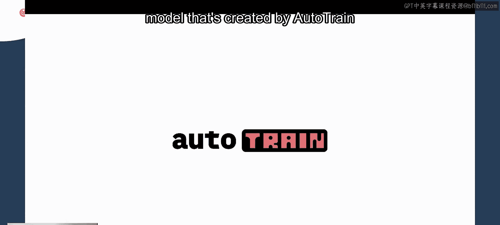

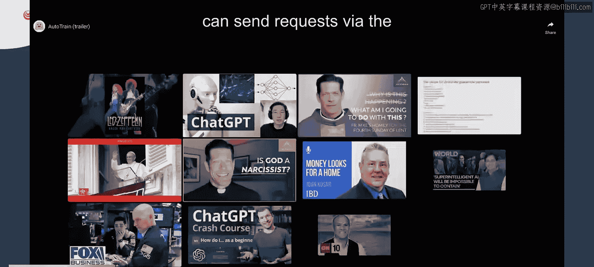


## 第三部分：使用Hugging Face Hub构建应用（无需担心基础设施）

上一节我们介绍了Hugging Face的最新动态，本节中我们来看看如何利用Hugging Face Hub来构建机器学习应用，而无需担心基础设施。

使用Hugging Face Hub，你可以做以下几件事：

### 1. 探索并寻找模型
这是模型中心的样子。你可以轻松地通过过滤器筛选，根据任务、使用的库、目标语言等缩小范围。

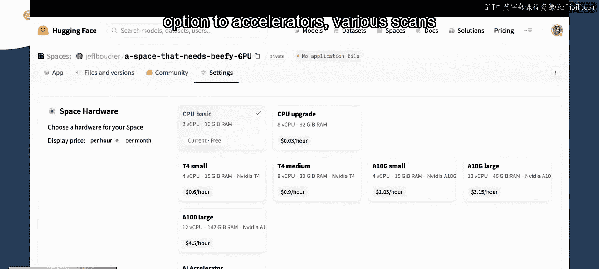


### 2. 管理你自己的模型
你找到了一个模型，现在想管理自己的模型。Hugging Face上的一切，从模型、数据集到空间，底层都是GitHub仓库。这意味着你可以拥有完整、稳健的版本控制。

查看模型页面时，你会看到模型卡片，它提供了关于模型的所有信息。右侧有非常简单的交互方式，可以通过无代码小组件体验来理解模型的工作原理。

在“文件”选项卡中，你可以看到仓库的内容、每个文件的完整历史记录、贡献者信息等。对于每个模型，我们都有简单的选项供你使用，例如通过我们的开源库（Transformers）使用，或通过推理端点部署进行推理。

### 3. 协作
协作对我们非常重要。新的“社区”选项卡就是为此设计的。在那里，你不仅可以看到围绕模型的所有讨论，还可以创建和审查拉取请求。如果你熟悉GitHub，你会熟悉拉取请求和讨论，这是与模型作者互动的好方法。

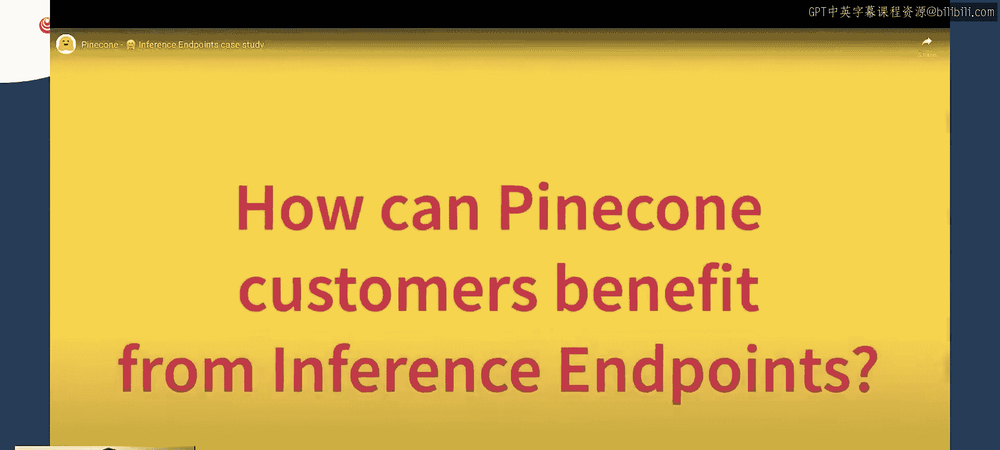

### 4. 使用任务
还记得三步流程吗？第一步是选择与你的问题对应的任务。我们为任何形式的机器学习任务提供了任务体验。如果你不知道要使用哪个模型，这是一个很好的入门方式。

在开源库中，任务的概念是通过一个名为 **`pipeline`** 的类实现的。它封装了机器学习任务的整个逻辑，你无需担心分词、预处理和后处理。


```python
from transformers import pipeline

classifier = pipeline("zero-shot-classification", model="facebook/bart-large-mnli")
result = classifier(
    "This course is about machine learning and AI.",
    candidate_labels=["education", "politics", "business", "finance"],
)
print(result)
# 输出会显示这个句子属于'finance'类，置信度为68%
```

### 5. 训练或微调
我们构建了一个名为 **`AutoTrain`** 的新体验，让你可以仅用一个小型训练数据集来微调模型或创建新模型。整个过程自动化，创建的每个模型都会自动部署，之后你可以通过推理API发送请求。

### 6. 构建演示应用
**`Spaces`** 允许你轻松创建机器学习应用程序，只需一个简单的Python文件，利用Streamlit或Gradio库发布任何类型的机器学习应用。社区每周都会创建惊人的体验。

创建一个新空间非常简单：登录后，点击用户图标，选择“新建空间”，命名你的应用，选择Streamlit或Gradio，然后创建。这个项目实际上是一个Git仓库，你可以在浏览器中添加和编辑文件，例如添加`requirements.txt`定义依赖，创建`app.py`定义应用逻辑。

### 7. 部署模型到生产环境
这就是 **`推理端点`** 的作用。它抽象了所有基础设施的复杂性。你从模型仓库开始，选择要部署的云服务和区域，选择合适的计算实例，设置自动扩缩参数和安全设置，然后就可以开始了。模型启动后，你会获得一个唯一的URL来集成到你的应用中。这是一个生产服务，你可以访问所有容器日志和分析数据。

---

## 第四部分：现场演示

上一节我们讲解了使用Hub的各个步骤，本节中我们通过一些现场演示来看看这些功能如何实际运作。

### 演示1：部署推理端点
我们以部署最新的稳定扩散2.1模型为例。在推理端点管理界面，找到模型，选择AWS云服务、区域，系统会建议实例类型，点击创建即可。整个过程自动化，大约需要5-20分钟。你可以在日志中查看进度。

### 演示2：使用BLOOMZ模型
BLOOMZ是BLOOM的指令微调版本，更实用。例如，我们可以让它为一段演讲摘要生成一个标题，或者将一段文本翻译成法语。它展示了大型语言模型快速适应各种任务的能力。

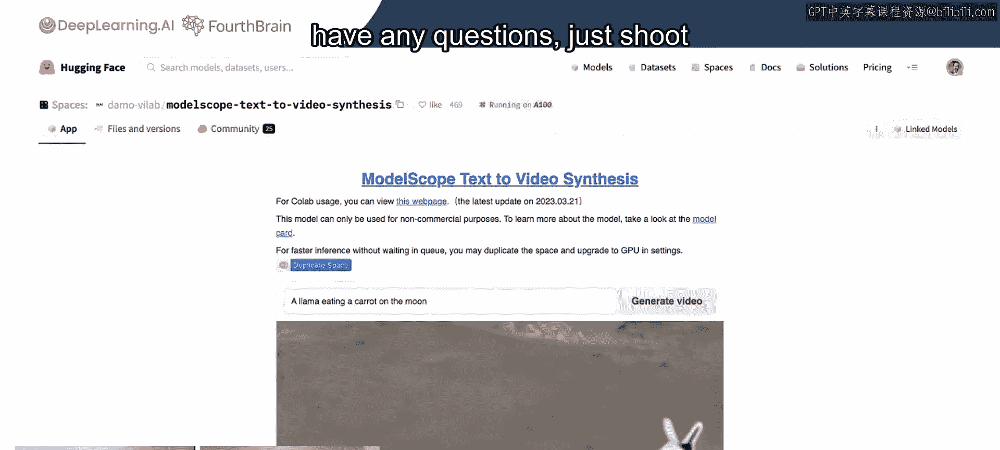

### 演示3：探索模型仓库
在BLOOMZ的模型页面，我们可以查看文件选项卡，了解所有文件及其完整历史。高级用户还可以使用TensorBoard指标功能，可视化训练实验的所有追踪数据。

### 演示4：社区协作
通过社区选项卡，可以与模型作者和社区互动，或直接通过拉取请求建议更改。这是询问模型相关问题或请求更新模型卡片的最佳方式。

### 演示5：使用Spaces和ControlNet
我们尝试使用一个基于ModelScope的文本生成视频空间，提示词是“llama eating carrots on the moon”。同时，我们展示ControlNet空间，它可以通过图像（如边缘检测、人体姿势、深度图）来引导稳定扩散的图像生成。例如，上传一个Logo，并提示“chocolate cake”，ControlNet会生成一个受Logo形状引导的巧克力蛋糕图像。

### 演示6：检查已部署的端点
回到之前创建的稳定扩散推理端点，可以看到它正在运行，并有一个可用的URL。你可以直接通过该端点测试生成图像。

---

## 总结
本节课中，我们一起学习了如何利用Hugging Face生态系统构建机器学习应用。我们从机器学习开发的演变讲起，了解了迁移学习和Transformer架构的重要性。然后，我们深入探索了Hugging Face平台的最新功能和海量资源，包括模型、数据集和工具。最后，我们逐步讲解了如何使用Hugging Face Hub来探索、管理、协作、使用任务、微调模型、构建演示应用，以及最终通过推理端点将模型部署到生产环境，而无需担心底层基础设施的复杂性。通过现场演示，我们看到了这些概念如何转化为实际的操作和令人兴奋的结果。现在，你可以开始利用这些工具，构建和分享你自己的生成式AI应用了。