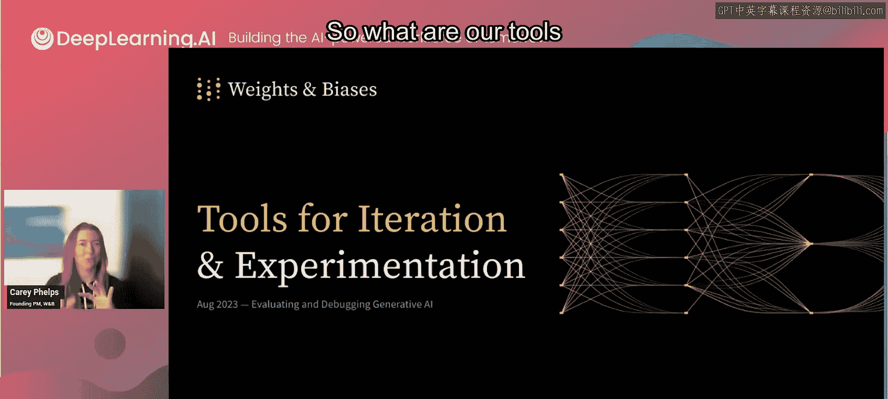
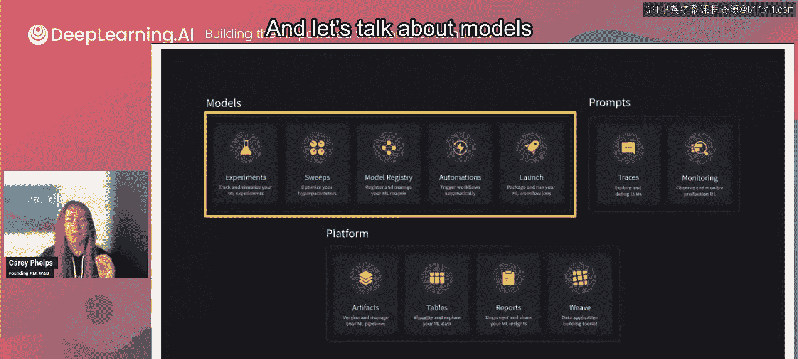
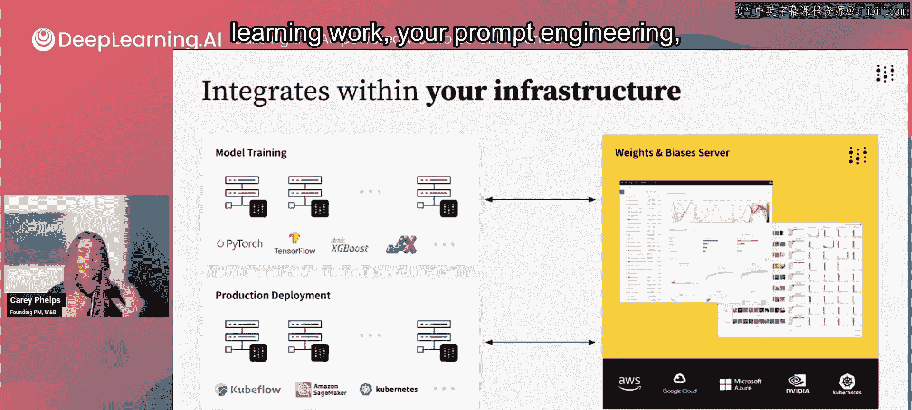
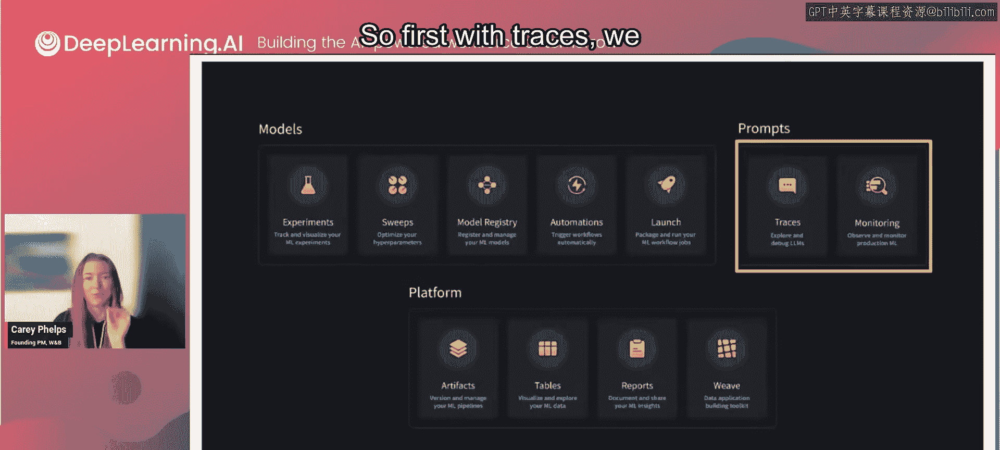
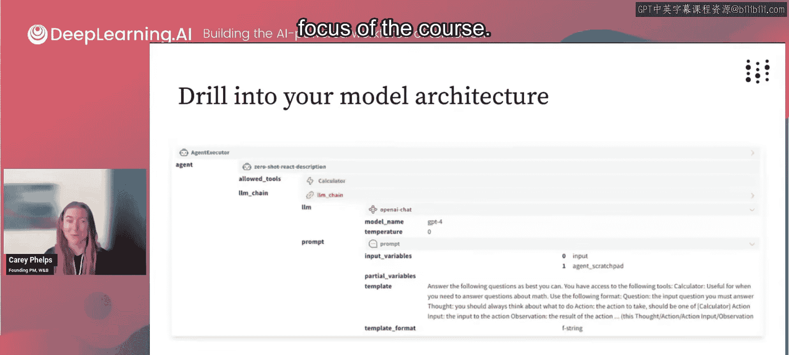
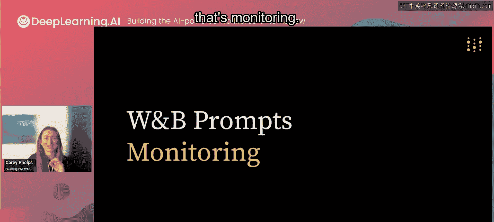
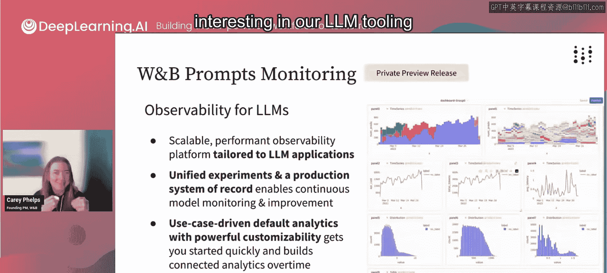
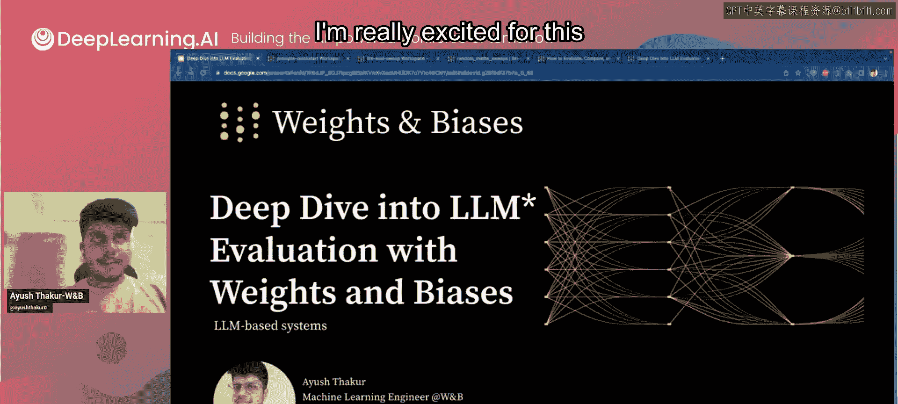
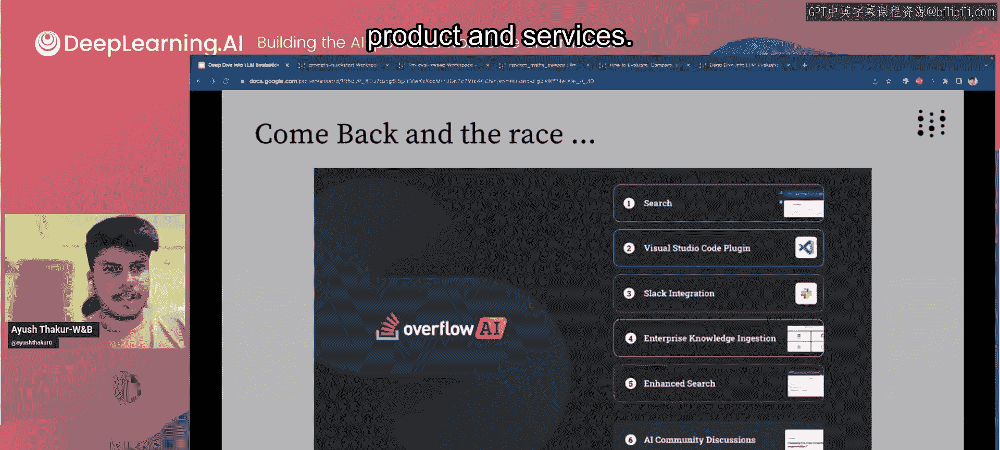
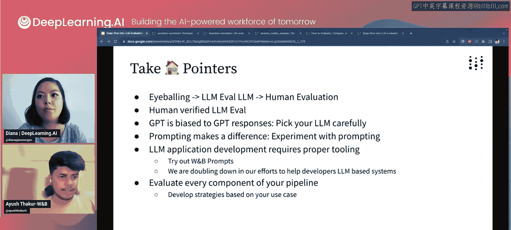

# 大语言模型评估：P1：使用Weights & Biases深入探讨LLM评估

在本课程中，我们将学习如何有效评估大语言模型系统，特别关注检索增强生成系统。我们将从讨论“目测”技术开始，介绍监督评估及其局限性，并探讨如何使用LLM进行自我评估，包括生成评估数据集、使用标准指标以及评估检索系统。最后，我们还将了解如何使用Weights & Biases的Sweeps工具进行超参数优化，以在准确性和成本之间找到最佳平衡。

大家好，我是Diana Chan Morganorgan，欢迎参加deeplearning.ai的下一次活动。今天，我们非常荣幸能与来自Weights & Biases的特别演讲嘉宾一起举办一场研讨会。本次研讨会将深入探讨如何有效评估LLM系统，特别关注检索增强生成系统。

我们将首先讨论“目测”技术，以及为什么Weights & Biases Prompts是该领域的优秀入门工具。接着，我们将探讨监督评估，强调其价值并指出一些局限性。最后，我们还将了解如何使用LLM进行自我评估，从生成自己的评估数据集到使用标准指标，甚至评估检索系统。

此外，我们还将简要介绍Weights & Biases Sweeps，这是一个用于超参数优化的卓越工具，可用于找到最大化准确性和最小化成本之间的理想平衡点。今天的会议最后将与演讲者进行问答环节，请务必在聊天中提问。我们将提供一个链接，供大家对所有问题进行投票。

本次研讨会也基于deeplearning.ai与Weights & Biases团队合作开设的“评估和调试LLM”基础课程。研讨会涵盖的所有内容都是该课程的延续教育，我们将在聊天中分享课程链接。

现在，我想介绍我们的第一位演讲者，Carrie Phelps。Carrie是Weights & Biases团队的创始产品经理。她在斯坦福大学学习计算机科学，并在加入Weights & Biases之前创立了Carta healthcareca。

我们的下一位演讲者是Ayush。Ayush也是Weights & Biases团队的机器学习工程师，同时也是Google在机器学习和TensorFlow领域的开发者专家。他对计算机视觉和表征学习的一切都感兴趣，过去七个月一直致力于LLM和RHF相关工作。

最后一位演讲者是Morgan McGuire。Morgan领导增长ML团队，是Weights & Biases的ML工程师。他拥有NLP背景，之前在Facebook的安全团队工作，帮助分类和标记可能需要删除的高严重性内容。

我们非常高兴他们今天能来到这里。现在，让我们正式开始，有请Carrie。

谢谢Diana。我先从宏观角度谈谈Weights & Biases更大的产品愿景和我们来自哪里，然后Ayush和Morgan会深入更多细节。

那么，我们用于机器学习的迭代和实验工具是什么？

从高层次看，我们有一个跨模型的平台，用于构建你自己的模型、从头开始训练。Prompts则用于迭代LLM，查看追踪视图器，这是本课程的重点，同时监控生产环境中的LLM。

然后，我们有我们的平台组件，即整个系统中的共享工具。

我们先谈谈模型。我们最初从实验追踪开始，OpenAI曾遇到一个问题：他们想看看随着时间推移训练模型，性能是变好还是变差。结果发现，在一个地方追踪这些指标相当令人沮丧，因此我们构建了一个实验追踪工具。接着，他们需要能够可视化不同数据集的比较，于是我们进入了数据可视化领域。然后是协作工具，以便能够集中分享这些见解，这就是报告功能的由来。

最后，我们需要为组织内不同团队建立中央记录系统。如何让参与项目的每个人在一个地方看到结果？

至关重要的是，Morgan深度参与了这项工作，即整合并使W&B能够跨不同工具访问，这些工具可供从事模型工作的人员使用。我们起步时，TensorFlow在2018年非常热门，而PyTorch还是新秀。我们清楚地认识到，与PyTorch、PyTorch Lightning等工具构建集成，将使W&B对训练模型的学术受众等更具可访问性。因此，我们的一个关键重点领域是：W&B如何与生态系统中的其他工具良好协作。

我们还与人们使用的任何基础设施集成。例如，如果你是一个刚入门机器学习的学生，在桌下的GPU甚至笔记本电脑上训练，我们可以在那里追踪。如果你使用OpenAI API来迭代提示，我们也可以在那里追踪结果。无论你在哪里进行机器学习工作或提示工程，我们的目标是让捕获这些结果变得非常简单。

现在我们来谈谈Prompts，这是我们讨论的重点。首先，通过追踪，我们有一个核心工具来理解和调试从输入到输出过程中发生的事情。有趣的是，这个过程并不像你想象的那么简单。你不仅仅是问一个问题就直接得到答案，其中涉及多个步骤。例如，使用计算器工具来计算答案，然后将其合并到LLM产生的结果中。因此，这种调试可能非常复杂，特别是如果你试图在终端输出上查看，很难解析所有发生的事情。这个可视化的追踪时间线让你能够理解与LLM交互过程中发生的事情。

你还可以深入查看模型的架构，了解它正在执行的步骤。在底层，你可以看到更多细节，包括我们捕获的元数据，以及你输入系统和接收到的每个输入和输出。

因此，Prompts的高层目标，特别是这个追踪工具，是让你能够非常容易地迭代你编写的提示，并从你使用的LLM中获得更好的结果。这确实是本课程的重点。但我也想谈谈我们正在开发的另一个令人兴奋的功能：监控。当你有一个LLM在生产环境中监控时会发生什么？这里涉及很多人。在我们合作的不同客户中，我们看到的几个问题是：很难系统地评估什么是不良表现。例如，我有一个帮助客户的聊天机器人，我构建了这个LLM来回答他们的问题。很难真正评估用户给出“踩”是因为答案错误，还是因为他们不喜欢答案。也许我无法更改航班，所以很难系统地评估它是否在做一项好工作，是否提供了用户想听到但实际上不正确的答案。

因此，监控生产环境中的LLM是一个真正的挑战。我们还有高昂的推理成本，这是一个昂贵的过程，并且很难运行我们在传统机器学习中看到的传统模式。此外，人们正在使用一套全新的工具，因此很难做出一次性决定，比如编写一次提示就停止迭代。随着你获得更多关于用户如何与系统交互的信息，能够持续调整非常重要。同时，也很难从LLM系统中的不同反馈点捕获和组合数据。

因此，我们试图通过生产监控工具解决这些关键点。包括能够通过评估板探索你在W&B中记录的结果上下文，能够实时监控并查看你工作的成本，能够与W&B生态系统内外的其他工具集成，然后实时流式传输结果，以便你能快速反应。这看起来像是专门为LLM设计的类似Datadog仪表板的东西。因此，这个可观测性工具是我们Prompts平台的新组件，我们非常兴奋它现在处于私有预览阶段。这是在迭代提示和实验什么方法有效之后，监控这些模型在生产环境中性能的下一步。

接下来，我们将与Ayush一起深入了解我们LLM工具中有趣的细节。我很高兴把话筒交给Ayush。

好的，谢谢Carrie。大家好，我是Ayush，是Weights & Biases的机器学习工程师。我对这次演讲感到非常兴奋，我认为我有相当多的内容要讲。如果有不清楚的地方，请随时在评论中留言，我会尽力回答或澄清。也欢迎大家在这次演讲结束后联系我，我会尽力回答你们的问题。对于所有来自印度的参与者，祝你们独立日快乐。

现在让我们进入演示。在过去的18个月里，我们与世界互动的方式正在迅速改变。我们设想与软件交互，这正在改变我们与工具交互的方式。

例如，作为开发者，我们十多年来一直依赖Stack Overflow来寻找代码片段和解决bug的方法。我们要么因为有人已经在Stack Overflow上提问而得到可行的答案，要么在网站上发布问题并等待回复。

但在过去的18个月里，Stack Overflow失去了大约35%的流量。ChatGPT被认为是Stack Overflow衰落的一个重要原因。据报道，仅在2023年3月，Stack Overflow就损失了14%的流量。原因是许多开发者开始直接向ChatGPT提问，没有明显的等待时间，你几乎可以用ChatGPT编程，你可以把执行错误代码扔给ChatGPT，也许它可以尝试为你解决代码。这是一种更自然的开发方式。Github Copilot也是如此，它于2021年10月推出，你可以看到Stack Overflow在那之后的衰落。

对于Github Copilot，我们也有VS Code扩展，所以你可以在编写代码的同一位置进行代码补全和其他高级操作，这是一种很棒的开发方式。关键是，在过去的18个月里，我们与工具交互的方式以及开发软件的方式已经发生了变化。那么，Stack Overflow的回应是什么？

他们发布了自己的生成式AI工具Stack Overflow AI。使用这个工具，你可以像在ChatGPT中一样提问和进行后续提问，答案会附带引用摘要。你也可以用它来起草问题，然后发布到Stack Overflow上。就像Copilot一样，他们也有自己的Visual Studio插件，所以现在你可以使用这个工具进行编程。关键是，企业、公司、机构等都已开始将生成式AI能力整合到自己的生产服务中。

再举几个例子，可汗学院发布了他们的Khanmigo导师机器人，还有Notion AI，Zapier也发布了生成式AI驱动的界面。

这个数字还在不断增加，据我所知，截至8月8日，已有超过250家生成式AI初创公司被统计。但同样，在这种情况下，整个领域正在爆炸式增长。

发生这种情况的原因是，它由GPT-4、PaLM 2、Falcon、Llama 2、Claude等模型驱动。这些都是基于Transformer架构的模型，已扩展到数十亿参数，并使用数千亿甚至数万亿token进行训练，同时具有非常大的上下文长度。

本次演讲的重点是大语言模型，但请记住，大型图像生成模型也在我们看到的这场变革中发挥着作用。

就个人而言，Weights & Biases的每个人都为我们对整个变革的贡献感到非常自豪，因为几乎这个领域的每个主要实验室和公司都在以某种形式使用Weights & Biases来追踪实验、进行模型版本控制等。坦白说，我们在几乎每一个你能找到的LLM微调工作流程中都发挥了重要作用。如果没有，我们也在努力确保能够为那些代码库和工作流程提供这些能力。

为什么扩展数十亿参数很重要？LLM之所以强大，是因为随着规模扩大，它们在训练任务上的表现确实变得更好，并且正在解锁新的能力。例如，你训练一个大语言模型进行语言理解或摘要，但结果发现它可以做一些常识推理、算术，回答一些基于物理的问题，这实际上是在解锁新的能力。然而，在底层，它只是下一个token预测。

你向这些大语言模型提供一些先前的token或文本，它们所做的就是：如果你正在创建摘要或进行翻译，无论你做什么，你都会提供一些先前的文本，基于此，模型根据某种概率分布生成下一个token。

现在要特别关注“先前文本”这个术语，因为它已经发展成自己的一整个领域，正式称为“提示”。提示包括传递给语言模型的指令和上下文，以实现所需的任务。例如，在文本中，我们可以指定指令、传入上下文、提供一些输入数据，甚至一些少样本示例，然后我们可以有一个输出指示符，并将此文本输入到一个序列模型或大语言模型中，它将基于我们给出的先前内容生成下一个序列或下一个token。

正因为如此，整个提示工程领域已经发展起来，并且在过去几个月里开发了许多提示技术。例如，思维链或思维树，这些都是与LLM交互或让LLM做事的非常有趣的方式。美妙之处在于，你只需在提示中指定“逐步思考”，模型就开始逐步思考，这种方式有点神奇。

我们谈到了语言模型和提示，但坦白说，我们现在所说的一切只有在拥有许多灵活框架的情况下才可能实现，这些框架可以封装所有这些提示技术。坦白说，一个提示技术可能很快过时，我们需要能够使用这些技术。像LangChain和LlamaIndex这样的框架使得这变得非常容易。它们可以访问现成的数据连接器，也可以使用这些框架进行内存管理。关键是，有了这些框架，现在构建AI驱动的解决方案变得非常容易。

早在2019年，Gartner研究（如果我没记错的话）表示，2022年部署的所有AI解决方案中只有15%会成功。我不确定这个百分比，但我确信现在构建这样的AI驱动产品确实很容易，因为你不需要从头开始，也不需要为特定用例经历整个ML生命周期，你可以利用大型视觉模型或大语言模型来实现。例如，你想构建自己的内部文档问答系统，你可能会找到现成的LangChain教程或LlamaIndex提示模板。

等等，我的意思是，我们拥有这个强大的工具，让我们去解决天底下所有问题吧。但这不会发生。为什么呢？因为LLM是一个很棒的原始工具，但仍然不确定它是否能做所有事情，它是否能解决所有问题。最大的挑战是，它是否能够正确测试我们想为用例构建的基于LLM的系统。这引出了今天的主要话题：评估。

接下来，我将只讨论评估。如果你有任何问题，请随时提出，我可以在演讲结束时看一下。

现在，在我深入讨论如何评估这些基于LLM的系统之前，对于那些评估新手，我们首先需要理解传统评估和基于LLM系统评估之间的区别。

在传统机器学习中（我所说的传统机器学习是指我们几个月前还在做的事情，现在LLM已经接管了一切。当然，仍有很多人在做真正的深度学习，但传统可能仅指分类、目标检测等任务），我们有一个训练分布，从中我们拆分出两个集合：训练集和验证集。然后我们在训练集上训练模型并获得一些指标，比如准确率达到90%。我们也在验证集上评估模型，我们不使用验证集来训练模型，只是用它来评估模型。通过这样做，我们基本上可以估计模型是过拟合还是欠拟合。然后我们在测试集上评估，测试集最好来自生产分布。这个评估然后给我们一个领域偏移，即训练分布和生产分布之间的偏移。如果你对模型在测试集上的性能感到满意，我们就部署它，并在生产数据上评估以获得漂移。这是相当标准的东西。

但是，在构建基于LLM的系统时，我们实际上无法访问训练分布。我们可能知道训练模型使用了哪个数据集，但这很难确切知道，我们不知道具体有哪些数据被用于训练GPT-4。大多数时候，大多数人甚至不关心这个，因为我们目前主要是在进行API调用。而且，训练的模型并不是为你的特定用例训练的，所以这些LLM与你的生产分布之间没有对齐。这是今天LLM系统评估面临的两个大问题。

在我继续之前，我想快速区分一下构建LLM和构建LLM驱动的应用程序。如果你正在构建LLM，比如计划构建GPT-5或Llama 4，你仍然可以使用传统评估，这仍然是一个非常活跃的研究领域，我们正在努力构建更好的基准测试。

但如果你正在构建基于LLM的应用程序，你必须深思熟虑，必须为你的特定用例提出有趣的解决方案。我在本次演讲中要讨论的内容可能甚至不适用于你的用例，所以你必须运用自己的聪明才智，提出自己的评估策略。

那么，我们如何考虑评估一个基于LLM的系统呢？我受到Jo Tobin几周前演讲的启发，创建了这个二维图表，Y轴是评估数据，X轴是指标。评估数据需要与你的用例相关，这很合理，并且你希望评估的数据也应该接近你的生产分布。

当你评估基于LLM的系统时，你拥有这种控制权，但你必须非常仔细地思考如何创建这些数据集。你可能想尝试的第一件事是挑选一个在公共基准测试上表现非常好的LLM。如果一个LLM在公共基准测试上表现良好，它可能在你的用例上也表现良好。但是有一个注意事项：如果你的用例是医学密集型或涉及法律文件等，你可能需要仔细考虑使用哪些公共基准测试来选择模型。模型可能在那个公共基准测试上表现不佳，但可能对法律文件或你的医学用例没有太多直觉。

为了解决这个问题，我们有微调，这目前是一个完全独立的话题，我不会涉及，但这是你应该开始的地方。如果你基于公共基准测试挑选了一个模型，那么接下来，这不是推荐的下一个方式，但这是评估你的管道最极端和推荐的方式之一，即为管道的每个组件雇佣标注员来构建黄金标准评估集。你的管道可能包含具有不同块大小的文档解析、检索等，你需要评估每个组件，所以雇佣标注员为其创建数据集。你可以想象，这既耗时又非常昂贵。

如果你已经有一个企业或初创公司，并且已经有一些用户基础在与你的产品互动，你可以进行一些用户测试，可以对服务于你产品的基于LLM的逻辑和之前使用的基于规则的逻辑进行A/B测试。你可以进行这些用户测试，并逐步进行更改，看看效果如何。同样，这很耗时，如果需要对用户提供一些激励，可能会很昂贵。这取决于你的用例，但如果你这样做，它将与你的用例高度相关，并且也能很好地模拟生产分布，因为实际上你的用户就在那里。

在模糊区域，有一个疯狂的想法，即使用大语言模型来评估大语言模型。坦白说，这确实有效。这是评估你对管道所做的任何增量更改的最快方式。但话虽如此，你真的需要仔细考虑。

也许我可以暂停一下，看看是否有任何问题我可以回答，然后我们将进入一些真正实质性的内容。Diana，我应该开始回答问题，还是继续幻灯片，也许我可以在最后回答？我们可以继续，并在最后回答问题。好的，太好了，那我们继续吧。

我们讨论了变化的世界，讨论了LLM领域，讨论了LLM如何创造了整个提示工程领域以及为什么提示很重要，涵盖了传统评估以及LLM系统评估与传统评估的不同之处，你还用那个二维轴思考了评估系统，并思考了一些评估的高级想法。现在，让我们谈谈实践中的评估。

在我看来，在实践中，我们有三种方法来评估一个LLM系统，或者可以说，这是评估任何LLM系统的更实际的工作流程。

第一种是目测。我们开始构建基于LLM的系统时，通常通过目测几个样本或几个学习示例来开始评估。我们有三四个例子，围绕这三四个例子构建系统以解决它们。在这样做的时候，我们实际上是用眼睛看生成的响应或检索器检索到的文档块是否良好，我们尝试不同的组件和不同的提示模板。

事实上，我们尝试了很多提示模板，并且可能使用像LangChain和LlamaIndex这样的框架。在这一点上，我想说，Weights & Biases的观点是，你应该尝试W&B Traces，它是一个很棒的工具，Carrie也提到了这一点。如果你使用LangChain或LlamaIndex，你实际上只需在脚本中添加两三行额外的代码，就可以开始追踪追踪时间线、输入响应、LLM调用等。

实际上，让我快速展示一下追踪器的实际应用。如果你能看到屏幕，这是一个追踪时间线或追踪